# `src/freedom.c`

> Source: [src/freedom.c:1](../../src/freedom.c#L1) | language `c` | coverage 15.8% | [API index](../index.md)

## Contents

- **Structs:** [`hl_font_stash`](#hl_font_stash)
- **Functions:** [`gets`](#gets), [`pool`](#pool), [`first`](#first), [`only`](#only), [`BLOCKED`](#blocked), [`elsewhere`](#elsewhere), [`parent`](#parent), [`main`](#main)
- **Macros:** [`_POSIX_C_SOURCE`](#_posix_c_source), [`_DEFAULT_SOURCE`](#_default_source), [`EXIT_OK`](#exit_ok), [`EXIT_ERROR`](#exit_error), [`EXIT_USAGE`](#exit_usage), [`CSS_DROPS_REPORT_MAX`](#css_drops_report_max), [`HL_FONT_MAX_SHEETS`](#hl_font_max_sheets), [`HL_FONT_MAX_BYTES`](#hl_font_max_bytes), [`HL_JS_NAV_MAX`](#hl_js_nav_max)

## Call Graph

Solid arrows stay in this module, dashed arrows leave it.

```mermaid
flowchart LR
    n_src_freedom_c__EXIT_USAGE(["EXIT_USAGE"])
    n_gui_browser_ui_c__proxy["browser_ui.proxy"]
    n_include_page_view_h__policy["page_view.policy"]
    n_include_page_view_h__pv_box_def_tree["page_view.pv_box_def.tree"]
    n_src_freedom_c__gets(["gets"])
    n_gui_browser_ui_c__strcmp["browser_ui.strcmp"]
    n_include_hostblock_h__hb_is_allowlisted["hostblock.hb_is_allowlisted"]
    n_include_request_policy_h__rp_host_of["request_policy.rp_host_of"]
    n_include_secure_fetch_h__sf_response_free["secure_fetch.sf_response_free"]
    n_include_tls_impersonate_h__ti_should_impersonate["tls_impersonate.ti_should_impersonate"]
    n_src_css_color_c__strncmp["css_color.strncmp"]
    n_src_link_nav_c__ln_resolve["link_nav.ln_resolve"]
    n_src_net_realm_c__nr_route_for["net_realm.nr_route_for"]
    n_src_secure_fetch_c__sf_config_default["secure_fetch.sf_config_default"]
    n_src_secure_fetch_c__sf_get_follow_navigable["secure_fetch.sf_get_follow_navigable"]
    n_src_secure_fetch_c__sf_post_navigable["secure_fetch.sf_post_navigable"]
    n_src_freedom_c__first(["first"])
    n_include_text_shape_h__tsh_webfont_clear["text_shape.tsh_webfont_clear"]
    n_src_webfont_load_c__wf_load_document["webfont_load.wf_load_document"]
    n_src_freedom_c__HL_JS_NAV_MAX(["HL_JS_NAV_MAX"])
    n_include_net_realm_h__nr_realm_allows_http["net_realm.nr_realm_allows_http"]
    n_include_net_realm_h__nr_realm_name["net_realm.nr_realm_name"]
    n_include_perf_trace_h__pt_elapsed_us["perf_trace.pt_elapsed_us"]
    n_include_perf_trace_h__pt_record["perf_trace.pt_record"]
    n_src_freedom_c__EXIT_USAGE -.-> n_gui_browser_ui_c__proxy
    n_src_freedom_c__EXIT_USAGE -.-> n_include_page_view_h__policy
    n_src_freedom_c__EXIT_USAGE -.-> n_include_page_view_h__pv_box_def_tree
    n_src_freedom_c__gets -.-> n_gui_browser_ui_c__strcmp
    n_src_freedom_c__gets -.-> n_include_hostblock_h__hb_is_allowlisted
    n_src_freedom_c__gets -.-> n_include_request_policy_h__rp_host_of
    n_src_freedom_c__gets -.-> n_include_secure_fetch_h__sf_response_free
    n_src_freedom_c__gets -.-> n_include_tls_impersonate_h__ti_should_impersonate
    n_src_freedom_c__gets -.-> n_src_css_color_c__strncmp
    n_src_freedom_c__gets -.-> n_src_link_nav_c__ln_resolve
    n_src_freedom_c__gets -.-> n_src_net_realm_c__nr_route_for
    n_src_freedom_c__gets -.-> n_src_secure_fetch_c__sf_config_default
    n_src_freedom_c__gets -.-> n_src_secure_fetch_c__sf_get_follow_navigable
    n_src_freedom_c__gets -.-> n_src_secure_fetch_c__sf_post_navigable
    n_src_freedom_c__first -.-> n_include_text_shape_h__tsh_webfont_clear
    n_src_freedom_c__first -.-> n_src_webfont_load_c__wf_load_document
    n_src_freedom_c__HL_JS_NAV_MAX -.-> n_include_hostblock_h__hb_is_allowlisted
    n_src_freedom_c__HL_JS_NAV_MAX -.-> n_include_net_realm_h__nr_realm_allows_http
    n_src_freedom_c__HL_JS_NAV_MAX -.-> n_include_net_realm_h__nr_realm_name
    n_src_freedom_c__HL_JS_NAV_MAX -.-> n_include_perf_trace_h__pt_elapsed_us
    n_src_freedom_c__HL_JS_NAV_MAX -.-> n_include_perf_trace_h__pt_record
    n_src_freedom_c__HL_JS_NAV_MAX -.-> n_include_request_policy_h__rp_host_of
    n_src_freedom_c__HL_JS_NAV_MAX -.-> n_include_secure_fetch_h__sf_response_free
    n_src_freedom_c__HL_JS_NAV_MAX -.-> n_include_tls_impersonate_h__ti_should_impersonate
```



## Structs

<a id="hl_font_stash"></a>

### `hl_font_stash`

`struct` | [src/freedom.c:603](../../src/freedom.c#L603)

```c
typedef struct
```

---

## Functions

<a id="gets"></a>

### `gets`

`function` | [src/freedom.c:460](../../src/freedom.c#L460)

```c
* gate a click gets (https-only, no downgrade, no foreign scheme), so relative * subresources work. Realm-routed (fail-closed);
```

**Parameters**

| Name | Type | Default | Description |
|---|---|---|---|
| `only` | `https-` |  |  |
| `downgrade` | `no` |  |  |
| `scheme` | `no foreign` |  |  |

**Returns:** `* gate a click`

*Calls:* [`strcmp`](gui.browser_ui.c.md#strcmp), [`hb_is_allowlisted`](include.hostblock.h.md#hb_is_allowlisted), [`rp_host_of`](include.request_policy.h.md#rp_host_of), [`sf_response_free`](include.secure_fetch.h.md#sf_response_free), [`ti_should_impersonate`](include.tls_impersonate.h.md#ti_should_impersonate), [`strncmp`](src.css_color.c.md#strncmp), [`ln_resolve`](src.link_nav.c.md#ln_resolve), [`nr_route_for`](src.net_realm.c.md#nr_route_for), [`sf_config_default`](src.secure_fetch.c.md#sf_config_default), [`sf_get_follow_navigable`](src.secure_fetch.c.md#sf_get_follow_navigable), [`sf_post_navigable`](src.secure_fetch.c.md#sf_post_navigable)

---

<a id="pool"></a>

### `pool`

`function` | [src/freedom.c:734](../../src/freedom.c#L734)

```c
* the pool (unconsumed results freed, in-flight fetches joined). */ tab_set_fetcher(t, headless_fetch, (void *)(uintptr_t)top_url);
```

**Parameters**

| Name | Type | Default | Description |
|---|---|---|---|
| `freed` | `unconsumed results` |  |  |
| `joined` | `in-flight fetches` |  |  |

**Returns:** `* the`

---

<a id="first"></a>

### `first`

`function` | [src/freedom.c:748](../../src/freedom.c#L748)

```c
* always cleared first (fetch_and_render may paint several pages per * process). A NULL top_...
```

**Parameters**

| Name | Type | Default | Description |
|---|---|---|---|
| `process` | `fetch_and_render may paint several pages per *` |  |  |

**Returns:** `* always cleared`

*Calls:* [`tsh_webfont_clear`](include.text_shape.h.md#tsh_webfont_clear), [`wf_load_document`](src.webfont_load.c.md#wf_load_document)

---

<a id="only"></a>

### `only`

`function` | [src/freedom.c:816](../../src/freedom.c#L816)

```c
* styling for the local render only (no network). --images enables image loading * AND rendering, including remote fetches (so --download-png --images actually * shows images in the bitmap). */ rdp_ca
```

**Parameters**

| Name | Type | Default | Description |
|---|---|---|---|
| `network` | `no` |  |  |

**Returns:** `* styling for the render`

---

<a id="blocked"></a>

### `BLOCKED`

`function` | [src/freedom.c:986](../../src/freedom.c#L986)

```c
* is BLOCKED (fail closed), never leaked over the clearnet. */ nr_route route = nr_route_for(url, global_net);
```

**Parameters**

| Name | Type | Default | Description |
|---|---|---|---|
| `closed` | `fail` |  |  |

**Returns:** `* is`

---

<a id="elsewhere"></a>

### `elsewhere`

`function` | [src/freedom.c:1021](../../src/freedom.c#L1021)

```c
* page whose script immediately forwards elsewhere (e.g. a search engine's * JS-capability interstitial) renders as an empty husk instead of its destination. */ static int fetch_and_render(const char *url)
```

**Parameters**

| Name | Type | Default | Description |
|---|---|---|---|
| `interstitial` | `e.g. a search engine's * JS-capability` |  |  |

**Returns:** `* page whose script immediately forwards`

*Calls:* [`free`](include.webfont_load.h.md#free)

---

<a id="parent"></a>

### `parent`

`function` | [src/freedom.c:1047](../../src/freedom.c#L1047)

```c
* gated by the parent (ln_resolve: a local target stays under the document's * directory, a remote one must be https), bounded by HL_JS_NAV_MAX hops. */ static int render_local(const char *target, int hop)
```

**Parameters**

| Name | Type | Default | Description |
|---|---|---|---|
| `https` | `ln_resolve: a local target stays under the document's * directory, a remote one must be` |  |  |

**Returns:** `* gated by the`

*Calls:* [`pt_elapsed_us`](include.perf_trace.h.md#pt_elapsed_us), [`pt_record`](include.perf_trace.h.md#pt_record), [`free`](include.webfont_load.h.md#free), [`strncmp`](src.css_color.c.md#strncmp)

---

<a id="main"></a>

### `main`

`function` | [src/freedom.c:1251](../../src/freedom.c#L1251)

```c
int main(int argc, char **argv)
```

**Parameters**

| Name | Type | Default | Description |
|---|---|---|---|
| `argc` | `int` |  |  |
| `argv` | `char **` |  |  |

**Returns:** `int`

*Calls:* [`strcmp`](gui.browser_ui.c.md#strcmp), [`ui_run_browser`](gui.browser_ui.c.md#ui_run_browser), [`fbp_expr`](include.fb_panes.h.md#fbp_expr), [`fbp_is_pane`](include.fb_panes.h.md#fbp_is_pane), [`fbp_tab_from_name`](include.fb_panes.h.md#fbp_tab_from_name), [`media_decoder_run`](include.media_decoder.h.md#media_decoder_run), [`tab_worker_dispatch`](include.tab.h.md#tab_worker_dispatch), [`wd_resolve_env`](include.wl_display.h.md#wd_resolve_env), [`strncmp`](src.css_color.c.md#strncmp), [`jsp_mode_from_str`](src.js_policy.c.md#jsp_mode_from_str)

---

## Macros

<a id="_posix_c_source"></a>

### `_POSIX_C_SOURCE`

`macro` | [src/freedom.c:9](../../src/freedom.c#L9)

```c
#define _POSIX_C_SOURCE
```

---

<a id="_default_source"></a>

### `_DEFAULT_SOURCE`

`macro` | [src/freedom.c:10](../../src/freedom.c#L10)

```c
#define _DEFAULT_SOURCE
```

---

<a id="exit_ok"></a>

### `EXIT_OK`

`macro` | [src/freedom.c:50](../../src/freedom.c#L50)

```c
#define EXIT_OK
```

---

<a id="exit_error"></a>

### `EXIT_ERROR`

`macro` | [src/freedom.c:51](../../src/freedom.c#L51)

```c
#define EXIT_ERROR
```

---

<a id="exit_usage"></a>

### `EXIT_USAGE`

`macro` | [src/freedom.c:52](../../src/freedom.c#L52)

```c
#define EXIT_USAGE
```

*Calls:* [`proxy`](gui.browser_ui.c.md#proxy), [`policy`](include.page_view.h.md#policy), [`pv_box_def.tree`](include.page_view.h.md#pv_box_def-tree)

---

<a id="css_drops_report_max"></a>

### `CSS_DROPS_REPORT_MAX`

`macro` | [src/freedom.c:173](../../src/freedom.c#L173)

```c
#define CSS_DROPS_REPORT_MAX
```

Distinct (property, cause) pairs the drop report lists.

The corpus's worst page has ~25; the cap keeps the report readable and the buffer on the stack, and the log's `total` still counts past it so the header never understates the number.

---

<a id="hl_font_max_sheets"></a>

### `HL_FONT_MAX_SHEETS`

`macro` | [src/freedom.c:600](../../src/freedom.c#L600)

```c
#define HL_FONT_MAX_SHEETS
```

@font-face stash for one headless render (spec/webfont.md b3b): the served extern sheets retained via the tab css sink, freed right after the font pass.

Same 16-sheet / 2 MiB bounds as the GUI stash (anti-DoS).

---

<a id="hl_font_max_bytes"></a>

### `HL_FONT_MAX_BYTES`

`macro` | [src/freedom.c:601](../../src/freedom.c#L601)

```c
#define HL_FONT_MAX_BYTES
```

---

<a id="hl_js_nav_max"></a>

### `HL_JS_NAV_MAX`

`macro` | [src/freedom.c:954](../../src/freedom.c#L954)

```c
#define HL_JS_NAV_MAX
```

Anti-loop cap on JS-requested navigations followed headless (mirrors the GUI's JS_NAV_MAX): a hostile page cannot chain the renderer through endless hops.

*Calls:* [`hb_is_allowlisted`](include.hostblock.h.md#hb_is_allowlisted), [`nr_realm_allows_http`](include.net_realm.h.md#nr_realm_allows_http), [`nr_realm_name`](include.net_realm.h.md#nr_realm_name), [`pt_elapsed_us`](include.perf_trace.h.md#pt_elapsed_us), [`pt_record`](include.perf_trace.h.md#pt_record), [`rp_host_of`](include.request_policy.h.md#rp_host_of), [`sf_response_free`](include.secure_fetch.h.md#sf_response_free), [`ti_should_impersonate`](include.tls_impersonate.h.md#ti_should_impersonate), [`nr_classify_url`](src.net_realm.c.md#nr_classify_url), [`nr_route_for`](src.net_realm.c.md#nr_route_for), [`sf_config_default`](src.secure_fetch.c.md#sf_config_default), [`sf_get_follow`](src.secure_fetch.c.md#sf_get_follow) and 1 more

---
