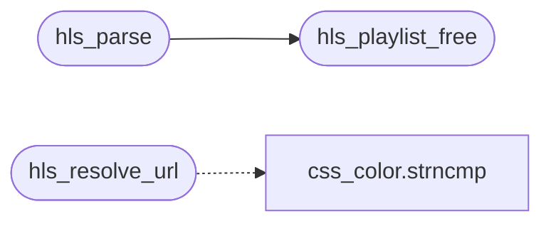

# `src/hls.c`

> Source: [src/hls.c:1](../../src/hls.c#L1) | language `c` | coverage 25.0% | [API index](../index.md)

## Contents

- **Functions:** [`name`](#name), [`hls_parse`](#hls_parse), [`hls_select_variant`](#hls_select_variant), [`hls_resolve_url`](#hls_resolve_url), [`hls_playlist_free`](#hls_playlist_free)
- **Macros:** [`_GNU_SOURCE`](#_gnu_source), [`_POSIX_C_SOURCE`](#_posix_c_source)

## Call Graph

Solid arrows stay in this module, dashed arrows leave it.



## Functions

<a id="name"></a>

### `name`

`function` | [src/hls.c:46](../../src/hls.c#L46)

```c
* attr is the attribute name (e.g. "BANDWIDTH=");
```

**Parameters**

| Name | Type | Default | Description |
|---|---|---|---|
| `BANDWIDTH` | `e.g. "` | `"` |  |

**Returns:** `* attr is the attribute`

---

<a id="hls_parse"></a>

### `hls_parse`

`function` | [src/hls.c:80](../../src/hls.c#L80)

```c
hls_status hls_parse(const char *text, size_t len, hls_playlist **out)
```

**Parameters**

| Name | Type | Default | Description |
|---|---|---|---|
| `text` | `char *` |  |  |
| `len` | `size_t` |  |  |
| `out` | `hls_playlist **` |  |  |

**Returns:** `hls_status`

*Calls:* [`hls_playlist_free`](#hls_playlist_free)

---

<a id="hls_select_variant"></a>

### `hls_select_variant`

`function` | [src/hls.c:202](../../src/hls.c#L202)

```c
size_t hls_select_variant(const hls_playlist *pl, int max_w, int max_h)
```

Selects the best variant from a multi-variant playlist.

Returns the index of the chosen variant, or (size_t)-1 on failure (empty variant list). Prefers the variant with the highest bandwidth that fits within `max_w` x `max_h` (0 = no resolution limit). Pure, no I/O.

**Parameters**

| Name | Type | Default | Description |
|---|---|---|---|
| `pl` | `hls_playlist *` |  |  |
| `max_w` | `int` |  |  |
| `max_h` | `int` |  |  |

**Returns:** `size_t`

> **Inherited:** Documentation from [`hls_select_variant`](#hls_select_variant) (include/hls.h:65).

---

<a id="hls_resolve_url"></a>

### `hls_resolve_url`

`function` | [src/hls.c:223](../../src/hls.c#L223)

```c
size_t hls_resolve_url(const char *base_url, const char *segment_url, char *resolved, size_t resolved_sz)
```

**Parameters**

| Name | Type | Default | Description |
|---|---|---|---|
| `base_url` | `char *` |  |  |
| `segment_url` | `char *` |  |  |
| `resolved` | `char *` |  |  |
| `resolved_sz` | `size_t` |  |  |

**Returns:** `size_t`

*Calls:* [`strncmp`](src.css_color.c.md#strncmp)

---

<a id="hls_playlist_free"></a>

### `hls_playlist_free`

`function` | [src/hls.c:253](../../src/hls.c#L253)

```c
void hls_playlist_free(hls_playlist *pl)
```

Frees a parsed playlist.

Safe on NULL.

**Parameters**

| Name | Type | Default | Description |
|---|---|---|---|
| `pl` | `hls_playlist *` |  |  |

> **Inherited:** Documentation from [`hls_playlist_free`](#hls_playlist_free) (include/hls.h:74).

*Called by:* [`hls_parse`](#hls_parse)

---

## Macros

<a id="_gnu_source"></a>

### `_GNU_SOURCE`

`macro` | [src/hls.c:21](../../src/hls.c#L21)

```c
#define _GNU_SOURCE
```

---

<a id="_posix_c_source"></a>

### `_POSIX_C_SOURCE`

`macro` | [src/hls.c:22](../../src/hls.c#L22)

```c
#define _POSIX_C_SOURCE
```

---
