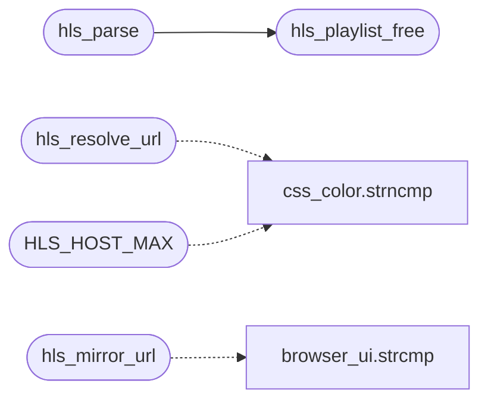

# `src/hls.c`

> Source: [src/hls.c:1](../../src/hls.c#L1) | language `c` | coverage 14.3% | [API index](../index.md)

## Contents

- **Functions:** [`name`](#name), [`hls_parse`](#hls_parse), [`hls_select_variant`](#hls_select_variant), [`hls_resolve_url`](#hls_resolve_url), [`hls_playlist_free`](#hls_playlist_free), [`hls_segment_payload`](#hls_segment_payload), [`hls_mirror_url`](#hls_mirror_url)
- **Macros:** [`_GNU_SOURCE`](#_gnu_source), [`_POSIX_C_SOURCE`](#_posix_c_source), [`HLS_TAG_MAX`](#hls_tag_max), [`HLS_TS_PACKET`](#hls_ts_packet), [`HLS_TS_PROBE`](#hls_ts_probe), [`HLS_HOST_MAX`](#hls_host_max)

## Call Graph

Solid arrows stay in this module, dashed arrows leave it.



## Functions

<a id="name"></a>

### `name`

`function` | [src/hls.c:51](../../src/hls.c#L51)

```c
* attr is the attribute name (e.g. "BANDWIDTH=");
```

**Parameters**

| Name | Type | Default | Description |
|---|---|---|---|
| `BANDWIDTH` | `e.g. "` | `"` |  |

**Returns:** `* attr is the attribute`

---

<a id="hls_parse"></a>

### `hls_parse`

`function` | [src/hls.c:85](../../src/hls.c#L85)

```c
hls_status hls_parse(const char *text, size_t len, hls_playlist **out)
```

**Parameters**

| Name | Type | Default | Description |
|---|---|---|---|
| `text` | `char *` |  |  |
| `len` | `size_t` |  |  |
| `out` | `hls_playlist **` |  |  |

**Returns:** `hls_status`

*Calls:* [`hls_playlist_free`](#hls_playlist_free)

*Called by:* [`LLVMFuzzerTestOneInput`](fuzz.fuzz_hls.c.md#llvmfuzzertestoneinput)

---

<a id="hls_select_variant"></a>

### `hls_select_variant`

`function` | [src/hls.c:215](../../src/hls.c#L215)

```c
size_t hls_select_variant(const hls_playlist *pl, int max_w, int max_h)
```

Selects the best variant from a multi-variant playlist.

Returns the index of the chosen variant, or (size_t)-1 on failure (empty variant list). Prefers the variant with the highest bandwidth that fits within `max_w` x `max_h` (0 = no resolution limit). Pure, no I/O.

**Parameters**

| Name | Type | Default | Description |
|---|---|---|---|
| `pl` | `hls_playlist *` |  |  |
| `max_w` | `int` |  |  |
| `max_h` | `int` |  |  |

**Returns:** `size_t`

> **Inherited:** Documentation from [`hls_select_variant`](#hls_select_variant) (include/hls.h:65).

---

<a id="hls_resolve_url"></a>

### `hls_resolve_url`

`function` | [src/hls.c:236](../../src/hls.c#L236)

```c
size_t hls_resolve_url(const char *base_url, const char *segment_url, char *resolved, size_t resolved_sz)
```

**Parameters**

| Name | Type | Default | Description |
|---|---|---|---|
| `base_url` | `char *` |  |  |
| `segment_url` | `char *` |  |  |
| `resolved` | `char *` |  |  |
| `resolved_sz` | `size_t` |  |  |

**Returns:** `size_t`

*Calls:* [`strncmp`](src.css_color.c.md#strncmp)

*Called by:* [`LLVMFuzzerTestOneInput`](fuzz.fuzz_hls.c.md#llvmfuzzertestoneinput)

---

<a id="hls_playlist_free"></a>

### `hls_playlist_free`

`function` | [src/hls.c:266](../../src/hls.c#L266)

```c
void hls_playlist_free(hls_playlist *pl)
```

Frees a parsed playlist.

Safe on NULL.

**Parameters**

| Name | Type | Default | Description |
|---|---|---|---|
| `pl` | `hls_playlist *` |  |  |

> **Inherited:** Documentation from [`hls_playlist_free`](#hls_playlist_free) (include/hls.h:74).

*Called by:* [`hls_parse`](#hls_parse)

---

<a id="hls_segment_payload"></a>

### `hls_segment_payload`

`function` | [src/hls.c:290](../../src/hls.c#L290)

```c
long hls_segment_payload(long http_code, const unsigned char *body, size_t len)
```

**Parameters**

| Name | Type | Default | Description |
|---|---|---|---|
| `http_code` | `long` |  |  |
| `body` | `unsigned char *` |  |  |
| `len` | `size_t` |  |  |

**Returns:** `long`

*Called by:* [`LLVMFuzzerTestOneInput`](fuzz.fuzz_hls.c.md#llvmfuzzertestoneinput)

---

<a id="hls_mirror_url"></a>

### `hls_mirror_url`

`function` | [src/hls.c:348](../../src/hls.c#L348)

```c
size_t hls_mirror_url(const hls_playlist *pl, const char *seg_abs, size_t k, char *out, size_t outsz)
```

**Parameters**

| Name | Type | Default | Description |
|---|---|---|---|
| `pl` | `hls_playlist *` |  |  |
| `seg_abs` | `char *` |  |  |
| `k` | `size_t` |  |  |
| `out` | `char *` |  |  |
| `outsz` | `size_t` |  |  |

**Returns:** `size_t`

*Calls:* [`strcmp`](gui.browser_ui.c.md#strcmp)

*Called by:* [`LLVMFuzzerTestOneInput`](fuzz.fuzz_hls.c.md#llvmfuzzertestoneinput)

---

## Macros

<a id="_gnu_source"></a>

### `_GNU_SOURCE`

`macro` | [src/hls.c:21](../../src/hls.c#L21)

```c
#define _GNU_SOURCE
```

---

<a id="_posix_c_source"></a>

### `_POSIX_C_SOURCE`

`macro` | [src/hls.c:22](../../src/hls.c#L22)

```c
#define _POSIX_C_SOURCE
```

---

<a id="hls_tag_max"></a>

### `HLS_TAG_MAX`

`macro` | [src/hls.c:32](../../src/hls.c#L32)

```c
#define HLS_TAG_MAX
```

---

<a id="hls_ts_packet"></a>

### `HLS_TS_PACKET`

`macro` | [src/hls.c:277](../../src/hls.c#L277)

```c
#define HLS_TS_PACKET
```

---

<a id="hls_ts_probe"></a>

### `HLS_TS_PROBE`

`macro` | [src/hls.c:278](../../src/hls.c#L278)

```c
#define HLS_TS_PROBE
```

---

<a id="hls_host_max"></a>

### `HLS_HOST_MAX`

`macro` | [src/hls.c:305](../../src/hls.c#L305)

```c
#define HLS_HOST_MAX
```

*Calls:* [`strncmp`](src.css_color.c.md#strncmp)

---
