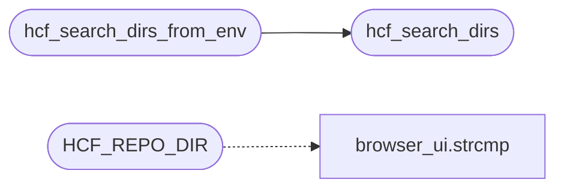

# `src/host_conf.c`

> Source: [src/host_conf.c:1](../../src/host_conf.c#L1) | language `c` | coverage 57.1% | [API index](../index.md)

## Contents

- **Functions:** [`hcf_search_dirs`](#hcf_search_dirs), [`hcf_search_dirs_from_env`](#hcf_search_dirs_from_env), [`hcf_load_filter`](#hcf_load_filter), [`hcf_load_allowlist`](#hcf_load_allowlist)
- **Macros:** [`HCF_USER_SUBDIR`](#hcf_user_subdir), [`HCF_REPO_DIR`](#hcf_repo_dir)

## Call Graph

Solid arrows stay in this module, dashed arrows leave it.



## Functions

<a id="hcf_search_dirs"></a>

### `hcf_search_dirs`

`function` | [src/host_conf.c:20](../../src/host_conf.c#L20)

```c
void hcf_search_dirs(const char *env, const char *home, hcf_dirs *out)
```

Pure.

Fills out with, in order: env (when non-empty), home + "/.config/freedom" (when home is non-empty), and "config". A directory already present is not added twice. out == NULL is a no-op.

**Parameters**

| Name | Type | Default | Description |
|---|---|---|---|
| `env` | `char *` |  |  |
| `home` | `char *` |  |  |
| `out` | `hcf_dirs *` |  |  |

> **Inherited:** Documentation from [`hcf_search_dirs`](#hcf_search_dirs) (include/host_conf.h:28).

*Called by:* [`hcf_search_dirs_from_env`](#hcf_search_dirs_from_env)

---

<a id="hcf_search_dirs_from_env"></a>

### `hcf_search_dirs_from_env`

`function` | [src/host_conf.c:32](../../src/host_conf.c#L32)

```c
void hcf_search_dirs_from_env(hcf_dirs *out)
```

hcf_search_dirs over $FREEDOM_HOSTS_DIR and $HOME.

**Parameters**

| Name | Type | Default | Description |
|---|---|---|---|
| `out` | `hcf_dirs *` |  |  |

> **Inherited:** Documentation from [`hcf_search_dirs_from_env`](#hcf_search_dirs_from_env) (include/host_conf.h:31).

*Calls:* [`hcf_search_dirs`](#hcf_search_dirs)

---

<a id="hcf_load_filter"></a>

### `hcf_load_filter`

`function` | [src/host_conf.c:65](../../src/host_conf.c#L65)

```c
hb_set *hcf_load_filter(const hcf_dirs *dirs)
```

block.conf (BLOCK) + allow.conf (ALLOW) from every directory, cumulative.

Missing or unreadable files fail open. NULL only on OOM or dirs == NULL.

**Parameters**

| Name | Type | Default | Description |
|---|---|---|---|
| `dirs` | `hcf_dirs *` |  |  |

**Returns:** `hb_set *`

> **Inherited:** Documentation from [`hcf_load_filter`](#hcf_load_filter) (include/host_conf.h:35).

---

<a id="hcf_load_allowlist"></a>

### `hcf_load_allowlist`

`function` | [src/host_conf.c:76](../../src/host_conf.c#L76)

```c
hb_set *hcf_load_allowlist(const hcf_dirs *dirs, const char *fname)
```

One file (js.conf, allow.conf, ...) from every directory as an ALLOW list.

NULL only on OOM or a NULL argument.

**Parameters**

| Name | Type | Default | Description |
|---|---|---|---|
| `dirs` | `hcf_dirs *` |  |  |
| `fname` | `char *` |  |  |

**Returns:** `hb_set *`

> **Inherited:** Documentation from [`hcf_load_allowlist`](#hcf_load_allowlist) (include/host_conf.h:39).

---

## Macros

<a id="hcf_user_subdir"></a>

### `HCF_USER_SUBDIR`

`macro` | [src/host_conf.c:7](../../src/host_conf.c#L7)

```c
#define HCF_USER_SUBDIR
```

---

<a id="hcf_repo_dir"></a>

### `HCF_REPO_DIR`

`macro` | [src/host_conf.c:8](../../src/host_conf.c#L8)

```c
#define HCF_REPO_DIR
```

*Calls:* [`strcmp`](gui.browser_ui.c.md#strcmp)

---
