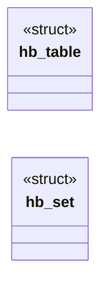

# `src/hostblock.c`

> Source: [src/hostblock.c:1](../../src/hostblock.c#L1) | language `c` | coverage 45.5% | [API index](../index.md)

## Contents

- **Structs:** [`hb_table`](#hb_table), [`hb_set`](#hb_set)
- **Functions:** [`hb_new`](#hb_new), [`hb_free`](#hb_free), [`hb_load`](#hb_load), [`hb_check`](#hb_check), [`hb_is_allowlisted`](#hb_is_allowlisted), [`hb_count`](#hb_count)
- **Macros:** [`HB_MAX_HOST`](#hb_max_host), [`HB_INIT_CAP`](#hb_init_cap)

## Type Diagram



## Structs

<a id="hb_table"></a>

### `hb_table`

`struct` | [src/hostblock.c:24](../../src/hostblock.c#L24)

```c
typedef struct hb_table
```

---

<a id="hb_set"></a>

### `hb_set`

`struct` | [src/hostblock.c:30](../../src/hostblock.c#L30)

```c
struct hb_set
```

---

## Functions

<a id="hb_new"></a>

### `hb_new`

`function` | [src/hostblock.c:144](../../src/hostblock.c#L144)

```c
hb_set *hb_new(void)
```

Allocates an empty set.

Returns NULL on OOM.

**Returns:** `hb_set *`

> **Inherited:** Documentation from [`hb_new`](#hb_new) (include/hostblock.h:49).

---

<a id="hb_free"></a>

### `hb_free`

`function` | [src/hostblock.c:149](../../src/hostblock.c#L149)

```c
void hb_free(hb_set *s)
```

Frees a set and every domain it owns.

Idempotent and safe on NULL.

**Parameters**

| Name | Type | Default | Description |
|---|---|---|---|
| `s` | `hb_set *` |  |  |

> **Inherited:** Documentation from [`hb_free`](#hb_free) (include/hostblock.h:52).

---

<a id="hb_load"></a>

### `hb_load`

`function` | [src/hostblock.c:156](../../src/hostblock.c#L156)

```c
hb_status hb_load(hb_set *s, const char *text, hb_list list)
```

**Parameters**

| Name | Type | Default | Description |
|---|---|---|---|
| `s` | `hb_set *` |  |  |
| `text` | `char *` |  |  |
| `list` | `hb_list` |  |  |

**Returns:** `hb_status`

---

<a id="hb_check"></a>

### `hb_check`

`function` | [src/hostblock.c:193](../../src/hostblock.c#L193)

```c
hb_decision hb_check(const hb_set *s, const char *host)
```

**Parameters**

| Name | Type | Default | Description |
|---|---|---|---|
| `s` | `hb_set *` |  |  |
| `host` | `char *` |  |  |

**Returns:** `hb_decision`

*Called by:* [`proceed`](gui.browser_ui.c.md#proceed)

---

<a id="hb_is_allowlisted"></a>

### `hb_is_allowlisted`

`function` | [src/hostblock.c:218](../../src/hostblock.c#L218)

```c
int hb_is_allowlisted(const hb_set *s, const char *host)
```

1 iff a domain suffix of host is explicitly on the allowlist (covers subdomains), else 0.

Distinct from hb_check: this reports an EXPLICIT allowlist entry, not the "allowed because nothing blocks it" default. The orchestrator uses it as the user's sovereign per-host override -- e.g. to navigate a site below Freedom's TLS standard. s/host NULL, empty, or longer than 253 chars => 0.

**Parameters**

| Name | Type | Default | Description |
|---|---|---|---|
| `s` | `hb_set *` |  |  |
| `host` | `char *` |  |  |

**Returns:** `int`

> **Inherited:** Documentation from [`hb_is_allowlisted`](#hb_is_allowlisted) (include/hostblock.h:75).

---

<a id="hb_count"></a>

### `hb_count`

`function` | [src/hostblock.c:238](../../src/hostblock.c#L238)

```c
size_t hb_count(const hb_set *s, hb_list list)
```

Number of unique domains on the given list (for tests/diagnostics).

0 if s is NULL.

**Parameters**

| Name | Type | Default | Description |
|---|---|---|---|
| `s` | `hb_set *` |  |  |
| `list` | `hb_list` |  |  |

**Returns:** `size_t`

> **Inherited:** Documentation from [`hb_count`](#hb_count) (include/hostblock.h:79).

---

## Macros

<a id="hb_max_host"></a>

### `HB_MAX_HOST`

`macro` | [src/hostblock.c:19](../../src/hostblock.c#L19)

```c
#define HB_MAX_HOST
```

---

<a id="hb_init_cap"></a>

### `HB_INIT_CAP`

`macro` | [src/hostblock.c:20](../../src/hostblock.c#L20)

```c
#define HB_INIT_CAP
```

longest domain we store or query

---
