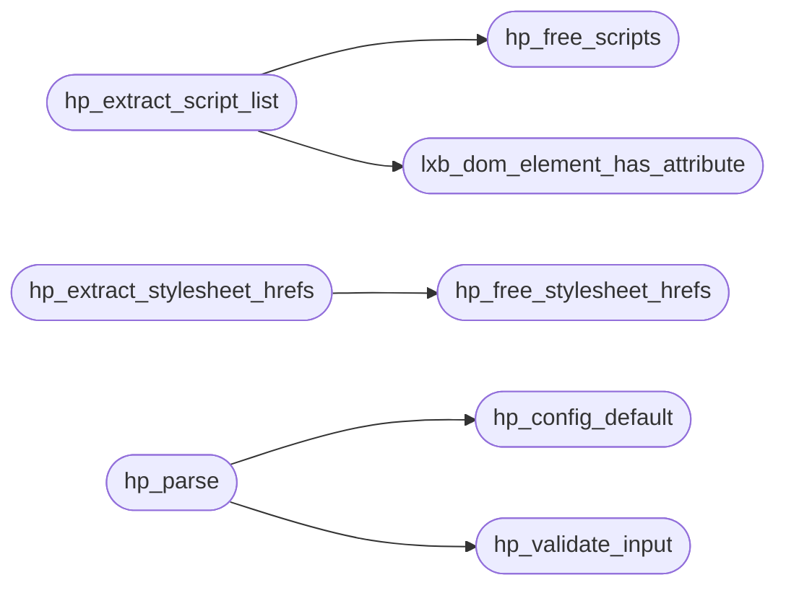

# `src/html_parse.c`

> Source: [src/html_parse.c:1](../../src/html_parse.c#L1) | language `c` | coverage 47.4% | [API index](../index.md)

## Contents

- **Structs:** [`hp_document`](#hp_document)
- **Functions:** [`hp_extract_script_list`](#hp_extract_script_list), [`lxb_dom_element_has_attribute`](#lxb_dom_element_has_attribute), [`hp_free_scripts`](#hp_free_scripts), [`hp_extract_stylesheet_hrefs`](#hp_extract_stylesheet_hrefs), [`hp_free_stylesheet_hrefs`](#hp_free_stylesheet_hrefs), [`hp_config_default`](#hp_config_default), [`hp_validate_input`](#hp_validate_input), [`hp_parse`](#hp_parse), [`hp_element_count`](#hp_element_count), [`hp_script_count`](#hp_script_count), [`hp_event_handler_count`](#hp_event_handler_count), [`hp_extract_text`](#hp_extract_text), [`hp_get_title`](#hp_get_title), [`hp_free`](#hp_free), [`hp_document_free`](#hp_document_free), [`hp_document_root`](#hp_document_root)
- **Macros:** [`_POSIX_C_SOURCE`](#_posix_c_source)

## Call Graph

Solid arrows stay in this module, dashed arrows leave it.



## Structs

<a id="hp_document"></a>

### `hp_document`

`struct` | [src/html_parse.c:21](../../src/html_parse.c#L21)

```c
struct hp_document
```

---

## Functions

<a id="hp_extract_script_list"></a>

### `hp_extract_script_list`

`function` | [src/html_parse.c:164](../../src/html_parse.c#L164)

```c
hp_script *hp_extract_script_list(const hp_document *doc, size_t *out_count)
```

Collects each executable <script> as its own entry, in document order: inline source for classic inline scripts, the raw src attribute for external ones.

Browsers run each <script> as a separate program, so the worker evaluates them one by one: an uncaught exception in one script must not abort the others (concatenating into a single eval would let the first failure kill them all). Bounded by HP_MAX_SCRIPTS (fail-closed anti-DoS). NULL with *out_count == 0 when there are none or on allocation failure; release with hp_free_scripts.

**Parameters**

| Name | Type | Default | Description |
|---|---|---|---|
| `doc` | `hp_document *` |  |  |
| `out_count` | `size_t *` |  |  |

**Returns:** `hp_script *`

*Calls:* [`hp_free_scripts`](#hp_free_scripts), [`lxb_dom_element_has_attribute`](#lxb_dom_element_has_attribute)

---

<a id="lxb_dom_element_has_attribute"></a>

### `lxb_dom_element_has_attribute`

`function` | [src/html_parse.c:230](../../src/html_parse.c#L230)

```c
&& lxb_dom_element_has_attribute(sel, (const lxb_char_t *)"nomodule", 8);
```

**Parameters**

| Name | Type | Default | Description |
|---|---|---|---|
| `nomodule` | `(const lxb_char_t *)" "` |  |  |
| `8` |  |  |  |

**Returns:** `&&`

*Called by:* [`dom_get_attribute`](src.dom.c.md#dom_get_attribute), [`hp_extract_script_list`](#hp_extract_script_list)

---

<a id="hp_free_scripts"></a>

### `hp_free_scripts`

`function` | [src/html_parse.c:238](../../src/html_parse.c#L238)

```c
void hp_free_scripts(hp_script *scripts, size_t count)
```

Releases an array returned by hp_extract_script_list (each text/src and the array).

Idempotent on NULL.

**Parameters**

| Name | Type | Default | Description |
|---|---|---|---|
| `scripts` | `hp_script *` |  |  |
| `count` | `size_t` |  |  |

> **Inherited:** Documentation from [`hp_free_scripts`](#hp_free_scripts) (include/html_parse.h:111).

*Called by:* [`hp_extract_script_list`](#hp_extract_script_list)

---

<a id="hp_extract_stylesheet_hrefs"></a>

### `hp_extract_stylesheet_hrefs`

`function` | [src/html_parse.c:294](../../src/html_parse.c#L294)

```c
char **hp_extract_stylesheet_hrefs(const hp_document *doc, size_t *out_count)
```

Returns the RAW href of every applicable <link rel=stylesheet>, in document order, as an owned array of NUL-terminated strings; *out_count receives the number found.

The parser never fetches: whether those bytes may be requested at all is the tab worker's decision, gated by the trusted parent (spec/tab.md §8). Applicable means: rel contains the whitespace-separated token "stylesheet" (ASCII case-insensitive) and NOT the token "alternate"; href is present and non-empty; and media is absent/empty or mentions "screen"/"all" (anything else, e.g. print, is skipped -- fail closed). Returns NULL (with *out_count == 0) when there are none or on allocation failure. Release with hp_free_stylesheet_hrefs.

**Parameters**

| Name | Type | Default | Description |
|---|---|---|---|
| `doc` | `hp_document *` |  |  |
| `out_count` | `size_t *` |  |  |

**Returns:** `char **`

> **Inherited:** Documentation from [`hp_extract_stylesheet_hrefs`](#hp_extract_stylesheet_hrefs) (include/html_parse.h:127).

*Calls:* [`hp_free_stylesheet_hrefs`](#hp_free_stylesheet_hrefs)

---

<a id="hp_free_stylesheet_hrefs"></a>

### `hp_free_stylesheet_hrefs`

`function` | [src/html_parse.c:328](../../src/html_parse.c#L328)

```c
void hp_free_stylesheet_hrefs(char **hrefs, size_t count)
```

Releases an array returned by hp_extract_stylesheet_hrefs.

Idempotent on NULL.

**Parameters**

| Name | Type | Default | Description |
|---|---|---|---|
| `hrefs` | `char **` |  |  |
| `count` | `size_t` |  |  |

> **Inherited:** Documentation from [`hp_free_stylesheet_hrefs`](#hp_free_stylesheet_hrefs) (include/html_parse.h:130).

*Called by:* [`hp_extract_stylesheet_hrefs`](#hp_extract_stylesheet_hrefs)

---

<a id="hp_config_default"></a>

### `hp_config_default`

`function` | [src/html_parse.c:357](../../src/html_parse.c#L357)

```c
hp_config hp_config_default(void)
```

**Returns:** `hp_config`

*Called by:* [`hp_parse`](#hp_parse), [`run_js`](src.tab.c.md#run_js)

---

<a id="hp_validate_input"></a>

### `hp_validate_input`

`function` | [src/html_parse.c:365](../../src/html_parse.c#L365)

```c
hp_status hp_validate_input(const char *html, size_t len, const hp_config *cfg)
```

**Parameters**

| Name | Type | Default | Description |
|---|---|---|---|
| `html` | `char *` |  |  |
| `len` | `size_t` |  |  |
| `cfg` | `hp_config *` |  |  |

**Returns:** `hp_status`

*Called by:* [`hp_parse`](#hp_parse)

---

<a id="hp_parse"></a>

### `hp_parse`

`function` | [src/html_parse.c:375](../../src/html_parse.c#L375)

```c
hp_status hp_parse(const char *html, size_t len, const hp_config *cfg, hp_document **out)
```

**Parameters**

| Name | Type | Default | Description |
|---|---|---|---|
| `html` | `char *` |  |  |
| `len` | `size_t` |  |  |
| `cfg` | `hp_config *` |  |  |
| `out` | `hp_document **` |  |  |

**Returns:** `hp_status`

*Calls:* [`hp_config_default`](#hp_config_default), [`hp_validate_input`](#hp_validate_input)

*Called by:* [`LLVMFuzzerTestOneInput`](fuzz.fuzz_js_dom.c.md#llvmfuzzertestoneinput), [`main`](gui.freedom_view.c.md#main), [`run_js`](src.tab.c.md#run_js)

---

<a id="hp_element_count"></a>

### `hp_element_count`

`function` | [src/html_parse.c:409](../../src/html_parse.c#L409)

```c
size_t hp_element_count(const hp_document *doc)
```

Read-only queries over the (already sanitised) tree.

NULL doc => 0.

**Parameters**

| Name | Type | Default | Description |
|---|---|---|---|
| `doc` | `hp_document *` |  |  |

**Returns:** `size_t`

> **Inherited:** Documentation from [`hp_element_count`](#hp_element_count) (include/html_parse.h:63).

---

<a id="hp_script_count"></a>

### `hp_script_count`

`function` | [src/html_parse.c:419](../../src/html_parse.c#L419)

```c
size_t hp_script_count(const hp_document *doc)
```

**Parameters**

| Name | Type | Default | Description |
|---|---|---|---|
| `doc` | `hp_document *` |  |  |

**Returns:** `size_t`

---

<a id="hp_event_handler_count"></a>

### `hp_event_handler_count`

`function` | [src/html_parse.c:429](../../src/html_parse.c#L429)

```c
size_t hp_event_handler_count(const hp_document *doc)
```

**Parameters**

| Name | Type | Default | Description |
|---|---|---|---|
| `doc` | `hp_document *` |  |  |

**Returns:** `size_t`

---

<a id="hp_extract_text"></a>

### `hp_extract_text`

`function` | [src/html_parse.c:445](../../src/html_parse.c#L445)

```c
char *hp_extract_text(const hp_document *doc, size_t *out_len)
```

Owned, NUL-terminated buffers; release with hp_free. *out_len (optional) excludes the trailing NUL.

Returns NULL on allocation failure or NULL doc.

**Parameters**

| Name | Type | Default | Description |
|---|---|---|---|
| `doc` | `hp_document *` |  |  |
| `out_len` | `size_t *` |  |  |

**Returns:** `char *`

> **Inherited:** Documentation from [`hp_extract_text`](#hp_extract_text) (include/html_parse.h:69).

---

<a id="hp_get_title"></a>

### `hp_get_title`

`function` | [src/html_parse.c:464](../../src/html_parse.c#L464)

```c
char *hp_get_title(const hp_document *doc, size_t *out_len)
```

**Parameters**

| Name | Type | Default | Description |
|---|---|---|---|
| `doc` | `hp_document *` |  |  |
| `out_len` | `size_t *` |  |  |

**Returns:** `char *`

---

<a id="hp_free"></a>

### `hp_free`

`function` | [src/html_parse.c:479](../../src/html_parse.c#L479)

```c
void hp_free(char *buf)
```

Release a buffer returned by hp_extract_text / hp_get_title.

**Parameters**

| Name | Type | Default | Description |
|---|---|---|---|
| `buf` | `char *` |  |  |

> **Inherited:** Documentation from [`hp_free`](#hp_free) (include/html_parse.h:133).

---

<a id="hp_document_free"></a>

### `hp_document_free`

`function` | [src/html_parse.c:483](../../src/html_parse.c#L483)

```c
void hp_document_free(hp_document *doc)
```

Idempotent; safe on NULL and safe to call twice.

**Parameters**

| Name | Type | Default | Description |
|---|---|---|---|
| `doc` | `hp_document *` |  |  |

> **Inherited:** Documentation from [`hp_document_free`](#hp_document_free) (include/html_parse.h:136).

---

<a id="hp_document_root"></a>

### `hp_document_root`

`function` `const` | [src/html_parse.c:489](../../src/html_parse.c#L489)

```c
const void *hp_document_root(const hp_document *doc)
```

Internal seam for the dom layer: returns the document's root node as an opaque handle (so html_parse.h stays free of backend types), or NULL.

The returned pointer is owned by doc and valid only while doc is alive. The dom module is the only intended consumer; general code should use the queries.

**Parameters**

| Name | Type | Default | Description |
|---|---|---|---|
| `doc` | `hp_document *` |  |  |

**Returns:** `void *`

> **Inherited:** Documentation from [`hp_document_root`](#hp_document_root) (include/html_parse.h:142).

---

## Macros

<a id="_posix_c_source"></a>

### `_POSIX_C_SOURCE`

`macro` | [src/html_parse.c:9](../../src/html_parse.c#L9)

```c
#define _POSIX_C_SOURCE
```

---
