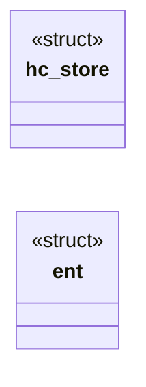
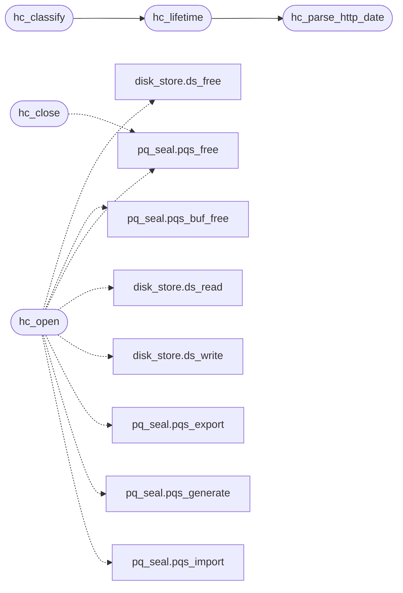

# `src/http_cache.c`

> Source: [src/http_cache.c:1](../../src/http_cache.c#L1) | language `c` | coverage 14.3% | [API index](../index.md)

## Contents

- **Structs:** [`hc_store`](#hc_store), [`ent`](#ent)
- **Functions:** [`hc_parse_http_date`](#hc_parse_http_date), [`hc_storable`](#hc_storable), [`hc_lifetime`](#hc_lifetime), [`hc_classify`](#hc_classify), [`hc_open`](#hc_open), [`hc_close`](#hc_close), [`hc_body_free`](#hc_body_free), [`hc_clear`](#hc_clear), [`hc_get`](#hc_get), [`hc_put`](#hc_put), [`hc_redirect_put`](#hc_redirect_put), [`hc_redirect_get`](#hc_redirect_get)
- **Macros:** [`_POSIX_C_SOURCE`](#_posix_c_source), [`HC_KEY_FILE`](#hc_key_file), [`HC_MAGIC`](#hc_magic), [`HC_NAME_HEX`](#hc_name_hex), [`HC_EVICT_EVERY`](#hc_evict_every), [`HC_MAX_AGE_CAP`](#hc_max_age_cap)

## Type Diagram



## Call Graph

Solid arrows stay in this module, dashed arrows leave it.



## Structs

<a id="hc_store"></a>

### `hc_store`

`struct` | [src/http_cache.c:146](../../src/http_cache.c#L146)

```c
struct hc_store
```

---

<a id="ent"></a>

### `ent`

`struct` | [src/http_cache.c:397](../../src/http_cache.c#L397)

```c
typedef struct { time_t mt; size_t sz; char name[80]; } ent;
```

---

## Functions

<a id="hc_parse_http_date"></a>

### `hc_parse_http_date`

`function` | [src/http_cache.c:55](../../src/http_cache.c#L55)

```c
time_t hc_parse_http_date(const char *s)
```

RFC 9110 IMF-fixdate ("Sun, 06 Nov 1994 08:49:37 GMT") -> UTC epoch, or -1.

**Parameters**

| Name | Type | Default | Description |
|---|---|---|---|
| `s` | `char *` |  |  |

**Returns:** `time_t`

> **Inherited:** Documentation from [`hc_parse_http_date`](#hc_parse_http_date) (include/http_cache.h:56).

*Called by:* [`hc_lifetime`](#hc_lifetime)

---

<a id="hc_storable"></a>

### `hc_storable`

`function` | [src/http_cache.c:107](../../src/http_cache.c#L107)

```c
int hc_storable(long http_code, const hc_meta *m, size_t body_len)
```

**Parameters**

| Name | Type | Default | Description |
|---|---|---|---|
| `http_code` | `long` |  |  |
| `m` | `hc_meta *` |  |  |
| `body_len` | `size_t` |  |  |

**Returns:** `int`

---

<a id="hc_lifetime"></a>

### `hc_lifetime`

`function` | [src/http_cache.c:115](../../src/http_cache.c#L115)

```c
long hc_lifetime(const hc_meta *m)
```

Freshness lifetime in seconds (>= 0), per the spec's order of rules.

**Parameters**

| Name | Type | Default | Description |
|---|---|---|---|
| `m` | `hc_meta *` |  |  |

**Returns:** `long`

> **Inherited:** Documentation from [`hc_lifetime`](#hc_lifetime) (include/http_cache.h:63).

*Calls:* [`hc_parse_http_date`](#hc_parse_http_date)

*Called by:* [`hc_classify`](#hc_classify)

---

<a id="hc_classify"></a>

### `hc_classify`

`function` | [src/http_cache.c:136](../../src/http_cache.c#L136)

```c
hc_class hc_classify(const hc_meta *m, time_t now)
```

**Parameters**

| Name | Type | Default | Description |
|---|---|---|---|
| `m` | `hc_meta *` |  |  |
| `now` | `time_t` |  |  |

**Returns:** `hc_class`

*Calls:* [`hc_lifetime`](#hc_lifetime)

*Called by:* [`cf_get_with`](src.cached_fetch.c.md#cf_get_with)

---

<a id="hc_open"></a>

### `hc_open`

`function` | [src/http_cache.c:230](../../src/http_cache.c#L230)

```c
hc_status hc_open(hc_store **out, const char *dir, const uint8_t wrap[LS_KEY_LEN])
```

**Parameters**

| Name | Type | Default | Description |
|---|---|---|---|
| `out` | `hc_store **` |  |  |
| `dir` | `char *` |  |  |
| `LS_KEY_LEN` | `uint8_t wrap[ ]` |  |  |

**Returns:** `hc_status`

*Calls:* [`ds_free`](include.disk_store.h.md#ds_free), [`pqs_buf_free`](include.pq_seal.h.md#pqs_buf_free), [`pqs_free`](include.pq_seal.h.md#pqs_free), [`ds_read`](src.disk_store.c.md#ds_read), [`ds_write`](src.disk_store.c.md#ds_write), [`pqs_export`](src.pq_seal.c.md#pqs_export), [`pqs_generate`](src.pq_seal.c.md#pqs_generate), [`pqs_import`](src.pq_seal.c.md#pqs_import)

---

<a id="hc_close"></a>

### `hc_close`

`function` | [src/http_cache.c:279](../../src/http_cache.c#L279)

```c
void hc_close(hc_store *s)
```

**Parameters**

| Name | Type | Default | Description |
|---|---|---|---|
| `s` | `hc_store *` |  |  |

*Calls:* [`pqs_free`](include.pq_seal.h.md#pqs_free)

---

<a id="hc_body_free"></a>

### `hc_body_free`

`function` | [src/http_cache.c:287](../../src/http_cache.c#L287)

```c
void hc_body_free(uint8_t *body, size_t len)
```

**Parameters**

| Name | Type | Default | Description |
|---|---|---|---|
| `body` | `uint8_t *` |  |  |
| `len` | `size_t` |  |  |

---

<a id="hc_clear"></a>

### `hc_clear`

`function` | [src/http_cache.c:473](../../src/http_cache.c#L473)

```c
void hc_clear(hc_store *s)
```

Removes every entry.

**Parameters**

| Name | Type | Default | Description |
|---|---|---|---|
| `s` | `hc_store *` |  |  |

> **Inherited:** Documentation from [`hc_clear`](#hc_clear) (include/http_cache.h:84).

---

<a id="hc_get"></a>

### `hc_get`

`function` | [src/http_cache.c:480](../../src/http_cache.c#L480)

```c
hc_status hc_get(hc_store *s, const char *partition, const char *url, hc_meta *meta, uint8_t **body, size_t *body_len)
```

**Parameters**

| Name | Type | Default | Description |
|---|---|---|---|
| `s` | `hc_store *` |  |  |
| `partition` | `char *` |  |  |
| `url` | `char *` |  |  |
| `meta` | `hc_meta *` |  |  |
| `body` | `uint8_t **` |  |  |
| `body_len` | `size_t *` |  |  |

**Returns:** `hc_status`

*Called by:* [`cf_get_with`](src.cached_fetch.c.md#cf_get_with)

---

<a id="hc_put"></a>

### `hc_put`

`function` | [src/http_cache.c:489](../../src/http_cache.c#L489)

```c
hc_status hc_put(hc_store *s, const char *partition, const char *url, const hc_meta *meta, const uint8_t *body, size_t body_len)
```

**Parameters**

| Name | Type | Default | Description |
|---|---|---|---|
| `s` | `hc_store *` |  |  |
| `partition` | `char *` |  |  |
| `url` | `char *` |  |  |
| `meta` | `hc_meta *` |  |  |
| `body` | `uint8_t *` |  |  |
| `body_len` | `size_t` |  |  |

**Returns:** `hc_status`

*Called by:* [`cf_get_with`](src.cached_fetch.c.md#cf_get_with)

---

<a id="hc_redirect_put"></a>

### `hc_redirect_put`

`function` | [src/http_cache.c:498](../../src/http_cache.c#L498)

```c
hc_status hc_redirect_put(hc_store *s, const char *from, const char *to, time_t now)
```

**Parameters**

| Name | Type | Default | Description |
|---|---|---|---|
| `s` | `hc_store *` |  |  |
| `from` | `char *` |  |  |
| `to` | `char *` |  |  |
| `now` | `time_t` |  |  |

**Returns:** `hc_status`

---

<a id="hc_redirect_get"></a>

### `hc_redirect_get`

`function` | [src/http_cache.c:506](../../src/http_cache.c#L506)

```c
hc_status hc_redirect_get(hc_store *s, const char *from, time_t now, char *out, size_t cap)
```

**Parameters**

| Name | Type | Default | Description |
|---|---|---|---|
| `s` | `hc_store *` |  |  |
| `from` | `char *` |  |  |
| `now` | `time_t` |  |  |
| `out` | `char *` |  |  |
| `cap` | `size_t` |  |  |

**Returns:** `hc_status`

---

## Macros

<a id="_posix_c_source"></a>

### `_POSIX_C_SOURCE`

`macro` | [src/http_cache.c:7](../../src/http_cache.c#L7)

```c
#define _POSIX_C_SOURCE
```

---

<a id="hc_key_file"></a>

### `HC_KEY_FILE`

`macro` | [src/http_cache.c:31](../../src/http_cache.c#L31)

```c
#define HC_KEY_FILE
```

---

<a id="hc_magic"></a>

### `HC_MAGIC`

`macro` | [src/http_cache.c:32](../../src/http_cache.c#L32)

```c
#define HC_MAGIC
```

---

<a id="hc_name_hex"></a>

### `HC_NAME_HEX`

`macro` | [src/http_cache.c:33](../../src/http_cache.c#L33)

```c
#define HC_NAME_HEX
```

---

<a id="hc_evict_every"></a>

### `HC_EVICT_EVERY`

`macro` | [src/http_cache.c:34](../../src/http_cache.c#L34)

```c
#define HC_EVICT_EVERY
```

---

<a id="hc_max_age_cap"></a>

### `HC_MAX_AGE_CAP`

`macro` | [src/http_cache.c:35](../../src/http_cache.c#L35)

```c
#define HC_MAX_AGE_CAP
```

---
