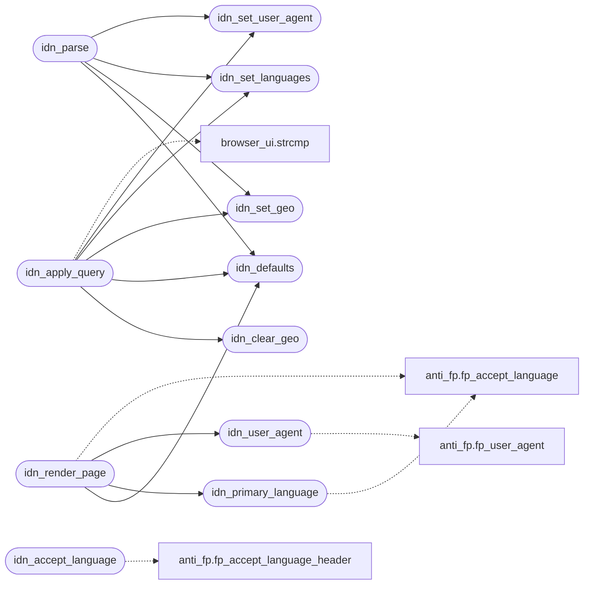

# `src/identity.c`

> Source: [src/identity.c:1](../../src/identity.c#L1) | language `c` | coverage 50.0% | [API index](../index.md)

## Contents

- **Functions:** [`idn_defaults`](#idn_defaults), [`idn_is_default`](#idn_is_default), [`idn_set_user_agent`](#idn_set_user_agent), [`idn_set_languages`](#idn_set_languages), [`idn_set_geo`](#idn_set_geo), [`idn_clear_geo`](#idn_clear_geo), [`idn_user_agent`](#idn_user_agent), [`idn_accept_language`](#idn_accept_language), [`idn_primary_language`](#idn_primary_language), [`idn_serialize`](#idn_serialize), [`idn_parse`](#idn_parse), [`idn_apply_query`](#idn_apply_query), [`idn_render_page`](#idn_render_page)
- **Macros:** [`_GNU_SOURCE`](#_gnu_source), [`IDN_QUERY_FIELD_MAX`](#idn_query_field_max)

## Call Graph

Solid arrows stay in this module, dashed arrows leave it.



## Functions

<a id="idn_defaults"></a>

### `idn_defaults`

`function` | [src/identity.c:23](../../src/identity.c#L23)

```c
void idn_defaults(idn_config *c)
```

The anti_fp identity, geolocation off.

NULL-safe.

**Parameters**

| Name | Type | Default | Description |
|---|---|---|---|
| `c` | `idn_config *` |  |  |

> **Inherited:** Documentation from [`idn_defaults`](#idn_defaults) (include/identity.h:45).

*Called by:* [`idn_apply_query`](#idn_apply_query), [`idn_parse`](#idn_parse), [`idn_render_page`](#idn_render_page)

---

<a id="idn_is_default"></a>

### `idn_is_default`

`function` | [src/identity.c:29](../../src/identity.c#L29)

```c
int idn_is_default(const idn_config *c)
```

1 when c carries no override at all (NULL counts as default).

**Parameters**

| Name | Type | Default | Description |
|---|---|---|---|
| `c` | `idn_config *` |  |  |

**Returns:** `int`

> **Inherited:** Documentation from [`idn_is_default`](#idn_is_default) (include/identity.h:48).

---

<a id="idn_set_user_agent"></a>

### `idn_set_user_agent`

`function` | [src/identity.c:34](../../src/identity.c#L34)

```c
int idn_set_user_agent(idn_config *c, const char *ua)
```

Validated setters: 0 on success, -1 (c untouched) when the value is not representable.

**Parameters**

| Name | Type | Default | Description |
|---|---|---|---|
| `c` | `idn_config *` |  |  |
| `ua` | `char *` |  |  |

**Returns:** `int`

> **Inherited:** Documentation from [`idn_set_user_agent`](#idn_set_user_agent) (include/identity.h:51).

*Called by:* [`idn_apply_query`](#idn_apply_query), [`idn_parse`](#idn_parse)

---

<a id="idn_set_languages"></a>

### `idn_set_languages`

`function` | [src/identity.c:63](../../src/identity.c#L63)

```c
int idn_set_languages(idn_config *c, const char *list)
```

**Parameters**

| Name | Type | Default | Description |
|---|---|---|---|
| `c` | `idn_config *` |  |  |
| `list` | `char *` |  |  |

**Returns:** `int`

*Called by:* [`idn_apply_query`](#idn_apply_query), [`idn_parse`](#idn_parse)

---

<a id="idn_set_geo"></a>

### `idn_set_geo`

`function` | [src/identity.c:91](../../src/identity.c#L91)

```c
int idn_set_geo(idn_config *c, double lat, double lon, double accuracy_m)
```

**Parameters**

| Name | Type | Default | Description |
|---|---|---|---|
| `c` | `idn_config *` |  |  |
| `lat` | `double` |  |  |
| `lon` | `double` |  |  |
| `accuracy_m` | `double` |  |  |

**Returns:** `int`

*Called by:* [`idn_apply_query`](#idn_apply_query), [`idn_parse`](#idn_parse)

---

<a id="idn_clear_geo"></a>

### `idn_clear_geo`

`function` | [src/identity.c:103](../../src/identity.c#L103)

```c
void idn_clear_geo(idn_config *c)
```

**Parameters**

| Name | Type | Default | Description |
|---|---|---|---|
| `c` | `idn_config *` |  |  |

*Called by:* [`idn_apply_query`](#idn_apply_query)

---

<a id="idn_user_agent"></a>

### `idn_user_agent`

`function` `const` | [src/identity.c:109](../../src/identity.c#L109)

```c
const char *idn_user_agent(const idn_config *c)
```

Effective values: the override, else the anti_fp default.

Never NULL / always terminated.

**Parameters**

| Name | Type | Default | Description |
|---|---|---|---|
| `c` | `idn_config *` |  |  |

**Returns:** `char *`

> **Inherited:** Documentation from [`idn_user_agent`](#idn_user_agent) (include/identity.h:57).

*Calls:* [`fp_user_agent`](include.anti_fp.h.md#fp_user_agent)

*Called by:* [`idn_render_page`](#idn_render_page)

---

<a id="idn_accept_language"></a>

### `idn_accept_language`

`function` | [src/identity.c:113](../../src/identity.c#L113)

```c
size_t idn_accept_language(const idn_config *c, char *out, size_t cap)
```

**Parameters**

| Name | Type | Default | Description |
|---|---|---|---|
| `c` | `idn_config *` |  |  |
| `out` | `char *` |  |  |
| `cap` | `size_t` |  |  |

**Returns:** `size_t`

*Calls:* [`fp_accept_language_header`](include.anti_fp.h.md#fp_accept_language_header)

---

<a id="idn_primary_language"></a>

### `idn_primary_language`

`function` | [src/identity.c:143](../../src/identity.c#L143)

```c
size_t idn_primary_language(const idn_config *c, char *out, size_t cap)
```

**Parameters**

| Name | Type | Default | Description |
|---|---|---|---|
| `c` | `idn_config *` |  |  |
| `out` | `char *` |  |  |
| `cap` | `size_t` |  |  |

**Returns:** `size_t`

*Calls:* [`fp_accept_language`](include.anti_fp.h.md#fp_accept_language)

*Called by:* [`idn_render_page`](#idn_render_page)

---

<a id="idn_serialize"></a>

### `idn_serialize`

`function` | [src/identity.c:206](../../src/identity.c#L206)

```c
size_t idn_serialize(const idn_config *c, char *out, size_t cap)
```

One-line text form for prefs and the worker IPC.

Returns the length (0 on cap overflow, out then "").

**Parameters**

| Name | Type | Default | Description |
|---|---|---|---|
| `c` | `idn_config *` |  |  |
| `out` | `char *` |  |  |
| `cap` | `size_t` |  |  |

**Returns:** `size_t`

> **Inherited:** Documentation from [`idn_serialize`](#idn_serialize) (include/identity.h:63).

---

<a id="idn_parse"></a>

### `idn_parse`

`function` | [src/identity.c:236](../../src/identity.c#L236)

```c
void idn_parse(idn_config *c, const char *text)
```

Parses idn_serialize output field by field; an invalid field keeps its default.

Always leaves c valid.

**Parameters**

| Name | Type | Default | Description |
|---|---|---|---|
| `c` | `idn_config *` |  |  |
| `text` | `char *` |  |  |

> **Inherited:** Documentation from [`idn_parse`](#idn_parse) (include/identity.h:67).

*Calls:* [`idn_defaults`](#idn_defaults), [`idn_set_geo`](#idn_set_geo), [`idn_set_languages`](#idn_set_languages), [`idn_set_user_agent`](#idn_set_user_agent)

---

<a id="idn_apply_query"></a>

### `idn_apply_query`

`function` | [src/identity.c:275](../../src/identity.c#L275)

```c
unsigned idn_apply_query(idn_config *c, const char *query)
```

Applies a GET-form query (spec/identity.md).

Returns the IDN_REJ_* mask.

**Parameters**

| Name | Type | Default | Description |
|---|---|---|---|
| `c` | `idn_config *` |  |  |
| `query` | `char *` |  |  |

**Returns:** `unsigned`

> **Inherited:** Documentation from [`idn_apply_query`](#idn_apply_query) (include/identity.h:70).

*Calls:* [`strcmp`](gui.browser_ui.c.md#strcmp), [`idn_clear_geo`](#idn_clear_geo), [`idn_defaults`](#idn_defaults), [`idn_set_geo`](#idn_set_geo), [`idn_set_languages`](#idn_set_languages), [`idn_set_user_agent`](#idn_set_user_agent)

---

<a id="idn_render_page"></a>

### `idn_render_page`

`function` | [src/identity.c:362](../../src/identity.c#L362)

```c
size_t idn_render_page(const idn_config *c, char *out, size_t cap)
```

Writes the about:config HTML.

Returns its length (0 when cap is too small, out "").

**Parameters**

| Name | Type | Default | Description |
|---|---|---|---|
| `c` | `idn_config *` |  |  |
| `out` | `char *` |  |  |
| `cap` | `size_t` |  |  |

**Returns:** `size_t`

> **Inherited:** Documentation from [`idn_render_page`](#idn_render_page) (include/identity.h:73).

*Calls:* [`fp_accept_language`](include.anti_fp.h.md#fp_accept_language), [`idn_defaults`](#idn_defaults), [`idn_primary_language`](#idn_primary_language), [`idn_user_agent`](#idn_user_agent)

---

## Macros

<a id="_gnu_source"></a>

### `_GNU_SOURCE`

`macro` | [src/identity.c:7](../../src/identity.c#L7)

```c
#define _GNU_SOURCE
```

---

<a id="idn_query_field_max"></a>

### `IDN_QUERY_FIELD_MAX`

`macro` | [src/identity.c:18](../../src/identity.c#L18)

```c
#define IDN_QUERY_FIELD_MAX
```

---
