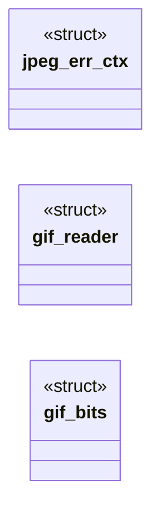
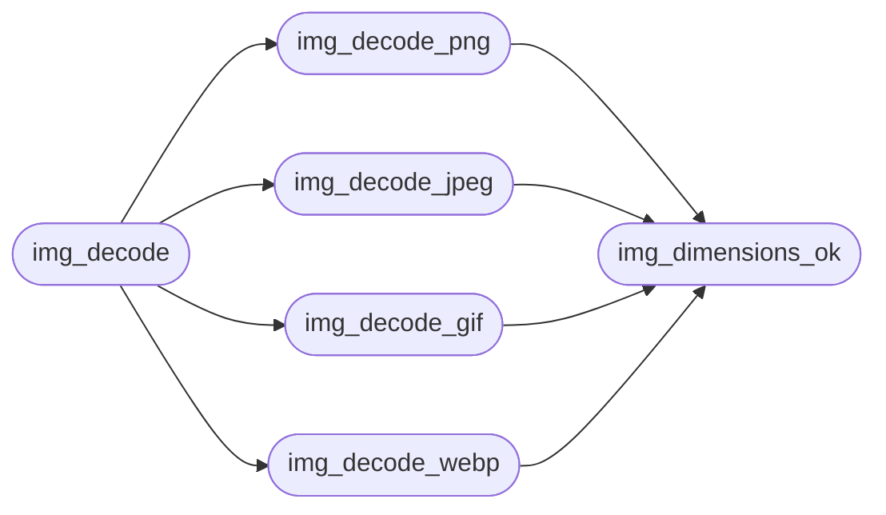

# `src/image_decode.c`

> Source: [src/image_decode.c:1](../../src/image_decode.c#L1) | language `c` | coverage 35.3% | [API index](../index.md)

## Contents

- **Structs:** [`jpeg_err_ctx`](#jpeg_err_ctx), [`gif_reader`](#gif_reader), [`gif_bits`](#gif_bits)
- **Functions:** [`exit`](#exit), [`img_png_dimensions`](#img_png_dimensions), [`img_dimensions_ok`](#img_dimensions_ok), [`img_fit`](#img_fit), [`img_decode_png`](#img_decode_png), [`img_decode_jpeg`](#img_decode_jpeg), [`img_decode_gif`](#img_decode_gif), [`img_decode_webp`](#img_decode_webp), [`img_decode`](#img_decode), [`img_pixels_free`](#img_pixels_free), [`img_format_name`](#img_format_name)
- **Macros:** [`PNG_IHDR_MIN`](#png_ihdr_min), [`GIF_LZW_MAX_CODES`](#gif_lzw_max_codes)

## Type Diagram



## Call Graph

Solid arrows stay in this module, dashed arrows leave it.



## Structs

<a id="jpeg_err_ctx"></a>

### `jpeg_err_ctx`

`struct` | [src/image_decode.c:153](../../src/image_decode.c#L153)

```c
struct jpeg_err_ctx
```

libjpeg error manager that longjmps instead of calling exit(), so a hostile JPEG fails closed (IMG_ERR_DECODE) without tearing the worker down.

---

<a id="gif_reader"></a>

### `gif_reader`

`struct` | [src/image_decode.c:255](../../src/image_decode.c#L255)

```c
typedef struct gif_reader
```

---

<a id="gif_bits"></a>

### `gif_bits`

`struct` | [src/image_decode.c:290](../../src/image_decode.c#L290)

```c
typedef struct gif_bits
```

Bit reader over the LZW data sub-block chain, LSB-first.

---

## Functions

<a id="exit"></a>

### `exit`

`function` | [src/image_decode.c:6](../../src/image_decode.c#L6)

```c
* malformed stream fails closed instead of calling exit(). GIF uses an own pure-C * bounded LZW decoder (no giflib). WebP uses libwebp's WebPDecodeBGRA in-memory * API. Output is tightly packed BGRA (
```

**Returns:** `* malformed stream fails closed instead of calling`

---

<a id="img_png_dimensions"></a>

### `img_png_dimensions`

`function` | [src/image_decode.c:57](../../src/image_decode.c#L57)

```c
img_status img_png_dimensions(const uint8_t *bytes, size_t len, uint32_t *out_w, uint32_t *out_h)
```

**Parameters**

| Name | Type | Default | Description |
|---|---|---|---|
| `bytes` | `uint8_t *` |  |  |
| `len` | `size_t` |  |  |
| `out_w` | `uint32_t *` |  |  |
| `out_h` | `uint32_t *` |  |  |

**Returns:** `img_status`

---

<a id="img_dimensions_ok"></a>

### `img_dimensions_ok`

`function` | [src/image_decode.c:68](../../src/image_decode.c#L68)

```c
int img_dimensions_ok(uint32_t w, uint32_t h)
```

1 iff (w,h) is non-zero and fits the anti-DoS caps (per-side and area, no overflow of width*height*4); 0 otherwise.

**Parameters**

| Name | Type | Default | Description |
|---|---|---|---|
| `w` | `uint32_t` |  |  |
| `h` | `uint32_t` |  |  |

**Returns:** `int`

> **Inherited:** Documentation from [`img_dimensions_ok`](#img_dimensions_ok) (include/image_decode.h:78).

*Called by:* [`img_decode_gif`](#img_decode_gif), [`img_decode_jpeg`](#img_decode_jpeg), [`img_decode_png`](#img_decode_png), [`img_decode_webp`](#img_decode_webp)

---

<a id="img_fit"></a>

### `img_fit`

`function` | [src/image_decode.c:76](../../src/image_decode.c#L76)

```c
void img_fit(uint32_t iw, uint32_t ih, double box_w, double box_h, double *out_w, double *out_h)
```

**Parameters**

| Name | Type | Default | Description |
|---|---|---|---|
| `iw` | `uint32_t` |  |  |
| `ih` | `uint32_t` |  |  |
| `box_w` | `double` |  |  |
| `box_h` | `double` |  |  |
| `out_w` | `double *` |  |  |
| `out_h` | `double *` |  |  |

---

<a id="img_decode_png"></a>

### `img_decode_png`

`function` | [src/image_decode.c:102](../../src/image_decode.c#L102)

```c
img_status img_decode_png(const uint8_t *bytes, size_t len, img_pixels *out)
```

**Parameters**

| Name | Type | Default | Description |
|---|---|---|---|
| `bytes` | `uint8_t *` |  |  |
| `len` | `size_t` |  |  |
| `out` | `img_pixels *` |  |  |

**Returns:** `img_status`

*Calls:* [`img_dimensions_ok`](#img_dimensions_ok)

*Called by:* [`img_decode`](#img_decode)

---

<a id="img_decode_jpeg"></a>

### `img_decode_jpeg`

`function` | [src/image_decode.c:166](../../src/image_decode.c#L166)

```c
img_status img_decode_jpeg(const uint8_t *bytes, size_t len, img_pixels *out)
```

**Parameters**

| Name | Type | Default | Description |
|---|---|---|---|
| `bytes` | `uint8_t *` |  |  |
| `len` | `size_t` |  |  |
| `out` | `img_pixels *` |  |  |

**Returns:** `img_status`

*Calls:* [`img_dimensions_ok`](#img_dimensions_ok)

*Called by:* [`img_decode`](#img_decode)

---

<a id="img_decode_gif"></a>

### `img_decode_gif`

`function` | [src/image_decode.c:354](../../src/image_decode.c#L354)

```c
img_status img_decode_gif(const uint8_t *bytes, size_t len, img_pixels *out)
```

**Parameters**

| Name | Type | Default | Description |
|---|---|---|---|
| `bytes` | `uint8_t *` |  |  |
| `len` | `size_t` |  |  |
| `out` | `img_pixels *` |  |  |

**Returns:** `img_status`

*Calls:* [`img_dimensions_ok`](#img_dimensions_ok)

*Called by:* [`img_decode`](#img_decode)

---

<a id="img_decode_webp"></a>

### `img_decode_webp`

`function` | [src/image_decode.c:520](../../src/image_decode.c#L520)

```c
img_status img_decode_webp(const uint8_t *bytes, size_t len, img_pixels *out)
```

**Parameters**

| Name | Type | Default | Description |
|---|---|---|---|
| `bytes` | `uint8_t *` |  |  |
| `len` | `size_t` |  |  |
| `out` | `img_pixels *` |  |  |

**Returns:** `img_status`

*Calls:* [`img_dimensions_ok`](#img_dimensions_ok)

*Called by:* [`img_decode`](#img_decode)

---

<a id="img_decode"></a>

### `img_decode`

`function` | [src/image_decode.c:553](../../src/image_decode.c#L553)

```c
img_status img_decode(const uint8_t *bytes, size_t len, img_pixels *out)
```

**Parameters**

| Name | Type | Default | Description |
|---|---|---|---|
| `bytes` | `uint8_t *` |  |  |
| `len` | `size_t` |  |  |
| `out` | `img_pixels *` |  |  |

**Returns:** `img_status`

*Calls:* [`img_decode_gif`](#img_decode_gif), [`img_decode_jpeg`](#img_decode_jpeg), [`img_decode_png`](#img_decode_png), [`img_decode_webp`](#img_decode_webp)

---

<a id="img_pixels_free"></a>

### `img_pixels_free`

`function` | [src/image_decode.c:566](../../src/image_decode.c#L566)

```c
void img_pixels_free(img_pixels *p)
```

Releases data and zeroes the struct.

Idempotent; safe on NULL and on a zeroed struct.

**Parameters**

| Name | Type | Default | Description |
|---|---|---|---|
| `p` | `img_pixels *` |  |  |

> **Inherited:** Documentation from [`img_pixels_free`](#img_pixels_free) (include/image_decode.h:121).

---

<a id="img_format_name"></a>

### `img_format_name`

`function` `const` | [src/image_decode.c:575](../../src/image_decode.c#L575)

```c
const char *img_format_name(img_format f)
```

Stable, short English name of a format for structured/agent output.

Never NULL.

**Parameters**

| Name | Type | Default | Description |
|---|---|---|---|
| `f` | `img_format` |  |  |

**Returns:** `char *`

> **Inherited:** Documentation from [`img_format_name`](#img_format_name) (include/image_decode.h:124).

---

## Macros

<a id="png_ihdr_min"></a>

### `PNG_IHDR_MIN`

`macro` | [src/image_decode.c:34](../../src/image_decode.c#L34)

```c
#define PNG_IHDR_MIN
```

Bytes needed to read width+height: signature(8) + IHDR len(4) + "IHDR"(4) + width(4) + height(4) = 24, with the type tag at offset 12 and the dimensions at 16/20, all big-endian.

---

<a id="gif_lzw_max_codes"></a>

### `GIF_LZW_MAX_CODES`

`macro` | [src/image_decode.c:253](../../src/image_decode.c#L253)

```c
#define GIF_LZW_MAX_CODES
```

---
