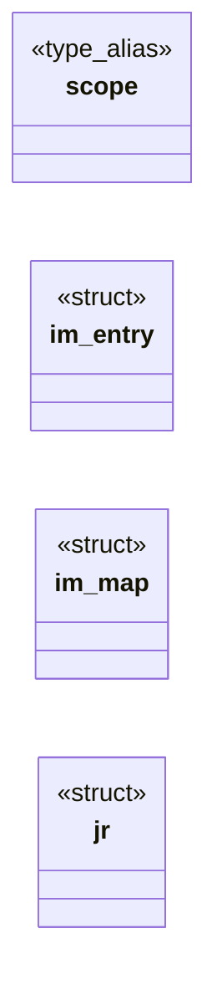
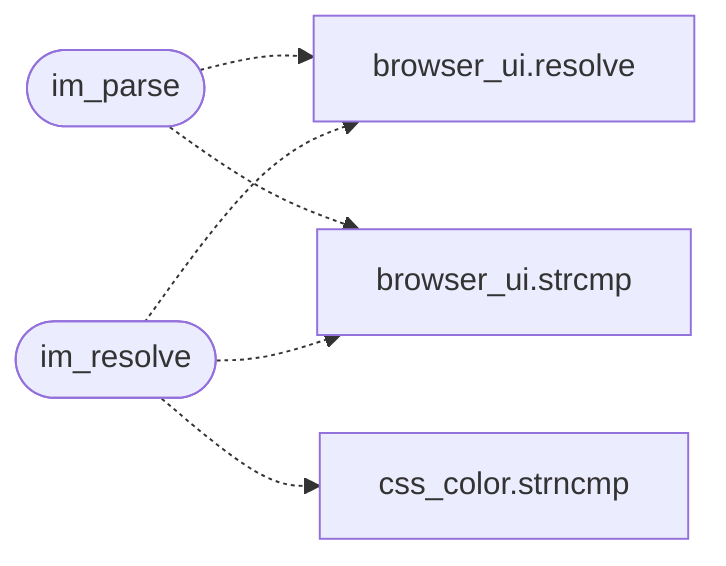

# `src/import_map.c`

> Source: [src/import_map.c:1](../../src/import_map.c#L1) | language `c` | coverage 45.5% | [API index](../index.md)

## Contents

- **Structs:** [`im_entry`](#im_entry), [`im_map`](#im_map), [`jr`](#jr)
- **Type Aliases:** [`scope`](#scope)
- **Functions:** [`im_parse`](#im_parse), [`im_resolve`](#im_resolve), [`im_count`](#im_count), [`im_free`](#im_free)
- **Macros:** [`IM_MAX_DEPTH`](#im_max_depth), [`IM_URL_MAX`](#im_url_max)

## Type Diagram



## Call Graph

Solid arrows stay in this module, dashed arrows leave it.



## Structs

<a id="im_entry"></a>

### `im_entry`

`struct` | [src/import_map.c:19](../../src/import_map.c#L19)

```c
typedef struct im_entry
```

---

<a id="im_map"></a>

### `im_map`

`struct` | [src/import_map.c:25](../../src/import_map.c#L25)

```c
struct im_map
```

---

<a id="jr"></a>

### `jr`

`struct` | [src/import_map.c:34](../../src/import_map.c#L34)

```c
typedef struct jr
```

---

## Type Aliases

<a id="scope"></a>

### `scope`

`type_alias` | [src/import_map.c:18](../../src/import_map.c#L18)

```c
typedef struct im_entry { int scope;
```

resolved URL buffer (url.h's URL_MAX_LEN)

---

## Functions

<a id="im_parse"></a>

### `im_parse`

`function` | [src/import_map.c:225](../../src/import_map.c#L225)

```c
im_map *im_parse(const char *json, size_t len, const char *doc_url, im_url_fn resolve, void *ctx)
```

**Parameters**

| Name | Type | Default | Description |
|---|---|---|---|
| `json` | `char *` |  |  |
| `len` | `size_t` |  |  |
| `doc_url` | `char *` |  |  |
| `resolve` | `im_url_fn` |  |  |
| `ctx` | `void *` |  |  |

**Returns:** `im_map *`

*Calls:* [`resolve`](gui.browser_ui.c.md#resolve), [`strcmp`](gui.browser_ui.c.md#strcmp)

*Called by:* [`LLVMFuzzerTestOneInput`](fuzz.fuzz_import_map.c.md#llvmfuzzertestoneinput), [`pf_pool_start_page`](src.prefetch.c.md#pf_pool_start_page)

---

<a id="im_resolve"></a>

### `im_resolve`

`function` | [src/import_map.c:301](../../src/import_map.c#L301)

```c
int im_resolve(const im_map *m, const char *base, const char *specifier, im_url_fn resolve, void *ctx, char *out, size_t outsz)
```

Resolves specifier as imported from base (the importing module's URL).

0 with the absolute URL in out, or -1 (a bare specifier without a mapping, or overflow).

**Parameters**

| Name | Type | Default | Description |
|---|---|---|---|
| `m` | `im_map *` |  |  |
| `base` | `char *` |  |  |
| `specifier` | `char *` |  |  |
| `resolve` | `im_url_fn` |  |  |
| `ctx` | `void *` |  |  |
| `out` | `char *` |  |  |
| `outsz` | `size_t` |  |  |

**Returns:** `int`

> **Inherited:** Documentation from [`im_resolve`](#im_resolve) (include/import_map.h:33).

*Calls:* [`resolve`](gui.browser_ui.c.md#resolve), [`strcmp`](gui.browser_ui.c.md#strcmp), [`strncmp`](src.css_color.c.md#strncmp)

---

<a id="im_count"></a>

### `im_count`

`function` | [src/import_map.c:339](../../src/import_map.c#L339)

```c
size_t im_count(const im_map *m)
```

Total entries (imports + every scope's).

0 for NULL.

**Parameters**

| Name | Type | Default | Description |
|---|---|---|---|
| `m` | `im_map *` |  |  |

**Returns:** `size_t`

> **Inherited:** Documentation from [`im_count`](#im_count) (include/import_map.h:37).

---

<a id="im_free"></a>

### `im_free`

`function` | [src/import_map.c:343](../../src/import_map.c#L343)

```c
void im_free(im_map *m)
```

NULL is a no-op.

**Parameters**

| Name | Type | Default | Description |
|---|---|---|---|
| `m` | `im_map *` |  |  |

> **Inherited:** Documentation from [`im_free`](#im_free) (include/import_map.h:40).

---

## Macros

<a id="im_max_depth"></a>

### `IM_MAX_DEPTH`

`macro` | [src/import_map.c:16](../../src/import_map.c#L16)

```c
#define IM_MAX_DEPTH
```

---

<a id="im_url_max"></a>

### `IM_URL_MAX`

`macro` | [src/import_map.c:17](../../src/import_map.c#L17)

```c
#define IM_URL_MAX
```

JSON nesting accepted anywhere in the text

---
