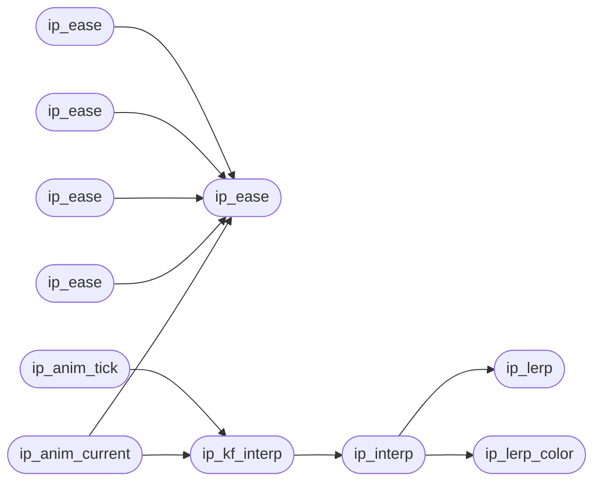

# `src/interp.c`

> Source: [src/interp.c:1](../../src/interp.c#L1) | language `c` | coverage 71.4% | [API index](../index.md)

## Contents

- **Functions:** [`ip_ease`](#ip_ease), [`ip_ease`](#ip_ease), [`ip_ease`](#ip_ease), [`ip_ease`](#ip_ease), [`ip_ease`](#ip_ease), [`ip_lerp`](#ip_lerp), [`ip_lerp_color`](#ip_lerp_color), [`ip_interp`](#ip_interp), [`ip_kf_interp`](#ip_kf_interp), [`ip_anim_init`](#ip_anim_init), [`ip_anim_tick`](#ip_anim_tick), [`ip_anim_current`](#ip_anim_current), [`ip_anim_done`](#ip_anim_done)

## Call Graph

Solid arrows stay in this module, dashed arrows leave it.



## Functions

<a id="ip_ease"></a>

### `ip_ease`

`function` | [src/interp.c:55](../../src/interp.c#L55)

```c
double ip_ease(double t, const ip_ease_fn *fn)
```

Compute eased t for normalized t ∈ [0,1].

Returns value ∈ [0,1]. Clamped: t < 0 → 0, t > 1 → 1. NULL-safe: returns t.

**Parameters**

| Name | Type | Default | Description |
|---|---|---|---|
| `t` | `double` |  |  |
| `fn` | `ip_ease_fn *` |  |  |

**Returns:** `double`

> **Inherited:** Documentation from [`ip_ease`](#ip_ease) (include/interp.h:48).

*Called by:* [`ip_anim_current`](#ip_anim_current), [`ip_ease`](#ip_ease), [`ip_ease`](#ip_ease), [`ip_ease`](#ip_ease), [`ip_ease`](#ip_ease)

---

<a id="ip_ease"></a>

### `ip_ease`

`function` | [src/interp.c:64](../../src/interp.c#L64)

```c
case IP_EASE_EASE: return ip_ease(t, &(ip_ease_fn)
```

Compute eased t for normalized t ∈ [0,1].

Returns value ∈ [0,1]. Clamped: t < 0 → 0, t > 1 → 1. NULL-safe: returns t.

**Parameters**

| Name | Type | Default | Description |
|---|---|---|---|
| `ip_ease_fn` |  |  |  |

**Returns:** `case IP_EASE_EASE: return`

> **Inherited:** Documentation from [`ip_ease`](#ip_ease) (include/interp.h:48).

*Calls:* [`ip_ease`](#ip_ease)

---

<a id="ip_ease"></a>

### `ip_ease`

`function` | [src/interp.c:70](../../src/interp.c#L70)

```c
case IP_EASE_EASE_IN: return ip_ease(t, &(ip_ease_fn)
```

Compute eased t for normalized t ∈ [0,1].

Returns value ∈ [0,1]. Clamped: t < 0 → 0, t > 1 → 1. NULL-safe: returns t.

**Parameters**

| Name | Type | Default | Description |
|---|---|---|---|
| `ip_ease_fn` |  |  |  |

**Returns:** `case IP_EASE_EASE_IN: return`

> **Inherited:** Documentation from [`ip_ease`](#ip_ease) (include/interp.h:48).

*Calls:* [`ip_ease`](#ip_ease)

---

<a id="ip_ease"></a>

### `ip_ease`

`function` | [src/interp.c:76](../../src/interp.c#L76)

```c
case IP_EASE_EASE_OUT: return ip_ease(t, &(ip_ease_fn)
```

Compute eased t for normalized t ∈ [0,1].

Returns value ∈ [0,1]. Clamped: t < 0 → 0, t > 1 → 1. NULL-safe: returns t.

**Parameters**

| Name | Type | Default | Description |
|---|---|---|---|
| `ip_ease_fn` |  |  |  |

**Returns:** `case IP_EASE_EASE_OUT: return`

> **Inherited:** Documentation from [`ip_ease`](#ip_ease) (include/interp.h:48).

*Calls:* [`ip_ease`](#ip_ease)

---

<a id="ip_ease"></a>

### `ip_ease`

`function` | [src/interp.c:82](../../src/interp.c#L82)

```c
case IP_EASE_EASE_IN_OUT: return ip_ease(t, &(ip_ease_fn)
```

Compute eased t for normalized t ∈ [0,1].

Returns value ∈ [0,1]. Clamped: t < 0 → 0, t > 1 → 1. NULL-safe: returns t.

**Parameters**

| Name | Type | Default | Description |
|---|---|---|---|
| `ip_ease_fn` |  |  |  |

**Returns:** `case IP_EASE_EASE_IN_OUT: return`

> **Inherited:** Documentation from [`ip_ease`](#ip_ease) (include/interp.h:48).

*Calls:* [`ip_ease`](#ip_ease)

---

<a id="ip_lerp"></a>

### `ip_lerp`

`function` | [src/interp.c:134](../../src/interp.c#L134)

```c
double ip_lerp(double a, double b, double t)
```

**Parameters**

| Name | Type | Default | Description |
|---|---|---|---|
| `a` | `double` |  |  |
| `b` | `double` |  |  |
| `t` | `double` |  |  |

**Returns:** `double`

*Called by:* [`ip_interp`](#ip_interp)

---

<a id="ip_lerp_color"></a>

### `ip_lerp_color`

`function` | [src/interp.c:139](../../src/interp.c#L139)

```c
uint32_t ip_lerp_color(uint32_t c1, uint32_t c2, double t)
```

**Parameters**

| Name | Type | Default | Description |
|---|---|---|---|
| `c1` | `uint32_t` |  |  |
| `c2` | `uint32_t` |  |  |
| `t` | `double` |  |  |

**Returns:** `uint32_t`

*Called by:* [`ip_interp`](#ip_interp)

---

<a id="ip_interp"></a>

### `ip_interp`

`function` | [src/interp.c:162](../../src/interp.c#L162)

```c
double ip_interp(ip_val_kind kind, double a, double b, double t)
```

**Parameters**

| Name | Type | Default | Description |
|---|---|---|---|
| `kind` | `ip_val_kind` |  |  |
| `a` | `double` |  |  |
| `b` | `double` |  |  |
| `t` | `double` |  |  |

**Returns:** `double`

*Calls:* [`ip_lerp`](#ip_lerp), [`ip_lerp_color`](#ip_lerp_color)

*Called by:* [`ip_kf_interp`](#ip_kf_interp)

---

<a id="ip_kf_interp"></a>

### `ip_kf_interp`

`function` | [src/interp.c:175](../../src/interp.c#L175)

```c
double ip_kf_interp(ip_val_kind val_kind, const ip_keyframe *kf, int n_kf, double pct)
```

Interpolate between the two keyframes bracketing [`pct`](include.interp.h.md#pct) (0..100).

Exact match → that keyframe's value. Before first / after last → clamped to first / last. NULL/empty → 0.

**Parameters**

| Name | Type | Default | Description |
|---|---|---|---|
| `val_kind` | `ip_val_kind` |  |  |
| `kf` | `ip_keyframe *` |  |  |
| `n_kf` | `int` |  |  |
| `pct` | `double` |  |  |

**Returns:** `double`

> **Inherited:** Documentation from [`ip_kf_interp`](#ip_kf_interp) (include/interp.h:78).

*Calls:* [`ip_interp`](#ip_interp)

*Called by:* [`ip_anim_current`](#ip_anim_current), [`ip_anim_tick`](#ip_anim_tick)

---

<a id="ip_anim_init"></a>

### `ip_anim_init`

`function` | [src/interp.c:196](../../src/interp.c#L196)

```c
void ip_anim_init(ip_anim *a, ip_val_kind vk, const ip_ease_fn *ease, const ip_keyframe *kf, int n_kf, double duration_ms, double delay_ms, int iteration_count, int direction, int fill_mode)
```

Initialize. kf must outlive the animation.

NULL-safe on a.

**Parameters**

| Name | Type | Default | Description |
|---|---|---|---|
| `a` | `ip_anim *` |  |  |
| `vk` | `ip_val_kind` |  |  |
| `ease` | `ip_ease_fn *` |  |  |
| `kf` | `ip_keyframe *` |  |  |
| `n_kf` | `int` |  |  |
| `duration_ms` | `double` |  |  |
| `delay_ms` | `double` |  |  |
| `iteration_count` | `int` |  |  |
| `direction` | `int` |  |  |
| `fill_mode` | `int` |  |  |

> **Inherited:** Documentation from [`ip_anim_init`](#ip_anim_init) (include/interp.h:121).

---

<a id="ip_anim_tick"></a>

### `ip_anim_tick`

`function` | [src/interp.c:236](../../src/interp.c#L236)

```c
int ip_anim_tick(ip_anim *a, double dt_ms)
```

Advance time by dt_ms.

Returns 1 if the value changed, 0 if unchanged. Negative dt ignored. NULL-safe.

**Parameters**

| Name | Type | Default | Description |
|---|---|---|---|
| `a` | `ip_anim *` |  |  |
| `dt_ms` | `double` |  |  |

**Returns:** `int`

> **Inherited:** Documentation from [`ip_anim_tick`](#ip_anim_tick) (include/interp.h:128).

*Calls:* [`ip_kf_interp`](#ip_kf_interp)

---

<a id="ip_anim_current"></a>

### `ip_anim_current`

`function` | [src/interp.c:282](../../src/interp.c#L282)

```c
double ip_anim_current(const ip_anim *a)
```

Current interpolated value.

0 if no keyframes or fill=none + done.

**Parameters**

| Name | Type | Default | Description |
|---|---|---|---|
| `a` | `ip_anim *` |  |  |

**Returns:** `double`

> **Inherited:** Documentation from [`ip_anim_current`](#ip_anim_current) (include/interp.h:131).

*Calls:* [`ip_ease`](#ip_ease), [`ip_kf_interp`](#ip_kf_interp)

---

<a id="ip_anim_done"></a>

### `ip_anim_done`

`function` | [src/interp.c:320](../../src/interp.c#L320)

```c
int ip_anim_done(const ip_anim *a)
```

1 if animation has finished (all iterations, no forwards fill).

**Parameters**

| Name | Type | Default | Description |
|---|---|---|---|
| `a` | `ip_anim *` |  |  |

**Returns:** `int`

> **Inherited:** Documentation from [`ip_anim_done`](#ip_anim_done) (include/interp.h:134).

---
