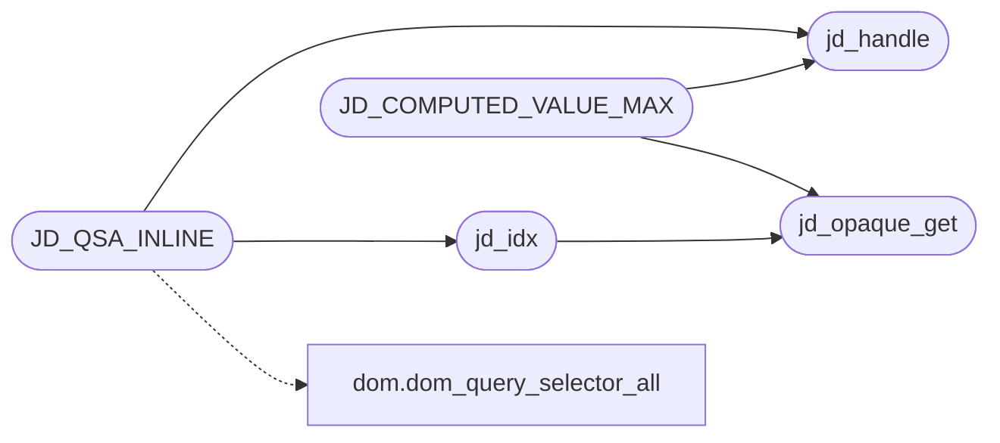

# `src/js_dom.c`

> Source: [src/js_dom.c:1](../../src/js_dom.c#L1) | language `c` | coverage 11.5% | [API index](../index.md)

## Contents

- **Structs:** [`jd_method`](#jd_method)
- **Functions:** [`jd_opaque_get`](#jd_opaque_get), [`jd_idx`](#jd_idx), [`jd_handle`](#jd_handle), [`jd_handle_or_null`](#jd_handle_or_null), [`table`](#table), [`attrNames`](#attrnames), [`scripts`](#scripts), [`enough`](#enough), [`ms`](#ms), [`empty`](#empty), [`geometry`](#geometry), [`size`](#size), [`js_env`](#js_env), [`jd_install`](#jd_install), [`jd_flush_custom_elements`](#jd_flush_custom_elements), [`fails`](#fails), [`jd_install_console`](#jd_install_console), [`jd_set_cookies`](#jd_set_cookies), [`jd_get_cookies`](#jd_get_cookies), [`jd_set_computed`](#jd_set_computed), [`jd_set_geometry`](#jd_set_geometry)
- **Macros:** [`_GNU_SOURCE`](#_gnu_source), [`JD_COMPUTED_VALUE_MAX`](#jd_computed_value_max), [`JD_QSA_INLINE`](#jd_qsa_inline)

## Call Graph

Solid arrows stay in this module, dashed arrows leave it.



## Structs

<a id="jd_method"></a>

### `jd_method`

`struct` | [src/js_dom.c:454](../../src/js_dom.c#L454)

```c
typedef struct jd_method
```

---

## Functions

<a id="jd_opaque_get"></a>

### `jd_opaque_get`

`function` | [src/js_dom.c:27](../../src/js_dom.c#L27)

```c
jd_opaque *jd_opaque_get(JSContext *ctx)
```

**Parameters**

| Name | Type | Default | Description |
|---|---|---|---|
| `ctx` | `JSContext *` |  |  |

**Returns:** `jd_opaque *`

*Called by:* [`JD_COMPUTED_VALUE_MAX`](#jd_computed_value_max), [`jd_idx`](#jd_idx)

---

<a id="jd_idx"></a>

### `jd_idx`

`function` | [src/js_dom.c:31](../../src/js_dom.c#L31)

```c
dom_index *jd_idx(JSContext *ctx)
```

**Parameters**

| Name | Type | Default | Description |
|---|---|---|---|
| `ctx` | `JSContext *` |  |  |

**Returns:** `dom_index *`

*Calls:* [`jd_opaque_get`](#jd_opaque_get)

*Called by:* [`JD_QSA_INLINE`](#jd_qsa_inline)

---

<a id="jd_handle"></a>

### `jd_handle`

`function` | [src/js_dom.c:40](../../src/js_dom.c#L40)

```c
int jd_handle(JSContext *ctx, JSValueConst v, dom_node_id *out)
```

Coerces a JS argument to a node handle.

Returns -1 with a pending exception if coercion threw; otherwise stores the handle (out-of-range values stay out of range and are rejected later by the dom validators).

**Parameters**

| Name | Type | Default | Description |
|---|---|---|---|
| `ctx` | `JSContext *` |  |  |
| `v` | `JSValueConst` |  |  |
| `out` | `dom_node_id *` |  |  |

**Returns:** `int`

*Called by:* [`JD_COMPUTED_VALUE_MAX`](#jd_computed_value_max), [`JD_QSA_INLINE`](#jd_qsa_inline)

---

<a id="jd_handle_or_null"></a>

### `jd_handle_or_null`

`function` | [src/js_dom.c:47](../../src/js_dom.c#L47)

```c
JSValue jd_handle_or_null(JSContext *ctx, dom_node_id h)
```

**Parameters**

| Name | Type | Default | Description |
|---|---|---|---|
| `ctx` | `JSContext *` |  |  |
| `h` | `dom_node_id` |  |  |

**Returns:** `JSValue`

---

<a id="table"></a>

### `table`

`function` | [src/js_dom.c:639](../../src/js_dom.c#L639)

```c
* a table (dom.viewport() non-null);
```

**Parameters**

| Name | Type | Default | Description |
|---|---|---|---|
| `null` | `dom.viewport() non-` |  |  |

**Returns:** `* a`

---

<a id="attrnames"></a>

### `attrNames`

`function` | [src/js_dom.c:680](../../src/js_dom.c#L680)

```c
* native attrNames(). jQuery's feature detection reads attrs[name].expando, so * a missing '...
```

**Returns:** `*`

---

<a id="scripts"></a>

### `scripts`

`function` | [src/js_dom.c:852](../../src/js_dom.c#L852)

```c
* player scripts (canPlayType feature-detection, play/pause, muted/loop * reflection, buffered ranges) run without throwing. No network, no real * playback in the worker -- actual decoding happens in
```

**Parameters**

| Name | Type | Default | Description |
|---|---|---|---|
| `detection` | `canPlayType feature-` |  |  |
| `pause` | `play/` |  |  |
| `reflection` | `muted/loop *` |  |  |
| `ranges` | `buffered` |  |  |

**Returns:** `* player`

---

<a id="enough"></a>

### `enough`

`function` | [src/js_dom.c:1025](../../src/js_dom.c#L1025)

```c
* enough (cloneNode/lastChild/removeChild/insertBefore) that library feature * detection does not throw: jQuery clones a fragment twice and reads .lastChild * (b.checkClone);
```

**Parameters**

| Name | Type | Default | Description |
|---|---|---|---|
| `insertBefore` | `cloneNode/lastChild/removeChild/` |  |  |

**Returns:** `*`

---

<a id="ms"></a>

### `ms`

`function` `virtual` | [src/js_dom.c:1196](../../src/js_dom.c#L1196)

```c
* due is the remaining virtual ms (the trusted parent advances the clock via * OP_TICK -> __tickTimers(elapsed);
```

**Parameters**

| Name | Type | Default | Description |
|---|---|---|---|
| `elapsed` | `the trusted parent advances the clock via * OP_TICK -> __tickTimers( );` |  |  |

**Returns:** `* due is the remaining`

---

<a id="empty"></a>

### `empty`

`function` | [src/js_dom.c:1385](../../src/js_dom.c#L1385)

```c
* inert: DOM interface constructors are empty (instanceof yields false, harmless);
```

**Parameters**

| Name | Type | Default | Description |
|---|---|---|---|
| `false` | `instanceof yields` |  |  |

**Returns:** `* inert: DOM constructors are`

---

<a id="geometry"></a>

### `geometry`

`function` | [src/js_dom.c:1387](../../src/js_dom.c#L1387)

```c
* constant geometry (zero real leak);
```

**Parameters**

| Name | Type | Default | Description |
|---|---|---|---|
| `leak` | `zero real` |  |  |

**Returns:** `* constant`

---

<a id="size"></a>

### `size`

`function` | [src/js_dom.c:1390](../../src/js_dom.c#L1390)

```c
* the viewport reads a fixed normalized size (matches the 1920 width * anti_fp uses for @media, not the real window);
```

**Parameters**

| Name | Type | Default | Description |
|---|---|---|---|
| `media` | `matches the 1920 width * anti_fp uses for @` |  |  |
| `window` | `not the real` |  |  |

**Returns:** `* the viewport reads a fixed normalized`

---

<a id="js_env"></a>

### `js_env`

`function` | [src/js_dom.c:1393](../../src/js_dom.c#L1393)

```c
* are owned by js_env (anti_fp) and are NOT redefined here. Runs after the * document shim (uses...
```

**Returns:** `* are owned by`

---

<a id="jd_install"></a>

### `jd_install`

`function` | [src/js_dom.c:1928](../../src/js_dom.c#L1928)

```c
jd_status jd_install(js_context *ctx, dom_index *idx, jd_opaque *opaque)
```

**Parameters**

| Name | Type | Default | Description |
|---|---|---|---|
| `ctx` | `js_context *` |  |  |
| `idx` | `dom_index *` |  |  |
| `opaque` | `jd_opaque *` |  |  |

**Returns:** `jd_status`

*Called by:* [`run_js`](src.tab.c.md#run_js)

---

<a id="jd_flush_custom_elements"></a>

### `jd_flush_custom_elements`

`function` | [src/js_dom.c:2010](../../src/js_dom.c#L2010)

```c
void jd_flush_custom_elements(js_context *ctx)
```

Reconciles Custom Elements (spec/js_custom_elements.md): upgrades the elements whose tag was just defined and fires attributeChanged/connected/disconnected callbacks.

The embedder calls it after each script, so the page sees the lifecycle a real browser would have run. A context without the facade, or NULL, is a no-op.

**Parameters**

| Name | Type | Default | Description |
|---|---|---|---|
| `ctx` | `js_context *` |  |  |

> **Inherited:** Documentation from [`jd_flush_custom_elements`](#jd_flush_custom_elements) (include/js_dom.h:239).

---

<a id="fails"></a>

### `fails`

`function` | [src/js_dom.c:2024](../../src/js_dom.c#L2024)

```c
* cap is reached or an allocation fails (caller stops), else 0. */ static int cb_append(char **bu...
```

**Parameters**

| Name | Type | Default | Description |
|---|---|---|---|
| `stops` | `caller` |  |  |

**Returns:** `* cap is reached or an allocation`

---

<a id="jd_install_console"></a>

### `jd_install_console`

`function` | [src/js_dom.c:2138](../../src/js_dom.c#L2138)

```c
jd_status jd_install_console(js_context *ctx, fb_buffer *log)
```

**Parameters**

| Name | Type | Default | Description |
|---|---|---|---|
| `ctx` | `js_context *` |  |  |
| `log` | `fb_buffer *` |  |  |

**Returns:** `jd_status`

*Called by:* [`run_js`](src.tab.c.md#run_js)

---

<a id="jd_set_cookies"></a>

### `jd_set_cookies`

`function` | [src/js_dom.c:2175](../../src/js_dom.c#L2175)

```c
jd_status jd_set_cookies(js_context *ctx, const char *cookies)
```

**Parameters**

| Name | Type | Default | Description |
|---|---|---|---|
| `ctx` | `js_context *` |  |  |
| `cookies` | `char *` |  |  |

**Returns:** `jd_status`

---

<a id="jd_get_cookies"></a>

### `jd_get_cookies`

`function` | [src/js_dom.c:2195](../../src/js_dom.c#L2195)

```c
int jd_get_cookies(js_context *ctx, char *buf, size_t bufsz)
```

Serialises the page's current cookie jar ("name=value; ...") into buf (bounded, NUL-terminated) and returns its length, so the trusted parent can fold JS-set cookies back into its ephemeral network jar.

Returns 0 when the jar is disabled/empty or on any error. Never throws into the page.

**Parameters**

| Name | Type | Default | Description |
|---|---|---|---|
| `ctx` | `js_context *` |  |  |
| `buf` | `char *` |  |  |
| `bufsz` | `size_t` |  |  |

**Returns:** `int`

> **Inherited:** Documentation from [`jd_get_cookies`](#jd_get_cookies) (include/js_dom.h:174).

---

<a id="jd_set_computed"></a>

### `jd_set_computed`

`function` | [src/js_dom.c:2218](../../src/js_dom.c#L2218)

```c
jd_status jd_set_computed(js_context *ctx, jd_computed_fn fn, void *fn_ctx)
```

**Parameters**

| Name | Type | Default | Description |
|---|---|---|---|
| `ctx` | `js_context *` |  |  |
| `fn` | `jd_computed_fn` |  |  |
| `fn_ctx` | `void *` |  |  |

**Returns:** `jd_status`

---

<a id="jd_set_geometry"></a>

### `jd_set_geometry`

`function` | [src/js_dom.c:2229](../../src/js_dom.c#L2229)

```c
jd_status jd_set_geometry(js_context *ctx, const jg_table *geom)
```

**Parameters**

| Name | Type | Default | Description |
|---|---|---|---|
| `ctx` | `js_context *` |  |  |
| `geom` | `jg_table *` |  |  |

**Returns:** `jd_status`

---

## Macros

<a id="_gnu_source"></a>

### `_GNU_SOURCE`

`macro` | [src/js_dom.c:10](../../src/js_dom.c#L10)

```c
#define _GNU_SOURCE
```

---

<a id="jd_computed_value_max"></a>

### `JD_COMPUTED_VALUE_MAX`

`macro` | [src/js_dom.c:412](../../src/js_dom.c#L412)

```c
#define JD_COMPUTED_VALUE_MAX
```

*Calls:* [`jd_handle`](#jd_handle), [`jd_opaque_get`](#jd_opaque_get)

---

<a id="jd_qsa_inline"></a>

### `JD_QSA_INLINE`

`macro` | [src/js_dom.c:475](../../src/js_dom.c#L475)

```c
#define JD_QSA_INLINE
```

*Calls:* [`dom_query_selector_all`](src.dom.c.md#dom_query_selector_all), [`jd_handle`](#jd_handle), [`jd_idx`](#jd_idx)

---
