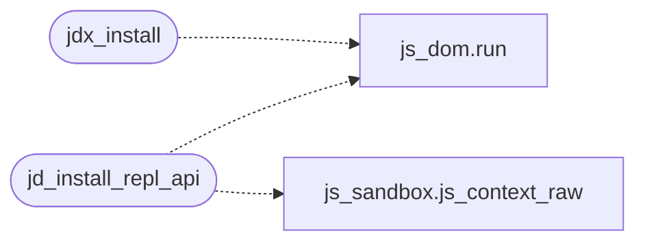

# `src/js_dom_ext.c`

> Source: [src/js_dom_ext.c:1](../../src/js_dom_ext.c#L1) | language `c` | coverage 0.0% | [API index](../index.md)

## Contents

- **Functions:** [`identity`](#identity), [`registration`](#registration), [`jdx_install`](#jdx_install), [`jd_install_repl_api`](#jd_install_repl_api)

## Call Graph

Solid arrows stay in this module, dashed arrows leave it.



## Functions

<a id="identity"></a>

### `identity`

`function` | [src/js_dom_ext.c:98](../../src/js_dom_ext.c#L98)

```c
* identity (host/shadowRoot/mode preserved) but every mutation ALSO mirrors * into the host's light DOM via dom.*, so the next pv_build_styled paints it. * innerHTML/textContent append (never replace
```

**Parameters**

| Name | Type | Default | Description |
|---|---|---|---|
| `preserved` | `host/shadowRoot/mode` |  |  |

**Returns:** `*`

---

<a id="registration"></a>

### `registration`

`function` | [src/js_dom_ext.c:373](../../src/js_dom_ext.c#L373)

```c
* registration (options, attributeFilter, subtree) and delivered in one microtask. An * observer...
```

**Returns:** `*`

---

<a id="jdx_install"></a>

### `jdx_install`

`function` | [src/js_dom_ext.c:523](../../src/js_dom_ext.c#L523)

```c
int jdx_install(JSContext *ctx)
```

**Parameters**

| Name | Type | Default | Description |
|---|---|---|---|
| `ctx` | `JSContext *` |  |  |

**Returns:** `int`

*Calls:* [`run`](include.js_dom.h.md#run)

---

<a id="jd_install_repl_api"></a>

### `jd_install_repl_api`

`function` | [src/js_dom_ext.c:529](../../src/js_dom_ext.c#L529)

```c
jd_status jd_install_repl_api(js_context *ctx)
```

**Parameters**

| Name | Type | Default | Description |
|---|---|---|---|
| `ctx` | `js_context *` |  |  |

**Returns:** `jd_status`

*Calls:* [`run`](include.js_dom.h.md#run), [`js_context_raw`](src.js_sandbox.c.md#js_context_raw)

---
