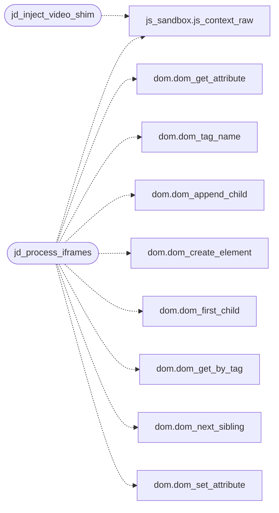

# `src/js_embed.c`

> Source: [src/js_embed.c:1](../../src/js_embed.c#L1) | language `c` | coverage 40.0% | [API index](../index.md)

## Contents

- **Functions:** [`jd_video_from_scripts`](#jd_video_from_scripts), [`jd_inject_video_shim`](#jd_inject_video_shim), [`jd_process_iframes`](#jd_process_iframes)
- **Macros:** [`_GNU_SOURCE`](#_gnu_source)

## Call Graph

Solid arrows stay in this module, dashed arrows leave it.



## Functions

<a id="jd_video_from_scripts"></a>

### `jd_video_from_scripts`

`function` | [src/js_embed.c:203](../../src/js_embed.c#L203)

```c
size_t jd_video_from_scripts(dom_index *idx, const char *const *script_texts, const size_t *script_lens, size_t nscripts, const char *page_url)
```

Creates <iframe> elements in the DOM from video data (`video[N]` / `video_data`) found in inline script text, WITHOUT executing JS.

Runs before the pre-script preserve_view snapshot so video elements survive jQuery corruption fallback. Scans each script for patterns matching video array/data assignments, extracts the iframe src URL, and creates an <iframe> in the DOM. page_url resolves relative URLs (may be NULL). Returns the number of iframes created (0 if none/error).

**Parameters**

| Name | Type | Default | Description |
|---|---|---|---|
| `idx` | `dom_index *` |  |  |
| `script_texts` | `char *const *` |  |  |
| `script_lens` | `size_t *` |  |  |
| `nscripts` | `size_t` |  |  |
| `page_url` | `char *` |  |  |

**Returns:** `size_t`

> **Inherited:** Documentation from [`jd_video_from_scripts`](#jd_video_from_scripts) (include/js_dom.h:250).

---

<a id="jd_inject_video_shim"></a>

### `jd_inject_video_shim`

`function` | [src/js_embed.c:242](../../src/js_embed.c#L242)

```c
jd_status jd_inject_video_shim(js_context *ctx)
```

**Parameters**

| Name | Type | Default | Description |
|---|---|---|---|
| `ctx` | `js_context *` |  |  |

**Returns:** `jd_status`

*Calls:* [`js_context_raw`](src.js_sandbox.c.md#js_context_raw)

---

<a id="jd_process_iframes"></a>

### `jd_process_iframes`

`function` | [src/js_embed.c:294](../../src/js_embed.c#L294)

```c
void jd_process_iframes(js_context *ctx, dom_index *idx, jd_fetch_fn fn, void *fetch_ctx)
```

**Parameters**

| Name | Type | Default | Description |
|---|---|---|---|
| `ctx` | `js_context *` |  |  |
| `idx` | `dom_index *` |  |  |
| `fn` | `jd_fetch_fn` |  |  |
| `fetch_ctx` | `void *` |  |  |

*Calls:* [`dom_get_attribute`](include.dom.h.md#dom_get_attribute), [`dom_tag_name`](include.dom.h.md#dom_tag_name), [`dom_append_child`](src.dom.c.md#dom_append_child), [`dom_create_element`](src.dom.c.md#dom_create_element), [`dom_first_child`](src.dom.c.md#dom_first_child), [`dom_get_by_tag`](src.dom.c.md#dom_get_by_tag), [`dom_next_sibling`](src.dom.c.md#dom_next_sibling), [`dom_set_attribute`](src.dom.c.md#dom_set_attribute), [`js_context_raw`](src.js_sandbox.c.md#js_context_raw)

---

## Macros

<a id="_gnu_source"></a>

### `_GNU_SOURCE`

`macro` | [src/js_embed.c:6](../../src/js_embed.c#L6)

```c
#define _GNU_SOURCE
```

js_embed.c -- <iframe> discovery and the <video> facade for trusted pages.

Split out of js_dom.c (anti-monolith clause, CLAUDE.md 3.4); contract in include/js_dom.h and spec/js_dom.md.

---
