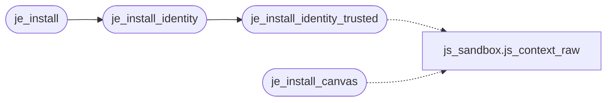

# `src/js_env.c`

> Source: [src/js_env.c:1](../../src/js_env.c#L1) | language `c` | coverage 0.0% | [API index](../index.md)

## Contents

- **Functions:** [`primitives`](#primitives), [`methods`](#methods), [`je_install`](#je_install), [`je_install_identity`](#je_install_identity), [`je_install_identity_trusted`](#je_install_identity_trusted), [`je_install_canvas`](#je_install_canvas)
- **Macros:** [`_POSIX_C_SOURCE`](#_posix_c_source), [`FP_MIME_COUNT`](#fp_mime_count), [`PERF_ORIGIN_EPOCH`](#perf_origin_epoch)

## Call Graph

Solid arrows stay in this module, dashed arrows leave it.



## Functions

<a id="primitives"></a>

### `primitives`

`function` | [src/js_env.c:6](../../src/js_env.c#L6)

```c
* the pure anti_fp primitives (one audited source of normalized constants);
```

**Parameters**

| Name | Type | Default | Description |
|---|---|---|---|
| `constants` | `one audited source of normalized` |  |  |

**Returns:** `* the pure anti_fp`

---

<a id="methods"></a>

### `methods`

`function` | [src/js_env.c:290](../../src/js_env.c#L290)

```c
* capability methods (sendBeacon, spec/js_dom.md 7h) without touching any * fingerprintable field. An untrusted page's prototype stays empty. */ JSValue proto = JS_NewObject(ctx);
```

**Parameters**

| Name | Type | Default | Description |
|---|---|---|---|
| `h` | `spec/js_dom.md 7` |  |  |

**Returns:** `* capability`

---

<a id="je_install"></a>

### `je_install`

`function` | [src/js_env.c:592](../../src/js_env.c#L592)

```c
je_status je_install(js_context *ctx, int screen_w, int screen_h)
```

**Parameters**

| Name | Type | Default | Description |
|---|---|---|---|
| `ctx` | `js_context *` |  |  |
| `screen_w` | `int` |  |  |
| `screen_h` | `int` |  |  |

**Returns:** `je_status`

*Calls:* [`je_install_identity`](#je_install_identity)

---

<a id="je_install_identity"></a>

### `je_install_identity`

`function` | [src/js_env.c:596](../../src/js_env.c#L596)

```c
je_status je_install_identity(js_context *ctx, int screen_w, int screen_h, const char *user_agent, const char *languages)
```

**Parameters**

| Name | Type | Default | Description |
|---|---|---|---|
| `ctx` | `js_context *` |  |  |
| `screen_w` | `int` |  |  |
| `screen_h` | `int` |  |  |
| `user_agent` | `char *` |  |  |
| `languages` | `char *` |  |  |

**Returns:** `je_status`

*Calls:* [`je_install_identity_trusted`](#je_install_identity_trusted)

*Called by:* [`je_install`](#je_install)

---

<a id="je_install_identity_trusted"></a>

### `je_install_identity_trusted`

`function` | [src/js_env.c:601](../../src/js_env.c#L601)

```c
je_status je_install_identity_trusted(js_context *ctx, int screen_w, int screen_h, const char *user_agent, const char *languages, int trusted)
```

**Parameters**

| Name | Type | Default | Description |
|---|---|---|---|
| `ctx` | `js_context *` |  |  |
| `screen_w` | `int` |  |  |
| `screen_h` | `int` |  |  |
| `user_agent` | `char *` |  |  |
| `languages` | `char *` |  |  |
| `trusted` | `int` |  |  |

**Returns:** `je_status`

*Calls:* [`js_context_raw`](src.js_sandbox.c.md#js_context_raw)

*Called by:* [`je_install_identity`](#je_install_identity)

---

<a id="je_install_canvas"></a>

### `je_install_canvas`

`function` | [src/js_env.c:622](../../src/js_env.c#L622)

```c
je_status je_install_canvas(js_context *ctx, uint64_t readback_key)
```

**Parameters**

| Name | Type | Default | Description |
|---|---|---|---|
| `ctx` | `js_context *` |  |  |
| `readback_key` | `uint64_t` |  |  |

**Returns:** `je_status`

*Calls:* [`js_context_raw`](src.js_sandbox.c.md#js_context_raw)

---

## Macros

<a id="_posix_c_source"></a>

### `_POSIX_C_SOURCE`

`macro` | [src/js_env.c:17](../../src/js_env.c#L17)

```c
#define _POSIX_C_SOURCE
```

---

<a id="fp_mime_count"></a>

### `FP_MIME_COUNT`

`macro` | [src/js_env.c:356](../../src/js_env.c#L356)

```c
#define FP_MIME_COUNT
```

---

<a id="perf_origin_epoch"></a>

### `PERF_ORIGIN_EPOCH`

`macro` | [src/js_env.c:439](../../src/js_env.c#L439)

```c
#define PERF_ORIGIN_EPOCH
```

---
