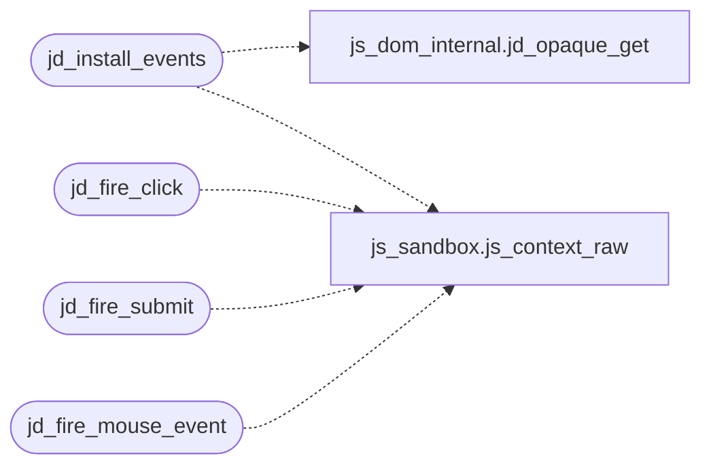

# `src/js_events.c`

> Source: [src/js_events.c:1](../../src/js_events.c#L1) | language `c` | coverage 22.2% | [API index](../index.md)

## Contents

- **Structs:** [`jd_click_state`](#jd_click_state)
- **Functions:** [`jd_click_state_new`](#jd_click_state_new), [`jd_click_state_free`](#jd_click_state_free), [`jd_install_events`](#jd_install_events), [`jd_fire_click`](#jd_fire_click), [`jd_fire_submit`](#jd_fire_submit), [`jd_fire_mouse_event`](#jd_fire_mouse_event)
- **Macros:** [`_GNU_SOURCE`](#_gnu_source)

## Call Graph

Solid arrows stay in this module, dashed arrows leave it.



## Structs

<a id="jd_click_state"></a>

### `jd_click_state`

`struct` | [src/js_events.c:25](../../src/js_events.c#L25)

```c
struct jd_click_state
```

---

## Functions

<a id="jd_click_state_new"></a>

### `jd_click_state_new`

`function` | [src/js_events.c:29](../../src/js_events.c#L29)

```c
jd_click_state *jd_click_state_new(void)
```

**Returns:** `jd_click_state *`

*Called by:* [`run_js`](src.tab.c.md#run_js)

---

<a id="jd_click_state_free"></a>

### `jd_click_state_free`

`function` | [src/js_events.c:34](../../src/js_events.c#L34)

```c
void jd_click_state_free(jd_click_state *s)
```

**Parameters**

| Name | Type | Default | Description |
|---|---|---|---|
| `s` | `jd_click_state *` |  |  |

---

<a id="jd_install_events"></a>

### `jd_install_events`

`function` | [src/js_events.c:38](../../src/js_events.c#L38)

```c
jd_status jd_install_events(js_context *ctx, jd_click_state *state)
```

**Parameters**

| Name | Type | Default | Description |
|---|---|---|---|
| `ctx` | `js_context *` |  |  |
| `state` | `jd_click_state *` |  |  |

**Returns:** `jd_status`

*Calls:* [`jd_opaque_get`](src.js_dom_internal.h.md#jd_opaque_get), [`js_context_raw`](src.js_sandbox.c.md#js_context_raw)

*Called by:* [`run_js`](src.tab.c.md#run_js)

---

<a id="jd_fire_click"></a>

### `jd_fire_click`

`function` | [src/js_events.c:66](../../src/js_events.c#L66)

```c
int jd_fire_click(js_context *ctx, dom_node_id node_id)
```

**Parameters**

| Name | Type | Default | Description |
|---|---|---|---|
| `ctx` | `js_context *` |  |  |
| `node_id` | `dom_node_id` |  |  |

**Returns:** `int`

*Calls:* [`js_context_raw`](src.js_sandbox.c.md#js_context_raw)

---

<a id="jd_fire_submit"></a>

### `jd_fire_submit`

`function` | [src/js_events.c:78](../../src/js_events.c#L78)

```c
int jd_fire_submit(js_context *ctx, dom_node_id form_node_id)
```

Fires the submit event for form_node_id.

Returns 0 if preventDefault() was called, 1 if the default action should proceed.

**Parameters**

| Name | Type | Default | Description |
|---|---|---|---|
| `ctx` | `js_context *` |  |  |
| `form_node_id` | `dom_node_id` |  |  |

**Returns:** `int`

*Calls:* [`js_context_raw`](src.js_sandbox.c.md#js_context_raw)

---

<a id="jd_fire_mouse_event"></a>

### `jd_fire_mouse_event`

`function` | [src/js_events.c:163](../../src/js_events.c#L163)

```c
int jd_fire_mouse_event(js_context *ctx, dom_node_id node_id, const char *event_type, int client_x, int client_y, int button)
```

**Parameters**

| Name | Type | Default | Description |
|---|---|---|---|
| `ctx` | `js_context *` |  |  |
| `node_id` | `dom_node_id` |  |  |
| `event_type` | `char *` |  |  |
| `client_x` | `int` |  |  |
| `client_y` | `int` |  |  |
| `button` | `int` |  |  |

**Returns:** `int`

*Calls:* [`js_context_raw`](src.js_sandbox.c.md#js_context_raw)

---

## Macros

<a id="_gnu_source"></a>

### `_GNU_SOURCE`

`macro` | [src/js_events.c:6](../../src/js_events.c#L6)

```c
#define _GNU_SOURCE
```

js_events.c -- click / submit / input / mouse event entry points from the host.

Split out of js_dom.c (anti-monolith clause, CLAUDE.md 3.4); contract in include/js_dom.h and spec/js_dom.md.

---
