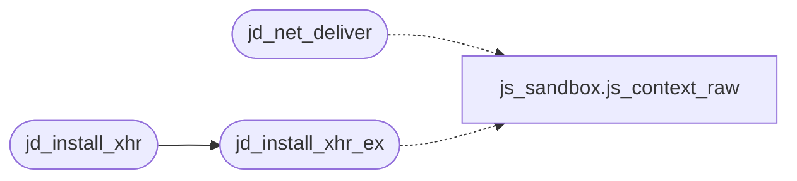

# `src/js_fetch.c`

> Source: [src/js_fetch.c:1](../../src/js_fetch.c#L1) | language `c` | coverage 14.3% | [API index](../index.md)

## Contents

- **Functions:** [`send`](#send), [`task`](#task), [`jd_install_xhr`](#jd_install_xhr), [`jd_net_deliver`](#jd_net_deliver), [`jd_install_xhr_ex`](#jd_install_xhr_ex)
- **Macros:** [`_GNU_SOURCE`](#_gnu_source)

## Call Graph

Solid arrows stay in this module, dashed arrows leave it.



## Functions

<a id="send"></a>

### `send`

`function` | [src/js_fetch.c:127](../../src/js_fetch.c#L127)

```c
* callbacks fire right after send();
```

**Returns:** `* callbacks fire right after`

---

<a id="task"></a>

### `task`

`function` | [src/js_fetch.c:311](../../src/js_fetch.c#L311)

```c
* current task (the page never waits on it);
```

**Parameters**

| Name | Type | Default | Description |
|---|---|---|---|
| `it` | `the page never waits on` |  |  |

**Returns:** `* current`

---

<a id="jd_install_xhr"></a>

### `jd_install_xhr`

`function` | [src/js_fetch.c:335](../../src/js_fetch.c#L335)

```c
jd_status jd_install_xhr(js_context *ctx, jd_fetch_fn fn, void *fetch_ctx)
```

**Parameters**

| Name | Type | Default | Description |
|---|---|---|---|
| `ctx` | `js_context *` |  |  |
| `fn` | `jd_fetch_fn` |  |  |
| `fetch_ctx` | `void *` |  |  |

**Returns:** `jd_status`

*Calls:* [`jd_install_xhr_ex`](#jd_install_xhr_ex)

---

<a id="jd_net_deliver"></a>

### `jd_net_deliver`

`function` | [src/js_fetch.c:339](../../src/js_fetch.c#L339)

```c
jd_status jd_net_deliver(js_context *ctx, int rc, int status, const char *body, size_t len, const char *ctype, const char *hdrs, int ms)
```

**Parameters**

| Name | Type | Default | Description |
|---|---|---|---|
| `ctx` | `js_context *` |  |  |
| `rc` | `int` |  |  |
| `status` | `int` |  |  |
| `body` | `char *` |  |  |
| `len` | `size_t` |  |  |
| `ctype` | `char *` |  |  |
| `hdrs` | `char *` |  |  |
| `ms` | `int` |  |  |

**Returns:** `jd_status`

*Calls:* [`js_context_raw`](src.js_sandbox.c.md#js_context_raw)

*Called by:* [`replies`](src.tab.c.md#replies)

---

<a id="jd_install_xhr_ex"></a>

### `jd_install_xhr_ex`

`function` | [src/js_fetch.c:360](../../src/js_fetch.c#L360)

```c
jd_status jd_install_xhr_ex(js_context *ctx, jd_fetch_fn fn, void *fetch_ctx, jd_fetch_async_fn afn, void *afetch_ctx)
```

**Parameters**

| Name | Type | Default | Description |
|---|---|---|---|
| `ctx` | `js_context *` |  |  |
| `fn` | `jd_fetch_fn` |  |  |
| `fetch_ctx` | `void *` |  |  |
| `afn` | `jd_fetch_async_fn` |  |  |
| `afetch_ctx` | `void *` |  |  |

**Returns:** `jd_status`

*Calls:* [`js_context_raw`](src.js_sandbox.c.md#js_context_raw)

*Called by:* [`jd_install_xhr`](#jd_install_xhr)

---

## Macros

<a id="_gnu_source"></a>

### `_GNU_SOURCE`

`macro` | [src/js_fetch.c:6](../../src/js_fetch.c#L6)

```c
#define _GNU_SOURCE
```

js_fetch.c -- XMLHttpRequest / fetch over the parent-gated host call (allow∩js only).

Split out of js_dom.c (anti-monolith clause, CLAUDE.md 3.4); contract in include/js_dom.h and spec/js_dom.md.

---
