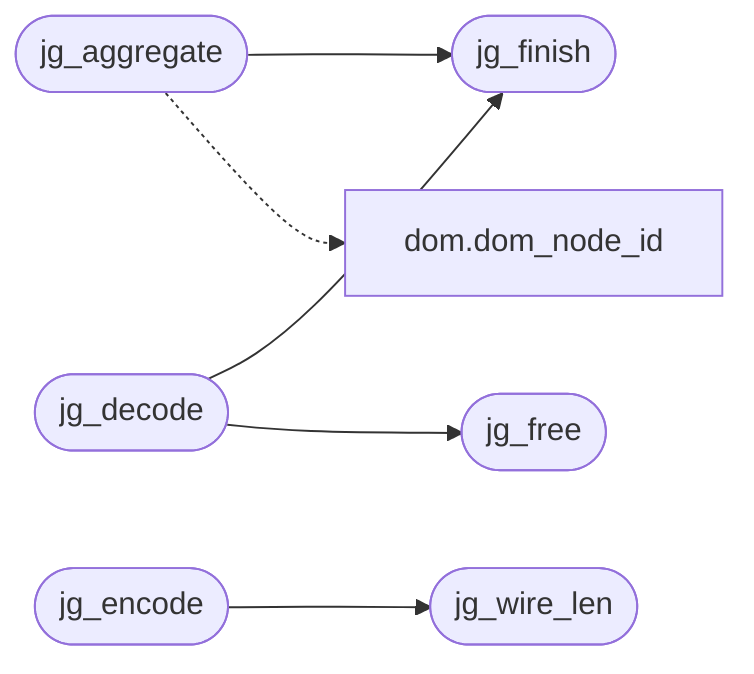

# `src/js_geom.c`

> Source: [src/js_geom.c:1](../../src/js_geom.c#L1) | language `c` | coverage 84.6% | [API index](../index.md)

## Contents

- **Functions:** [`jg_init`](#jg_init), [`jg_free`](#jg_free), [`jg_add`](#jg_add), [`jg_finish`](#jg_finish), [`jg_find`](#jg_find), [`jg_aggregate`](#jg_aggregate), [`jg_wire_len`](#jg_wire_len), [`jg_encode`](#jg_encode), [`jg_decode`](#jg_decode), [`jg_hash`](#jg_hash)
- **Macros:** [`JG_INDEX_SLOTS`](#jg_index_slots), [`JG_SLOT_EMPTY`](#jg_slot_empty)

## Call Graph

Solid arrows stay in this module, dashed arrows leave it.



## Functions

<a id="jg_init"></a>

### `jg_init`

`function` | [src/js_geom.c:17](../../src/js_geom.c#L17)

```c
void jg_init(jg_table *t)
```

Empty table.

**Parameters**

| Name | Type | Default | Description |
|---|---|---|---|
| `t` | `jg_table *` |  |  |

> **Inherited:** Documentation from [`jg_init`](#jg_init) (include/js_geom.h:44).

---

<a id="jg_free"></a>

### `jg_free`

`function` | [src/js_geom.c:21](../../src/js_geom.c#L21)

```c
void jg_free(jg_table *t)
```

Frees the rect array and resets to empty.

Idempotent; NULL is a no-op.

**Parameters**

| Name | Type | Default | Description |
|---|---|---|---|
| `t` | `jg_table *` |  |  |

> **Inherited:** Documentation from [`jg_free`](#jg_free) (include/js_geom.h:47).

*Called by:* [`jg_decode`](#jg_decode)

---

<a id="jg_add"></a>

### `jg_add`

`function` | [src/js_geom.c:52](../../src/js_geom.c#L52)

```c
int jg_add(jg_table *t, dom_node_id node, double x, double y, double w, double h)
```

Appends one rect.

DOM_NODE_NONE or a non-finite value is ignored (returns 0); coordinates are clamped to +-JG_COORD_MAX and a negative size becomes 0. Returns -1 on NULL or when JG_MAX_RECTS is reached (the table stays valid).

**Parameters**

| Name | Type | Default | Description |
|---|---|---|---|
| `t` | `jg_table *` |  |  |
| `node` | `dom_node_id` |  |  |
| `x` | `double` |  |  |
| `y` | `double` |  |  |
| `w` | `double` |  |  |
| `h` | `double` |  |  |

**Returns:** `int`

> **Inherited:** Documentation from [`jg_add`](#jg_add) (include/js_geom.h:52).

---

<a id="jg_finish"></a>

### `jg_finish`

`function` | [src/js_geom.c:83](../../src/js_geom.c#L83)

```c
int jg_finish(jg_table *t)
```

Sorts by node and merges rects of the same node into their bounding box.

Returns 0, or -1 on NULL.

**Parameters**

| Name | Type | Default | Description |
|---|---|---|---|
| `t` | `jg_table *` |  |  |

**Returns:** `int`

> **Inherited:** Documentation from [`jg_finish`](#jg_finish) (include/js_geom.h:56).

*Called by:* [`jg_aggregate`](#jg_aggregate), [`jg_decode`](#jg_decode)

---

<a id="jg_find"></a>

### `jg_find`

`function` `const` | [src/js_geom.c:96](../../src/js_geom.c#L96)

```c
const jg_rect *jg_find(const jg_table *t, dom_node_id node)
```

The rect of node in a finished table, or NULL.

**Parameters**

| Name | Type | Default | Description |
|---|---|---|---|
| `t` | `jg_table *` |  |  |
| `node` | `dom_node_id` |  |  |

**Returns:** `jg_rect *`

> **Inherited:** Documentation from [`jg_find`](#jg_find) (include/js_geom.h:59).

---

<a id="jg_aggregate"></a>

### `jg_aggregate`

`function` | [src/js_geom.c:124](../../src/js_geom.c#L124)

```c
int jg_aggregate(jg_table *t, dom_node_id (*parent)(void *ctx, dom_node_id node), void *ctx)
```

Unions every rect into each of its ancestors (parent(ctx, n) until DOM_NODE_NONE, at most JG_MAX_DEPTH steps, so a cyclic parent function terminates), then finishes the table.

Returns 0, or -1 on NULL / exhaustion of JG_MAX_RECTS (the table then holds every rect it could fit, finished).

**Parameters**

| Name | Type | Default | Description |
|---|---|---|---|
| `t` | `jg_table *` |  |  |
| `node` | `dom_node_id (*parent)(void *ctx, dom_node_id )` |  |  |
| `ctx` | `void *` |  |  |

**Returns:** `int`

> **Inherited:** Documentation from [`jg_aggregate`](#jg_aggregate) (include/js_geom.h:65).

*Calls:* [`dom_node_id`](include.dom.h.md#dom_node_id), [`jg_finish`](#jg_finish)

---

<a id="jg_wire_len"></a>

### `jg_wire_len`

`function` | [src/js_geom.c:163](../../src/js_geom.c#L163)

```c
size_t jg_wire_len(const jg_table *t)
```

Number of int32 values jg_encode writes: JG_HEADER_N + 1 + n * JG_RECT_N.

**Parameters**

| Name | Type | Default | Description |
|---|---|---|---|
| `t` | `jg_table *` |  |  |

**Returns:** `size_t`

> **Inherited:** Documentation from [`jg_wire_len`](#jg_wire_len) (include/js_geom.h:68).

*Called by:* [`jg_encode`](#jg_encode)

---

<a id="jg_encode"></a>

### `jg_encode`

`function` | [src/js_geom.c:167](../../src/js_geom.c#L167)

```c
int jg_encode(const jg_table *t, int32_t *out, size_t cap)
```

Serializes into out (cap int32 values).

Returns 0, or -1 on NULL / too small.

**Parameters**

| Name | Type | Default | Description |
|---|---|---|---|
| `t` | `jg_table *` |  |  |
| `out` | `int32_t *` |  |  |
| `cap` | `size_t` |  |  |

**Returns:** `int`

> **Inherited:** Documentation from [`jg_encode`](#jg_encode) (include/js_geom.h:71).

*Calls:* [`jg_wire_len`](#jg_wire_len)

---

<a id="jg_decode"></a>

### `jg_decode`

`function` | [src/js_geom.c:186](../../src/js_geom.c#L186)

```c
int jg_decode(const int32_t *in, size_t n, jg_table *out)
```

Parses a wire array into out (which must be jg_init'ed or empty; previous contents are freed).

Validates the header, the count against n and JG_MAX_RECTS and every value's range; on any failure returns -1 and leaves out empty. The result is finished.

**Parameters**

| Name | Type | Default | Description |
|---|---|---|---|
| `in` | `int32_t *` |  |  |
| `n` | `size_t` |  |  |
| `out` | `jg_table *` |  |  |

**Returns:** `int`

> **Inherited:** Documentation from [`jg_decode`](#jg_decode) (include/js_geom.h:77).

*Calls:* [`jg_finish`](#jg_finish), [`jg_free`](#jg_free)

---

<a id="jg_hash"></a>

### `jg_hash`

`function` | [src/js_geom.c:221](../../src/js_geom.c#L221)

```c
uint64_t jg_hash(const jg_table *t)
```

FNV-1a over the header and every rect: equal tables hash equal.

**Parameters**

| Name | Type | Default | Description |
|---|---|---|---|
| `t` | `jg_table *` |  |  |

**Returns:** `uint64_t`

> **Inherited:** Documentation from [`jg_hash`](#jg_hash) (include/js_geom.h:80).

---

## Macros

<a id="jg_index_slots"></a>

### `JG_INDEX_SLOTS`

`macro` | [src/js_geom.c:14](../../src/js_geom.c#L14)

```c
#define JG_INDEX_SLOTS
```

Open-addressing slots of the aggregation index: a power of two >= 2x the rect bound, so the load factor never passes 1/2.

---

<a id="jg_slot_empty"></a>

### `JG_SLOT_EMPTY`

`macro` | [src/js_geom.c:15](../../src/js_geom.c#L15)

```c
#define JG_SLOT_EMPTY
```

---
