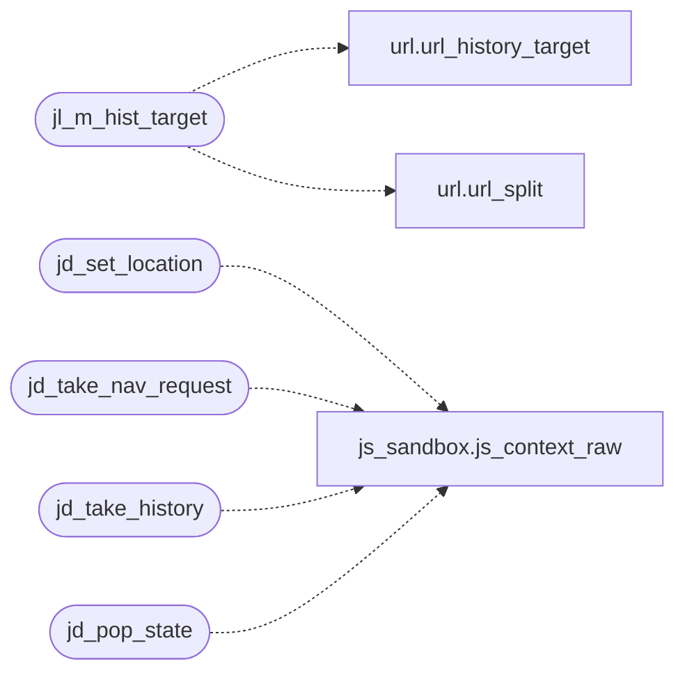

# `src/js_location.c`

> Source: [src/js_location.c:1](../../src/js_location.c#L1) | language `c` | coverage 50.0% | [API index](../index.md)

## Contents

- **Functions:** [`jl_m_hist_target`](#jl_m_hist_target), [`jd_set_location`](#jd_set_location), [`jd_take_nav_request`](#jd_take_nav_request), [`jd_take_history`](#jd_take_history), [`jd_pop_state`](#jd_pop_state)

## Call Graph

Solid arrows stay in this module, dashed arrows leave it.



## Functions

<a id="jl_m_hist_target"></a>

### `jl_m_hist_target`

`function` | [src/js_location.c:35](../../src/js_location.c#L35)

```c
JSValue jl_m_hist_target(JSContext *ctx, JSValueConst this_val, int argc, JSValueConst *argv)
```

dom.histTarget(base, ref): the same-origin target of history.pushState/replaceState (url_history_target) as a location-parts object {href, protocol, origin, host, hostname, port, pathname, search, hash}, or null when ref is cross-origin, not resolvable, or carries a control character (it will travel as one line to the parent).

A file:// target yields {href} only, like the location it replaces.

**Parameters**

| Name | Type | Default | Description |
|---|---|---|---|
| `ctx` | `JSContext *` |  |  |
| `this_val` | `JSValueConst` |  |  |
| `argc` | `int` |  |  |
| `argv` | `JSValueConst *` |  |  |

**Returns:** `JSValue`

*Calls:* [`url_history_target`](src.url.c.md#url_history_target), [`url_split`](src.url.c.md#url_split)

---

<a id="jd_set_location"></a>

### `jd_set_location`

`function` | [src/js_location.c:139](../../src/js_location.c#L139)

```c
jd_status jd_set_location(js_context *ctx, const char *href, const url_parts *parts)
```

**Parameters**

| Name | Type | Default | Description |
|---|---|---|---|
| `ctx` | `js_context *` |  |  |
| `href` | `char *` |  |  |
| `parts` | `url_parts *` |  |  |

**Returns:** `jd_status`

*Calls:* [`js_context_raw`](src.js_sandbox.c.md#js_context_raw)

*Called by:* [`LLVMFuzzerTestOneInput`](fuzz.fuzz_js_dom.c.md#llvmfuzzertestoneinput), [`run_js`](src.tab.c.md#run_js)

---

<a id="jd_take_nav_request"></a>

### `jd_take_nav_request`

`function` | [src/js_location.c:173](../../src/js_location.c#L173)

```c
int jd_take_nav_request(js_context *ctx, char *buf, size_t bufsz, int *replace)
```

**Parameters**

| Name | Type | Default | Description |
|---|---|---|---|
| `ctx` | `js_context *` |  |  |
| `buf` | `char *` |  |  |
| `bufsz` | `size_t` |  |  |
| `replace` | `int *` |  |  |

**Returns:** `int`

*Calls:* [`js_context_raw`](src.js_sandbox.c.md#js_context_raw)

---

<a id="jd_take_history"></a>

### `jd_take_history`

`function` | [src/js_location.c:219](../../src/js_location.c#L219)

```c
char *jd_take_history(js_context *ctx, int *go)
```

Drains the history operations page JS performed since the last call: an owned string of lines "P <url>\n" (pushState) / "R <url>\n" (replaceState), URLs absolute and already same-origin-checked by the worker (the parent re-checks), or NULL when there were none. *go (optional) receives the net history.back/forward/go delta, also cleared.

**Parameters**

| Name | Type | Default | Description |
|---|---|---|---|
| `ctx` | `js_context *` |  |  |
| `go` | `int *` |  |  |

**Returns:** `char *`

> **Inherited:** Documentation from [`jd_take_history`](#jd_take_history) (include/js_location.h:38).

*Calls:* [`js_context_raw`](src.js_sandbox.c.md#js_context_raw)

---

<a id="jd_pop_state"></a>

### `jd_pop_state`

`function` | [src/js_location.c:250](../../src/js_location.c#L250)

```c
int jd_pop_state(js_context *ctx, int index)
```

Moves the page's history to entry index (the parent went Back/Forward within the same document): updates location and dispatches popstate (and hashchange when only the fragment changed) on window.

Returns 1 when applied, 0 when index is out of range or no location is installed.

**Parameters**

| Name | Type | Default | Description |
|---|---|---|---|
| `ctx` | `js_context *` |  |  |
| `index` | `int` |  |  |

**Returns:** `int`

> **Inherited:** Documentation from [`jd_pop_state`](#jd_pop_state) (include/js_location.h:44).

*Calls:* [`js_context_raw`](src.js_sandbox.c.md#js_context_raw)

---
