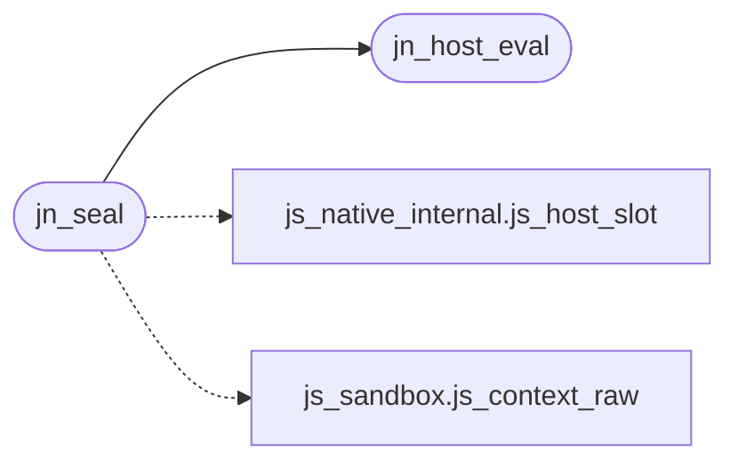

# `src/js_native.c`

> Source: [src/js_native.c:1](../../src/js_native.c#L1) | language `c` | coverage 25.0% | [API index](../index.md)

## Contents

- **Functions:** [`jn_host_eval`](#jn_host_eval), [`jn_seal`](#jn_seal)
- **Macros:** [`JN_SUPPORTS_MAX`](#jn_supports_max)

## Call Graph

Solid arrows stay in this module, dashed arrows leave it.



## Functions

<a id="jn_host_eval"></a>

### `jn_host_eval`

`function` | [src/js_native.c:15](../../src/js_native.c#L15)

```c
JSValue jn_host_eval(JSContext *c, const char *src, size_t len, const char *name)
```

**Parameters**

| Name | Type | Default | Description |
|---|---|---|---|
| `c` | `JSContext *` |  |  |
| `src` | `char *` |  |  |
| `len` | `size_t` |  |  |
| `name` | `char *` |  |  |

**Returns:** `JSValue`

*Called by:* [`jdce_install`](src.js_custom_elements.c.md#jdce_install), [`jd_inject_video_shim`](src.js_embed.c.md#jd_inject_video_shim), [`jd_install_xhr_ex`](src.js_fetch.c.md#jd_install_xhr_ex), [`jd_pop_state`](src.js_location.c.md#jd_pop_state), [`jd_set_location`](src.js_location.c.md#jd_set_location), [`jd_take_history`](src.js_location.c.md#jd_take_history), [`jn_seal`](#jn_seal), [`jt_enable_frames`](src.js_trusted.c.md#jt_enable_frames), [`jt_enable_observers`](src.js_trusted.c.md#jt_enable_observers), [`jt_enable_open`](src.js_trusted.c.md#jt_enable_open), [`jt_enable_storage`](src.js_trusted.c.md#jt_enable_storage), [`jt_enable_worker`](src.js_trusted.c.md#jt_enable_worker) and 4 more

---

<a id="jn_seal"></a>

### `jn_seal`

`function` | [src/js_native.c:144](../../src/js_native.c#L144)

```c
int jn_seal(js_context *ctx)
```

**Parameters**

| Name | Type | Default | Description |
|---|---|---|---|
| `ctx` | `js_context *` |  |  |

**Returns:** `int`

*Calls:* [`jn_host_eval`](#jn_host_eval), [`js_host_slot`](src.js_native_internal.h.md#js_host_slot), [`js_context_raw`](src.js_sandbox.c.md#js_context_raw)

*Called by:* [`run_js`](src.tab.c.md#run_js)

---

## Macros

<a id="jn_supports_max"></a>

### `JN_SUPPORTS_MAX`

`macro` | [src/js_native.c:13](../../src/js_native.c#L13)

```c
#define JN_SUPPORTS_MAX
```

Longest `property: value` CSS.supports() answers for; anything longer is unsupported.

---
