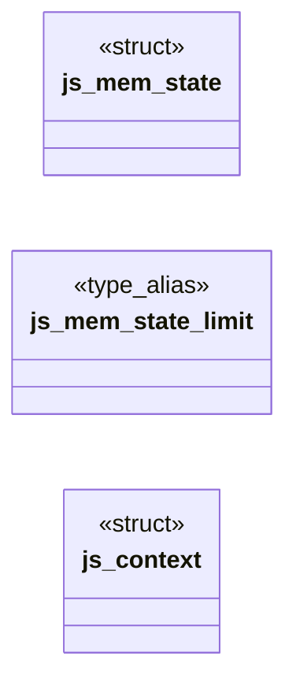
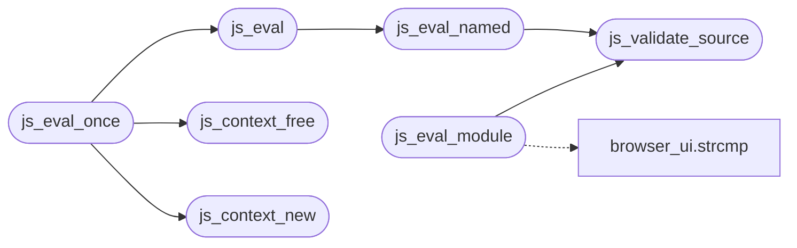

# `src/js_sandbox.c`

> Source: [src/js_sandbox.c:1](../../src/js_sandbox.c#L1) | language `c` | coverage 43.5% | [API index](../index.md)

## Contents

- **Structs:** [`js_mem_state`](#js_mem_state), [`js_context`](#js_context)
- **Functions:** [`js_loc_from_stack`](#js_loc_from_stack), [`undefined`](#undefined), [`js_limits_default`](#js_limits_default), [`js_validate_source`](#js_validate_source), [`js_context_new`](#js_context_new), [`js_context_free`](#js_context_free), [`js_set_time_budget`](#js_set_time_budget), [`js_eval`](#js_eval), [`js_eval_named`](#js_eval_named), [`js_pump_jobs`](#js_pump_jobs), [`js_eval_once`](#js_eval_once), [`js_result_free`](#js_result_free), [`js_set_current_script`](#js_set_current_script), [`js_context_raw`](#js_context_raw), [`js_set_module_host`](#js_set_module_host), [`js_eval_module`](#js_eval_module), [`js_install_realms`](#js_install_realms)
- **Macros:** [`_POSIX_C_SOURCE`](#_posix_c_source), [`JS_MODULE_URL_MAX`](#js_module_url_max)

## Type Diagram



## Call Graph

Solid arrows stay in this module, dashed arrows leave it.



## Structs

<a id="js_mem_state"></a>

### `js_mem_state`

`struct` | [src/js_sandbox.c:27](../../src/js_sandbox.c#L27)

```c
typedef struct js_mem_state
```

We enforce the heap cap ourselves (not via JS_SetMemoryLimit, whose check runs *inside* QuickJS before our allocator and is therefore unobservable).

Leaving QuickJS's own limit at its default (0 == unlimited) makes this the sole enforcer, so a denied allocation is a deterministic, testable signal.

**Members**

| Member | Kind | Summary |
|---|---|---|
| [`limit`](#js_mem_state-limit) | type_alias | We enforce the heap cap ourselves (not via JS_SetMemoryLimit, whose check runs *inside* QuickJS before our allocator and is therefore unobservable). |

<a id="js_mem_state-limit"></a>

#### `js_mem_state.limit`

`type_alias` | [src/js_sandbox.c:27](../../src/js_sandbox.c#L27)

```c
typedef struct js_mem_state { size_t limit;
```

We enforce the heap cap ourselves (not via JS_SetMemoryLimit, whose check runs *inside* QuickJS before our allocator and is therefore unobservable).

Leaving QuickJS's own limit at its default (0 == unlimited) makes this the sole enforcer, so a denied allocation is a deterministic, testable signal.

---

<a id="js_context"></a>

### `js_context`

`struct` | [src/js_sandbox.c:33](../../src/js_sandbox.c#L33)

```c
struct js_context
```

---

## Functions

<a id="js_loc_from_stack"></a>

### `js_loc_from_stack`

`function` | [src/js_sandbox.c:129](../../src/js_sandbox.c#L129)

```c
int js_loc_from_stack(const char *stack, char *file_out, size_t file_cap, int *line, int *col)
```

Pure parser: extracts the throw site (file, line, column) from the FIRST frame of a QuickJS .stack string.

Recognised frame forms: at <name> (<file>:<line>:<col>) at <file>:<line>:<col> Writes up to file_cap-1 bytes of <file> (NUL-terminated) into file_out and the numbers into *line / *col (*col is 0 when the frame carries only a line). Returns 1 when a line number was parsed, else 0 (file_out emptied, *line=*col=0). Tolerant of NULL/garbage input. No I/O, no allocation, reentrant.

**Parameters**

| Name | Type | Default | Description |
|---|---|---|---|
| `stack` | `char *` |  |  |
| `file_out` | `char *` |  |  |
| `file_cap` | `size_t` |  |  |
| `line` | `int *` |  |  |
| `col` | `int *` |  |  |

**Returns:** `int`

> **Inherited:** Documentation from [`js_loc_from_stack`](#js_loc_from_stack) (include/js_sandbox.h:140).

---

<a id="undefined"></a>

### `undefined`

`function` | [src/js_sandbox.c:221](../../src/js_sandbox.c#L221)

```c
* yields undefined (or a getter throws), in which case we leave it unknown. */ JSValue st = JS_GetPropertyStr(ctx, exc, "stack");
```

**Parameters**

| Name | Type | Default | Description |
|---|---|---|---|
| `throws` | `or a getter` |  |  |

**Returns:** `* yields`

---

<a id="js_limits_default"></a>

### `js_limits_default`

`function` | [src/js_sandbox.c:248](../../src/js_sandbox.c#L248)

```c
js_limits js_limits_default(void)
```

**Returns:** `js_limits`

---

<a id="js_validate_source"></a>

### `js_validate_source`

`function` | [src/js_sandbox.c:266](../../src/js_sandbox.c#L266)

```c
js_status js_validate_source(const char *src, size_t len, const js_limits *lim)
```

**Parameters**

| Name | Type | Default | Description |
|---|---|---|---|
| `src` | `char *` |  |  |
| `len` | `size_t` |  |  |
| `lim` | `js_limits *` |  |  |

**Returns:** `js_status`

*Called by:* [`js_eval_module`](#js_eval_module), [`js_eval_named`](#js_eval_named)

---

<a id="js_context_new"></a>

### `js_context_new`

`function` | [src/js_sandbox.c:277](../../src/js_sandbox.c#L277)

```c
js_status js_context_new(const js_limits *lim, js_context **out)
```

**Parameters**

| Name | Type | Default | Description |
|---|---|---|---|
| `lim` | `js_limits *` |  |  |
| `out` | `js_context **` |  |  |

**Returns:** `js_status`

*Called by:* [`js_eval_once`](#js_eval_once), [`run_js`](src.tab.c.md#run_js)

---

<a id="js_context_free"></a>

### `js_context_free`

`function` | [src/js_sandbox.c:316](../../src/js_sandbox.c#L316)

```c
void js_context_free(js_context *ctx)
```

Idempotent; safe on NULL and safe to call twice.

**Parameters**

| Name | Type | Default | Description |
|---|---|---|---|
| `ctx` | `js_context *` |  |  |

> **Inherited:** Documentation from [`js_context_free`](#js_context_free) (include/js_sandbox.h:86).

*Called by:* [`js_eval_once`](#js_eval_once)

---

<a id="js_set_time_budget"></a>

### `js_set_time_budget`

`function` | [src/js_sandbox.c:342](../../src/js_sandbox.c#L342)

```c
void js_set_time_budget(js_context *ctx, uint64_t budget_ms)
```

Adjusts the wall-clock budget armed on each subsequent js_eval.

Used to enforce a single page-wide budget across a sequence of evaluations (e.g. a page's inline scripts run one by one): the caller lowers the budget to the time remaining before each call, so isolating scripts into separate evals does not multiply the cap. No-op on a NULL context. Does not affect an evaluation already in progress.

**Parameters**

| Name | Type | Default | Description |
|---|---|---|---|
| `ctx` | `js_context *` |  |  |
| `budget_ms` | `uint64_t` |  |  |

> **Inherited:** Documentation from [`js_set_time_budget`](#js_set_time_budget) (include/js_sandbox.h:148).

---

<a id="js_eval"></a>

### `js_eval`

`function` | [src/js_sandbox.c:347](../../src/js_sandbox.c#L347)

```c
js_status js_eval(js_context *ctx, const char *src, size_t len, js_result *res)
```

**Parameters**

| Name | Type | Default | Description |
|---|---|---|---|
| `ctx` | `js_context *` |  |  |
| `src` | `char *` |  |  |
| `len` | `size_t` |  |  |
| `res` | `js_result *` |  |  |

**Returns:** `js_status`

*Calls:* [`js_eval_named`](#js_eval_named)

*Called by:* [`js_eval_once`](#js_eval_once)

---

<a id="js_eval_named"></a>

### `js_eval_named`

`function` | [src/js_sandbox.c:351](../../src/js_sandbox.c#L351)

```c
js_status js_eval_named(js_context *ctx, const char *src, size_t len, const char *filename, js_result *res)
```

**Parameters**

| Name | Type | Default | Description |
|---|---|---|---|
| `ctx` | `js_context *` |  |  |
| `src` | `char *` |  |  |
| `len` | `size_t` |  |  |
| `filename` | `char *` |  |  |
| `res` | `js_result *` |  |  |

**Returns:** `js_status`

*Calls:* [`js_validate_source`](#js_validate_source)

*Called by:* [`js_eval`](#js_eval)

---

<a id="js_pump_jobs"></a>

### `js_pump_jobs`

`function` | [src/js_sandbox.c:434](../../src/js_sandbox.c#L434)

```c
int js_pump_jobs(js_context *ctx, int max_jobs)
```

Runs up to max_jobs pending microtasks/jobs (promise reactions queued by the last eval), under the context's current time budget.

Job exceptions (rejected promises with no handler, etc.) are swallowed -- a job never aborts the caller. Returns the number of jobs run. Needed because js_eval does not drain the queue itself, so promise/.then/await continuations (e.g. from fetch) would otherwise never run. No-op (returns 0) on a NULL context.

**Parameters**

| Name | Type | Default | Description |
|---|---|---|---|
| `ctx` | `js_context *` |  |  |
| `max_jobs` | `int` |  |  |

**Returns:** `int`

> **Inherited:** Documentation from [`js_pump_jobs`](#js_pump_jobs) (include/js_sandbox.h:159).

---

<a id="js_eval_once"></a>

### `js_eval_once`

`function` | [src/js_sandbox.c:452](../../src/js_sandbox.c#L452)

```c
js_status js_eval_once(const char *src, size_t len, const js_limits *lim, js_result *res)
```

**Parameters**

| Name | Type | Default | Description |
|---|---|---|---|
| `src` | `char *` |  |  |
| `len` | `size_t` |  |  |
| `lim` | `js_limits *` |  |  |
| `res` | `js_result *` |  |  |

**Returns:** `js_status`

*Calls:* [`js_context_free`](#js_context_free), [`js_context_new`](#js_context_new), [`js_eval`](#js_eval)

---

<a id="js_result_free"></a>

### `js_result_free`

`function` | [src/js_sandbox.c:465](../../src/js_sandbox.c#L465)

```c
void js_result_free(js_result *res)
```

Idempotent; safe on a zero-initialised struct and safe to call twice.

**Parameters**

| Name | Type | Default | Description |
|---|---|---|---|
| `res` | `js_result *` |  |  |

> **Inherited:** Documentation from [`js_result_free`](#js_result_free) (include/js_sandbox.h:151).

---

<a id="js_set_current_script"></a>

### `js_set_current_script`

`function` | [src/js_sandbox.c:489](../../src/js_sandbox.c#L489)

```c
void js_set_current_script(js_context *ctx, const char *src, const char *type)
```

Sets document.currentScript on the global object so external scripts can read their own src / type / data-* attributes through getAttribute.

The script element is a fabricated plain object with {src, type, getAttribute} that answers these three keys. Pass src=NULL for an inline script (no src attribute). Call after the evaluation to restore currentScript to null.

**Parameters**

| Name | Type | Default | Description |
|---|---|---|---|
| `ctx` | `js_context *` |  |  |
| `src` | `char *` |  |  |
| `type` | `char *` |  |  |

> **Inherited:** Documentation from [`js_set_current_script`](#js_set_current_script) (include/js_sandbox.h:171).

---

<a id="js_context_raw"></a>

### `js_context_raw`

`function` | [src/js_sandbox.c:522](../../src/js_sandbox.c#L522)

```c
void *js_context_raw(js_context *ctx)
```

**Parameters**

| Name | Type | Default | Description |
|---|---|---|---|
| `ctx` | `js_context *` |  |  |

**Returns:** `void *`

*Called by:* [`jd_inject_video_shim`](src.js_embed.c.md#jd_inject_video_shim), [`jd_process_iframes`](src.js_embed.c.md#jd_process_iframes), [`je_install_canvas`](src.js_env.c.md#je_install_canvas), [`je_install_identity`](src.js_env.c.md#je_install_identity), [`jd_fire_click`](src.js_events.c.md#jd_fire_click), [`jd_fire_mouse_event`](src.js_events.c.md#jd_fire_mouse_event), [`jd_fire_submit`](src.js_events.c.md#jd_fire_submit), [`jd_install_events`](src.js_events.c.md#jd_install_events), [`jd_install_xhr`](src.js_fetch.c.md#jd_install_xhr), [`jd_pop_state`](src.js_location.c.md#jd_pop_state), [`jd_set_location`](src.js_location.c.md#jd_set_location), [`jd_take_history`](src.js_location.c.md#jd_take_history) and 11 more

---

<a id="js_set_module_host"></a>

### `js_set_module_host`

`function` | [src/js_sandbox.c:602](../../src/js_sandbox.c#L602)

```c
void js_set_module_host(js_context *ctx, js_module_resolve_fn resolve, js_module_fetch_fn fetch, void *host)
```

Installs the host every static import and dynamic import() goes through. host must outlive ctx.

NULL functions uninstall it (every import then fails).

**Parameters**

| Name | Type | Default | Description |
|---|---|---|---|
| `ctx` | `js_context *` |  |  |
| `resolve` | `js_module_resolve_fn` |  |  |
| `fetch` | `js_module_fetch_fn` |  |  |
| `host` | `void *` |  |  |

> **Inherited:** Documentation from [`js_set_module_host`](#js_set_module_host) (include/js_sandbox.h:119).

---

<a id="js_eval_module"></a>

### `js_eval_module`

`function` | [src/js_sandbox.c:632](../../src/js_sandbox.c#L632)

```c
js_status js_eval_module(js_context *ctx, const char *src, size_t len, const char *name, js_result *res)
```

**Parameters**

| Name | Type | Default | Description |
|---|---|---|---|
| `ctx` | `js_context *` |  |  |
| `src` | `char *` |  |  |
| `len` | `size_t` |  |  |
| `name` | `char *` |  |  |
| `res` | `js_result *` |  |  |

**Returns:** `js_status`

*Calls:* [`strcmp`](gui.browser_ui.c.md#strcmp), [`js_validate_source`](#js_validate_source)

---

<a id="js_install_realms"></a>

### `js_install_realms`

`function` | [src/js_sandbox.c:794](../../src/js_sandbox.c#L794)

```c
js_status js_install_realms(js_context *ctx)
```

**Parameters**

| Name | Type | Default | Description |
|---|---|---|---|
| `ctx` | `js_context *` |  |  |

**Returns:** `js_status`

*Called by:* [`jt_enable_worker`](src.js_trusted.c.md#jt_enable_worker)

---

## Macros

<a id="_posix_c_source"></a>

### `_POSIX_C_SOURCE`

`macro` | [src/js_sandbox.c:12](../../src/js_sandbox.c#L12)

```c
#define _POSIX_C_SOURCE
```

---

<a id="js_module_url_max"></a>

### `JS_MODULE_URL_MAX`

`macro` | [src/js_sandbox.c:527](../../src/js_sandbox.c#L527)

```c
#define JS_MODULE_URL_MAX
```

Longest module URL the resolver may produce (matches url.h's URL_MAX_LEN).

---
