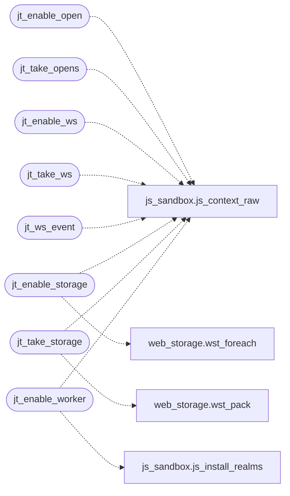

# `src/js_trusted.c`

> Source: [src/js_trusted.c:1](../../src/js_trusted.c#L1) | language `c` | coverage 33.3% | [API index](../index.md)

## Contents

- **Structs:** [`jt_seed_ctx`](#jt_seed_ctx)
- **Functions:** [`jt_enable_open`](#jt_enable_open), [`jt_take_opens`](#jt_take_opens), [`jt_enable_ws`](#jt_enable_ws), [`jt_ws_ops_free`](#jt_ws_ops_free), [`jt_take_ws`](#jt_take_ws), [`jt_ws_event`](#jt_ws_event), [`jt_enable_storage`](#jt_enable_storage), [`jt_take_storage`](#jt_take_storage), [`explicitly`](#explicitly), [`jt_enable_worker`](#jt_enable_worker)

## Call Graph

Solid arrows stay in this module, dashed arrows leave it.



## Structs

<a id="jt_seed_ctx"></a>

### `jt_seed_ctx`

`struct` | [src/js_trusted.c:263](../../src/js_trusted.c#L263)

```c
typedef struct jt_seed_ctx { JSContext *js; JSValue fn; JSValue global; } jt_seed_ctx;
```

---

## Functions

<a id="jt_enable_open"></a>

### `jt_enable_open`

`function` | [src/js_trusted.c:26](../../src/js_trusted.c#L26)

```c
jd_status jt_enable_open(js_context *ctx)
```

**Parameters**

| Name | Type | Default | Description |
|---|---|---|---|
| `ctx` | `js_context *` |  |  |

**Returns:** `jd_status`

*Calls:* [`js_context_raw`](src.js_sandbox.c.md#js_context_raw)

*Called by:* [`LLVMFuzzerTestOneInput`](fuzz.fuzz_js_dom.c.md#llvmfuzzertestoneinput)

---

<a id="jt_take_opens"></a>

### `jt_take_opens`

`function` | [src/js_trusted.c:42](../../src/js_trusted.c#L42)

```c
char *jt_take_opens(js_context *ctx)
```

Drains the recorded window.open targets as "url\n" lines, or NULL when none.

**Parameters**

| Name | Type | Default | Description |
|---|---|---|---|
| `ctx` | `js_context *` |  |  |

**Returns:** `char *`

> **Inherited:** Documentation from [`jt_take_opens`](#jt_take_opens) (include/js_trusted.h:31).

*Calls:* [`js_context_raw`](src.js_sandbox.c.md#js_context_raw)

---

<a id="jt_enable_ws"></a>

### `jt_enable_ws`

`function` | [src/js_trusted.c:120](../../src/js_trusted.c#L120)

```c
jd_status jt_enable_ws(js_context *ctx)
```

**Parameters**

| Name | Type | Default | Description |
|---|---|---|---|
| `ctx` | `js_context *` |  |  |

**Returns:** `jd_status`

*Calls:* [`js_context_raw`](src.js_sandbox.c.md#js_context_raw)

*Called by:* [`LLVMFuzzerTestOneInput`](fuzz.fuzz_js_dom.c.md#llvmfuzzertestoneinput)

---

<a id="jt_ws_ops_free"></a>

### `jt_ws_ops_free`

`function` | [src/js_trusted.c:132](../../src/js_trusted.c#L132)

```c
void jt_ws_ops_free(jt_ws_op *ops, size_t n)
```

**Parameters**

| Name | Type | Default | Description |
|---|---|---|---|
| `ops` | `jt_ws_op *` |  |  |
| `n` | `size_t` |  |  |

---

<a id="jt_take_ws"></a>

### `jt_take_ws`

`function` | [src/js_trusted.c:168](../../src/js_trusted.c#L168)

```c
size_t jt_take_ws(js_context *ctx, jt_ws_op *ops, size_t cap)
```

Drains up to cap recorded operations into ops (each data owned; release with jt_ws_ops_free).

Returns the count. Operations past JT_WS_MAX_OPS/JT_WS_MAX_BYTES are dropped and their socket is errored+closed on the page side.

**Parameters**

| Name | Type | Default | Description |
|---|---|---|---|
| `ctx` | `js_context *` |  |  |
| `ops` | `jt_ws_op *` |  |  |
| `cap` | `size_t` |  |  |

**Returns:** `size_t`

> **Inherited:** Documentation from [`jt_take_ws`](#jt_take_ws) (include/js_trusted.h:64).

*Calls:* [`js_context_raw`](src.js_sandbox.c.md#js_context_raw)

---

<a id="jt_ws_event"></a>

### `jt_ws_event`

`function` | [src/js_trusted.c:210](../../src/js_trusted.c#L210)

```c
int jt_ws_event(js_context *ctx, int id, int kind, int code, const char *data, size_t len)
```

Delivers a socket event from the parent: data enters JS as a VALUE (a string for text, an ArrayBuffer for binary, the reason for close), never as source.

Returns 1 when a live socket with that id received it.

**Parameters**

| Name | Type | Default | Description |
|---|---|---|---|
| `ctx` | `js_context *` |  |  |
| `id` | `int` |  |  |
| `kind` | `int` |  |  |
| `code` | `int` |  |  |
| `data` | `char *` |  |  |
| `len` | `size_t` |  |  |

**Returns:** `int`

> **Inherited:** Documentation from [`jt_ws_event`](#jt_ws_event) (include/js_trusted.h:70).

*Calls:* [`js_context_raw`](src.js_sandbox.c.md#js_context_raw)

---

<a id="jt_enable_storage"></a>

### `jt_enable_storage`

`function` | [src/js_trusted.c:275](../../src/js_trusted.c#L275)

```c
jd_status jt_enable_storage(js_context *ctx, const char *blob, size_t len)
```

**Parameters**

| Name | Type | Default | Description |
|---|---|---|---|
| `ctx` | `js_context *` |  |  |
| `blob` | `char *` |  |  |
| `len` | `size_t` |  |  |

**Returns:** `jd_status`

*Calls:* [`js_context_raw`](src.js_sandbox.c.md#js_context_raw), [`wst_foreach`](src.web_storage.c.md#wst_foreach)

*Called by:* [`LLVMFuzzerTestOneInput`](fuzz.fuzz_js_dom.c.md#llvmfuzzertestoneinput)

---

<a id="jt_take_storage"></a>

### `jt_take_storage`

`function` | [src/js_trusted.c:296](../../src/js_trusted.c#L296)

```c
int jt_take_storage(js_context *ctx, char **out, size_t *len)
```

When the store changed since the last call, returns 1 with an owned snapshot of the whole store in *out (length *len) and clears the dirty bit; 0 otherwise.

**Parameters**

| Name | Type | Default | Description |
|---|---|---|---|
| `ctx` | `js_context *` |  |  |
| `out` | `char **` |  |  |
| `len` | `size_t *` |  |  |

**Returns:** `int`

> **Inherited:** Documentation from [`jt_take_storage`](#jt_take_storage) (include/js_trusted.h:82).

*Calls:* [`js_context_raw`](src.js_sandbox.c.md#js_context_raw), [`wst_pack`](src.web_storage.c.md#wst_pack)

---

<a id="explicitly"></a>

### `explicitly`

`function` | [src/js_trusted.c:344](../../src/js_trusted.c#L344)

```c
* explicitly (no window, no document). Delivery is always a timer task. */ static const char JT_W...
```

**Parameters**

| Name | Type | Default | Description |
|---|---|---|---|
| `window` | `no` |  |  |
| `document` | `no` |  |  |

**Returns:** `*`

---

<a id="jt_enable_worker"></a>

### `jt_enable_worker`

`function` | [src/js_trusted.c:425](../../src/js_trusted.c#L425)

```c
jd_status jt_enable_worker(js_context *ctx)
```

**Parameters**

| Name | Type | Default | Description |
|---|---|---|---|
| `ctx` | `js_context *` |  |  |

**Returns:** `jd_status`

*Calls:* [`js_context_raw`](src.js_sandbox.c.md#js_context_raw), [`js_install_realms`](src.js_sandbox.c.md#js_install_realms)

*Called by:* [`LLVMFuzzerTestOneInput`](fuzz.fuzz_js_dom.c.md#llvmfuzzertestoneinput)

---
