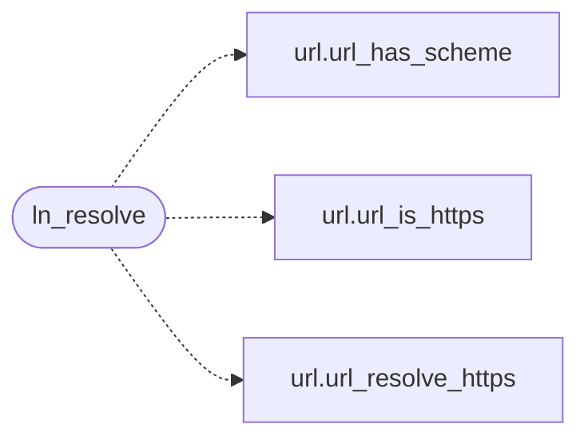

# `src/link_nav.c`

> Source: [src/link_nav.c:1](../../src/link_nav.c#L1) | language `c` | coverage 33.3% | [API index](../index.md)

## Contents

- **Functions:** [`ln_resolve`](#ln_resolve), [`ln_block_reason_text`](#ln_block_reason_text)

## Call Graph

Solid arrows stay in this module, dashed arrows leave it.



## Functions

<a id="ln_resolve"></a>

### `ln_resolve`

`function` | [src/link_nav.c:172](../../src/link_nav.c#L172)

```c
ln_status ln_resolve(const char *base, const char *href, ln_result *out)
```

**Parameters**

| Name | Type | Default | Description |
|---|---|---|---|
| `base` | `char *` |  |  |
| `href` | `char *` |  |  |
| `out` | `ln_result *` |  |  |

**Returns:** `ln_status`

*Calls:* [`url_has_scheme`](include.url.h.md#url_has_scheme), [`url_is_https`](include.url.h.md#url_is_https), [`url_resolve_https`](src.url.c.md#url_resolve_https)

*Called by:* [`LLVMFuzzerTestOneInput`](fuzz.fuzz_url.c.md#llvmfuzzertestoneinput), [`only`](gui.browser_ui.c.md#only), [`gets`](src.freedom.c.md#gets)

---

<a id="ln_block_reason_text"></a>

### `ln_block_reason_text`

`function` `const` | [src/link_nav.c:241](../../src/link_nav.c#L241)

```c
const char *ln_block_reason_text(ln_block_reason reason)
```

Stable, short English notice for a block reason (e.g. for a UI toast or agent output).

Never NULL; an unknown value yields "blocked".

**Parameters**

| Name | Type | Default | Description |
|---|---|---|---|
| `reason` | `ln_block_reason` |  |  |

**Returns:** `char *`

> **Inherited:** Documentation from [`ln_block_reason_text`](#ln_block_reason_text) (include/link_nav.h:85).

---
