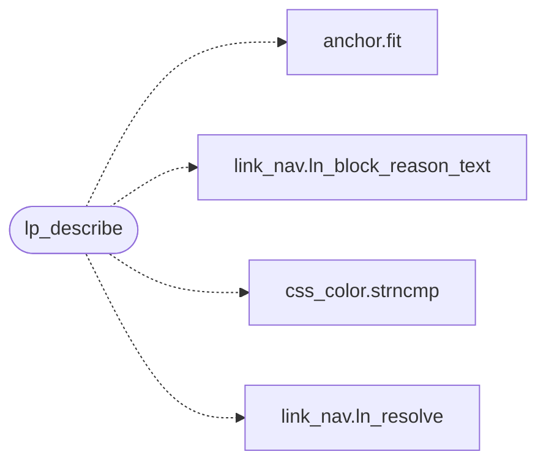

# `src/link_preview.c`

> Source: [src/link_preview.c:1](../../src/link_preview.c#L1) | language `c` | coverage 66.7% | [API index](../index.md)

link_preview -- the status-strip description of a hovered link (spec/link_preview.md).

## Contents

- **Structs:** [`lp_sink`](#lp_sink)
- **Functions:** [`lp_describe`](#lp_describe)

## Call Graph

Solid arrows stay in this module, dashed arrows leave it.



## Structs

<a id="lp_sink"></a>

### `lp_sink`

`struct` | [src/link_preview.c:12](../../src/link_preview.c#L12)

```c
typedef struct lp_sink
```

Growable-free escape sink: writes into a caller-sized buffer that is always large enough (3 bytes per source byte), so no bound check is lost on a short write.

---

## Functions

<a id="lp_describe"></a>

### `lp_describe`

`function` | [src/link_preview.c:105](../../src/link_preview.c#L105)

```c
lp_status lp_describe(const char *base, const char *href, lp_preview *out)
```

**Parameters**

| Name | Type | Default | Description |
|---|---|---|---|
| `base` | `char *` |  |  |
| `href` | `char *` |  |  |
| `out` | `lp_preview *` |  |  |

**Returns:** `lp_status`

*Calls:* [`fit`](include.anchor.h.md#fit), [`ln_block_reason_text`](include.link_nav.h.md#ln_block_reason_text), [`strncmp`](src.css_color.c.md#strncmp), [`ln_resolve`](src.link_nav.c.md#ln_resolve)

*Called by:* [`LLVMFuzzerTestOneInput`](fuzz.fuzz_link_preview.c.md#llvmfuzzertestoneinput)

---
