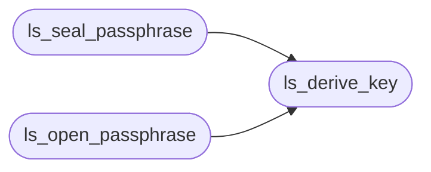

# `src/local_store.c`

> Source: [src/local_store.c:1](../../src/local_store.c#L1) | language `c` | coverage 1.5% | [API index](../index.md)

## Contents

- **Functions:** [`ls_derive_key`](#ls_derive_key), [`ls_seal`](#ls_seal), [`ls_open`](#ls_open), [`ls_seal_passphrase`](#ls_seal_passphrase), [`ls_open_passphrase`](#ls_open_passphrase), [`ls_free`](#ls_free)
- **Macros:** [`OSSL_KDF_PARAM_ARGON2_LANES`](#ossl_kdf_param_argon2_lanes), [`OSSL_KDF_PARAM_ARGON2_MEMCOST`](#ossl_kdf_param_argon2_memcost), [`OSSL_KDF_PARAM_THREADS`](#ossl_kdf_param_threads), [`_GNU_SOURCE`](#_gnu_source), [`OSSL_KDF_PARAM_ARGON2_LANES`](#ossl_kdf_param_argon2_lanes), [`OSSL_KDF_PARAM_ARGON2_MEMCOST`](#ossl_kdf_param_argon2_memcost), [`OSSL_KDF_PARAM_THREADS`](#ossl_kdf_param_threads), [`_GNU_SOURCE`](#_gnu_source), [`OSSL_KDF_PARAM_ARGON2_LANES`](#ossl_kdf_param_argon2_lanes), [`OSSL_KDF_PARAM_ARGON2_MEMCOST`](#ossl_kdf_param_argon2_memcost), [`OSSL_KDF_PARAM_THREADS`](#ossl_kdf_param_threads), [`_GNU_SOURCE`](#_gnu_source), [`OSSL_KDF_PARAM_ARGON2_LANES`](#ossl_kdf_param_argon2_lanes), [`OSSL_KDF_PARAM_ARGON2_MEMCOST`](#ossl_kdf_param_argon2_memcost), [`OSSL_KDF_PARAM_THREADS`](#ossl_kdf_param_threads), [`_GNU_SOURCE`](#_gnu_source), [`OSSL_KDF_PARAM_ARGON2_LANES`](#ossl_kdf_param_argon2_lanes), [`OSSL_KDF_PARAM_ARGON2_MEMCOST`](#ossl_kdf_param_argon2_memcost), [`OSSL_KDF_PARAM_THREADS`](#ossl_kdf_param_threads), [`_GNU_SOURCE`](#_gnu_source), [`OSSL_KDF_PARAM_ARGON2_LANES`](#ossl_kdf_param_argon2_lanes), [`OSSL_KDF_PARAM_ARGON2_MEMCOST`](#ossl_kdf_param_argon2_memcost), [`OSSL_KDF_PARAM_THREADS`](#ossl_kdf_param_threads), [`_GNU_SOURCE`](#_gnu_source), [`OSSL_KDF_PARAM_ARGON2_LANES`](#ossl_kdf_param_argon2_lanes), [`OSSL_KDF_PARAM_ARGON2_MEMCOST`](#ossl_kdf_param_argon2_memcost), [`OSSL_KDF_PARAM_THREADS`](#ossl_kdf_param_threads), [`_GNU_SOURCE`](#_gnu_source), [`OSSL_KDF_PARAM_ARGON2_LANES`](#ossl_kdf_param_argon2_lanes), [`OSSL_KDF_PARAM_ARGON2_MEMCOST`](#ossl_kdf_param_argon2_memcost), [`OSSL_KDF_PARAM_THREADS`](#ossl_kdf_param_threads), [`_GNU_SOURCE`](#_gnu_source), [`OSSL_KDF_PARAM_ARGON2_LANES`](#ossl_kdf_param_argon2_lanes), [`OSSL_KDF_PARAM_ARGON2_MEMCOST`](#ossl_kdf_param_argon2_memcost), [`OSSL_KDF_PARAM_THREADS`](#ossl_kdf_param_threads), [`_GNU_SOURCE`](#_gnu_source), [`OSSL_KDF_PARAM_ARGON2_LANES`](#ossl_kdf_param_argon2_lanes), [`OSSL_KDF_PARAM_ARGON2_MEMCOST`](#ossl_kdf_param_argon2_memcost), [`OSSL_KDF_PARAM_THREADS`](#ossl_kdf_param_threads), [`_GNU_SOURCE`](#_gnu_source), [`OSSL_KDF_PARAM_ARGON2_LANES`](#ossl_kdf_param_argon2_lanes), [`OSSL_KDF_PARAM_ARGON2_MEMCOST`](#ossl_kdf_param_argon2_memcost), [`OSSL_KDF_PARAM_THREADS`](#ossl_kdf_param_threads), [`_GNU_SOURCE`](#_gnu_source), [`OSSL_KDF_PARAM_ARGON2_LANES`](#ossl_kdf_param_argon2_lanes), [`OSSL_KDF_PARAM_ARGON2_MEMCOST`](#ossl_kdf_param_argon2_memcost), [`OSSL_KDF_PARAM_THREADS`](#ossl_kdf_param_threads), [`_GNU_SOURCE`](#_gnu_source), [`OSSL_KDF_PARAM_ARGON2_LANES`](#ossl_kdf_param_argon2_lanes), [`OSSL_KDF_PARAM_ARGON2_MEMCOST`](#ossl_kdf_param_argon2_memcost), [`OSSL_KDF_PARAM_THREADS`](#ossl_kdf_param_threads), [`_GNU_SOURCE`](#_gnu_source), [`OSSL_KDF_PARAM_ARGON2_LANES`](#ossl_kdf_param_argon2_lanes), [`OSSL_KDF_PARAM_ARGON2_MEMCOST`](#ossl_kdf_param_argon2_memcost), [`OSSL_KDF_PARAM_THREADS`](#ossl_kdf_param_threads), [`_GNU_SOURCE`](#_gnu_source), [`OSSL_KDF_PARAM_ARGON2_LANES`](#ossl_kdf_param_argon2_lanes), [`OSSL_KDF_PARAM_ARGON2_MEMCOST`](#ossl_kdf_param_argon2_memcost), [`OSSL_KDF_PARAM_THREADS`](#ossl_kdf_param_threads), [`_GNU_SOURCE`](#_gnu_source), [`OSSL_KDF_PARAM_ARGON2_LANES`](#ossl_kdf_param_argon2_lanes), [`OSSL_KDF_PARAM_ARGON2_MEMCOST`](#ossl_kdf_param_argon2_memcost), [`OSSL_KDF_PARAM_THREADS`](#ossl_kdf_param_threads), [`_GNU_SOURCE`](#_gnu_source), [`OSSL_KDF_PARAM_ARGON2_LANES`](#ossl_kdf_param_argon2_lanes), [`OSSL_KDF_PARAM_ARGON2_MEMCOST`](#ossl_kdf_param_argon2_memcost), [`OSSL_KDF_PARAM_THREADS`](#ossl_kdf_param_threads), [`_GNU_SOURCE`](#_gnu_source), [`OSSL_KDF_PARAM_ARGON2_LANES`](#ossl_kdf_param_argon2_lanes), [`OSSL_KDF_PARAM_ARGON2_MEMCOST`](#ossl_kdf_param_argon2_memcost), [`OSSL_KDF_PARAM_THREADS`](#ossl_kdf_param_threads), [`_GNU_SOURCE`](#_gnu_source), [`OSSL_KDF_PARAM_ARGON2_LANES`](#ossl_kdf_param_argon2_lanes), [`OSSL_KDF_PARAM_ARGON2_MEMCOST`](#ossl_kdf_param_argon2_memcost), [`OSSL_KDF_PARAM_THREADS`](#ossl_kdf_param_threads), [`_GNU_SOURCE`](#_gnu_source), [`OSSL_KDF_PARAM_ARGON2_LANES`](#ossl_kdf_param_argon2_lanes), [`OSSL_KDF_PARAM_ARGON2_MEMCOST`](#ossl_kdf_param_argon2_memcost), [`OSSL_KDF_PARAM_THREADS`](#ossl_kdf_param_threads), [`_GNU_SOURCE`](#_gnu_source), [`OSSL_KDF_PARAM_ARGON2_LANES`](#ossl_kdf_param_argon2_lanes), [`OSSL_KDF_PARAM_ARGON2_MEMCOST`](#ossl_kdf_param_argon2_memcost), [`OSSL_KDF_PARAM_THREADS`](#ossl_kdf_param_threads), [`_GNU_SOURCE`](#_gnu_source), [`OSSL_KDF_PARAM_ARGON2_LANES`](#ossl_kdf_param_argon2_lanes), [`OSSL_KDF_PARAM_ARGON2_MEMCOST`](#ossl_kdf_param_argon2_memcost), [`OSSL_KDF_PARAM_THREADS`](#ossl_kdf_param_threads), [`_GNU_SOURCE`](#_gnu_source), [`OSSL_KDF_PARAM_ARGON2_LANES`](#ossl_kdf_param_argon2_lanes), [`OSSL_KDF_PARAM_ARGON2_MEMCOST`](#ossl_kdf_param_argon2_memcost), [`OSSL_KDF_PARAM_THREADS`](#ossl_kdf_param_threads), [`_GNU_SOURCE`](#_gnu_source), [`OSSL_KDF_PARAM_ARGON2_LANES`](#ossl_kdf_param_argon2_lanes), [`OSSL_KDF_PARAM_ARGON2_MEMCOST`](#ossl_kdf_param_argon2_memcost), [`OSSL_KDF_PARAM_THREADS`](#ossl_kdf_param_threads), [`_GNU_SOURCE`](#_gnu_source), [`OSSL_KDF_PARAM_ARGON2_LANES`](#ossl_kdf_param_argon2_lanes), [`OSSL_KDF_PARAM_ARGON2_MEMCOST`](#ossl_kdf_param_argon2_memcost), [`OSSL_KDF_PARAM_THREADS`](#ossl_kdf_param_threads), [`_GNU_SOURCE`](#_gnu_source), [`OSSL_KDF_PARAM_ARGON2_LANES`](#ossl_kdf_param_argon2_lanes), [`OSSL_KDF_PARAM_ARGON2_MEMCOST`](#ossl_kdf_param_argon2_memcost), [`OSSL_KDF_PARAM_THREADS`](#ossl_kdf_param_threads), [`_GNU_SOURCE`](#_gnu_source), [`OSSL_KDF_PARAM_ARGON2_LANES`](#ossl_kdf_param_argon2_lanes), [`OSSL_KDF_PARAM_ARGON2_MEMCOST`](#ossl_kdf_param_argon2_memcost), [`OSSL_KDF_PARAM_THREADS`](#ossl_kdf_param_threads), [`_GNU_SOURCE`](#_gnu_source), [`OSSL_KDF_PARAM_ARGON2_LANES`](#ossl_kdf_param_argon2_lanes), [`OSSL_KDF_PARAM_ARGON2_MEMCOST`](#ossl_kdf_param_argon2_memcost), [`OSSL_KDF_PARAM_THREADS`](#ossl_kdf_param_threads), [`_GNU_SOURCE`](#_gnu_source), [`OSSL_KDF_PARAM_ARGON2_LANES`](#ossl_kdf_param_argon2_lanes), [`OSSL_KDF_PARAM_ARGON2_MEMCOST`](#ossl_kdf_param_argon2_memcost), [`OSSL_KDF_PARAM_THREADS`](#ossl_kdf_param_threads), [`_GNU_SOURCE`](#_gnu_source), [`OSSL_KDF_PARAM_ARGON2_LANES`](#ossl_kdf_param_argon2_lanes), [`OSSL_KDF_PARAM_ARGON2_MEMCOST`](#ossl_kdf_param_argon2_memcost), [`OSSL_KDF_PARAM_THREADS`](#ossl_kdf_param_threads), [`_GNU_SOURCE`](#_gnu_source), [`OSSL_KDF_PARAM_ARGON2_LANES`](#ossl_kdf_param_argon2_lanes), [`OSSL_KDF_PARAM_ARGON2_MEMCOST`](#ossl_kdf_param_argon2_memcost), [`OSSL_KDF_PARAM_THREADS`](#ossl_kdf_param_threads), [`_GNU_SOURCE`](#_gnu_source), [`OSSL_KDF_PARAM_ARGON2_LANES`](#ossl_kdf_param_argon2_lanes), [`OSSL_KDF_PARAM_ARGON2_MEMCOST`](#ossl_kdf_param_argon2_memcost), [`OSSL_KDF_PARAM_THREADS`](#ossl_kdf_param_threads), [`_GNU_SOURCE`](#_gnu_source), [`OSSL_KDF_PARAM_ARGON2_LANES`](#ossl_kdf_param_argon2_lanes), [`OSSL_KDF_PARAM_ARGON2_MEMCOST`](#ossl_kdf_param_argon2_memcost), [`OSSL_KDF_PARAM_THREADS`](#ossl_kdf_param_threads), [`_GNU_SOURCE`](#_gnu_source), [`OSSL_KDF_PARAM_ARGON2_LANES`](#ossl_kdf_param_argon2_lanes), [`OSSL_KDF_PARAM_ARGON2_MEMCOST`](#ossl_kdf_param_argon2_memcost), [`OSSL_KDF_PARAM_THREADS`](#ossl_kdf_param_threads), [`_GNU_SOURCE`](#_gnu_source), [`OSSL_KDF_PARAM_ARGON2_LANES`](#ossl_kdf_param_argon2_lanes), [`OSSL_KDF_PARAM_ARGON2_MEMCOST`](#ossl_kdf_param_argon2_memcost), [`OSSL_KDF_PARAM_THREADS`](#ossl_kdf_param_threads), [`_GNU_SOURCE`](#_gnu_source), [`OSSL_KDF_PARAM_ARGON2_LANES`](#ossl_kdf_param_argon2_lanes), [`OSSL_KDF_PARAM_ARGON2_MEMCOST`](#ossl_kdf_param_argon2_memcost), [`OSSL_KDF_PARAM_THREADS`](#ossl_kdf_param_threads), [`_GNU_SOURCE`](#_gnu_source), [`OSSL_KDF_PARAM_ARGON2_LANES`](#ossl_kdf_param_argon2_lanes), [`OSSL_KDF_PARAM_ARGON2_MEMCOST`](#ossl_kdf_param_argon2_memcost), [`OSSL_KDF_PARAM_THREADS`](#ossl_kdf_param_threads), [`_GNU_SOURCE`](#_gnu_source), [`OSSL_KDF_PARAM_ARGON2_LANES`](#ossl_kdf_param_argon2_lanes), [`OSSL_KDF_PARAM_ARGON2_MEMCOST`](#ossl_kdf_param_argon2_memcost), [`OSSL_KDF_PARAM_THREADS`](#ossl_kdf_param_threads), [`_GNU_SOURCE`](#_gnu_source), [`OSSL_KDF_PARAM_ARGON2_LANES`](#ossl_kdf_param_argon2_lanes), [`OSSL_KDF_PARAM_ARGON2_MEMCOST`](#ossl_kdf_param_argon2_memcost), [`OSSL_KDF_PARAM_THREADS`](#ossl_kdf_param_threads), [`_GNU_SOURCE`](#_gnu_source), [`OSSL_KDF_PARAM_ARGON2_LANES`](#ossl_kdf_param_argon2_lanes), [`OSSL_KDF_PARAM_ARGON2_MEMCOST`](#ossl_kdf_param_argon2_memcost), [`OSSL_KDF_PARAM_THREADS`](#ossl_kdf_param_threads), [`_GNU_SOURCE`](#_gnu_source), [`OSSL_KDF_PARAM_ARGON2_LANES`](#ossl_kdf_param_argon2_lanes), [`OSSL_KDF_PARAM_ARGON2_MEMCOST`](#ossl_kdf_param_argon2_memcost), [`OSSL_KDF_PARAM_THREADS`](#ossl_kdf_param_threads), [`_GNU_SOURCE`](#_gnu_source), [`OSSL_KDF_PARAM_ARGON2_LANES`](#ossl_kdf_param_argon2_lanes), [`OSSL_KDF_PARAM_ARGON2_MEMCOST`](#ossl_kdf_param_argon2_memcost), [`OSSL_KDF_PARAM_THREADS`](#ossl_kdf_param_threads), [`_GNU_SOURCE`](#_gnu_source), [`OSSL_KDF_PARAM_ARGON2_LANES`](#ossl_kdf_param_argon2_lanes), [`OSSL_KDF_PARAM_ARGON2_MEMCOST`](#ossl_kdf_param_argon2_memcost), [`OSSL_KDF_PARAM_THREADS`](#ossl_kdf_param_threads), [`_GNU_SOURCE`](#_gnu_source), [`OSSL_KDF_PARAM_ARGON2_LANES`](#ossl_kdf_param_argon2_lanes), [`OSSL_KDF_PARAM_ARGON2_MEMCOST`](#ossl_kdf_param_argon2_memcost), [`OSSL_KDF_PARAM_THREADS`](#ossl_kdf_param_threads), [`_GNU_SOURCE`](#_gnu_source), [`OSSL_KDF_PARAM_ARGON2_LANES`](#ossl_kdf_param_argon2_lanes), [`OSSL_KDF_PARAM_ARGON2_MEMCOST`](#ossl_kdf_param_argon2_memcost), [`OSSL_KDF_PARAM_THREADS`](#ossl_kdf_param_threads), [`_GNU_SOURCE`](#_gnu_source), [`OSSL_KDF_PARAM_ARGON2_LANES`](#ossl_kdf_param_argon2_lanes), [`OSSL_KDF_PARAM_ARGON2_MEMCOST`](#ossl_kdf_param_argon2_memcost), [`OSSL_KDF_PARAM_THREADS`](#ossl_kdf_param_threads), [`_GNU_SOURCE`](#_gnu_source), [`OSSL_KDF_PARAM_ARGON2_LANES`](#ossl_kdf_param_argon2_lanes), [`OSSL_KDF_PARAM_ARGON2_MEMCOST`](#ossl_kdf_param_argon2_memcost), [`OSSL_KDF_PARAM_THREADS`](#ossl_kdf_param_threads), [`_GNU_SOURCE`](#_gnu_source), [`OSSL_KDF_PARAM_ARGON2_LANES`](#ossl_kdf_param_argon2_lanes), [`OSSL_KDF_PARAM_ARGON2_MEMCOST`](#ossl_kdf_param_argon2_memcost), [`OSSL_KDF_PARAM_THREADS`](#ossl_kdf_param_threads), [`_GNU_SOURCE`](#_gnu_source), [`OSSL_KDF_PARAM_ARGON2_LANES`](#ossl_kdf_param_argon2_lanes), [`OSSL_KDF_PARAM_ARGON2_MEMCOST`](#ossl_kdf_param_argon2_memcost), [`OSSL_KDF_PARAM_THREADS`](#ossl_kdf_param_threads), [`_GNU_SOURCE`](#_gnu_source), [`OSSL_KDF_PARAM_ARGON2_LANES`](#ossl_kdf_param_argon2_lanes), [`OSSL_KDF_PARAM_ARGON2_MEMCOST`](#ossl_kdf_param_argon2_memcost), [`OSSL_KDF_PARAM_THREADS`](#ossl_kdf_param_threads), [`_GNU_SOURCE`](#_gnu_source), [`OSSL_KDF_PARAM_ARGON2_LANES`](#ossl_kdf_param_argon2_lanes), [`OSSL_KDF_PARAM_ARGON2_MEMCOST`](#ossl_kdf_param_argon2_memcost), [`OSSL_KDF_PARAM_THREADS`](#ossl_kdf_param_threads), [`_GNU_SOURCE`](#_gnu_source), [`OSSL_KDF_PARAM_ARGON2_LANES`](#ossl_kdf_param_argon2_lanes), [`OSSL_KDF_PARAM_ARGON2_MEMCOST`](#ossl_kdf_param_argon2_memcost), [`OSSL_KDF_PARAM_THREADS`](#ossl_kdf_param_threads), [`_GNU_SOURCE`](#_gnu_source), [`OSSL_KDF_PARAM_ARGON2_LANES`](#ossl_kdf_param_argon2_lanes), [`OSSL_KDF_PARAM_ARGON2_MEMCOST`](#ossl_kdf_param_argon2_memcost), [`OSSL_KDF_PARAM_THREADS`](#ossl_kdf_param_threads), [`_GNU_SOURCE`](#_gnu_source), [`OSSL_KDF_PARAM_ARGON2_LANES`](#ossl_kdf_param_argon2_lanes), [`OSSL_KDF_PARAM_ARGON2_MEMCOST`](#ossl_kdf_param_argon2_memcost), [`OSSL_KDF_PARAM_THREADS`](#ossl_kdf_param_threads), [`_GNU_SOURCE`](#_gnu_source), [`OSSL_KDF_PARAM_ARGON2_LANES`](#ossl_kdf_param_argon2_lanes), [`OSSL_KDF_PARAM_ARGON2_MEMCOST`](#ossl_kdf_param_argon2_memcost), [`OSSL_KDF_PARAM_THREADS`](#ossl_kdf_param_threads), [`_GNU_SOURCE`](#_gnu_source), [`OSSL_KDF_PARAM_ARGON2_LANES`](#ossl_kdf_param_argon2_lanes), [`OSSL_KDF_PARAM_ARGON2_MEMCOST`](#ossl_kdf_param_argon2_memcost), [`OSSL_KDF_PARAM_THREADS`](#ossl_kdf_param_threads), [`_GNU_SOURCE`](#_gnu_source), [`OSSL_KDF_PARAM_ARGON2_LANES`](#ossl_kdf_param_argon2_lanes), [`OSSL_KDF_PARAM_ARGON2_MEMCOST`](#ossl_kdf_param_argon2_memcost), [`OSSL_KDF_PARAM_THREADS`](#ossl_kdf_param_threads), [`_GNU_SOURCE`](#_gnu_source), [`OSSL_KDF_PARAM_ARGON2_LANES`](#ossl_kdf_param_argon2_lanes), [`OSSL_KDF_PARAM_ARGON2_MEMCOST`](#ossl_kdf_param_argon2_memcost), [`OSSL_KDF_PARAM_THREADS`](#ossl_kdf_param_threads), [`_GNU_SOURCE`](#_gnu_source), [`OSSL_KDF_PARAM_ARGON2_LANES`](#ossl_kdf_param_argon2_lanes), [`OSSL_KDF_PARAM_ARGON2_MEMCOST`](#ossl_kdf_param_argon2_memcost), [`OSSL_KDF_PARAM_THREADS`](#ossl_kdf_param_threads), [`_GNU_SOURCE`](#_gnu_source), [`OSSL_KDF_PARAM_ARGON2_LANES`](#ossl_kdf_param_argon2_lanes), [`OSSL_KDF_PARAM_ARGON2_MEMCOST`](#ossl_kdf_param_argon2_memcost), [`OSSL_KDF_PARAM_THREADS`](#ossl_kdf_param_threads), [`_GNU_SOURCE`](#_gnu_source), [`OSSL_KDF_PARAM_ARGON2_LANES`](#ossl_kdf_param_argon2_lanes), [`OSSL_KDF_PARAM_ARGON2_MEMCOST`](#ossl_kdf_param_argon2_memcost), [`OSSL_KDF_PARAM_THREADS`](#ossl_kdf_param_threads), [`_GNU_SOURCE`](#_gnu_source), [`OSSL_KDF_PARAM_ARGON2_LANES`](#ossl_kdf_param_argon2_lanes), [`OSSL_KDF_PARAM_ARGON2_MEMCOST`](#ossl_kdf_param_argon2_memcost), [`OSSL_KDF_PARAM_THREADS`](#ossl_kdf_param_threads), [`_GNU_SOURCE`](#_gnu_source), [`OSSL_KDF_PARAM_ARGON2_LANES`](#ossl_kdf_param_argon2_lanes), [`OSSL_KDF_PARAM_ARGON2_MEMCOST`](#ossl_kdf_param_argon2_memcost), [`OSSL_KDF_PARAM_THREADS`](#ossl_kdf_param_threads), [`_GNU_SOURCE`](#_gnu_source), [`OSSL_KDF_PARAM_ARGON2_LANES`](#ossl_kdf_param_argon2_lanes), [`OSSL_KDF_PARAM_ARGON2_MEMCOST`](#ossl_kdf_param_argon2_memcost), [`OSSL_KDF_PARAM_THREADS`](#ossl_kdf_param_threads), [`_GNU_SOURCE`](#_gnu_source), [`OSSL_KDF_PARAM_ARGON2_LANES`](#ossl_kdf_param_argon2_lanes), [`OSSL_KDF_PARAM_ARGON2_MEMCOST`](#ossl_kdf_param_argon2_memcost), [`OSSL_KDF_PARAM_THREADS`](#ossl_kdf_param_threads), [`_GNU_SOURCE`](#_gnu_source), [`OSSL_KDF_PARAM_ARGON2_LANES`](#ossl_kdf_param_argon2_lanes), [`OSSL_KDF_PARAM_ARGON2_MEMCOST`](#ossl_kdf_param_argon2_memcost), [`OSSL_KDF_PARAM_THREADS`](#ossl_kdf_param_threads), [`_GNU_SOURCE`](#_gnu_source), [`OSSL_KDF_PARAM_ARGON2_LANES`](#ossl_kdf_param_argon2_lanes), [`OSSL_KDF_PARAM_ARGON2_MEMCOST`](#ossl_kdf_param_argon2_memcost), [`OSSL_KDF_PARAM_THREADS`](#ossl_kdf_param_threads), [`_GNU_SOURCE`](#_gnu_source), [`OSSL_KDF_PARAM_ARGON2_LANES`](#ossl_kdf_param_argon2_lanes), [`OSSL_KDF_PARAM_ARGON2_MEMCOST`](#ossl_kdf_param_argon2_memcost), [`OSSL_KDF_PARAM_THREADS`](#ossl_kdf_param_threads), [`_GNU_SOURCE`](#_gnu_source), [`OSSL_KDF_PARAM_ARGON2_LANES`](#ossl_kdf_param_argon2_lanes), [`OSSL_KDF_PARAM_ARGON2_MEMCOST`](#ossl_kdf_param_argon2_memcost), [`OSSL_KDF_PARAM_THREADS`](#ossl_kdf_param_threads), [`_GNU_SOURCE`](#_gnu_source), [`OSSL_KDF_PARAM_ARGON2_LANES`](#ossl_kdf_param_argon2_lanes), [`OSSL_KDF_PARAM_ARGON2_MEMCOST`](#ossl_kdf_param_argon2_memcost), [`OSSL_KDF_PARAM_THREADS`](#ossl_kdf_param_threads), [`_GNU_SOURCE`](#_gnu_source), [`OSSL_KDF_PARAM_ARGON2_LANES`](#ossl_kdf_param_argon2_lanes), [`OSSL_KDF_PARAM_ARGON2_MEMCOST`](#ossl_kdf_param_argon2_memcost), [`OSSL_KDF_PARAM_THREADS`](#ossl_kdf_param_threads), [`_GNU_SOURCE`](#_gnu_source), [`OSSL_KDF_PARAM_ARGON2_LANES`](#ossl_kdf_param_argon2_lanes), [`OSSL_KDF_PARAM_ARGON2_MEMCOST`](#ossl_kdf_param_argon2_memcost), [`OSSL_KDF_PARAM_THREADS`](#ossl_kdf_param_threads), [`_GNU_SOURCE`](#_gnu_source), [`OSSL_KDF_PARAM_ARGON2_LANES`](#ossl_kdf_param_argon2_lanes), [`OSSL_KDF_PARAM_ARGON2_MEMCOST`](#ossl_kdf_param_argon2_memcost), [`OSSL_KDF_PARAM_THREADS`](#ossl_kdf_param_threads), [`_GNU_SOURCE`](#_gnu_source), [`OSSL_KDF_PARAM_ARGON2_LANES`](#ossl_kdf_param_argon2_lanes), [`OSSL_KDF_PARAM_ARGON2_MEMCOST`](#ossl_kdf_param_argon2_memcost), [`OSSL_KDF_PARAM_THREADS`](#ossl_kdf_param_threads), [`_GNU_SOURCE`](#_gnu_source), [`OSSL_KDF_PARAM_ARGON2_LANES`](#ossl_kdf_param_argon2_lanes), [`OSSL_KDF_PARAM_ARGON2_MEMCOST`](#ossl_kdf_param_argon2_memcost), [`OSSL_KDF_PARAM_THREADS`](#ossl_kdf_param_threads), [`_GNU_SOURCE`](#_gnu_source), [`OSSL_KDF_PARAM_ARGON2_LANES`](#ossl_kdf_param_argon2_lanes), [`OSSL_KDF_PARAM_ARGON2_MEMCOST`](#ossl_kdf_param_argon2_memcost), [`OSSL_KDF_PARAM_THREADS`](#ossl_kdf_param_threads), [`_GNU_SOURCE`](#_gnu_source), [`OSSL_KDF_PARAM_ARGON2_LANES`](#ossl_kdf_param_argon2_lanes), [`OSSL_KDF_PARAM_ARGON2_MEMCOST`](#ossl_kdf_param_argon2_memcost), [`OSSL_KDF_PARAM_THREADS`](#ossl_kdf_param_threads), [`_GNU_SOURCE`](#_gnu_source), [`OSSL_KDF_PARAM_ARGON2_LANES`](#ossl_kdf_param_argon2_lanes), [`OSSL_KDF_PARAM_ARGON2_MEMCOST`](#ossl_kdf_param_argon2_memcost), [`OSSL_KDF_PARAM_THREADS`](#ossl_kdf_param_threads), [`_GNU_SOURCE`](#_gnu_source), [`OSSL_KDF_PARAM_ARGON2_LANES`](#ossl_kdf_param_argon2_lanes), [`OSSL_KDF_PARAM_ARGON2_MEMCOST`](#ossl_kdf_param_argon2_memcost), [`OSSL_KDF_PARAM_THREADS`](#ossl_kdf_param_threads), [`_GNU_SOURCE`](#_gnu_source), [`OSSL_KDF_PARAM_ARGON2_LANES`](#ossl_kdf_param_argon2_lanes), [`OSSL_KDF_PARAM_ARGON2_MEMCOST`](#ossl_kdf_param_argon2_memcost), [`OSSL_KDF_PARAM_THREADS`](#ossl_kdf_param_threads), [`LS_VERSION`](#ls_version), [`LS_KDF_NONE`](#ls_kdf_none), [`LS_KDF_ARGON2ID`](#ls_kdf_argon2id), [`LS_ARGON2_T`](#ls_argon2_t), [`LS_ARGON2_M_KIB`](#ls_argon2_m_kib), [`LS_ARGON2_P`](#ls_argon2_p), [`OFF_MAGIC`](#off_magic), [`OFF_VERSION`](#off_version), [`OFF_AEAD`](#off_aead), [`OFF_KDF`](#off_kdf), [`OFF_SALT`](#off_salt), [`OFF_NONCE`](#off_nonce)

## Call Graph

Solid arrows stay in this module, dashed arrows leave it.



## Functions

<a id="ls_derive_key"></a>

### `ls_derive_key`

`function` | [src/local_store.c:965](../../src/local_store.c#L965)

```c
ls_status ls_derive_key(const uint8_t *passphrase, size_t pass_len, const uint8_t *salt, size_t salt_len, uint8_t out_key[LS_KEY_LEN])
```

**Parameters**

| Name | Type | Default | Description |
|---|---|---|---|
| `passphrase` | `uint8_t *` |  |  |
| `pass_len` | `size_t` |  |  |
| `salt` | `uint8_t *` |  |  |
| `salt_len` | `size_t` |  |  |
| `LS_KEY_LEN` | `uint8_t out_key[ ]` |  |  |

**Returns:** `ls_status`

*Called by:* [`ls_open_passphrase`](#ls_open_passphrase), [`ls_seal_passphrase`](#ls_seal_passphrase), [`profile_open`](src.profile.c.md#profile_open)

---

<a id="ls_seal"></a>

### `ls_seal`

`function` | [src/local_store.c:1096](../../src/local_store.c#L1096)

```c
ls_status ls_seal(const uint8_t key[LS_KEY_LEN], ls_aead aead, const uint8_t *plaintext, size_t pt_len, uint8_t **out, size_t *out_len)
```

**Parameters**

| Name | Type | Default | Description |
|---|---|---|---|
| `LS_KEY_LEN` | `uint8_t key[ ]` |  |  |
| `aead` | `ls_aead` |  |  |
| `plaintext` | `uint8_t *` |  |  |
| `pt_len` | `size_t` |  |  |
| `out` | `uint8_t **` |  |  |
| `out_len` | `size_t *` |  |  |

**Returns:** `ls_status`

*Called by:* [`ds_write`](src.disk_store.c.md#ds_write), [`pqs_seal`](src.pq_seal.c.md#pqs_seal)

---

<a id="ls_open"></a>

### `ls_open`

`function` | [src/local_store.c:1109](../../src/local_store.c#L1109)

```c
ls_status ls_open(const uint8_t key[LS_KEY_LEN], const uint8_t *blob, size_t blob_len, uint8_t **out, size_t *out_len)
```

**Parameters**

| Name | Type | Default | Description |
|---|---|---|---|
| `LS_KEY_LEN` | `uint8_t key[ ]` |  |  |
| `blob` | `uint8_t *` |  |  |
| `blob_len` | `size_t` |  |  |
| `out` | `uint8_t **` |  |  |
| `out_len` | `size_t *` |  |  |

**Returns:** `ls_status`

*Called by:* [`ds_read`](src.disk_store.c.md#ds_read), [`pqs_open`](src.pq_seal.c.md#pqs_open)

---

<a id="ls_seal_passphrase"></a>

### `ls_seal_passphrase`

`function` | [src/local_store.c:1120](../../src/local_store.c#L1120)

```c
ls_status ls_seal_passphrase(const uint8_t *passphrase, size_t pass_len, ls_aead aead, const uint8_t *plaintext, size_t pt_len, uint8_t **out, size_t *out_len)
```

**Parameters**

| Name | Type | Default | Description |
|---|---|---|---|
| `passphrase` | `uint8_t *` |  |  |
| `pass_len` | `size_t` |  |  |
| `aead` | `ls_aead` |  |  |
| `plaintext` | `uint8_t *` |  |  |
| `pt_len` | `size_t` |  |  |
| `out` | `uint8_t **` |  |  |
| `out_len` | `size_t *` |  |  |

**Returns:** `ls_status`

*Calls:* [`ls_derive_key`](#ls_derive_key)

---

<a id="ls_open_passphrase"></a>

### `ls_open_passphrase`

`function` | [src/local_store.c:1141](../../src/local_store.c#L1141)

```c
ls_status ls_open_passphrase(const uint8_t *passphrase, size_t pass_len, const uint8_t *blob, size_t blob_len, uint8_t **out, size_t *out_len)
```

**Parameters**

| Name | Type | Default | Description |
|---|---|---|---|
| `passphrase` | `uint8_t *` |  |  |
| `pass_len` | `size_t` |  |  |
| `blob` | `uint8_t *` |  |  |
| `blob_len` | `size_t` |  |  |
| `out` | `uint8_t **` |  |  |
| `out_len` | `size_t *` |  |  |

**Returns:** `ls_status`

*Calls:* [`ls_derive_key`](#ls_derive_key)

---

<a id="ls_free"></a>

### `ls_free`

`function` | [src/local_store.c:1161](../../src/local_store.c#L1161)

```c
void ls_free(uint8_t *buf, size_t len)
```

Secure free: OPENSSL_cleanse(buf, len) then free.

Safe on NULL.

**Parameters**

| Name | Type | Default | Description |
|---|---|---|---|
| `buf` | `uint8_t *` |  |  |
| `len` | `size_t` |  |  |

> **Inherited:** Documentation from [`ls_free`](#ls_free) (include/local_store.h:80).

---

## Macros

<a id="ossl_kdf_param_argon2_lanes"></a>

### `OSSL_KDF_PARAM_ARGON2_LANES`

`macro` | [src/local_store.c:3](../../src/local_store.c#L3)

```c
#define OSSL_KDF_PARAM_ARGON2_LANES
```

---

<a id="ossl_kdf_param_argon2_memcost"></a>

### `OSSL_KDF_PARAM_ARGON2_MEMCOST`

`macro` | [src/local_store.c:6](../../src/local_store.c#L6)

```c
#define OSSL_KDF_PARAM_ARGON2_MEMCOST
```

---

<a id="ossl_kdf_param_threads"></a>

### `OSSL_KDF_PARAM_THREADS`

`macro` | [src/local_store.c:9](../../src/local_store.c#L9)

```c
#define OSSL_KDF_PARAM_THREADS
```

---

<a id="_gnu_source"></a>

### `_GNU_SOURCE`

`macro` | [src/local_store.c:11](../../src/local_store.c#L11)

```c
#define _GNU_SOURCE
```

---

<a id="ossl_kdf_param_argon2_lanes"></a>

### `OSSL_KDF_PARAM_ARGON2_LANES`

`macro` | [src/local_store.c:14](../../src/local_store.c#L14)

```c
#define OSSL_KDF_PARAM_ARGON2_LANES
```

---

<a id="ossl_kdf_param_argon2_memcost"></a>

### `OSSL_KDF_PARAM_ARGON2_MEMCOST`

`macro` | [src/local_store.c:17](../../src/local_store.c#L17)

```c
#define OSSL_KDF_PARAM_ARGON2_MEMCOST
```

---

<a id="ossl_kdf_param_threads"></a>

### `OSSL_KDF_PARAM_THREADS`

`macro` | [src/local_store.c:20](../../src/local_store.c#L20)

```c
#define OSSL_KDF_PARAM_THREADS
```

---

<a id="_gnu_source"></a>

### `_GNU_SOURCE`

`macro` | [src/local_store.c:22](../../src/local_store.c#L22)

```c
#define _GNU_SOURCE
```

---

<a id="ossl_kdf_param_argon2_lanes"></a>

### `OSSL_KDF_PARAM_ARGON2_LANES`

`macro` | [src/local_store.c:25](../../src/local_store.c#L25)

```c
#define OSSL_KDF_PARAM_ARGON2_LANES
```

---

<a id="ossl_kdf_param_argon2_memcost"></a>

### `OSSL_KDF_PARAM_ARGON2_MEMCOST`

`macro` | [src/local_store.c:28](../../src/local_store.c#L28)

```c
#define OSSL_KDF_PARAM_ARGON2_MEMCOST
```

---

<a id="ossl_kdf_param_threads"></a>

### `OSSL_KDF_PARAM_THREADS`

`macro` | [src/local_store.c:31](../../src/local_store.c#L31)

```c
#define OSSL_KDF_PARAM_THREADS
```

---

<a id="_gnu_source"></a>

### `_GNU_SOURCE`

`macro` | [src/local_store.c:33](../../src/local_store.c#L33)

```c
#define _GNU_SOURCE
```

---

<a id="ossl_kdf_param_argon2_lanes"></a>

### `OSSL_KDF_PARAM_ARGON2_LANES`

`macro` | [src/local_store.c:36](../../src/local_store.c#L36)

```c
#define OSSL_KDF_PARAM_ARGON2_LANES
```

---

<a id="ossl_kdf_param_argon2_memcost"></a>

### `OSSL_KDF_PARAM_ARGON2_MEMCOST`

`macro` | [src/local_store.c:39](../../src/local_store.c#L39)

```c
#define OSSL_KDF_PARAM_ARGON2_MEMCOST
```

---

<a id="ossl_kdf_param_threads"></a>

### `OSSL_KDF_PARAM_THREADS`

`macro` | [src/local_store.c:42](../../src/local_store.c#L42)

```c
#define OSSL_KDF_PARAM_THREADS
```

---

<a id="_gnu_source"></a>

### `_GNU_SOURCE`

`macro` | [src/local_store.c:44](../../src/local_store.c#L44)

```c
#define _GNU_SOURCE
```

---

<a id="ossl_kdf_param_argon2_lanes"></a>

### `OSSL_KDF_PARAM_ARGON2_LANES`

`macro` | [src/local_store.c:47](../../src/local_store.c#L47)

```c
#define OSSL_KDF_PARAM_ARGON2_LANES
```

---

<a id="ossl_kdf_param_argon2_memcost"></a>

### `OSSL_KDF_PARAM_ARGON2_MEMCOST`

`macro` | [src/local_store.c:50](../../src/local_store.c#L50)

```c
#define OSSL_KDF_PARAM_ARGON2_MEMCOST
```

---

<a id="ossl_kdf_param_threads"></a>

### `OSSL_KDF_PARAM_THREADS`

`macro` | [src/local_store.c:53](../../src/local_store.c#L53)

```c
#define OSSL_KDF_PARAM_THREADS
```

---

<a id="_gnu_source"></a>

### `_GNU_SOURCE`

`macro` | [src/local_store.c:55](../../src/local_store.c#L55)

```c
#define _GNU_SOURCE
```

---

<a id="ossl_kdf_param_argon2_lanes"></a>

### `OSSL_KDF_PARAM_ARGON2_LANES`

`macro` | [src/local_store.c:58](../../src/local_store.c#L58)

```c
#define OSSL_KDF_PARAM_ARGON2_LANES
```

---

<a id="ossl_kdf_param_argon2_memcost"></a>

### `OSSL_KDF_PARAM_ARGON2_MEMCOST`

`macro` | [src/local_store.c:61](../../src/local_store.c#L61)

```c
#define OSSL_KDF_PARAM_ARGON2_MEMCOST
```

---

<a id="ossl_kdf_param_threads"></a>

### `OSSL_KDF_PARAM_THREADS`

`macro` | [src/local_store.c:64](../../src/local_store.c#L64)

```c
#define OSSL_KDF_PARAM_THREADS
```

---

<a id="_gnu_source"></a>

### `_GNU_SOURCE`

`macro` | [src/local_store.c:66](../../src/local_store.c#L66)

```c
#define _GNU_SOURCE
```

---

<a id="ossl_kdf_param_argon2_lanes"></a>

### `OSSL_KDF_PARAM_ARGON2_LANES`

`macro` | [src/local_store.c:69](../../src/local_store.c#L69)

```c
#define OSSL_KDF_PARAM_ARGON2_LANES
```

---

<a id="ossl_kdf_param_argon2_memcost"></a>

### `OSSL_KDF_PARAM_ARGON2_MEMCOST`

`macro` | [src/local_store.c:72](../../src/local_store.c#L72)

```c
#define OSSL_KDF_PARAM_ARGON2_MEMCOST
```

---

<a id="ossl_kdf_param_threads"></a>

### `OSSL_KDF_PARAM_THREADS`

`macro` | [src/local_store.c:75](../../src/local_store.c#L75)

```c
#define OSSL_KDF_PARAM_THREADS
```

---

<a id="_gnu_source"></a>

### `_GNU_SOURCE`

`macro` | [src/local_store.c:77](../../src/local_store.c#L77)

```c
#define _GNU_SOURCE
```

---

<a id="ossl_kdf_param_argon2_lanes"></a>

### `OSSL_KDF_PARAM_ARGON2_LANES`

`macro` | [src/local_store.c:80](../../src/local_store.c#L80)

```c
#define OSSL_KDF_PARAM_ARGON2_LANES
```

---

<a id="ossl_kdf_param_argon2_memcost"></a>

### `OSSL_KDF_PARAM_ARGON2_MEMCOST`

`macro` | [src/local_store.c:83](../../src/local_store.c#L83)

```c
#define OSSL_KDF_PARAM_ARGON2_MEMCOST
```

---

<a id="ossl_kdf_param_threads"></a>

### `OSSL_KDF_PARAM_THREADS`

`macro` | [src/local_store.c:86](../../src/local_store.c#L86)

```c
#define OSSL_KDF_PARAM_THREADS
```

---

<a id="_gnu_source"></a>

### `_GNU_SOURCE`

`macro` | [src/local_store.c:88](../../src/local_store.c#L88)

```c
#define _GNU_SOURCE
```

---

<a id="ossl_kdf_param_argon2_lanes"></a>

### `OSSL_KDF_PARAM_ARGON2_LANES`

`macro` | [src/local_store.c:91](../../src/local_store.c#L91)

```c
#define OSSL_KDF_PARAM_ARGON2_LANES
```

---

<a id="ossl_kdf_param_argon2_memcost"></a>

### `OSSL_KDF_PARAM_ARGON2_MEMCOST`

`macro` | [src/local_store.c:94](../../src/local_store.c#L94)

```c
#define OSSL_KDF_PARAM_ARGON2_MEMCOST
```

---

<a id="ossl_kdf_param_threads"></a>

### `OSSL_KDF_PARAM_THREADS`

`macro` | [src/local_store.c:97](../../src/local_store.c#L97)

```c
#define OSSL_KDF_PARAM_THREADS
```

---

<a id="_gnu_source"></a>

### `_GNU_SOURCE`

`macro` | [src/local_store.c:99](../../src/local_store.c#L99)

```c
#define _GNU_SOURCE
```

---

<a id="ossl_kdf_param_argon2_lanes"></a>

### `OSSL_KDF_PARAM_ARGON2_LANES`

`macro` | [src/local_store.c:102](../../src/local_store.c#L102)

```c
#define OSSL_KDF_PARAM_ARGON2_LANES
```

---

<a id="ossl_kdf_param_argon2_memcost"></a>

### `OSSL_KDF_PARAM_ARGON2_MEMCOST`

`macro` | [src/local_store.c:105](../../src/local_store.c#L105)

```c
#define OSSL_KDF_PARAM_ARGON2_MEMCOST
```

---

<a id="ossl_kdf_param_threads"></a>

### `OSSL_KDF_PARAM_THREADS`

`macro` | [src/local_store.c:108](../../src/local_store.c#L108)

```c
#define OSSL_KDF_PARAM_THREADS
```

---

<a id="_gnu_source"></a>

### `_GNU_SOURCE`

`macro` | [src/local_store.c:110](../../src/local_store.c#L110)

```c
#define _GNU_SOURCE
```

---

<a id="ossl_kdf_param_argon2_lanes"></a>

### `OSSL_KDF_PARAM_ARGON2_LANES`

`macro` | [src/local_store.c:113](../../src/local_store.c#L113)

```c
#define OSSL_KDF_PARAM_ARGON2_LANES
```

---

<a id="ossl_kdf_param_argon2_memcost"></a>

### `OSSL_KDF_PARAM_ARGON2_MEMCOST`

`macro` | [src/local_store.c:116](../../src/local_store.c#L116)

```c
#define OSSL_KDF_PARAM_ARGON2_MEMCOST
```

---

<a id="ossl_kdf_param_threads"></a>

### `OSSL_KDF_PARAM_THREADS`

`macro` | [src/local_store.c:119](../../src/local_store.c#L119)

```c
#define OSSL_KDF_PARAM_THREADS
```

---

<a id="_gnu_source"></a>

### `_GNU_SOURCE`

`macro` | [src/local_store.c:121](../../src/local_store.c#L121)

```c
#define _GNU_SOURCE
```

---

<a id="ossl_kdf_param_argon2_lanes"></a>

### `OSSL_KDF_PARAM_ARGON2_LANES`

`macro` | [src/local_store.c:124](../../src/local_store.c#L124)

```c
#define OSSL_KDF_PARAM_ARGON2_LANES
```

---

<a id="ossl_kdf_param_argon2_memcost"></a>

### `OSSL_KDF_PARAM_ARGON2_MEMCOST`

`macro` | [src/local_store.c:127](../../src/local_store.c#L127)

```c
#define OSSL_KDF_PARAM_ARGON2_MEMCOST
```

---

<a id="ossl_kdf_param_threads"></a>

### `OSSL_KDF_PARAM_THREADS`

`macro` | [src/local_store.c:130](../../src/local_store.c#L130)

```c
#define OSSL_KDF_PARAM_THREADS
```

---

<a id="_gnu_source"></a>

### `_GNU_SOURCE`

`macro` | [src/local_store.c:132](../../src/local_store.c#L132)

```c
#define _GNU_SOURCE
```

---

<a id="ossl_kdf_param_argon2_lanes"></a>

### `OSSL_KDF_PARAM_ARGON2_LANES`

`macro` | [src/local_store.c:135](../../src/local_store.c#L135)

```c
#define OSSL_KDF_PARAM_ARGON2_LANES
```

---

<a id="ossl_kdf_param_argon2_memcost"></a>

### `OSSL_KDF_PARAM_ARGON2_MEMCOST`

`macro` | [src/local_store.c:138](../../src/local_store.c#L138)

```c
#define OSSL_KDF_PARAM_ARGON2_MEMCOST
```

---

<a id="ossl_kdf_param_threads"></a>

### `OSSL_KDF_PARAM_THREADS`

`macro` | [src/local_store.c:141](../../src/local_store.c#L141)

```c
#define OSSL_KDF_PARAM_THREADS
```

---

<a id="_gnu_source"></a>

### `_GNU_SOURCE`

`macro` | [src/local_store.c:143](../../src/local_store.c#L143)

```c
#define _GNU_SOURCE
```

---

<a id="ossl_kdf_param_argon2_lanes"></a>

### `OSSL_KDF_PARAM_ARGON2_LANES`

`macro` | [src/local_store.c:146](../../src/local_store.c#L146)

```c
#define OSSL_KDF_PARAM_ARGON2_LANES
```

---

<a id="ossl_kdf_param_argon2_memcost"></a>

### `OSSL_KDF_PARAM_ARGON2_MEMCOST`

`macro` | [src/local_store.c:149](../../src/local_store.c#L149)

```c
#define OSSL_KDF_PARAM_ARGON2_MEMCOST
```

---

<a id="ossl_kdf_param_threads"></a>

### `OSSL_KDF_PARAM_THREADS`

`macro` | [src/local_store.c:152](../../src/local_store.c#L152)

```c
#define OSSL_KDF_PARAM_THREADS
```

---

<a id="_gnu_source"></a>

### `_GNU_SOURCE`

`macro` | [src/local_store.c:154](../../src/local_store.c#L154)

```c
#define _GNU_SOURCE
```

---

<a id="ossl_kdf_param_argon2_lanes"></a>

### `OSSL_KDF_PARAM_ARGON2_LANES`

`macro` | [src/local_store.c:157](../../src/local_store.c#L157)

```c
#define OSSL_KDF_PARAM_ARGON2_LANES
```

---

<a id="ossl_kdf_param_argon2_memcost"></a>

### `OSSL_KDF_PARAM_ARGON2_MEMCOST`

`macro` | [src/local_store.c:160](../../src/local_store.c#L160)

```c
#define OSSL_KDF_PARAM_ARGON2_MEMCOST
```

---

<a id="ossl_kdf_param_threads"></a>

### `OSSL_KDF_PARAM_THREADS`

`macro` | [src/local_store.c:163](../../src/local_store.c#L163)

```c
#define OSSL_KDF_PARAM_THREADS
```

---

<a id="_gnu_source"></a>

### `_GNU_SOURCE`

`macro` | [src/local_store.c:165](../../src/local_store.c#L165)

```c
#define _GNU_SOURCE
```

---

<a id="ossl_kdf_param_argon2_lanes"></a>

### `OSSL_KDF_PARAM_ARGON2_LANES`

`macro` | [src/local_store.c:168](../../src/local_store.c#L168)

```c
#define OSSL_KDF_PARAM_ARGON2_LANES
```

---

<a id="ossl_kdf_param_argon2_memcost"></a>

### `OSSL_KDF_PARAM_ARGON2_MEMCOST`

`macro` | [src/local_store.c:171](../../src/local_store.c#L171)

```c
#define OSSL_KDF_PARAM_ARGON2_MEMCOST
```

---

<a id="ossl_kdf_param_threads"></a>

### `OSSL_KDF_PARAM_THREADS`

`macro` | [src/local_store.c:174](../../src/local_store.c#L174)

```c
#define OSSL_KDF_PARAM_THREADS
```

---

<a id="_gnu_source"></a>

### `_GNU_SOURCE`

`macro` | [src/local_store.c:176](../../src/local_store.c#L176)

```c
#define _GNU_SOURCE
```

---

<a id="ossl_kdf_param_argon2_lanes"></a>

### `OSSL_KDF_PARAM_ARGON2_LANES`

`macro` | [src/local_store.c:179](../../src/local_store.c#L179)

```c
#define OSSL_KDF_PARAM_ARGON2_LANES
```

---

<a id="ossl_kdf_param_argon2_memcost"></a>

### `OSSL_KDF_PARAM_ARGON2_MEMCOST`

`macro` | [src/local_store.c:182](../../src/local_store.c#L182)

```c
#define OSSL_KDF_PARAM_ARGON2_MEMCOST
```

---

<a id="ossl_kdf_param_threads"></a>

### `OSSL_KDF_PARAM_THREADS`

`macro` | [src/local_store.c:185](../../src/local_store.c#L185)

```c
#define OSSL_KDF_PARAM_THREADS
```

---

<a id="_gnu_source"></a>

### `_GNU_SOURCE`

`macro` | [src/local_store.c:187](../../src/local_store.c#L187)

```c
#define _GNU_SOURCE
```

---

<a id="ossl_kdf_param_argon2_lanes"></a>

### `OSSL_KDF_PARAM_ARGON2_LANES`

`macro` | [src/local_store.c:190](../../src/local_store.c#L190)

```c
#define OSSL_KDF_PARAM_ARGON2_LANES
```

---

<a id="ossl_kdf_param_argon2_memcost"></a>

### `OSSL_KDF_PARAM_ARGON2_MEMCOST`

`macro` | [src/local_store.c:193](../../src/local_store.c#L193)

```c
#define OSSL_KDF_PARAM_ARGON2_MEMCOST
```

---

<a id="ossl_kdf_param_threads"></a>

### `OSSL_KDF_PARAM_THREADS`

`macro` | [src/local_store.c:196](../../src/local_store.c#L196)

```c
#define OSSL_KDF_PARAM_THREADS
```

---

<a id="_gnu_source"></a>

### `_GNU_SOURCE`

`macro` | [src/local_store.c:198](../../src/local_store.c#L198)

```c
#define _GNU_SOURCE
```

---

<a id="ossl_kdf_param_argon2_lanes"></a>

### `OSSL_KDF_PARAM_ARGON2_LANES`

`macro` | [src/local_store.c:201](../../src/local_store.c#L201)

```c
#define OSSL_KDF_PARAM_ARGON2_LANES
```

---

<a id="ossl_kdf_param_argon2_memcost"></a>

### `OSSL_KDF_PARAM_ARGON2_MEMCOST`

`macro` | [src/local_store.c:204](../../src/local_store.c#L204)

```c
#define OSSL_KDF_PARAM_ARGON2_MEMCOST
```

---

<a id="ossl_kdf_param_threads"></a>

### `OSSL_KDF_PARAM_THREADS`

`macro` | [src/local_store.c:207](../../src/local_store.c#L207)

```c
#define OSSL_KDF_PARAM_THREADS
```

---

<a id="_gnu_source"></a>

### `_GNU_SOURCE`

`macro` | [src/local_store.c:209](../../src/local_store.c#L209)

```c
#define _GNU_SOURCE
```

---

<a id="ossl_kdf_param_argon2_lanes"></a>

### `OSSL_KDF_PARAM_ARGON2_LANES`

`macro` | [src/local_store.c:212](../../src/local_store.c#L212)

```c
#define OSSL_KDF_PARAM_ARGON2_LANES
```

---

<a id="ossl_kdf_param_argon2_memcost"></a>

### `OSSL_KDF_PARAM_ARGON2_MEMCOST`

`macro` | [src/local_store.c:215](../../src/local_store.c#L215)

```c
#define OSSL_KDF_PARAM_ARGON2_MEMCOST
```

---

<a id="ossl_kdf_param_threads"></a>

### `OSSL_KDF_PARAM_THREADS`

`macro` | [src/local_store.c:218](../../src/local_store.c#L218)

```c
#define OSSL_KDF_PARAM_THREADS
```

---

<a id="_gnu_source"></a>

### `_GNU_SOURCE`

`macro` | [src/local_store.c:220](../../src/local_store.c#L220)

```c
#define _GNU_SOURCE
```

---

<a id="ossl_kdf_param_argon2_lanes"></a>

### `OSSL_KDF_PARAM_ARGON2_LANES`

`macro` | [src/local_store.c:223](../../src/local_store.c#L223)

```c
#define OSSL_KDF_PARAM_ARGON2_LANES
```

---

<a id="ossl_kdf_param_argon2_memcost"></a>

### `OSSL_KDF_PARAM_ARGON2_MEMCOST`

`macro` | [src/local_store.c:226](../../src/local_store.c#L226)

```c
#define OSSL_KDF_PARAM_ARGON2_MEMCOST
```

---

<a id="ossl_kdf_param_threads"></a>

### `OSSL_KDF_PARAM_THREADS`

`macro` | [src/local_store.c:229](../../src/local_store.c#L229)

```c
#define OSSL_KDF_PARAM_THREADS
```

---

<a id="_gnu_source"></a>

### `_GNU_SOURCE`

`macro` | [src/local_store.c:231](../../src/local_store.c#L231)

```c
#define _GNU_SOURCE
```

---

<a id="ossl_kdf_param_argon2_lanes"></a>

### `OSSL_KDF_PARAM_ARGON2_LANES`

`macro` | [src/local_store.c:234](../../src/local_store.c#L234)

```c
#define OSSL_KDF_PARAM_ARGON2_LANES
```

---

<a id="ossl_kdf_param_argon2_memcost"></a>

### `OSSL_KDF_PARAM_ARGON2_MEMCOST`

`macro` | [src/local_store.c:237](../../src/local_store.c#L237)

```c
#define OSSL_KDF_PARAM_ARGON2_MEMCOST
```

---

<a id="ossl_kdf_param_threads"></a>

### `OSSL_KDF_PARAM_THREADS`

`macro` | [src/local_store.c:240](../../src/local_store.c#L240)

```c
#define OSSL_KDF_PARAM_THREADS
```

---

<a id="_gnu_source"></a>

### `_GNU_SOURCE`

`macro` | [src/local_store.c:242](../../src/local_store.c#L242)

```c
#define _GNU_SOURCE
```

---

<a id="ossl_kdf_param_argon2_lanes"></a>

### `OSSL_KDF_PARAM_ARGON2_LANES`

`macro` | [src/local_store.c:245](../../src/local_store.c#L245)

```c
#define OSSL_KDF_PARAM_ARGON2_LANES
```

---

<a id="ossl_kdf_param_argon2_memcost"></a>

### `OSSL_KDF_PARAM_ARGON2_MEMCOST`

`macro` | [src/local_store.c:248](../../src/local_store.c#L248)

```c
#define OSSL_KDF_PARAM_ARGON2_MEMCOST
```

---

<a id="ossl_kdf_param_threads"></a>

### `OSSL_KDF_PARAM_THREADS`

`macro` | [src/local_store.c:251](../../src/local_store.c#L251)

```c
#define OSSL_KDF_PARAM_THREADS
```

---

<a id="_gnu_source"></a>

### `_GNU_SOURCE`

`macro` | [src/local_store.c:253](../../src/local_store.c#L253)

```c
#define _GNU_SOURCE
```

---

<a id="ossl_kdf_param_argon2_lanes"></a>

### `OSSL_KDF_PARAM_ARGON2_LANES`

`macro` | [src/local_store.c:256](../../src/local_store.c#L256)

```c
#define OSSL_KDF_PARAM_ARGON2_LANES
```

---

<a id="ossl_kdf_param_argon2_memcost"></a>

### `OSSL_KDF_PARAM_ARGON2_MEMCOST`

`macro` | [src/local_store.c:259](../../src/local_store.c#L259)

```c
#define OSSL_KDF_PARAM_ARGON2_MEMCOST
```

---

<a id="ossl_kdf_param_threads"></a>

### `OSSL_KDF_PARAM_THREADS`

`macro` | [src/local_store.c:262](../../src/local_store.c#L262)

```c
#define OSSL_KDF_PARAM_THREADS
```

---

<a id="_gnu_source"></a>

### `_GNU_SOURCE`

`macro` | [src/local_store.c:264](../../src/local_store.c#L264)

```c
#define _GNU_SOURCE
```

---

<a id="ossl_kdf_param_argon2_lanes"></a>

### `OSSL_KDF_PARAM_ARGON2_LANES`

`macro` | [src/local_store.c:267](../../src/local_store.c#L267)

```c
#define OSSL_KDF_PARAM_ARGON2_LANES
```

---

<a id="ossl_kdf_param_argon2_memcost"></a>

### `OSSL_KDF_PARAM_ARGON2_MEMCOST`

`macro` | [src/local_store.c:270](../../src/local_store.c#L270)

```c
#define OSSL_KDF_PARAM_ARGON2_MEMCOST
```

---

<a id="ossl_kdf_param_threads"></a>

### `OSSL_KDF_PARAM_THREADS`

`macro` | [src/local_store.c:273](../../src/local_store.c#L273)

```c
#define OSSL_KDF_PARAM_THREADS
```

---

<a id="_gnu_source"></a>

### `_GNU_SOURCE`

`macro` | [src/local_store.c:275](../../src/local_store.c#L275)

```c
#define _GNU_SOURCE
```

---

<a id="ossl_kdf_param_argon2_lanes"></a>

### `OSSL_KDF_PARAM_ARGON2_LANES`

`macro` | [src/local_store.c:278](../../src/local_store.c#L278)

```c
#define OSSL_KDF_PARAM_ARGON2_LANES
```

---

<a id="ossl_kdf_param_argon2_memcost"></a>

### `OSSL_KDF_PARAM_ARGON2_MEMCOST`

`macro` | [src/local_store.c:281](../../src/local_store.c#L281)

```c
#define OSSL_KDF_PARAM_ARGON2_MEMCOST
```

---

<a id="ossl_kdf_param_threads"></a>

### `OSSL_KDF_PARAM_THREADS`

`macro` | [src/local_store.c:284](../../src/local_store.c#L284)

```c
#define OSSL_KDF_PARAM_THREADS
```

---

<a id="_gnu_source"></a>

### `_GNU_SOURCE`

`macro` | [src/local_store.c:286](../../src/local_store.c#L286)

```c
#define _GNU_SOURCE
```

---

<a id="ossl_kdf_param_argon2_lanes"></a>

### `OSSL_KDF_PARAM_ARGON2_LANES`

`macro` | [src/local_store.c:289](../../src/local_store.c#L289)

```c
#define OSSL_KDF_PARAM_ARGON2_LANES
```

---

<a id="ossl_kdf_param_argon2_memcost"></a>

### `OSSL_KDF_PARAM_ARGON2_MEMCOST`

`macro` | [src/local_store.c:292](../../src/local_store.c#L292)

```c
#define OSSL_KDF_PARAM_ARGON2_MEMCOST
```

---

<a id="ossl_kdf_param_threads"></a>

### `OSSL_KDF_PARAM_THREADS`

`macro` | [src/local_store.c:295](../../src/local_store.c#L295)

```c
#define OSSL_KDF_PARAM_THREADS
```

---

<a id="_gnu_source"></a>

### `_GNU_SOURCE`

`macro` | [src/local_store.c:297](../../src/local_store.c#L297)

```c
#define _GNU_SOURCE
```

---

<a id="ossl_kdf_param_argon2_lanes"></a>

### `OSSL_KDF_PARAM_ARGON2_LANES`

`macro` | [src/local_store.c:300](../../src/local_store.c#L300)

```c
#define OSSL_KDF_PARAM_ARGON2_LANES
```

---

<a id="ossl_kdf_param_argon2_memcost"></a>

### `OSSL_KDF_PARAM_ARGON2_MEMCOST`

`macro` | [src/local_store.c:303](../../src/local_store.c#L303)

```c
#define OSSL_KDF_PARAM_ARGON2_MEMCOST
```

---

<a id="ossl_kdf_param_threads"></a>

### `OSSL_KDF_PARAM_THREADS`

`macro` | [src/local_store.c:306](../../src/local_store.c#L306)

```c
#define OSSL_KDF_PARAM_THREADS
```

---

<a id="_gnu_source"></a>

### `_GNU_SOURCE`

`macro` | [src/local_store.c:308](../../src/local_store.c#L308)

```c
#define _GNU_SOURCE
```

---

<a id="ossl_kdf_param_argon2_lanes"></a>

### `OSSL_KDF_PARAM_ARGON2_LANES`

`macro` | [src/local_store.c:311](../../src/local_store.c#L311)

```c
#define OSSL_KDF_PARAM_ARGON2_LANES
```

---

<a id="ossl_kdf_param_argon2_memcost"></a>

### `OSSL_KDF_PARAM_ARGON2_MEMCOST`

`macro` | [src/local_store.c:314](../../src/local_store.c#L314)

```c
#define OSSL_KDF_PARAM_ARGON2_MEMCOST
```

---

<a id="ossl_kdf_param_threads"></a>

### `OSSL_KDF_PARAM_THREADS`

`macro` | [src/local_store.c:317](../../src/local_store.c#L317)

```c
#define OSSL_KDF_PARAM_THREADS
```

---

<a id="_gnu_source"></a>

### `_GNU_SOURCE`

`macro` | [src/local_store.c:319](../../src/local_store.c#L319)

```c
#define _GNU_SOURCE
```

---

<a id="ossl_kdf_param_argon2_lanes"></a>

### `OSSL_KDF_PARAM_ARGON2_LANES`

`macro` | [src/local_store.c:322](../../src/local_store.c#L322)

```c
#define OSSL_KDF_PARAM_ARGON2_LANES
```

---

<a id="ossl_kdf_param_argon2_memcost"></a>

### `OSSL_KDF_PARAM_ARGON2_MEMCOST`

`macro` | [src/local_store.c:325](../../src/local_store.c#L325)

```c
#define OSSL_KDF_PARAM_ARGON2_MEMCOST
```

---

<a id="ossl_kdf_param_threads"></a>

### `OSSL_KDF_PARAM_THREADS`

`macro` | [src/local_store.c:328](../../src/local_store.c#L328)

```c
#define OSSL_KDF_PARAM_THREADS
```

---

<a id="_gnu_source"></a>

### `_GNU_SOURCE`

`macro` | [src/local_store.c:330](../../src/local_store.c#L330)

```c
#define _GNU_SOURCE
```

---

<a id="ossl_kdf_param_argon2_lanes"></a>

### `OSSL_KDF_PARAM_ARGON2_LANES`

`macro` | [src/local_store.c:333](../../src/local_store.c#L333)

```c
#define OSSL_KDF_PARAM_ARGON2_LANES
```

---

<a id="ossl_kdf_param_argon2_memcost"></a>

### `OSSL_KDF_PARAM_ARGON2_MEMCOST`

`macro` | [src/local_store.c:336](../../src/local_store.c#L336)

```c
#define OSSL_KDF_PARAM_ARGON2_MEMCOST
```

---

<a id="ossl_kdf_param_threads"></a>

### `OSSL_KDF_PARAM_THREADS`

`macro` | [src/local_store.c:339](../../src/local_store.c#L339)

```c
#define OSSL_KDF_PARAM_THREADS
```

---

<a id="_gnu_source"></a>

### `_GNU_SOURCE`

`macro` | [src/local_store.c:341](../../src/local_store.c#L341)

```c
#define _GNU_SOURCE
```

---

<a id="ossl_kdf_param_argon2_lanes"></a>

### `OSSL_KDF_PARAM_ARGON2_LANES`

`macro` | [src/local_store.c:344](../../src/local_store.c#L344)

```c
#define OSSL_KDF_PARAM_ARGON2_LANES
```

---

<a id="ossl_kdf_param_argon2_memcost"></a>

### `OSSL_KDF_PARAM_ARGON2_MEMCOST`

`macro` | [src/local_store.c:347](../../src/local_store.c#L347)

```c
#define OSSL_KDF_PARAM_ARGON2_MEMCOST
```

---

<a id="ossl_kdf_param_threads"></a>

### `OSSL_KDF_PARAM_THREADS`

`macro` | [src/local_store.c:350](../../src/local_store.c#L350)

```c
#define OSSL_KDF_PARAM_THREADS
```

---

<a id="_gnu_source"></a>

### `_GNU_SOURCE`

`macro` | [src/local_store.c:352](../../src/local_store.c#L352)

```c
#define _GNU_SOURCE
```

---

<a id="ossl_kdf_param_argon2_lanes"></a>

### `OSSL_KDF_PARAM_ARGON2_LANES`

`macro` | [src/local_store.c:355](../../src/local_store.c#L355)

```c
#define OSSL_KDF_PARAM_ARGON2_LANES
```

---

<a id="ossl_kdf_param_argon2_memcost"></a>

### `OSSL_KDF_PARAM_ARGON2_MEMCOST`

`macro` | [src/local_store.c:358](../../src/local_store.c#L358)

```c
#define OSSL_KDF_PARAM_ARGON2_MEMCOST
```

---

<a id="ossl_kdf_param_threads"></a>

### `OSSL_KDF_PARAM_THREADS`

`macro` | [src/local_store.c:361](../../src/local_store.c#L361)

```c
#define OSSL_KDF_PARAM_THREADS
```

---

<a id="_gnu_source"></a>

### `_GNU_SOURCE`

`macro` | [src/local_store.c:363](../../src/local_store.c#L363)

```c
#define _GNU_SOURCE
```

---

<a id="ossl_kdf_param_argon2_lanes"></a>

### `OSSL_KDF_PARAM_ARGON2_LANES`

`macro` | [src/local_store.c:366](../../src/local_store.c#L366)

```c
#define OSSL_KDF_PARAM_ARGON2_LANES
```

---

<a id="ossl_kdf_param_argon2_memcost"></a>

### `OSSL_KDF_PARAM_ARGON2_MEMCOST`

`macro` | [src/local_store.c:369](../../src/local_store.c#L369)

```c
#define OSSL_KDF_PARAM_ARGON2_MEMCOST
```

---

<a id="ossl_kdf_param_threads"></a>

### `OSSL_KDF_PARAM_THREADS`

`macro` | [src/local_store.c:372](../../src/local_store.c#L372)

```c
#define OSSL_KDF_PARAM_THREADS
```

---

<a id="_gnu_source"></a>

### `_GNU_SOURCE`

`macro` | [src/local_store.c:374](../../src/local_store.c#L374)

```c
#define _GNU_SOURCE
```

---

<a id="ossl_kdf_param_argon2_lanes"></a>

### `OSSL_KDF_PARAM_ARGON2_LANES`

`macro` | [src/local_store.c:377](../../src/local_store.c#L377)

```c
#define OSSL_KDF_PARAM_ARGON2_LANES
```

---

<a id="ossl_kdf_param_argon2_memcost"></a>

### `OSSL_KDF_PARAM_ARGON2_MEMCOST`

`macro` | [src/local_store.c:380](../../src/local_store.c#L380)

```c
#define OSSL_KDF_PARAM_ARGON2_MEMCOST
```

---

<a id="ossl_kdf_param_threads"></a>

### `OSSL_KDF_PARAM_THREADS`

`macro` | [src/local_store.c:383](../../src/local_store.c#L383)

```c
#define OSSL_KDF_PARAM_THREADS
```

---

<a id="_gnu_source"></a>

### `_GNU_SOURCE`

`macro` | [src/local_store.c:385](../../src/local_store.c#L385)

```c
#define _GNU_SOURCE
```

---

<a id="ossl_kdf_param_argon2_lanes"></a>

### `OSSL_KDF_PARAM_ARGON2_LANES`

`macro` | [src/local_store.c:388](../../src/local_store.c#L388)

```c
#define OSSL_KDF_PARAM_ARGON2_LANES
```

---

<a id="ossl_kdf_param_argon2_memcost"></a>

### `OSSL_KDF_PARAM_ARGON2_MEMCOST`

`macro` | [src/local_store.c:391](../../src/local_store.c#L391)

```c
#define OSSL_KDF_PARAM_ARGON2_MEMCOST
```

---

<a id="ossl_kdf_param_threads"></a>

### `OSSL_KDF_PARAM_THREADS`

`macro` | [src/local_store.c:394](../../src/local_store.c#L394)

```c
#define OSSL_KDF_PARAM_THREADS
```

---

<a id="_gnu_source"></a>

### `_GNU_SOURCE`

`macro` | [src/local_store.c:396](../../src/local_store.c#L396)

```c
#define _GNU_SOURCE
```

---

<a id="ossl_kdf_param_argon2_lanes"></a>

### `OSSL_KDF_PARAM_ARGON2_LANES`

`macro` | [src/local_store.c:399](../../src/local_store.c#L399)

```c
#define OSSL_KDF_PARAM_ARGON2_LANES
```

---

<a id="ossl_kdf_param_argon2_memcost"></a>

### `OSSL_KDF_PARAM_ARGON2_MEMCOST`

`macro` | [src/local_store.c:402](../../src/local_store.c#L402)

```c
#define OSSL_KDF_PARAM_ARGON2_MEMCOST
```

---

<a id="ossl_kdf_param_threads"></a>

### `OSSL_KDF_PARAM_THREADS`

`macro` | [src/local_store.c:405](../../src/local_store.c#L405)

```c
#define OSSL_KDF_PARAM_THREADS
```

---

<a id="_gnu_source"></a>

### `_GNU_SOURCE`

`macro` | [src/local_store.c:407](../../src/local_store.c#L407)

```c
#define _GNU_SOURCE
```

---

<a id="ossl_kdf_param_argon2_lanes"></a>

### `OSSL_KDF_PARAM_ARGON2_LANES`

`macro` | [src/local_store.c:410](../../src/local_store.c#L410)

```c
#define OSSL_KDF_PARAM_ARGON2_LANES
```

---

<a id="ossl_kdf_param_argon2_memcost"></a>

### `OSSL_KDF_PARAM_ARGON2_MEMCOST`

`macro` | [src/local_store.c:413](../../src/local_store.c#L413)

```c
#define OSSL_KDF_PARAM_ARGON2_MEMCOST
```

---

<a id="ossl_kdf_param_threads"></a>

### `OSSL_KDF_PARAM_THREADS`

`macro` | [src/local_store.c:416](../../src/local_store.c#L416)

```c
#define OSSL_KDF_PARAM_THREADS
```

---

<a id="_gnu_source"></a>

### `_GNU_SOURCE`

`macro` | [src/local_store.c:418](../../src/local_store.c#L418)

```c
#define _GNU_SOURCE
```

---

<a id="ossl_kdf_param_argon2_lanes"></a>

### `OSSL_KDF_PARAM_ARGON2_LANES`

`macro` | [src/local_store.c:421](../../src/local_store.c#L421)

```c
#define OSSL_KDF_PARAM_ARGON2_LANES
```

---

<a id="ossl_kdf_param_argon2_memcost"></a>

### `OSSL_KDF_PARAM_ARGON2_MEMCOST`

`macro` | [src/local_store.c:424](../../src/local_store.c#L424)

```c
#define OSSL_KDF_PARAM_ARGON2_MEMCOST
```

---

<a id="ossl_kdf_param_threads"></a>

### `OSSL_KDF_PARAM_THREADS`

`macro` | [src/local_store.c:427](../../src/local_store.c#L427)

```c
#define OSSL_KDF_PARAM_THREADS
```

---

<a id="_gnu_source"></a>

### `_GNU_SOURCE`

`macro` | [src/local_store.c:429](../../src/local_store.c#L429)

```c
#define _GNU_SOURCE
```

---

<a id="ossl_kdf_param_argon2_lanes"></a>

### `OSSL_KDF_PARAM_ARGON2_LANES`

`macro` | [src/local_store.c:432](../../src/local_store.c#L432)

```c
#define OSSL_KDF_PARAM_ARGON2_LANES
```

---

<a id="ossl_kdf_param_argon2_memcost"></a>

### `OSSL_KDF_PARAM_ARGON2_MEMCOST`

`macro` | [src/local_store.c:435](../../src/local_store.c#L435)

```c
#define OSSL_KDF_PARAM_ARGON2_MEMCOST
```

---

<a id="ossl_kdf_param_threads"></a>

### `OSSL_KDF_PARAM_THREADS`

`macro` | [src/local_store.c:438](../../src/local_store.c#L438)

```c
#define OSSL_KDF_PARAM_THREADS
```

---

<a id="_gnu_source"></a>

### `_GNU_SOURCE`

`macro` | [src/local_store.c:440](../../src/local_store.c#L440)

```c
#define _GNU_SOURCE
```

---

<a id="ossl_kdf_param_argon2_lanes"></a>

### `OSSL_KDF_PARAM_ARGON2_LANES`

`macro` | [src/local_store.c:443](../../src/local_store.c#L443)

```c
#define OSSL_KDF_PARAM_ARGON2_LANES
```

---

<a id="ossl_kdf_param_argon2_memcost"></a>

### `OSSL_KDF_PARAM_ARGON2_MEMCOST`

`macro` | [src/local_store.c:446](../../src/local_store.c#L446)

```c
#define OSSL_KDF_PARAM_ARGON2_MEMCOST
```

---

<a id="ossl_kdf_param_threads"></a>

### `OSSL_KDF_PARAM_THREADS`

`macro` | [src/local_store.c:449](../../src/local_store.c#L449)

```c
#define OSSL_KDF_PARAM_THREADS
```

---

<a id="_gnu_source"></a>

### `_GNU_SOURCE`

`macro` | [src/local_store.c:451](../../src/local_store.c#L451)

```c
#define _GNU_SOURCE
```

---

<a id="ossl_kdf_param_argon2_lanes"></a>

### `OSSL_KDF_PARAM_ARGON2_LANES`

`macro` | [src/local_store.c:454](../../src/local_store.c#L454)

```c
#define OSSL_KDF_PARAM_ARGON2_LANES
```

---

<a id="ossl_kdf_param_argon2_memcost"></a>

### `OSSL_KDF_PARAM_ARGON2_MEMCOST`

`macro` | [src/local_store.c:457](../../src/local_store.c#L457)

```c
#define OSSL_KDF_PARAM_ARGON2_MEMCOST
```

---

<a id="ossl_kdf_param_threads"></a>

### `OSSL_KDF_PARAM_THREADS`

`macro` | [src/local_store.c:460](../../src/local_store.c#L460)

```c
#define OSSL_KDF_PARAM_THREADS
```

---

<a id="_gnu_source"></a>

### `_GNU_SOURCE`

`macro` | [src/local_store.c:462](../../src/local_store.c#L462)

```c
#define _GNU_SOURCE
```

---

<a id="ossl_kdf_param_argon2_lanes"></a>

### `OSSL_KDF_PARAM_ARGON2_LANES`

`macro` | [src/local_store.c:465](../../src/local_store.c#L465)

```c
#define OSSL_KDF_PARAM_ARGON2_LANES
```

---

<a id="ossl_kdf_param_argon2_memcost"></a>

### `OSSL_KDF_PARAM_ARGON2_MEMCOST`

`macro` | [src/local_store.c:468](../../src/local_store.c#L468)

```c
#define OSSL_KDF_PARAM_ARGON2_MEMCOST
```

---

<a id="ossl_kdf_param_threads"></a>

### `OSSL_KDF_PARAM_THREADS`

`macro` | [src/local_store.c:471](../../src/local_store.c#L471)

```c
#define OSSL_KDF_PARAM_THREADS
```

---

<a id="_gnu_source"></a>

### `_GNU_SOURCE`

`macro` | [src/local_store.c:473](../../src/local_store.c#L473)

```c
#define _GNU_SOURCE
```

---

<a id="ossl_kdf_param_argon2_lanes"></a>

### `OSSL_KDF_PARAM_ARGON2_LANES`

`macro` | [src/local_store.c:476](../../src/local_store.c#L476)

```c
#define OSSL_KDF_PARAM_ARGON2_LANES
```

---

<a id="ossl_kdf_param_argon2_memcost"></a>

### `OSSL_KDF_PARAM_ARGON2_MEMCOST`

`macro` | [src/local_store.c:479](../../src/local_store.c#L479)

```c
#define OSSL_KDF_PARAM_ARGON2_MEMCOST
```

---

<a id="ossl_kdf_param_threads"></a>

### `OSSL_KDF_PARAM_THREADS`

`macro` | [src/local_store.c:482](../../src/local_store.c#L482)

```c
#define OSSL_KDF_PARAM_THREADS
```

---

<a id="_gnu_source"></a>

### `_GNU_SOURCE`

`macro` | [src/local_store.c:484](../../src/local_store.c#L484)

```c
#define _GNU_SOURCE
```

---

<a id="ossl_kdf_param_argon2_lanes"></a>

### `OSSL_KDF_PARAM_ARGON2_LANES`

`macro` | [src/local_store.c:487](../../src/local_store.c#L487)

```c
#define OSSL_KDF_PARAM_ARGON2_LANES
```

---

<a id="ossl_kdf_param_argon2_memcost"></a>

### `OSSL_KDF_PARAM_ARGON2_MEMCOST`

`macro` | [src/local_store.c:490](../../src/local_store.c#L490)

```c
#define OSSL_KDF_PARAM_ARGON2_MEMCOST
```

---

<a id="ossl_kdf_param_threads"></a>

### `OSSL_KDF_PARAM_THREADS`

`macro` | [src/local_store.c:493](../../src/local_store.c#L493)

```c
#define OSSL_KDF_PARAM_THREADS
```

---

<a id="_gnu_source"></a>

### `_GNU_SOURCE`

`macro` | [src/local_store.c:495](../../src/local_store.c#L495)

```c
#define _GNU_SOURCE
```

---

<a id="ossl_kdf_param_argon2_lanes"></a>

### `OSSL_KDF_PARAM_ARGON2_LANES`

`macro` | [src/local_store.c:498](../../src/local_store.c#L498)

```c
#define OSSL_KDF_PARAM_ARGON2_LANES
```

---

<a id="ossl_kdf_param_argon2_memcost"></a>

### `OSSL_KDF_PARAM_ARGON2_MEMCOST`

`macro` | [src/local_store.c:501](../../src/local_store.c#L501)

```c
#define OSSL_KDF_PARAM_ARGON2_MEMCOST
```

---

<a id="ossl_kdf_param_threads"></a>

### `OSSL_KDF_PARAM_THREADS`

`macro` | [src/local_store.c:504](../../src/local_store.c#L504)

```c
#define OSSL_KDF_PARAM_THREADS
```

---

<a id="_gnu_source"></a>

### `_GNU_SOURCE`

`macro` | [src/local_store.c:506](../../src/local_store.c#L506)

```c
#define _GNU_SOURCE
```

---

<a id="ossl_kdf_param_argon2_lanes"></a>

### `OSSL_KDF_PARAM_ARGON2_LANES`

`macro` | [src/local_store.c:509](../../src/local_store.c#L509)

```c
#define OSSL_KDF_PARAM_ARGON2_LANES
```

---

<a id="ossl_kdf_param_argon2_memcost"></a>

### `OSSL_KDF_PARAM_ARGON2_MEMCOST`

`macro` | [src/local_store.c:512](../../src/local_store.c#L512)

```c
#define OSSL_KDF_PARAM_ARGON2_MEMCOST
```

---

<a id="ossl_kdf_param_threads"></a>

### `OSSL_KDF_PARAM_THREADS`

`macro` | [src/local_store.c:515](../../src/local_store.c#L515)

```c
#define OSSL_KDF_PARAM_THREADS
```

---

<a id="_gnu_source"></a>

### `_GNU_SOURCE`

`macro` | [src/local_store.c:517](../../src/local_store.c#L517)

```c
#define _GNU_SOURCE
```

---

<a id="ossl_kdf_param_argon2_lanes"></a>

### `OSSL_KDF_PARAM_ARGON2_LANES`

`macro` | [src/local_store.c:520](../../src/local_store.c#L520)

```c
#define OSSL_KDF_PARAM_ARGON2_LANES
```

---

<a id="ossl_kdf_param_argon2_memcost"></a>

### `OSSL_KDF_PARAM_ARGON2_MEMCOST`

`macro` | [src/local_store.c:523](../../src/local_store.c#L523)

```c
#define OSSL_KDF_PARAM_ARGON2_MEMCOST
```

---

<a id="ossl_kdf_param_threads"></a>

### `OSSL_KDF_PARAM_THREADS`

`macro` | [src/local_store.c:526](../../src/local_store.c#L526)

```c
#define OSSL_KDF_PARAM_THREADS
```

---

<a id="_gnu_source"></a>

### `_GNU_SOURCE`

`macro` | [src/local_store.c:528](../../src/local_store.c#L528)

```c
#define _GNU_SOURCE
```

---

<a id="ossl_kdf_param_argon2_lanes"></a>

### `OSSL_KDF_PARAM_ARGON2_LANES`

`macro` | [src/local_store.c:531](../../src/local_store.c#L531)

```c
#define OSSL_KDF_PARAM_ARGON2_LANES
```

---

<a id="ossl_kdf_param_argon2_memcost"></a>

### `OSSL_KDF_PARAM_ARGON2_MEMCOST`

`macro` | [src/local_store.c:534](../../src/local_store.c#L534)

```c
#define OSSL_KDF_PARAM_ARGON2_MEMCOST
```

---

<a id="ossl_kdf_param_threads"></a>

### `OSSL_KDF_PARAM_THREADS`

`macro` | [src/local_store.c:537](../../src/local_store.c#L537)

```c
#define OSSL_KDF_PARAM_THREADS
```

---

<a id="_gnu_source"></a>

### `_GNU_SOURCE`

`macro` | [src/local_store.c:539](../../src/local_store.c#L539)

```c
#define _GNU_SOURCE
```

---

<a id="ossl_kdf_param_argon2_lanes"></a>

### `OSSL_KDF_PARAM_ARGON2_LANES`

`macro` | [src/local_store.c:542](../../src/local_store.c#L542)

```c
#define OSSL_KDF_PARAM_ARGON2_LANES
```

---

<a id="ossl_kdf_param_argon2_memcost"></a>

### `OSSL_KDF_PARAM_ARGON2_MEMCOST`

`macro` | [src/local_store.c:545](../../src/local_store.c#L545)

```c
#define OSSL_KDF_PARAM_ARGON2_MEMCOST
```

---

<a id="ossl_kdf_param_threads"></a>

### `OSSL_KDF_PARAM_THREADS`

`macro` | [src/local_store.c:548](../../src/local_store.c#L548)

```c
#define OSSL_KDF_PARAM_THREADS
```

---

<a id="_gnu_source"></a>

### `_GNU_SOURCE`

`macro` | [src/local_store.c:550](../../src/local_store.c#L550)

```c
#define _GNU_SOURCE
```

---

<a id="ossl_kdf_param_argon2_lanes"></a>

### `OSSL_KDF_PARAM_ARGON2_LANES`

`macro` | [src/local_store.c:553](../../src/local_store.c#L553)

```c
#define OSSL_KDF_PARAM_ARGON2_LANES
```

---

<a id="ossl_kdf_param_argon2_memcost"></a>

### `OSSL_KDF_PARAM_ARGON2_MEMCOST`

`macro` | [src/local_store.c:556](../../src/local_store.c#L556)

```c
#define OSSL_KDF_PARAM_ARGON2_MEMCOST
```

---

<a id="ossl_kdf_param_threads"></a>

### `OSSL_KDF_PARAM_THREADS`

`macro` | [src/local_store.c:559](../../src/local_store.c#L559)

```c
#define OSSL_KDF_PARAM_THREADS
```

---

<a id="_gnu_source"></a>

### `_GNU_SOURCE`

`macro` | [src/local_store.c:561](../../src/local_store.c#L561)

```c
#define _GNU_SOURCE
```

---

<a id="ossl_kdf_param_argon2_lanes"></a>

### `OSSL_KDF_PARAM_ARGON2_LANES`

`macro` | [src/local_store.c:564](../../src/local_store.c#L564)

```c
#define OSSL_KDF_PARAM_ARGON2_LANES
```

---

<a id="ossl_kdf_param_argon2_memcost"></a>

### `OSSL_KDF_PARAM_ARGON2_MEMCOST`

`macro` | [src/local_store.c:567](../../src/local_store.c#L567)

```c
#define OSSL_KDF_PARAM_ARGON2_MEMCOST
```

---

<a id="ossl_kdf_param_threads"></a>

### `OSSL_KDF_PARAM_THREADS`

`macro` | [src/local_store.c:570](../../src/local_store.c#L570)

```c
#define OSSL_KDF_PARAM_THREADS
```

---

<a id="_gnu_source"></a>

### `_GNU_SOURCE`

`macro` | [src/local_store.c:572](../../src/local_store.c#L572)

```c
#define _GNU_SOURCE
```

---

<a id="ossl_kdf_param_argon2_lanes"></a>

### `OSSL_KDF_PARAM_ARGON2_LANES`

`macro` | [src/local_store.c:575](../../src/local_store.c#L575)

```c
#define OSSL_KDF_PARAM_ARGON2_LANES
```

---

<a id="ossl_kdf_param_argon2_memcost"></a>

### `OSSL_KDF_PARAM_ARGON2_MEMCOST`

`macro` | [src/local_store.c:578](../../src/local_store.c#L578)

```c
#define OSSL_KDF_PARAM_ARGON2_MEMCOST
```

---

<a id="ossl_kdf_param_threads"></a>

### `OSSL_KDF_PARAM_THREADS`

`macro` | [src/local_store.c:581](../../src/local_store.c#L581)

```c
#define OSSL_KDF_PARAM_THREADS
```

---

<a id="_gnu_source"></a>

### `_GNU_SOURCE`

`macro` | [src/local_store.c:583](../../src/local_store.c#L583)

```c
#define _GNU_SOURCE
```

---

<a id="ossl_kdf_param_argon2_lanes"></a>

### `OSSL_KDF_PARAM_ARGON2_LANES`

`macro` | [src/local_store.c:586](../../src/local_store.c#L586)

```c
#define OSSL_KDF_PARAM_ARGON2_LANES
```

---

<a id="ossl_kdf_param_argon2_memcost"></a>

### `OSSL_KDF_PARAM_ARGON2_MEMCOST`

`macro` | [src/local_store.c:589](../../src/local_store.c#L589)

```c
#define OSSL_KDF_PARAM_ARGON2_MEMCOST
```

---

<a id="ossl_kdf_param_threads"></a>

### `OSSL_KDF_PARAM_THREADS`

`macro` | [src/local_store.c:592](../../src/local_store.c#L592)

```c
#define OSSL_KDF_PARAM_THREADS
```

---

<a id="_gnu_source"></a>

### `_GNU_SOURCE`

`macro` | [src/local_store.c:594](../../src/local_store.c#L594)

```c
#define _GNU_SOURCE
```

---

<a id="ossl_kdf_param_argon2_lanes"></a>

### `OSSL_KDF_PARAM_ARGON2_LANES`

`macro` | [src/local_store.c:597](../../src/local_store.c#L597)

```c
#define OSSL_KDF_PARAM_ARGON2_LANES
```

---

<a id="ossl_kdf_param_argon2_memcost"></a>

### `OSSL_KDF_PARAM_ARGON2_MEMCOST`

`macro` | [src/local_store.c:600](../../src/local_store.c#L600)

```c
#define OSSL_KDF_PARAM_ARGON2_MEMCOST
```

---

<a id="ossl_kdf_param_threads"></a>

### `OSSL_KDF_PARAM_THREADS`

`macro` | [src/local_store.c:603](../../src/local_store.c#L603)

```c
#define OSSL_KDF_PARAM_THREADS
```

---

<a id="_gnu_source"></a>

### `_GNU_SOURCE`

`macro` | [src/local_store.c:605](../../src/local_store.c#L605)

```c
#define _GNU_SOURCE
```

---

<a id="ossl_kdf_param_argon2_lanes"></a>

### `OSSL_KDF_PARAM_ARGON2_LANES`

`macro` | [src/local_store.c:608](../../src/local_store.c#L608)

```c
#define OSSL_KDF_PARAM_ARGON2_LANES
```

---

<a id="ossl_kdf_param_argon2_memcost"></a>

### `OSSL_KDF_PARAM_ARGON2_MEMCOST`

`macro` | [src/local_store.c:611](../../src/local_store.c#L611)

```c
#define OSSL_KDF_PARAM_ARGON2_MEMCOST
```

---

<a id="ossl_kdf_param_threads"></a>

### `OSSL_KDF_PARAM_THREADS`

`macro` | [src/local_store.c:614](../../src/local_store.c#L614)

```c
#define OSSL_KDF_PARAM_THREADS
```

---

<a id="_gnu_source"></a>

### `_GNU_SOURCE`

`macro` | [src/local_store.c:616](../../src/local_store.c#L616)

```c
#define _GNU_SOURCE
```

---

<a id="ossl_kdf_param_argon2_lanes"></a>

### `OSSL_KDF_PARAM_ARGON2_LANES`

`macro` | [src/local_store.c:619](../../src/local_store.c#L619)

```c
#define OSSL_KDF_PARAM_ARGON2_LANES
```

---

<a id="ossl_kdf_param_argon2_memcost"></a>

### `OSSL_KDF_PARAM_ARGON2_MEMCOST`

`macro` | [src/local_store.c:622](../../src/local_store.c#L622)

```c
#define OSSL_KDF_PARAM_ARGON2_MEMCOST
```

---

<a id="ossl_kdf_param_threads"></a>

### `OSSL_KDF_PARAM_THREADS`

`macro` | [src/local_store.c:625](../../src/local_store.c#L625)

```c
#define OSSL_KDF_PARAM_THREADS
```

---

<a id="_gnu_source"></a>

### `_GNU_SOURCE`

`macro` | [src/local_store.c:627](../../src/local_store.c#L627)

```c
#define _GNU_SOURCE
```

---

<a id="ossl_kdf_param_argon2_lanes"></a>

### `OSSL_KDF_PARAM_ARGON2_LANES`

`macro` | [src/local_store.c:630](../../src/local_store.c#L630)

```c
#define OSSL_KDF_PARAM_ARGON2_LANES
```

---

<a id="ossl_kdf_param_argon2_memcost"></a>

### `OSSL_KDF_PARAM_ARGON2_MEMCOST`

`macro` | [src/local_store.c:633](../../src/local_store.c#L633)

```c
#define OSSL_KDF_PARAM_ARGON2_MEMCOST
```

---

<a id="ossl_kdf_param_threads"></a>

### `OSSL_KDF_PARAM_THREADS`

`macro` | [src/local_store.c:636](../../src/local_store.c#L636)

```c
#define OSSL_KDF_PARAM_THREADS
```

---

<a id="_gnu_source"></a>

### `_GNU_SOURCE`

`macro` | [src/local_store.c:638](../../src/local_store.c#L638)

```c
#define _GNU_SOURCE
```

---

<a id="ossl_kdf_param_argon2_lanes"></a>

### `OSSL_KDF_PARAM_ARGON2_LANES`

`macro` | [src/local_store.c:641](../../src/local_store.c#L641)

```c
#define OSSL_KDF_PARAM_ARGON2_LANES
```

---

<a id="ossl_kdf_param_argon2_memcost"></a>

### `OSSL_KDF_PARAM_ARGON2_MEMCOST`

`macro` | [src/local_store.c:644](../../src/local_store.c#L644)

```c
#define OSSL_KDF_PARAM_ARGON2_MEMCOST
```

---

<a id="ossl_kdf_param_threads"></a>

### `OSSL_KDF_PARAM_THREADS`

`macro` | [src/local_store.c:647](../../src/local_store.c#L647)

```c
#define OSSL_KDF_PARAM_THREADS
```

---

<a id="_gnu_source"></a>

### `_GNU_SOURCE`

`macro` | [src/local_store.c:649](../../src/local_store.c#L649)

```c
#define _GNU_SOURCE
```

---

<a id="ossl_kdf_param_argon2_lanes"></a>

### `OSSL_KDF_PARAM_ARGON2_LANES`

`macro` | [src/local_store.c:652](../../src/local_store.c#L652)

```c
#define OSSL_KDF_PARAM_ARGON2_LANES
```

---

<a id="ossl_kdf_param_argon2_memcost"></a>

### `OSSL_KDF_PARAM_ARGON2_MEMCOST`

`macro` | [src/local_store.c:655](../../src/local_store.c#L655)

```c
#define OSSL_KDF_PARAM_ARGON2_MEMCOST
```

---

<a id="ossl_kdf_param_threads"></a>

### `OSSL_KDF_PARAM_THREADS`

`macro` | [src/local_store.c:658](../../src/local_store.c#L658)

```c
#define OSSL_KDF_PARAM_THREADS
```

---

<a id="_gnu_source"></a>

### `_GNU_SOURCE`

`macro` | [src/local_store.c:660](../../src/local_store.c#L660)

```c
#define _GNU_SOURCE
```

---

<a id="ossl_kdf_param_argon2_lanes"></a>

### `OSSL_KDF_PARAM_ARGON2_LANES`

`macro` | [src/local_store.c:663](../../src/local_store.c#L663)

```c
#define OSSL_KDF_PARAM_ARGON2_LANES
```

---

<a id="ossl_kdf_param_argon2_memcost"></a>

### `OSSL_KDF_PARAM_ARGON2_MEMCOST`

`macro` | [src/local_store.c:666](../../src/local_store.c#L666)

```c
#define OSSL_KDF_PARAM_ARGON2_MEMCOST
```

---

<a id="ossl_kdf_param_threads"></a>

### `OSSL_KDF_PARAM_THREADS`

`macro` | [src/local_store.c:669](../../src/local_store.c#L669)

```c
#define OSSL_KDF_PARAM_THREADS
```

---

<a id="_gnu_source"></a>

### `_GNU_SOURCE`

`macro` | [src/local_store.c:671](../../src/local_store.c#L671)

```c
#define _GNU_SOURCE
```

---

<a id="ossl_kdf_param_argon2_lanes"></a>

### `OSSL_KDF_PARAM_ARGON2_LANES`

`macro` | [src/local_store.c:674](../../src/local_store.c#L674)

```c
#define OSSL_KDF_PARAM_ARGON2_LANES
```

---

<a id="ossl_kdf_param_argon2_memcost"></a>

### `OSSL_KDF_PARAM_ARGON2_MEMCOST`

`macro` | [src/local_store.c:677](../../src/local_store.c#L677)

```c
#define OSSL_KDF_PARAM_ARGON2_MEMCOST
```

---

<a id="ossl_kdf_param_threads"></a>

### `OSSL_KDF_PARAM_THREADS`

`macro` | [src/local_store.c:680](../../src/local_store.c#L680)

```c
#define OSSL_KDF_PARAM_THREADS
```

---

<a id="_gnu_source"></a>

### `_GNU_SOURCE`

`macro` | [src/local_store.c:682](../../src/local_store.c#L682)

```c
#define _GNU_SOURCE
```

---

<a id="ossl_kdf_param_argon2_lanes"></a>

### `OSSL_KDF_PARAM_ARGON2_LANES`

`macro` | [src/local_store.c:685](../../src/local_store.c#L685)

```c
#define OSSL_KDF_PARAM_ARGON2_LANES
```

---

<a id="ossl_kdf_param_argon2_memcost"></a>

### `OSSL_KDF_PARAM_ARGON2_MEMCOST`

`macro` | [src/local_store.c:688](../../src/local_store.c#L688)

```c
#define OSSL_KDF_PARAM_ARGON2_MEMCOST
```

---

<a id="ossl_kdf_param_threads"></a>

### `OSSL_KDF_PARAM_THREADS`

`macro` | [src/local_store.c:691](../../src/local_store.c#L691)

```c
#define OSSL_KDF_PARAM_THREADS
```

---

<a id="_gnu_source"></a>

### `_GNU_SOURCE`

`macro` | [src/local_store.c:693](../../src/local_store.c#L693)

```c
#define _GNU_SOURCE
```

---

<a id="ossl_kdf_param_argon2_lanes"></a>

### `OSSL_KDF_PARAM_ARGON2_LANES`

`macro` | [src/local_store.c:696](../../src/local_store.c#L696)

```c
#define OSSL_KDF_PARAM_ARGON2_LANES
```

---

<a id="ossl_kdf_param_argon2_memcost"></a>

### `OSSL_KDF_PARAM_ARGON2_MEMCOST`

`macro` | [src/local_store.c:699](../../src/local_store.c#L699)

```c
#define OSSL_KDF_PARAM_ARGON2_MEMCOST
```

---

<a id="ossl_kdf_param_threads"></a>

### `OSSL_KDF_PARAM_THREADS`

`macro` | [src/local_store.c:702](../../src/local_store.c#L702)

```c
#define OSSL_KDF_PARAM_THREADS
```

---

<a id="_gnu_source"></a>

### `_GNU_SOURCE`

`macro` | [src/local_store.c:704](../../src/local_store.c#L704)

```c
#define _GNU_SOURCE
```

---

<a id="ossl_kdf_param_argon2_lanes"></a>

### `OSSL_KDF_PARAM_ARGON2_LANES`

`macro` | [src/local_store.c:707](../../src/local_store.c#L707)

```c
#define OSSL_KDF_PARAM_ARGON2_LANES
```

---

<a id="ossl_kdf_param_argon2_memcost"></a>

### `OSSL_KDF_PARAM_ARGON2_MEMCOST`

`macro` | [src/local_store.c:710](../../src/local_store.c#L710)

```c
#define OSSL_KDF_PARAM_ARGON2_MEMCOST
```

---

<a id="ossl_kdf_param_threads"></a>

### `OSSL_KDF_PARAM_THREADS`

`macro` | [src/local_store.c:713](../../src/local_store.c#L713)

```c
#define OSSL_KDF_PARAM_THREADS
```

---

<a id="_gnu_source"></a>

### `_GNU_SOURCE`

`macro` | [src/local_store.c:715](../../src/local_store.c#L715)

```c
#define _GNU_SOURCE
```

---

<a id="ossl_kdf_param_argon2_lanes"></a>

### `OSSL_KDF_PARAM_ARGON2_LANES`

`macro` | [src/local_store.c:718](../../src/local_store.c#L718)

```c
#define OSSL_KDF_PARAM_ARGON2_LANES
```

---

<a id="ossl_kdf_param_argon2_memcost"></a>

### `OSSL_KDF_PARAM_ARGON2_MEMCOST`

`macro` | [src/local_store.c:721](../../src/local_store.c#L721)

```c
#define OSSL_KDF_PARAM_ARGON2_MEMCOST
```

---

<a id="ossl_kdf_param_threads"></a>

### `OSSL_KDF_PARAM_THREADS`

`macro` | [src/local_store.c:724](../../src/local_store.c#L724)

```c
#define OSSL_KDF_PARAM_THREADS
```

---

<a id="_gnu_source"></a>

### `_GNU_SOURCE`

`macro` | [src/local_store.c:726](../../src/local_store.c#L726)

```c
#define _GNU_SOURCE
```

---

<a id="ossl_kdf_param_argon2_lanes"></a>

### `OSSL_KDF_PARAM_ARGON2_LANES`

`macro` | [src/local_store.c:729](../../src/local_store.c#L729)

```c
#define OSSL_KDF_PARAM_ARGON2_LANES
```

---

<a id="ossl_kdf_param_argon2_memcost"></a>

### `OSSL_KDF_PARAM_ARGON2_MEMCOST`

`macro` | [src/local_store.c:732](../../src/local_store.c#L732)

```c
#define OSSL_KDF_PARAM_ARGON2_MEMCOST
```

---

<a id="ossl_kdf_param_threads"></a>

### `OSSL_KDF_PARAM_THREADS`

`macro` | [src/local_store.c:735](../../src/local_store.c#L735)

```c
#define OSSL_KDF_PARAM_THREADS
```

---

<a id="_gnu_source"></a>

### `_GNU_SOURCE`

`macro` | [src/local_store.c:737](../../src/local_store.c#L737)

```c
#define _GNU_SOURCE
```

---

<a id="ossl_kdf_param_argon2_lanes"></a>

### `OSSL_KDF_PARAM_ARGON2_LANES`

`macro` | [src/local_store.c:740](../../src/local_store.c#L740)

```c
#define OSSL_KDF_PARAM_ARGON2_LANES
```

---

<a id="ossl_kdf_param_argon2_memcost"></a>

### `OSSL_KDF_PARAM_ARGON2_MEMCOST`

`macro` | [src/local_store.c:743](../../src/local_store.c#L743)

```c
#define OSSL_KDF_PARAM_ARGON2_MEMCOST
```

---

<a id="ossl_kdf_param_threads"></a>

### `OSSL_KDF_PARAM_THREADS`

`macro` | [src/local_store.c:746](../../src/local_store.c#L746)

```c
#define OSSL_KDF_PARAM_THREADS
```

---

<a id="_gnu_source"></a>

### `_GNU_SOURCE`

`macro` | [src/local_store.c:748](../../src/local_store.c#L748)

```c
#define _GNU_SOURCE
```

---

<a id="ossl_kdf_param_argon2_lanes"></a>

### `OSSL_KDF_PARAM_ARGON2_LANES`

`macro` | [src/local_store.c:751](../../src/local_store.c#L751)

```c
#define OSSL_KDF_PARAM_ARGON2_LANES
```

---

<a id="ossl_kdf_param_argon2_memcost"></a>

### `OSSL_KDF_PARAM_ARGON2_MEMCOST`

`macro` | [src/local_store.c:754](../../src/local_store.c#L754)

```c
#define OSSL_KDF_PARAM_ARGON2_MEMCOST
```

---

<a id="ossl_kdf_param_threads"></a>

### `OSSL_KDF_PARAM_THREADS`

`macro` | [src/local_store.c:757](../../src/local_store.c#L757)

```c
#define OSSL_KDF_PARAM_THREADS
```

---

<a id="_gnu_source"></a>

### `_GNU_SOURCE`

`macro` | [src/local_store.c:759](../../src/local_store.c#L759)

```c
#define _GNU_SOURCE
```

---

<a id="ossl_kdf_param_argon2_lanes"></a>

### `OSSL_KDF_PARAM_ARGON2_LANES`

`macro` | [src/local_store.c:762](../../src/local_store.c#L762)

```c
#define OSSL_KDF_PARAM_ARGON2_LANES
```

---

<a id="ossl_kdf_param_argon2_memcost"></a>

### `OSSL_KDF_PARAM_ARGON2_MEMCOST`

`macro` | [src/local_store.c:765](../../src/local_store.c#L765)

```c
#define OSSL_KDF_PARAM_ARGON2_MEMCOST
```

---

<a id="ossl_kdf_param_threads"></a>

### `OSSL_KDF_PARAM_THREADS`

`macro` | [src/local_store.c:768](../../src/local_store.c#L768)

```c
#define OSSL_KDF_PARAM_THREADS
```

---

<a id="_gnu_source"></a>

### `_GNU_SOURCE`

`macro` | [src/local_store.c:770](../../src/local_store.c#L770)

```c
#define _GNU_SOURCE
```

---

<a id="ossl_kdf_param_argon2_lanes"></a>

### `OSSL_KDF_PARAM_ARGON2_LANES`

`macro` | [src/local_store.c:773](../../src/local_store.c#L773)

```c
#define OSSL_KDF_PARAM_ARGON2_LANES
```

---

<a id="ossl_kdf_param_argon2_memcost"></a>

### `OSSL_KDF_PARAM_ARGON2_MEMCOST`

`macro` | [src/local_store.c:776](../../src/local_store.c#L776)

```c
#define OSSL_KDF_PARAM_ARGON2_MEMCOST
```

---

<a id="ossl_kdf_param_threads"></a>

### `OSSL_KDF_PARAM_THREADS`

`macro` | [src/local_store.c:779](../../src/local_store.c#L779)

```c
#define OSSL_KDF_PARAM_THREADS
```

---

<a id="_gnu_source"></a>

### `_GNU_SOURCE`

`macro` | [src/local_store.c:781](../../src/local_store.c#L781)

```c
#define _GNU_SOURCE
```

---

<a id="ossl_kdf_param_argon2_lanes"></a>

### `OSSL_KDF_PARAM_ARGON2_LANES`

`macro` | [src/local_store.c:784](../../src/local_store.c#L784)

```c
#define OSSL_KDF_PARAM_ARGON2_LANES
```

---

<a id="ossl_kdf_param_argon2_memcost"></a>

### `OSSL_KDF_PARAM_ARGON2_MEMCOST`

`macro` | [src/local_store.c:787](../../src/local_store.c#L787)

```c
#define OSSL_KDF_PARAM_ARGON2_MEMCOST
```

---

<a id="ossl_kdf_param_threads"></a>

### `OSSL_KDF_PARAM_THREADS`

`macro` | [src/local_store.c:790](../../src/local_store.c#L790)

```c
#define OSSL_KDF_PARAM_THREADS
```

---

<a id="_gnu_source"></a>

### `_GNU_SOURCE`

`macro` | [src/local_store.c:792](../../src/local_store.c#L792)

```c
#define _GNU_SOURCE
```

---

<a id="ossl_kdf_param_argon2_lanes"></a>

### `OSSL_KDF_PARAM_ARGON2_LANES`

`macro` | [src/local_store.c:795](../../src/local_store.c#L795)

```c
#define OSSL_KDF_PARAM_ARGON2_LANES
```

---

<a id="ossl_kdf_param_argon2_memcost"></a>

### `OSSL_KDF_PARAM_ARGON2_MEMCOST`

`macro` | [src/local_store.c:798](../../src/local_store.c#L798)

```c
#define OSSL_KDF_PARAM_ARGON2_MEMCOST
```

---

<a id="ossl_kdf_param_threads"></a>

### `OSSL_KDF_PARAM_THREADS`

`macro` | [src/local_store.c:801](../../src/local_store.c#L801)

```c
#define OSSL_KDF_PARAM_THREADS
```

---

<a id="_gnu_source"></a>

### `_GNU_SOURCE`

`macro` | [src/local_store.c:803](../../src/local_store.c#L803)

```c
#define _GNU_SOURCE
```

---

<a id="ossl_kdf_param_argon2_lanes"></a>

### `OSSL_KDF_PARAM_ARGON2_LANES`

`macro` | [src/local_store.c:806](../../src/local_store.c#L806)

```c
#define OSSL_KDF_PARAM_ARGON2_LANES
```

---

<a id="ossl_kdf_param_argon2_memcost"></a>

### `OSSL_KDF_PARAM_ARGON2_MEMCOST`

`macro` | [src/local_store.c:809](../../src/local_store.c#L809)

```c
#define OSSL_KDF_PARAM_ARGON2_MEMCOST
```

---

<a id="ossl_kdf_param_threads"></a>

### `OSSL_KDF_PARAM_THREADS`

`macro` | [src/local_store.c:812](../../src/local_store.c#L812)

```c
#define OSSL_KDF_PARAM_THREADS
```

---

<a id="_gnu_source"></a>

### `_GNU_SOURCE`

`macro` | [src/local_store.c:814](../../src/local_store.c#L814)

```c
#define _GNU_SOURCE
```

---

<a id="ossl_kdf_param_argon2_lanes"></a>

### `OSSL_KDF_PARAM_ARGON2_LANES`

`macro` | [src/local_store.c:817](../../src/local_store.c#L817)

```c
#define OSSL_KDF_PARAM_ARGON2_LANES
```

---

<a id="ossl_kdf_param_argon2_memcost"></a>

### `OSSL_KDF_PARAM_ARGON2_MEMCOST`

`macro` | [src/local_store.c:820](../../src/local_store.c#L820)

```c
#define OSSL_KDF_PARAM_ARGON2_MEMCOST
```

---

<a id="ossl_kdf_param_threads"></a>

### `OSSL_KDF_PARAM_THREADS`

`macro` | [src/local_store.c:823](../../src/local_store.c#L823)

```c
#define OSSL_KDF_PARAM_THREADS
```

---

<a id="_gnu_source"></a>

### `_GNU_SOURCE`

`macro` | [src/local_store.c:825](../../src/local_store.c#L825)

```c
#define _GNU_SOURCE
```

---

<a id="ossl_kdf_param_argon2_lanes"></a>

### `OSSL_KDF_PARAM_ARGON2_LANES`

`macro` | [src/local_store.c:828](../../src/local_store.c#L828)

```c
#define OSSL_KDF_PARAM_ARGON2_LANES
```

---

<a id="ossl_kdf_param_argon2_memcost"></a>

### `OSSL_KDF_PARAM_ARGON2_MEMCOST`

`macro` | [src/local_store.c:831](../../src/local_store.c#L831)

```c
#define OSSL_KDF_PARAM_ARGON2_MEMCOST
```

---

<a id="ossl_kdf_param_threads"></a>

### `OSSL_KDF_PARAM_THREADS`

`macro` | [src/local_store.c:834](../../src/local_store.c#L834)

```c
#define OSSL_KDF_PARAM_THREADS
```

---

<a id="_gnu_source"></a>

### `_GNU_SOURCE`

`macro` | [src/local_store.c:836](../../src/local_store.c#L836)

```c
#define _GNU_SOURCE
```

---

<a id="ossl_kdf_param_argon2_lanes"></a>

### `OSSL_KDF_PARAM_ARGON2_LANES`

`macro` | [src/local_store.c:839](../../src/local_store.c#L839)

```c
#define OSSL_KDF_PARAM_ARGON2_LANES
```

---

<a id="ossl_kdf_param_argon2_memcost"></a>

### `OSSL_KDF_PARAM_ARGON2_MEMCOST`

`macro` | [src/local_store.c:842](../../src/local_store.c#L842)

```c
#define OSSL_KDF_PARAM_ARGON2_MEMCOST
```

---

<a id="ossl_kdf_param_threads"></a>

### `OSSL_KDF_PARAM_THREADS`

`macro` | [src/local_store.c:845](../../src/local_store.c#L845)

```c
#define OSSL_KDF_PARAM_THREADS
```

---

<a id="_gnu_source"></a>

### `_GNU_SOURCE`

`macro` | [src/local_store.c:847](../../src/local_store.c#L847)

```c
#define _GNU_SOURCE
```

---

<a id="ossl_kdf_param_argon2_lanes"></a>

### `OSSL_KDF_PARAM_ARGON2_LANES`

`macro` | [src/local_store.c:850](../../src/local_store.c#L850)

```c
#define OSSL_KDF_PARAM_ARGON2_LANES
```

---

<a id="ossl_kdf_param_argon2_memcost"></a>

### `OSSL_KDF_PARAM_ARGON2_MEMCOST`

`macro` | [src/local_store.c:853](../../src/local_store.c#L853)

```c
#define OSSL_KDF_PARAM_ARGON2_MEMCOST
```

---

<a id="ossl_kdf_param_threads"></a>

### `OSSL_KDF_PARAM_THREADS`

`macro` | [src/local_store.c:856](../../src/local_store.c#L856)

```c
#define OSSL_KDF_PARAM_THREADS
```

---

<a id="_gnu_source"></a>

### `_GNU_SOURCE`

`macro` | [src/local_store.c:858](../../src/local_store.c#L858)

```c
#define _GNU_SOURCE
```

---

<a id="ossl_kdf_param_argon2_lanes"></a>

### `OSSL_KDF_PARAM_ARGON2_LANES`

`macro` | [src/local_store.c:861](../../src/local_store.c#L861)

```c
#define OSSL_KDF_PARAM_ARGON2_LANES
```

---

<a id="ossl_kdf_param_argon2_memcost"></a>

### `OSSL_KDF_PARAM_ARGON2_MEMCOST`

`macro` | [src/local_store.c:864](../../src/local_store.c#L864)

```c
#define OSSL_KDF_PARAM_ARGON2_MEMCOST
```

---

<a id="ossl_kdf_param_threads"></a>

### `OSSL_KDF_PARAM_THREADS`

`macro` | [src/local_store.c:867](../../src/local_store.c#L867)

```c
#define OSSL_KDF_PARAM_THREADS
```

---

<a id="_gnu_source"></a>

### `_GNU_SOURCE`

`macro` | [src/local_store.c:869](../../src/local_store.c#L869)

```c
#define _GNU_SOURCE
```

---

<a id="ossl_kdf_param_argon2_lanes"></a>

### `OSSL_KDF_PARAM_ARGON2_LANES`

`macro` | [src/local_store.c:896](../../src/local_store.c#L896)

```c
#define OSSL_KDF_PARAM_ARGON2_LANES
```

---

<a id="ossl_kdf_param_argon2_memcost"></a>

### `OSSL_KDF_PARAM_ARGON2_MEMCOST`

`macro` | [src/local_store.c:899](../../src/local_store.c#L899)

```c
#define OSSL_KDF_PARAM_ARGON2_MEMCOST
```

---

<a id="ossl_kdf_param_threads"></a>

### `OSSL_KDF_PARAM_THREADS`

`macro` | [src/local_store.c:902](../../src/local_store.c#L902)

```c
#define OSSL_KDF_PARAM_THREADS
```

---

<a id="ls_version"></a>

### `LS_VERSION`

`macro` | [src/local_store.c:905](../../src/local_store.c#L905)

```c
#define LS_VERSION
```

---

<a id="ls_kdf_none"></a>

### `LS_KDF_NONE`

`macro` | [src/local_store.c:906](../../src/local_store.c#L906)

```c
#define LS_KDF_NONE
```

---

<a id="ls_kdf_argon2id"></a>

### `LS_KDF_ARGON2ID`

`macro` | [src/local_store.c:907](../../src/local_store.c#L907)

```c
#define LS_KDF_ARGON2ID
```

---

<a id="ls_argon2_t"></a>

### `LS_ARGON2_T`

`macro` | [src/local_store.c:910](../../src/local_store.c#L910)

```c
#define LS_ARGON2_T
```

Argon2id v1 parameters (OWASP interactive minimums).

---

<a id="ls_argon2_m_kib"></a>

### `LS_ARGON2_M_KIB`

`macro` | [src/local_store.c:911](../../src/local_store.c#L911)

```c
#define LS_ARGON2_M_KIB
```

passes (t_cost)

---

<a id="ls_argon2_p"></a>

### `LS_ARGON2_P`

`macro` | [src/local_store.c:912](../../src/local_store.c#L912)

```c
#define LS_ARGON2_P
```

memory cost in KiB (19 MiB)

---

<a id="off_magic"></a>

### `OFF_MAGIC`

`macro` | [src/local_store.c:915](../../src/local_store.c#L915)

```c
#define OFF_MAGIC
```

Container field offsets.

---

<a id="off_version"></a>

### `OFF_VERSION`

`macro` | [src/local_store.c:916](../../src/local_store.c#L916)

```c
#define OFF_VERSION
```

---

<a id="off_aead"></a>

### `OFF_AEAD`

`macro` | [src/local_store.c:917](../../src/local_store.c#L917)

```c
#define OFF_AEAD
```

---

<a id="off_kdf"></a>

### `OFF_KDF`

`macro` | [src/local_store.c:918](../../src/local_store.c#L918)

```c
#define OFF_KDF
```

---

<a id="off_salt"></a>

### `OFF_SALT`

`macro` | [src/local_store.c:919](../../src/local_store.c#L919)

```c
#define OFF_SALT
```

---

<a id="off_nonce"></a>

### `OFF_NONCE`

`macro` | [src/local_store.c:920](../../src/local_store.c#L920)

```c
#define OFF_NONCE
```

---
