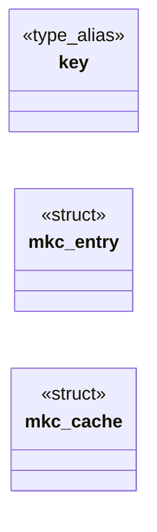

# `src/mask_cache.c`

> Source: [src/mask_cache.c:1](../../src/mask_cache.c#L1) | language `c` | coverage 72.7% | [API index](../index.md)

## Contents

- **Structs:** [`mkc_entry`](#mkc_entry), [`mkc_cache`](#mkc_cache)
- **Type Aliases:** [`key`](#key)
- **Functions:** [`mkc_new`](#mkc_new), [`mkc_clear`](#mkc_clear), [`mkc_free`](#mkc_free), [`mkc_get`](#mkc_get), [`mkc_put`](#mkc_put), [`mkc_bytes`](#mkc_bytes), [`mkc_count`](#mkc_count)

## Type Diagram



## Call Graph

Solid arrows stay in this module, dashed arrows leave it.


## Structs

<a id="mkc_entry"></a>

### `mkc_entry`

`struct` | [src/mask_cache.c:7](../../src/mask_cache.c#L7)

```c
typedef struct mkc_entry
```

One retained mask. tick orders recency (larger = more recent); buf NULL = free slot.

---

<a id="mkc_cache"></a>

### `mkc_cache`

`struct` | [src/mask_cache.c:15](../../src/mask_cache.c#L15)

```c
struct mkc_cache
```

---

## Type Aliases

<a id="key"></a>

### `key`

`type_alias` | [src/mask_cache.c:7](../../src/mask_cache.c#L7)

```c
typedef struct mkc_entry { mkc_key key;
```

One retained mask. tick orders recency (larger = more recent); buf NULL = free slot.

---

## Functions

<a id="mkc_new"></a>

### `mkc_new`

`function` | [src/mask_cache.c:49](../../src/mask_cache.c#L49)

```c
mkc_cache *mkc_new(size_t byte_budget, size_t max_entries)
```

A cache holding at most byte_budget bytes of mask buffers in at most max_entries masks.

NULL when either bound is 0 or on allocation failure.

**Parameters**

| Name | Type | Default | Description |
|---|---|---|---|
| `byte_budget` | `size_t` |  |  |
| `max_entries` | `size_t` |  |  |

**Returns:** `mkc_cache *`

> **Inherited:** Documentation from [`mkc_new`](#mkc_new) (include/mask_cache.h:29).

---

<a id="mkc_clear"></a>

### `mkc_clear`

`function` | [src/mask_cache.c:60](../../src/mask_cache.c#L60)

```c
void mkc_clear(mkc_cache *c)
```

Drops every retained mask (document change).

NULL-safe, idempotent.

**Parameters**

| Name | Type | Default | Description |
|---|---|---|---|
| `c` | `mkc_cache *` |  |  |

> **Inherited:** Documentation from [`mkc_clear`](#mkc_clear) (include/mask_cache.h:35).

*Called by:* [`mkc_free`](#mkc_free)

---

<a id="mkc_free"></a>

### `mkc_free`

`function` | [src/mask_cache.c:65](../../src/mask_cache.c#L65)

```c
void mkc_free(mkc_cache *c)
```

Releases the cache and every buffer.

NULL-safe.

**Parameters**

| Name | Type | Default | Description |
|---|---|---|---|
| `c` | `mkc_cache *` |  |  |

> **Inherited:** Documentation from [`mkc_free`](#mkc_free) (include/mask_cache.h:32).

*Calls:* [`mkc_clear`](#mkc_clear)

---

<a id="mkc_get"></a>

### `mkc_get`

`function` `const` | [src/mask_cache.c:72](../../src/mask_cache.c#L72)

```c
const unsigned char *mkc_get(mkc_cache *c, const mkc_key *k, int *stride)
```

The buffer retained for k (stride bytes per row) and makes it the most recent, or NULL.

Valid until the next mkc_put / mkc_clear / mkc_free.

**Parameters**

| Name | Type | Default | Description |
|---|---|---|---|
| `c` | `mkc_cache *` |  |  |
| `k` | `mkc_key *` |  |  |
| `stride` | `int *` |  |  |

**Returns:** `unsigned char *`

> **Inherited:** Documentation from [`mkc_get`](#mkc_get) (include/mask_cache.h:39).

---

<a id="mkc_put"></a>

### `mkc_put`

`function` | [src/mask_cache.c:81](../../src/mask_cache.c#L81)

```c
unsigned char *mkc_put(mkc_cache *c, const mkc_key *k, int stride)
```

Reserves a zeroed buffer of stride * k->h bytes owned by the cache for k (replacing any entry for k), evicting least-recently-used masks until it fits, and returns it for the caller to fill.

NULL, cache untouched, when an argument is invalid (stride < w, a size <= 0, an overflowing or over-budget size) or the allocation fails.

**Parameters**

| Name | Type | Default | Description |
|---|---|---|---|
| `c` | `mkc_cache *` |  |  |
| `k` | `mkc_key *` |  |  |
| `stride` | `int` |  |  |

**Returns:** `unsigned char *`

> **Inherited:** Documentation from [`mkc_put`](#mkc_put) (include/mask_cache.h:45).

---

<a id="mkc_bytes"></a>

### `mkc_bytes`

`function` | [src/mask_cache.c:111](../../src/mask_cache.c#L111)

```c
size_t mkc_bytes(const mkc_cache *c)
```

Bytes currently retained / number of masks retained (0 for NULL).

**Parameters**

| Name | Type | Default | Description |
|---|---|---|---|
| `c` | `mkc_cache *` |  |  |

**Returns:** `size_t`

> **Inherited:** Documentation from [`mkc_bytes`](#mkc_bytes) (include/mask_cache.h:48).

---

<a id="mkc_count"></a>

### `mkc_count`

`function` | [src/mask_cache.c:113](../../src/mask_cache.c#L113)

```c
size_t mkc_count(const mkc_cache *c)
```

**Parameters**

| Name | Type | Default | Description |
|---|---|---|---|
| `c` | `mkc_cache *` |  |  |

**Returns:** `size_t`

---
