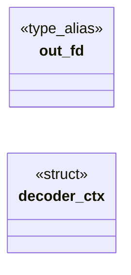
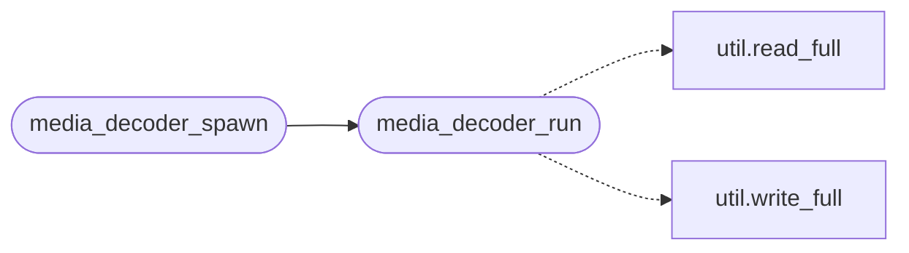

# `src/media_decoder.c`

> Source: [src/media_decoder.c:1](../../src/media_decoder.c#L1) | language `c` | coverage 30.0% | [API index](../index.md)

## Contents

- **Structs:** [`decoder_ctx`](#decoder_ctx)
- **Type Aliases:** [`out_fd`](#out_fd)
- **Functions:** [`open`](#open), [`av_rescale_q`](#av_rescale_q), [`dropped`](#dropped), [`media_decoder_run`](#media_decoder_run), [`media_decoder_spawn`](#media_decoder_spawn), [`fd`](#fd)
- **Macros:** [`_POSIX_C_SOURCE`](#_posix_c_source)

## Type Diagram



## Call Graph

Solid arrows stay in this module, dashed arrows leave it.



## Structs

<a id="decoder_ctx"></a>

### `decoder_ctx`

`struct` | [src/media_decoder.c:54](../../src/media_decoder.c#L54)

```c
typedef struct decoder_ctx
```

---

## Type Aliases

<a id="out_fd"></a>

### `out_fd`

`type_alias` | [src/media_decoder.c:53](../../src/media_decoder.c#L53)

```c
typedef struct decoder_ctx { int out_fd;
```

--- The decoder context (state lives across segments) ---

---

## Functions

<a id="open"></a>

### `open`

`function` | [src/media_decoder.c:18](../../src/media_decoder.c#L18)

```c
* * Sandbox: the decoder needs open() for shared libraries (.so loading) and * brk/mmap for FFm...
```

**Returns:** `* * Sandbox: the decoder needs`

---

<a id="av_rescale_q"></a>

### `av_rescale_q`

`function` | [src/media_decoder.c:217](../../src/media_decoder.c#L217)

```c
return av_rescale_q(f->pts, tb, (AVRational)
```

**Parameters**

| Name | Type | Default | Description |
|---|---|---|---|
| `pts` | `f->` |  |  |
| `AVRational` |  |  |  |

**Returns:** `return`

---

<a id="dropped"></a>

### `dropped`

`function` | [src/media_decoder.c:369](../../src/media_decoder.c#L369)

```c
* the codec in permanent EOF state: every segment after the first decoded * one was silently dropped ("plays a couple of seconds then stops"). * Reorder-buffered frames flush with the next segment's p
```

**Parameters**

| Name | Type | Default | Description |
|---|---|---|---|
| `stops` | `"plays a couple of seconds then "` |  |  |

**Returns:** `* the codec in permanent EOF state: every segment after the first decoded * one was silently`

---

<a id="media_decoder_run"></a>

### `media_decoder_run`

`function` | [src/media_decoder.c:379](../../src/media_decoder.c#L379)

```c
void media_decoder_run(int out_fd, int cmd_fd)
```

Entry point for the decoder child process.

Called from main() when argv matches "--media-decoder <out_fd> <cmd_fd>". Reads commands from cmd_fd, writes responses to out_fd, never returns (_exit).

**Parameters**

| Name | Type | Default | Description |
|---|---|---|---|
| `out_fd` | `int` |  |  |
| `cmd_fd` | `int` |  |  |

> **Inherited:** Documentation from [`media_decoder_run`](#media_decoder_run) (include/media_decoder.h:99).

*Calls:* [`read_full`](include.util.h.md#read_full), [`write_full`](include.util.h.md#write_full)

*Called by:* [`media_decoder_spawn`](#media_decoder_spawn)

---

<a id="media_decoder_spawn"></a>

### `media_decoder_spawn`

`function` | [src/media_decoder.c:449](../../src/media_decoder.c#L449)

```c
int media_decoder_spawn(pid_t *pid, int *out_fd, int *cmd_fd)
```

Spawns a media decoder child via fork+exec.

On success stores child pid in *pid, the read-end of the child's output pipe in *out_fd, and the write-end of the command pipe in *cmd_fd; returns 0. On failure returns -1.

**Parameters**

| Name | Type | Default | Description |
|---|---|---|---|
| `pid` | `pid_t *` |  |  |
| `out_fd` | `int *` |  |  |
| `cmd_fd` | `int *` |  |  |

**Returns:** `int`

> **Inherited:** Documentation from [`media_decoder_spawn`](#media_decoder_spawn) (include/media_decoder.h:104).

*Calls:* [`media_decoder_run`](#media_decoder_run)

---

<a id="fd"></a>

### `fd`

`function` | [src/media_decoder.c:469](../../src/media_decoder.c#L469)

```c
* prevent the Wayland display fd (inherited from the parent) from * surviving the exec. An inherited Wayland fd would be leaked to the * decoder child and, if accidentally written to (e.g. by an FFmpe
```

**Parameters**

| Name | Type | Default | Description |
|---|---|---|---|
| `parent` | `inherited from the` |  |  |

**Returns:** `* prevent the Wayland display`

---

## Macros

<a id="_posix_c_source"></a>

### `_POSIX_C_SOURCE`

`macro` | [src/media_decoder.c:23](../../src/media_decoder.c#L23)

```c
#define _POSIX_C_SOURCE
```

---
