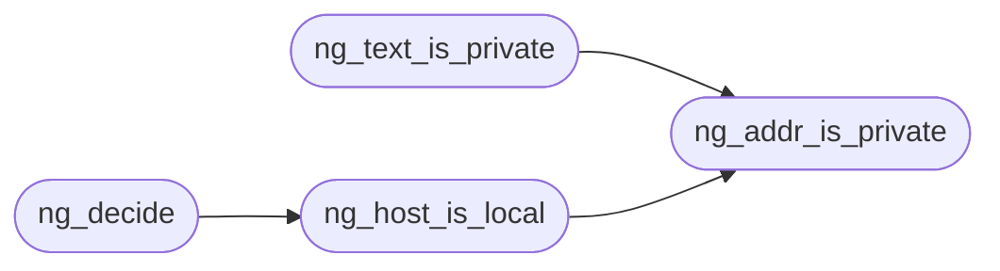

# `src/net_guard.c`

> Source: [src/net_guard.c:1](../../src/net_guard.c#L1) | language `c` | coverage 50.0% | [API index](../index.md)

net_guard -- see include/net_guard.h and spec/net_guard.md.

## Contents

- **Functions:** [`decides`](#decides), [`ng_addr_is_private`](#ng_addr_is_private), [`ng_text_is_private`](#ng_text_is_private), [`ng_host_is_ip`](#ng_host_is_ip), [`ng_host_is_local`](#ng_host_is_local), [`ng_decide`](#ng_decide)
- **Macros:** [`NG_V4_LEN`](#ng_v4_len), [`NG_V6_LEN`](#ng_v6_len), [`NG_TEXT_MAX`](#ng_text_max)

## Call Graph

Solid arrows stay in this module, dashed arrows leave it.



## Functions

<a id="decides"></a>

### `decides`

`function` | [src/net_guard.c:40](../../src/net_guard.c#L40)

```c
* IPv4 decides (:: and ::1 embed 0.0.0.0 and 0.0.0.1, both in 0/8). */ if (head_zero && (s[5] == 0 || s[5] == 0xffff)) return ng_v4_is_private(a + 12);
```

**Parameters**

| Name | Type | Default | Description |
|---|---|---|---|
| `and` | `:: and ::1 embed 0.0.0.0 0.0.0.1` |  |  |
| `in` | `both 0/8` |  |  |

**Returns:** `* IPv4`

---

<a id="ng_addr_is_private"></a>

### `ng_addr_is_private`

`function` | [src/net_guard.c:63](../../src/net_guard.c#L63)

```c
int ng_addr_is_private(int family, const unsigned char *addr, size_t len)
```

1 when the address is not globally routable (loopback, RFC 1918, link-local, CGNAT, documentation, multicast, reserved, IPv6 unique-local, and every IPv4-in-IPv6 embedding of those). family is NG_FAMILY_V4 (len 4) or NG_FAMILY_V6 (len 16), bytes in network order.

Anything else answers 1 (fail closed).

**Parameters**

| Name | Type | Default | Description |
|---|---|---|---|
| `family` | `int` |  |  |
| `addr` | `unsigned char *` |  |  |
| `len` | `size_t` |  |  |

**Returns:** `int`

> **Inherited:** Documentation from [`ng_addr_is_private`](#ng_addr_is_private) (include/net_guard.h:38).

*Called by:* [`ng_host_is_local`](#ng_host_is_local), [`ng_text_is_private`](#ng_text_is_private)

---

<a id="ng_text_is_private"></a>

### `ng_text_is_private`

`function` | [src/net_guard.c:84](../../src/net_guard.c#L84)

```c
int ng_text_is_private(const char *ip_text)
```

As ng_addr_is_private over a textual IPv4/IPv6 address (optionally bracketed).

Text that is not exactly one address answers 1 (fail closed).

**Parameters**

| Name | Type | Default | Description |
|---|---|---|---|
| `ip_text` | `char *` |  |  |

**Returns:** `int`

> **Inherited:** Documentation from [`ng_text_is_private`](#ng_text_is_private) (include/net_guard.h:42).

*Calls:* [`ng_addr_is_private`](#ng_addr_is_private)

---

<a id="ng_host_is_ip"></a>

### `ng_host_is_ip`

`function` | [src/net_guard.c:91](../../src/net_guard.c#L91)

```c
int ng_host_is_ip(const char *host)
```

1 when host is an IPv4/IPv6 literal (optionally bracketed), 0 for a name or NULL.

A registrable-domain comparison is meaningless for literals: compare them whole.

**Parameters**

| Name | Type | Default | Description |
|---|---|---|---|
| `host` | `char *` |  |  |

**Returns:** `int`

> **Inherited:** Documentation from [`ng_host_is_ip`](#ng_host_is_ip) (include/net_guard.h:46).

---

<a id="ng_host_is_local"></a>

### `ng_host_is_local`

`function` | [src/net_guard.c:107](../../src/net_guard.c#L107)

```c
int ng_host_is_local(const char *host)
```

1 when host names this machine or a private address without resolving anything: "localhost", any "*.localhost", or a private IP literal.

NULL/"" answers 0.

**Parameters**

| Name | Type | Default | Description |
|---|---|---|---|
| `host` | `char *` |  |  |

**Returns:** `int`

> **Inherited:** Documentation from [`ng_host_is_local`](#ng_host_is_local) (include/net_guard.h:50).

*Calls:* [`ng_addr_is_private`](#ng_addr_is_private)

*Called by:* [`ng_decide`](#ng_decide)

---

<a id="ng_decide"></a>

### `ng_decide`

`function` | [src/net_guard.c:121](../../src/net_guard.c#L121)

```c
ng_verdict ng_decide(const ng_request *r, int peer_private)
```

**Parameters**

| Name | Type | Default | Description |
|---|---|---|---|
| `r` | `ng_request *` |  |  |
| `peer_private` | `int` |  |  |

**Returns:** `ng_verdict`

*Calls:* [`ng_host_is_local`](#ng_host_is_local)

---

## Macros

<a id="ng_v4_len"></a>

### `NG_V4_LEN`

`macro` | [src/net_guard.c:8](../../src/net_guard.c#L8)

```c
#define NG_V4_LEN
```

---

<a id="ng_v6_len"></a>

### `NG_V6_LEN`

`macro` | [src/net_guard.c:9](../../src/net_guard.c#L9)

```c
#define NG_V6_LEN
```

---

<a id="ng_text_max"></a>

### `NG_TEXT_MAX`

`macro` | [src/net_guard.c:10](../../src/net_guard.c#L10)

```c
#define NG_TEXT_MAX
```

---
