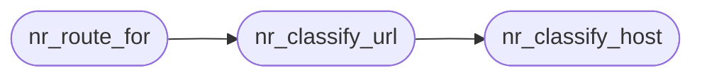

# `src/net_realm.c`

> Source: [src/net_realm.c:1](../../src/net_realm.c#L1) | language `c` | coverage 25.0% | [API index](../index.md)

## Contents

- **Functions:** [`nr_classify_host`](#nr_classify_host), [`nr_classify_url`](#nr_classify_url), [`nr_route_for`](#nr_route_for), [`nr_realm_allows_http`](#nr_realm_allows_http), [`nr_realm_name`](#nr_realm_name), [`nr_route_name`](#nr_route_name)
- **Macros:** [`NR_MAX_HOST`](#nr_max_host)

## Call Graph

Solid arrows stay in this module, dashed arrows leave it.



## Functions

<a id="nr_classify_host"></a>

### `nr_classify_host`

`function` | [src/net_realm.c:34](../../src/net_realm.c#L34)

```c
nr_realm nr_classify_host(const char *host)
```

**Parameters**

| Name | Type | Default | Description |
|---|---|---|---|
| `host` | `char *` |  |  |

**Returns:** `nr_realm`

*Called by:* [`nr_classify_url`](#nr_classify_url)

---

<a id="nr_classify_url"></a>

### `nr_classify_url`

`function` | [src/net_realm.c:68](../../src/net_realm.c#L68)

```c
nr_realm nr_classify_url(const char *url)
```

**Parameters**

| Name | Type | Default | Description |
|---|---|---|---|
| `url` | `char *` |  |  |

**Returns:** `nr_realm`

*Calls:* [`nr_classify_host`](#nr_classify_host)

*Called by:* [`proceed`](gui.browser_ui.c.md#proceed), [`HL_JS_NAV_MAX`](src.freedom.c.md#hl_js_nav_max), [`nr_route_for`](#nr_route_for)

---

<a id="nr_route_for"></a>

### `nr_route_for`

`function` | [src/net_realm.c:74](../../src/net_realm.c#L74)

```c
nr_route nr_route_for(const char *url, nr_config cfg)
```

**Parameters**

| Name | Type | Default | Description |
|---|---|---|---|
| `url` | `char *` |  |  |
| `cfg` | `nr_config` |  |  |

**Returns:** `nr_route`

*Calls:* [`nr_classify_url`](#nr_classify_url)

*Called by:* [`HL_JS_NAV_MAX`](src.freedom.c.md#hl_js_nav_max), [`gets`](src.freedom.c.md#gets)

---

<a id="nr_realm_allows_http"></a>

### `nr_realm_allows_http`

`function` | [src/net_realm.c:88](../../src/net_realm.c#L88)

```c
int nr_realm_allows_http(nr_realm r)
```

1 iff plain http:// is acceptable for this realm.

An overlay realm authenticates and encrypts by its address (the I2P destination / onion key), so http over it is not a downgrade. Currently: NR_I2P => 1 (eepsites are http); NR_ONION => 0 (owner keeps .onion https-only); NR_CLEARNET => 0 (clearnet is always https). The caller must still route the request through the overlay proxy.

**Parameters**

| Name | Type | Default | Description |
|---|---|---|---|
| `r` | `nr_realm` |  |  |

**Returns:** `int`

> **Inherited:** Documentation from [`nr_realm_allows_http`](#nr_realm_allows_http) (include/net_realm.h:66).

---

<a id="nr_realm_name"></a>

### `nr_realm_name`

`function` `const` | [src/net_realm.c:94](../../src/net_realm.c#L94)

```c
const char *nr_realm_name(nr_realm r)
```

Stable short English names for structured/agent output and toasts.

Never NULL.

**Parameters**

| Name | Type | Default | Description |
|---|---|---|---|
| `r` | `nr_realm` |  |  |

**Returns:** `char *`

> **Inherited:** Documentation from [`nr_realm_name`](#nr_realm_name) (include/net_realm.h:69).

---

<a id="nr_route_name"></a>

### `nr_route_name`

`function` `const` | [src/net_realm.c:103](../../src/net_realm.c#L103)

```c
const char *nr_route_name(nr_route r)
```

**Parameters**

| Name | Type | Default | Description |
|---|---|---|---|
| `r` | `nr_route` |  |  |

**Returns:** `char *`

---

## Macros

<a id="nr_max_host"></a>

### `NR_MAX_HOST`

`macro` | [src/net_realm.c:15](../../src/net_realm.c#L15)

```c
#define NR_MAX_HOST
```

---
