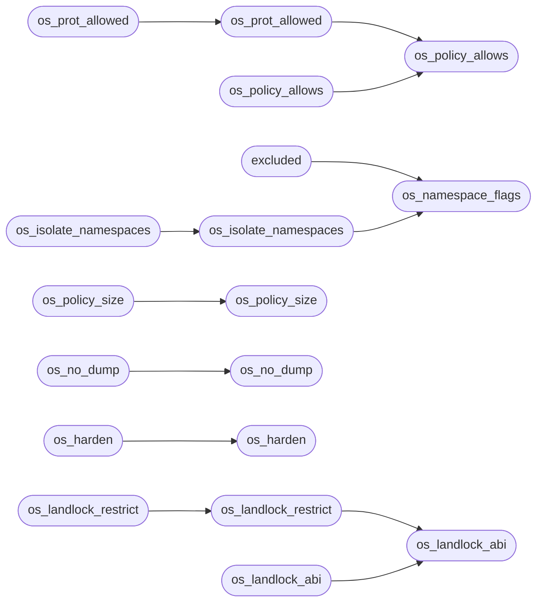

# `src/os_sandbox.c`

> Source: [src/os_sandbox.c:1](../../src/os_sandbox.c#L1) | language `c` | coverage 33.3% | [API index](../index.md)

## Contents

- **Functions:** [`os_policy_allows`](#os_policy_allows), [`os_policy_size`](#os_policy_size), [`os_prot_allowed`](#os_prot_allowed), [`os_no_dump`](#os_no_dump), [`excluded`](#excluded), [`os_isolate_namespaces`](#os_isolate_namespaces), [`os_policy_allows`](#os_policy_allows), [`os_policy_size`](#os_policy_size), [`os_prot_allowed`](#os_prot_allowed), [`os_no_dump`](#os_no_dump), [`os_harden`](#os_harden), [`os_namespace_flags`](#os_namespace_flags), [`os_isolate_namespaces`](#os_isolate_namespaces), [`os_harden`](#os_harden), [`number`](#number), [`headroom`](#headroom), [`os_landlock_abi`](#os_landlock_abi), [`os_landlock_restrict`](#os_landlock_restrict), [`fields`](#fields), [`os_landlock_abi`](#os_landlock_abi), [`os_landlock_restrict`](#os_landlock_restrict)
- **Macros:** [`_GNU_SOURCE`](#_gnu_source), [`OS_ALLOWED_N`](#os_allowed_n), [`OS_SECCOMP_ARCH`](#os_seccomp_arch), [`OS_SECCOMP_ARCH`](#os_seccomp_arch), [`LL_FS_BASE`](#ll_fs_base)

## Call Graph

Solid arrows stay in this module, dashed arrows leave it.



## Functions

<a id="os_policy_allows"></a>

### `os_policy_allows`

`function` | [src/os_sandbox.c:52](../../src/os_sandbox.c#L52)

```c
int os_policy_allows(long syscall_nr)
```

**Parameters**

| Name | Type | Default | Description |
|---|---|---|---|
| `syscall_nr` | `long` |  |  |

**Returns:** `int`

*Called by:* [`os_policy_allows`](#os_policy_allows), [`os_prot_allowed`](#os_prot_allowed)

---

<a id="os_policy_size"></a>

### `os_policy_size`

`function` | [src/os_sandbox.c:59](../../src/os_sandbox.c#L59)

```c
size_t os_policy_size(void)
```

Number of syscalls on the allowlist.

**Returns:** `size_t`

> **Inherited:** Documentation from [`os_policy_size`](#os_policy_size) (include/os_sandbox.h:43).

*Called by:* [`os_policy_size`](#os_policy_size)

---

<a id="os_prot_allowed"></a>

### `os_prot_allowed`

`function` | [src/os_sandbox.c:65](../../src/os_sandbox.c#L65)

```c
int os_prot_allowed(long syscall_nr, unsigned long prot)
```

W^X mirror: mmap/mprotect keep their membership but lose any request that asks for executable memory.

The single source of truth the BPF prot-check replicates.

**Parameters**

| Name | Type | Default | Description |
|---|---|---|---|
| `syscall_nr` | `long` |  |  |
| `prot` | `unsigned long` |  |  |

**Returns:** `int`

*Calls:* [`os_policy_allows`](#os_policy_allows)

*Called by:* [`os_prot_allowed`](#os_prot_allowed)

---

<a id="os_no_dump"></a>

### `os_no_dump`

`function` | [src/os_sandbox.c:75](../../src/os_sandbox.c#L75)

```c
os_status os_no_dump(void)
```

Anti-dump defense in depth: undumpable + no core file, so neither a crash nor a foreign ptrace can exfiltrate worker secrets.

Best-effort; call before os_harden (prctl is not on the seccomp allowlist).

**Returns:** `os_status`

*Called by:* [`os_no_dump`](#os_no_dump)

---

<a id="excluded"></a>

### `excluded`

`function` | [src/os_sandbox.c:89](../../src/os_sandbox.c#L89)

```c
* intentionally excluded (they need /proc remounting and a post-unshare fork). */ int os_namespac...
```

**Parameters**

| Name | Type | Default | Description |
|---|---|---|---|
| `fork` | `they need /proc remounting and a post-unshare` |  |  |

**Returns:** `* intentionally`

*Calls:* [`os_namespace_flags`](#os_namespace_flags)

---

<a id="os_isolate_namespaces"></a>

### `os_isolate_namespaces`

`function` | [src/os_sandbox.c:94](../../src/os_sandbox.c#L94)

```c
os_status os_isolate_namespaces(void)
```

**Returns:** `os_status`

*Calls:* [`os_namespace_flags`](#os_namespace_flags)

*Called by:* [`os_isolate_namespaces`](#os_isolate_namespaces)

---

<a id="os_policy_allows"></a>

### `os_policy_allows`

`function` | [src/os_sandbox.c:106](../../src/os_sandbox.c#L106)

```c
int os_policy_allows(long syscall_nr)
```

**Parameters**

| Name | Type | Default | Description |
|---|---|---|---|
| `syscall_nr` | `long` |  |  |

**Returns:** `int`

*Calls:* [`os_policy_allows`](#os_policy_allows)

---

<a id="os_policy_size"></a>

### `os_policy_size`

`function` | [src/os_sandbox.c:107](../../src/os_sandbox.c#L107)

```c
size_t os_policy_size(void)
```

Number of syscalls on the allowlist.

**Returns:** `size_t`

> **Inherited:** Documentation from [`os_policy_size`](#os_policy_size) (include/os_sandbox.h:43).

*Calls:* [`os_policy_size`](#os_policy_size)

---

<a id="os_prot_allowed"></a>

### `os_prot_allowed`

`function` | [src/os_sandbox.c:108](../../src/os_sandbox.c#L108)

```c
int os_prot_allowed(long syscall_nr, unsigned long prot)
```

Pure mirror of the BPF program's EFFECTIVE decision for memory syscalls (W^X).

Nonzero iff a call to syscall_nr with the given memory-protection flags would be permitted. For non-memory syscalls this is just os_policy_allows(syscall_nr); for mmap/mprotect it is additionally false when prot requests PROT_EXEC, because the worker is an interpreter over already-mapped code and never needs to create or flip executable pages. Denying PROT_EXEC removes the last step of native code injection even after a control-flow hijack. No side effects.

**Parameters**

| Name | Type | Default | Description |
|---|---|---|---|
| `syscall_nr` | `long` |  |  |
| `prot` | `unsigned long` |  |  |

**Returns:** `int`

> **Inherited:** Documentation from [`os_prot_allowed`](#os_prot_allowed) (include/os_sandbox.h:52).

*Calls:* [`os_prot_allowed`](#os_prot_allowed)

---

<a id="os_no_dump"></a>

### `os_no_dump`

`function` | [src/os_sandbox.c:111](../../src/os_sandbox.c#L111)

```c
os_status os_no_dump(void)
```

**Returns:** `os_status`

*Calls:* [`os_no_dump`](#os_no_dump)

---

<a id="os_harden"></a>

### `os_harden`

`function` | [src/os_sandbox.c:113](../../src/os_sandbox.c#L113)

```c
os_status os_harden(os_violation action)
```

**Parameters**

| Name | Type | Default | Description |
|---|---|---|---|
| `action` | `os_violation` |  |  |

**Returns:** `os_status`

*Called by:* [`os_harden`](#os_harden)

---

<a id="os_namespace_flags"></a>

### `os_namespace_flags`

`function` | [src/os_sandbox.c:115](../../src/os_sandbox.c#L115)

```c
int os_namespace_flags(void)
```

The set of CLONE_* namespace flags the worker isolates into: a new user namespace (the unprivileged enabler), network (the worker never needs the network -- the parent fetches and passes bytes -- so it gets an empty stack), IPC and UTS namespaces.

Pure: returns the same constant the enforcer requests, the directly testable mirror of what os_isolate_namespaces applies. 0 on platforms without these namespaces. Mount and PID namespaces are out of scope (they need extra plumbing); see spec/os_sandbox.md.

**Returns:** `int`

> **Inherited:** Documentation from [`os_namespace_flags`](#os_namespace_flags) (include/os_sandbox.h:81).

*Called by:* [`excluded`](#excluded), [`os_isolate_namespaces`](#os_isolate_namespaces)

---

<a id="os_isolate_namespaces"></a>

### `os_isolate_namespaces`

`function` | [src/os_sandbox.c:116](../../src/os_sandbox.c#L116)

```c
os_status os_isolate_namespaces(void)
```

**Returns:** `os_status`

*Calls:* [`os_isolate_namespaces`](#os_isolate_namespaces)

---

<a id="os_harden"></a>

### `os_harden`

`function` | [src/os_sandbox.c:145](../../src/os_sandbox.c#L145)

```c
os_status os_harden(os_violation action)
```

**Parameters**

| Name | Type | Default | Description |
|---|---|---|---|
| `action` | `os_violation` |  |  |

**Returns:** `os_status`

*Calls:* [`os_harden`](#os_harden)

---

<a id="number"></a>

### `number`

`function` | [src/os_sandbox.c:157](../../src/os_sandbox.c#L157)

```c
* number (x32/i386 on x86_64, AArch32 on aarch64). */ prog[n++] = (struct sock_filter)BPF_STMT(BPF_LD | BPF_W | BPF_ABS, offsetof(struct seccomp_data, arch));
```

**Parameters**

| Name | Type | Default | Description |
|---|---|---|---|
| `x86_64` | `x32/i386 on` |  |  |
| `aarch64` | `AArch32 on` |  |  |

**Returns:** `*`

---

<a id="headroom"></a>

### `headroom`

`function` | [src/os_sandbox.c:203](../../src/os_sandbox.c#L203)

```c
* wide headroom (room for ~125 allowed syscalls). */ prog[at_mmap].jt = (unsigned char)(prot_check - (at_mmap + 1));
```

**Parameters**

| Name | Type | Default | Description |
|---|---|---|---|
| `syscalls` | `room for ~125 allowed` |  |  |

**Returns:** `* wide`

---

<a id="os_landlock_abi"></a>

### `os_landlock_abi`

`function` | [src/os_sandbox.c:285](../../src/os_sandbox.c#L285)

```c
int os_landlock_abi(void)
```

Kernel Landlock ABI version (>=1), 0 if unsupported, <0 on query error.

**Returns:** `int`

> **Inherited:** Documentation from [`os_landlock_abi`](#os_landlock_abi) (include/os_sandbox.h:114).

*Called by:* [`os_landlock_abi`](#os_landlock_abi), [`os_landlock_restrict`](#os_landlock_restrict)

---

<a id="os_landlock_restrict"></a>

### `os_landlock_restrict`

`function` | [src/os_sandbox.c:291](../../src/os_sandbox.c#L291)

```c
os_status os_landlock_restrict(const os_fs_rule *rules, size_t n)
```

**Parameters**

| Name | Type | Default | Description |
|---|---|---|---|
| `rules` | `os_fs_rule *` |  |  |
| `n` | `size_t` |  |  |

**Returns:** `os_status`

*Calls:* [`os_landlock_abi`](#os_landlock_abi)

*Called by:* [`os_landlock_restrict`](#os_landlock_restrict)

---

<a id="fields"></a>

### `fields`

`function` | [src/os_sandbox.c:303](../../src/os_sandbox.c#L303)

```c
* long as the unknown trailing fields (net/scoped) are zero, which they are. */ int rfd = (int)ll_create_ruleset(&attr, sizeof attr, 0);
```

**Parameters**

| Name | Type | Default | Description |
|---|---|---|---|
| `scoped` | `net/` |  |  |

**Returns:** `* long as the unknown trailing`

---

<a id="os_landlock_abi"></a>

### `os_landlock_abi`

`function` | [src/os_sandbox.c:331](../../src/os_sandbox.c#L331)

```c
int os_landlock_abi(void)
```

Kernel Landlock ABI version (>=1), 0 if unsupported, <0 on query error.

**Returns:** `int`

> **Inherited:** Documentation from [`os_landlock_abi`](#os_landlock_abi) (include/os_sandbox.h:114).

*Calls:* [`os_landlock_abi`](#os_landlock_abi)

---

<a id="os_landlock_restrict"></a>

### `os_landlock_restrict`

`function` | [src/os_sandbox.c:332](../../src/os_sandbox.c#L332)

```c
os_status os_landlock_restrict(const os_fs_rule *rules, size_t n)
```

**Parameters**

| Name | Type | Default | Description |
|---|---|---|---|
| `rules` | `os_fs_rule *` |  |  |
| `n` | `size_t` |  |  |

**Returns:** `os_status`

*Calls:* [`os_landlock_restrict`](#os_landlock_restrict)

---

## Macros

<a id="_gnu_source"></a>

### `_GNU_SOURCE`

`macro` | [src/os_sandbox.c:13](../../src/os_sandbox.c#L13)

```c
#define _GNU_SOURCE
```

---

<a id="os_allowed_n"></a>

### `OS_ALLOWED_N`

`macro` | [src/os_sandbox.c:50](../../src/os_sandbox.c#L50)

```c
#define OS_ALLOWED_N
```

---

<a id="os_seccomp_arch"></a>

### `OS_SECCOMP_ARCH`

`macro` | [src/os_sandbox.c:140](../../src/os_sandbox.c#L140)

```c
# define OS_SECCOMP_ARCH
```

---

<a id="os_seccomp_arch"></a>

### `OS_SECCOMP_ARCH`

`macro` | [src/os_sandbox.c:142](../../src/os_sandbox.c#L142)

```c
# define OS_SECCOMP_ARCH
```

---

<a id="ll_fs_base"></a>

### `LL_FS_BASE`

`macro` | [src/os_sandbox.c:254](../../src/os_sandbox.c#L254)

```c
#define LL_FS_BASE
```

Filesystem rights present since Landlock ABI v1.

---
