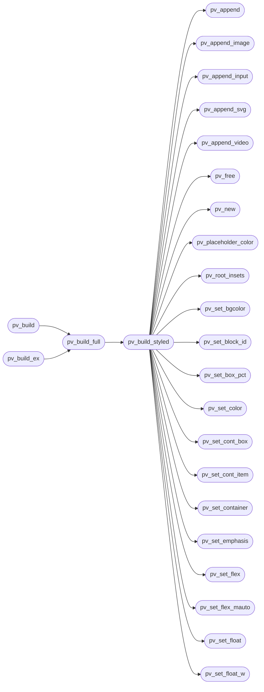

# `src/page_view.c`

> Source: [src/page_view.c:1](../../src/page_view.c#L1) | language `c` | coverage 43.8% | [API index](../index.md)

## Contents

- **Structs:** [`pv_ptrmap`](#pv_ptrmap), [`pv_node_map`](#pv_node_map), [`pv_cont_info`](#pv_cont_info), [`pv_item_track`](#pv_item_track), [`pv_box_info`](#pv_box_info), [`pv_container_reg`](#pv_container_reg), [`pv_after_pending`](#pv_after_pending), [`pv_box_reg`](#pv_box_reg), [`pv_var_node`](#pv_var_node), [`pv_def_h`](#pv_def_h), [`pv_style_cache`](#pv_style_cache), [`pv_flow_reg`](#pv_flow_reg), [`sz_fill`](#sz_fill), [`pv_root_els`](#pv_root_els), [`form_rec`](#form_rec), [`form_table`](#form_table), [`pv_flow_reg`](#pv_flow_reg), [`pv_computed`](#pv_computed)
- **Type Aliases:** [`cols`](#cols), [`mb`](#mb), [`chain`](#chain)
- **Functions:** [`positions`](#positions), [`pv_new`](#pv_new), [`pv_append`](#pv_append), [`pv_append_image`](#pv_append_image), [`pv_append_input`](#pv_append_input), [`pv_append_video`](#pv_append_video), [`pv_append_svg`](#pv_append_svg), [`pv_set_emphasis`](#pv_set_emphasis), [`pv_set_indent`](#pv_set_indent), [`pv_set_color`](#pv_set_color), [`pv_set_bgcolor`](#pv_set_bgcolor), [`pv_set_text_style`](#pv_set_text_style), [`pv_set_grad_text`](#pv_set_grad_text), [`pv_set_text_ext`](#pv_set_text_ext), [`ignored`](#ignored), [`pv_set_container`](#pv_set_container), [`pv_set_row_span`](#pv_set_row_span), [`pv_set_grid_area`](#pv_set_grid_area), [`pv_set_grid`](#pv_set_grid), [`pv_set_grid_rows`](#pv_set_grid_rows), [`pv_set_cont_box`](#pv_set_cont_box), [`pv_set_flex`](#pv_set_flex), [`pv_set_flex_mauto`](#pv_set_flex_mauto), [`pv_set_cont_item`](#pv_set_cont_item), [`pv_set_float_w`](#pv_set_float_w), [`pv_set_float`](#pv_set_float), [`pv_set_box`](#pv_set_box), [`pv_set_box_pct`](#pv_set_box_pct), [`pv_set_box_maxw`](#pv_set_box_maxw), [`pv_set_ua_tag`](#pv_set_ua_tag), [`pv_set_node_id`](#pv_set_node_id), [`pv_set_block_id`](#pv_set_block_id), [`pv_set_own_box`](#pv_set_own_box), [`pv_set_oof`](#pv_set_oof), [`pv_set_justify_self`](#pv_set_justify_self), [`pv_set_block_node`](#pv_set_block_node), [`pv_set_br_line`](#pv_set_br_line), [`pv_set_input_checked`](#pv_set_input_checked), [`pv_set_input_placeholder`](#pv_set_input_placeholder), [`pv_svg_append_root_attrs`](#pv_svg_append_root_attrs), [`pv_placeholder_color`](#pv_placeholder_color), [`pv_set_input_select_opts`](#pv_set_input_select_opts), [`pv_add_cont_def`](#pv_add_cont_def), [`pv_cont_count`](#pv_cont_count), [`pv_cont_at`](#pv_cont_at), [`pv_add_box_def`](#pv_add_box_def), [`pv_free`](#pv_free), [`pv_count`](#pv_count), [`pv_at`](#pv_at), [`pv_box_count`](#pv_box_count), [`pv_box_at`](#pv_box_at), [`resolves`](#resolves), [`paints`](#paints), [`content`](#content), [`address`](#address), [`child`](#child), [`it`](#it), [`pv_content_hidden`](#pv_content_hidden), [`pv_text_ext_reset`](#pv_text_ext_reset), [`trying`](#trying), [`here`](#here), [`glyphs`](#glyphs), [`none`](#none), [`size`](#size), [`builder`](#builder), [`outermost`](#outermost), [`opens`](#opens), [`css_inline_boxdeco`](#css_inline_boxdeco), [`margins`](#margins), [`container`](#container), [`walk`](#walk), [`float`](#float), [`present`](#present), [`dimensions`](#dimensions), [`attributes`](#attributes), [`string`](#string), [`links`](#links), [`table`](#table), [`pv_build`](#pv_build), [`pv_build_ex`](#pv_build_ex), [`pv_build_full`](#pv_build_full), [`pv_root_insets`](#pv_root_insets), [`pv_build_styled`](#pv_build_styled), [`inside`](#inside), [`control`](#control), [`px`](#px), [`band`](#band), [`height`](#height), [`block_id`](#block_id), [`URL`](#url), [`block`](#block), [`flow`](#flow), [`engine`](#engine), [`line`](#line), [`pv_css_drops`](#pv_css_drops), [`pv_computed_new`](#pv_computed_new), [`pv_computed_get`](#pv_computed_get), [`pv_computed_free`](#pv_computed_free)
- **Macros:** [`_POSIX_C_SOURCE`](#_posix_c_source), [`PV_MAX_DIM`](#pv_max_dim), [`PV_FONT_REL_MIN`](#pv_font_rel_min), [`PV_FONT_REL_MAX`](#pv_font_rel_max), [`PV_FONT_CHAIN_MAX`](#pv_font_chain_max), [`PV_FONT_PCT_MIN`](#pv_font_pct_min), [`PV_FONT_PCT_MAX`](#pv_font_pct_max), [`PV_NODE_MAP_INIT_CAP`](#pv_node_map_init_cap), [`PV_COLOR_TOKEN_MAX`](#pv_color_token_max), [`PV_MAX_CONTAINERS`](#pv_max_containers), [`PV_MAX_GRID_COLS`](#pv_max_grid_cols), [`PV_MAX_BOXES`](#pv_max_boxes), [`PV_STYLE_RETIRE_MAX`](#pv_style_retire_max), [`PV_MAX_INLINE_ROW_ITEMS`](#pv_max_inline_row_items), [`PV_TEXTLESS_DEPTH_MAX`](#pv_textless_depth_max), [`PV_MAX_STYLE_BYTES`](#pv_max_style_bytes)

## Type Diagram

```mermaid
classDiagram
    direction LR
    class pv_ptrmap
    <<struct>> pv_ptrmap
    class pv_node_map
    <<struct>> pv_node_map
    class cols
    <<type_alias>> cols
    class pv_cont_info
    <<struct>> pv_cont_info
    pv_cont_info : id()
    class pv_item_track
    <<struct>> pv_item_track
    class mb
    <<type_alias>> mb
    class pv_box_info
    <<struct>> pv_box_info
    class pv_container_reg
    <<struct>> pv_container_reg
    class pv_after_pending
    <<struct>> pv_after_pending
    class pv_box_reg
    <<struct>> pv_box_reg
    class chain
    <<type_alias>> chain
    class pv_var_node
    <<struct>> pv_var_node
    class pv_def_h
    <<struct>> pv_def_h
    class pv_style_cache
    <<struct>> pv_style_cache
    class pv_flow_reg
    <<struct>> pv_flow_reg
    class sz_fill
    <<struct>> sz_fill
    class pv_root_els
    <<struct>> pv_root_els
    class form_rec
    <<struct>> form_rec
    class form_table
    <<struct>> form_table
    class pv_flow_reg
    <<struct>> pv_flow_reg
    class pv_computed
    <<struct>> pv_computed
```



## Call Graph

Solid arrows stay in this module, dashed arrows leave it.



## Structs

<a id="pv_ptrmap"></a>

### `pv_ptrmap`

`struct` | [src/page_view.c:295](../../src/page_view.c#L295)

```c
typedef struct pv_ptrmap
```

A small open-addressed map pointer -> int: the per-element verdict on a generated box (-2 display:none, -1 no box, >= 0 its box id), so the pseudo's cascade runs ONCE per element even though every text node of it asks.

Grows by doubling at half load; OOM leaves it as is (the answer is recomputed).

---

<a id="pv_node_map"></a>

### `pv_node_map`

`struct` | [src/page_view.c:349](../../src/page_view.c#L349)

```c
typedef struct pv_node_map
```

---

<a id="pv_cont_info"></a>

### `pv_cont_info`

`struct` | [src/page_view.c:1268](../../src/page_view.c#L1268)

```c
typedef struct pv_cont_info
```

Nearest-container info attached to a run, plus the flex per-item values (Stage 3): grow/shrink/basis/order come from the ITEM element (the container's direct child on the run's ancestor chain); direction from the container itself.

Unset sentinels: grow/shrink -1, basis/order CSS_LEN_UNSET, direction 0. [`item`](src.css.c.md#item) is that same direct child (NULL = anonymous item: text directly inside the container); pv_build maps it to the run's cont_item ordinal so inline fragments of one child share one item.

**Members**

| Member | Kind | Summary |
|---|---|---|
| [`id`](#pv_cont_info-id) | method |  |

<a id="pv_cont_info-id"></a>

#### `pv_cont_info.id`

`method` | [src/page_view.c:1290](../../src/page_view.c#L1290)

```c
* group id (-1 = the nearest IS the outermost: single-level float, the * painter's old path);
```

**Parameters**

| Name | Type | Default | Description |
|---|---|---|---|
| `-1` |  | `the nearest IS the outermost: single-level float` |  |
| `path` | `the * painter's old` |  |  |

**Returns:** `* group`

---

<a id="pv_item_track"></a>

### `pv_item_track`

`struct` | [src/page_view.c:1351](../../src/page_view.c#L1351)

```c
typedef struct pv_item_track
```

Per-container item-ordinal tracker: ord[cid] is the ordinal last handed out for container cid, node[cid] the direct-child element it belongs to.

A run whose item differs from the tracked one (or is NULL = anonymous) opens the next ordinal, so consecutive runs of one child share it and nested-container interruptions do not break the outer container's item continuity.

---

<a id="pv_box_info"></a>

### `pv_box_info`

`struct` | [src/page_view.c:1370](../../src/page_view.c#L1370)

```c
typedef struct pv_box_info
```

Author box model resolved for a run: horizontal placement (l/r insets, w cap, centered) from the nearest block ancestor that declares a box, plus the leaf block's own vertical-margin override (mt/mb, or PV_LEN_UNSET).

---

<a id="pv_container_reg"></a>

### `pv_container_reg`

`struct` | [src/page_view.c:1713](../../src/page_view.c#L1713)

```c
typedef struct pv_container_reg
```

Document-order registry of flex/grid container nodes, so the runs of one container share a stable id.

---

<a id="pv_after_pending"></a>

### `pv_after_pending`

`struct` | [src/page_view.c:1866](../../src/page_view.c#L1866)

```c
typedef struct pv_after_pending
```

The ::after of an element that has children is emitted when the walk LEAVES the element, so everything it must ride is captured when it is armed: the element's own container, item and block annotation, and the text style of its last text.

A generated run that carries none of it (the case when the pseudo has no box of its own) is a stray run outside the flex/grid item, which ends the item's band and starts the next item on a fresh one.

---

<a id="pv_box_reg"></a>

### `pv_box_reg`

`struct` | [src/page_view.c:1907](../../src/page_view.c#L1907)

```c
typedef struct pv_box_reg
```

Box engine (Hito 23b-8 Step D): document-order registry of box-carrying block nodes plus each box's resolved definition (decoration + parent link).

A box's block_id is its index here, so the painter can reconstruct the box tree.

---

<a id="pv_var_node"></a>

### `pv_var_node`

`struct` | [src/page_view.c:2295](../../src/page_view.c#L2295)

```c
typedef struct pv_var_node
```

One element's custom-property node: its own winning `--name` table and the chain it inherited.

Allocated only for elements that declare something; every other element shares its parent's chain pointer.

---

<a id="pv_def_h"></a>

### `pv_def_h`

`struct` | [src/page_view.c:2304](../../src/page_view.c#L2304)

```c
typedef struct
```

The two heights a descendant resolves a percentage [`height`](#height) against: its parent's definite CONTENT height (CSS 2.1 10.5), and the PADDING-box height of the nearest positioned ancestor, which is the containing block of an absolutely positioned box (10.1). -1 = indefinite.

---

<a id="pv_style_cache"></a>

### `pv_style_cache`

`struct` | [src/page_view.c:2311](../../src/page_view.c#L2311)

```c
typedef struct pv_style_cache
```

---

<a id="pv_flow_reg"></a>

### `pv_flow_reg`

`struct` | [src/page_view.c:3341](../../src/page_view.c#L3341)

```c
struct pv_flow_reg;
```

Nonzero when cell (a td/th) is a WALKED cell of a FLOW table (defined after the flow-table machinery below): such a cell's content shares its ROW's line, so the cell must not carry its own box (the painter flushes the line at every box transition -- a per-cell box would split the row).

---

<a id="sz_fill"></a>

### `sz_fill`

`struct` | [src/page_view.c:4147](../../src/page_view.c#L4147)

```c
typedef struct sz_fill
```

---

<a id="pv_root_els"></a>

### `pv_root_els`

`struct` | [src/page_view.c:4403](../../src/page_view.c#L4403)

```c
typedef struct pv_root_els
```

The document's <html> and <body> elements (either may be NULL): the roots a custom-property rule must match to feed the page-global var() table.

---

<a id="form_rec"></a>

### `form_rec`

`struct` | [src/page_view.c:4469](../../src/page_view.c#L4469)

```c
typedef struct form_rec
```

One <form> seen in document order: its grouping id is its index. action is an owned NUL-terminated copy of the raw action attribute (or NULL); method is GET unless method="post".

---

<a id="form_table"></a>

### `form_table`

`struct` | [src/page_view.c:4475](../../src/page_view.c#L4475)

```c
typedef struct form_table
```

---

<a id="pv_flow_reg"></a>

### `pv_flow_reg`

`struct` | [src/page_view.c:4831](../../src/page_view.c#L4831)

```c
typedef struct pv_flow_reg
```

Cache of the per-table flow decision (a table subtree is scanned at most once, anti-DoS) PLUS the style context the table machinery needs to answer "what role does this element play".

Registry full => grid (the previous behaviour), bounded fail-closed.

sheet/cache ride here rather than as two more parameters on nine helpers: the
table role of an element is its computed `display` (CSS 2.1 17.2), so resolving it
needs the cascade, and the memo cache is what keeps that from being quadratic.

---

<a id="pv_computed"></a>

### `pv_computed`

`struct` | [src/page_view.c:7035](../../src/page_view.c#L7035)

```c
struct pv_computed
```

---

## Type Aliases

<a id="cols"></a>

### `cols`

`type_alias` | [src/page_view.c:1268](../../src/page_view.c#L1268)

```c
typedef struct pv_cont_info { int id, display, gap, justify, cols;
```

Nearest-container info attached to a run, plus the flex per-item values (Stage 3): grow/shrink/basis/order come from the ITEM element (the container's direct child on the run's ancestor chain); direction from the container itself.

Unset sentinels: grow/shrink -1, basis/order CSS_LEN_UNSET, direction 0. [`item`](src.css.c.md#item) is that same direct child (NULL = anonymous item: text directly inside the container); pv_build maps it to the run's cont_item ordinal so inline fragments of one child share one item.

---

<a id="mb"></a>

### `mb`

`type_alias` | [src/page_view.c:1370](../../src/page_view.c#L1370)

```c
typedef struct pv_box_info { int l, r, w, center, mt, mb;
```

Author box model resolved for a run: horizontal placement (l/r insets, w cap, centered) from the nearest block ancestor that declares a box, plus the leaf block's own vertical-margin override (mt/mb, or PV_LEN_UNSET).

---

<a id="chain"></a>

### `chain`

`type_alias` | [src/page_view.c:2295](../../src/page_view.c#L2295)

```c
typedef struct pv_var_node { cvr_chain chain;
```

One element's custom-property node: its own winning `--name` table and the chain it inherited.

Allocated only for elements that declare something; every other element shares its parent's chain pointer.

---

## Functions

<a id="positions"></a>

### `positions`

`function` | [src/page_view.c:140](../../src/page_view.c#L140)

```c
* positions (cp == 0) keep the legacy '?' fallback. */ unsigned int cp = cp1252_to_ucs(c);
```

**Returns:** `*`

---

<a id="pv_new"></a>

### `pv_new`

`function` | [src/page_view.c:416](../../src/page_view.c#L416)

```c
pv_view *pv_new(void)
```

Allocates an empty view (used by the IPC deserialiser to rebuild a view on the receiving side).

Returns NULL on allocation failure.

**Returns:** `pv_view *`

> **Inherited:** Documentation from [`pv_new`](#pv_new) (include/page_view.h:938).

*Called by:* [`pv_build_styled`](#pv_build_styled)

---

<a id="pv_append"></a>

### `pv_append`

`function` | [src/page_view.c:420](../../src/page_view.c#L420)

```c
pv_status pv_append(pv_view *v, pv_kind kind, int heading, int block_break, const char *text, const char *href)
```

**Parameters**

| Name | Type | Default | Description |
|---|---|---|---|
| `v` | `pv_view *` |  |  |
| `kind` | `pv_kind` |  |  |
| `heading` | `int` |  |  |
| `block_break` | `int` |  |  |
| `text` | `char *` |  |  |
| `href` | `char *` |  |  |

**Returns:** `pv_status`

*Called by:* [`pv_build_styled`](#pv_build_styled)

---

<a id="pv_append_image"></a>

### `pv_append_image`

`function` | [src/page_view.c:455](../../src/page_view.c#L455)

```c
pv_status pv_append_image(pv_view *v, int heading, int block_break, const char *alt, const char *src, int w, int h)
```

**Parameters**

| Name | Type | Default | Description |
|---|---|---|---|
| `v` | `pv_view *` |  |  |
| `heading` | `int` |  |  |
| `block_break` | `int` |  |  |
| `alt` | `char *` |  |  |
| `src` | `char *` |  |  |
| `w` | `int` |  |  |
| `h` | `int` |  |  |

**Returns:** `pv_status`

*Called by:* [`pv_build_styled`](#pv_build_styled)

---

<a id="pv_append_input"></a>

### `pv_append_input`

`function` | [src/page_view.c:485](../../src/page_view.c#L485)

```c
pv_status pv_append_input(pv_view *v, int heading, int block_break, pv_input_type input_type, const char *text, const char *name, const char *value, const char *action, int form_id, int method)
```

**Parameters**

| Name | Type | Default | Description |
|---|---|---|---|
| `v` | `pv_view *` |  |  |
| `heading` | `int` |  |  |
| `block_break` | `int` |  |  |
| `input_type` | `pv_input_type` |  |  |
| `text` | `char *` |  |  |
| `name` | `char *` |  |  |
| `value` | `char *` |  |  |
| `action` | `char *` |  |  |
| `form_id` | `int` |  |  |
| `method` | `int` |  |  |

**Returns:** `pv_status`

*Called by:* [`pv_build_styled`](#pv_build_styled)

---

<a id="pv_append_video"></a>

### `pv_append_video`

`function` | [src/page_view.c:525](../../src/page_view.c#L525)

```c
pv_status pv_append_video(pv_view *v, int heading, int block_break, const char *alt, const char *src, const char *poster, int w, int h)
```

**Parameters**

| Name | Type | Default | Description |
|---|---|---|---|
| `v` | `pv_view *` |  |  |
| `heading` | `int` |  |  |
| `block_break` | `int` |  |  |
| `alt` | `char *` |  |  |
| `src` | `char *` |  |  |
| `poster` | `char *` |  |  |
| `w` | `int` |  |  |
| `h` | `int` |  |  |

**Returns:** `pv_status`

*Called by:* [`pv_build_styled`](#pv_build_styled), [`run`](src.tab.c.md#run)

---

<a id="pv_append_svg"></a>

### `pv_append_svg`

`function` | [src/page_view.c:561](../../src/page_view.c#L561)

```c
pv_status pv_append_svg(pv_view *v, int heading, int block_break, const char *markup, int w, int h)
```

**Parameters**

| Name | Type | Default | Description |
|---|---|---|---|
| `v` | `pv_view *` |  |  |
| `heading` | `int` |  |  |
| `block_break` | `int` |  |  |
| `markup` | `char *` |  |  |
| `w` | `int` |  |  |
| `h` | `int` |  |  |

**Returns:** `pv_status`

*Called by:* [`pv_build_styled`](#pv_build_styled)

---

<a id="pv_set_emphasis"></a>

### `pv_set_emphasis`

`function` | [src/page_view.c:590](../../src/page_view.c#L590)

```c
void pv_set_emphasis(pv_view *v, int bold, int italic)
```

Sets the inline emphasis flags (bold from <b>/<strong>/<th>, italic from <i>/<em>) on the most recently appended run.

No-op on an empty or NULL view. Both append helpers default a new run to bold=0, italic=0. Emphasis is structure (which glyph weight/slant), not author styling, so it is carried by default and is not gated by caps.css.

**Parameters**

| Name | Type | Default | Description |
|---|---|---|---|
| `v` | `pv_view *` |  |  |
| `bold` | `int` |  |  |
| `italic` | `int` |  |  |

> **Inherited:** Documentation from [`pv_set_emphasis`](#pv_set_emphasis) (include/page_view.h:989).

*Called by:* [`pv_build_styled`](#pv_build_styled)

---

<a id="pv_set_indent"></a>

### `pv_set_indent`

`function` | [src/page_view.c:597](../../src/page_view.c#L597)

```c
void pv_set_indent(pv_view *v, int indent)
```

**Parameters**

| Name | Type | Default | Description |
|---|---|---|---|
| `v` | `pv_view *` |  |  |
| `indent` | `int` |  |  |

---

<a id="pv_set_color"></a>

### `pv_set_color`

`function` | [src/page_view.c:602](../../src/page_view.c#L602)

```c
void pv_set_color(pv_view *v, int fg_rgb)
```

**Parameters**

| Name | Type | Default | Description |
|---|---|---|---|
| `v` | `pv_view *` |  |  |
| `fg_rgb` | `int` |  |  |

*Called by:* [`pv_build_styled`](#pv_build_styled)

---

<a id="pv_set_bgcolor"></a>

### `pv_set_bgcolor`

`function` | [src/page_view.c:607](../../src/page_view.c#L607)

```c
void pv_set_bgcolor(pv_view *v, int bg_rgb)
```

Sets the author background-color (packed 0xRRGGBB, or -1 for none) on the most recently appended run.

No-op when the view is empty or NULL. Both append helpers default a new run's bg_rgb to -1. background-color does not inherit in CSS; in this flat model pv_build resolves it from the nearest ancestor that sets one, so a block's background shows behind its text runs.

**Parameters**

| Name | Type | Default | Description |
|---|---|---|---|
| `v` | `pv_view *` |  |  |
| `bg_rgb` | `int` |  |  |

> **Inherited:** Documentation from [`pv_set_bgcolor`](#pv_set_bgcolor) (include/page_view.h:1004).

*Called by:* [`pv_build_styled`](#pv_build_styled)

---

<a id="pv_set_text_style"></a>

### `pv_set_text_style`

`function` | [src/page_view.c:612](../../src/page_view.c#L612)

```c
void pv_set_text_style(pv_view *v, int text_align, int font_scale, int font_abs, int line_scale, int text_decoration)
```

Sets the author text presentation (text_align as a css_align, font_scale as a font-size percent or 0, font_abs as 1 when that percent is of the 16px root, line_scale as a line-height percent or 0, text_decoration as an OR of CSS_DECO_* / 0 none / -1 unset) on the most recently appended run.

No-op on an empty or NULL view. The append helpers default text_align/font_scale/ font_abs/line_scale to 0 and text_decoration to -1. Like author colors, render_doc applies these only with caps.css.

**Parameters**

| Name | Type | Default | Description |
|---|---|---|---|
| `v` | `pv_view *` |  |  |
| `text_align` | `int` |  |  |
| `font_scale` | `int` |  |  |
| `font_abs` | `int` |  |  |
| `line_scale` | `int` |  |  |
| `text_decoration` | `int` |  |  |

> **Inherited:** Documentation from [`pv_set_text_style`](#pv_set_text_style) (include/page_view.h:1013).

*Called by:* [`pv_build_styled`](#pv_build_styled)

---

<a id="pv_set_grad_text"></a>

### `pv_set_grad_text`

`function` | [src/page_view.c:623](../../src/page_view.c#L623)

```c
void pv_set_grad_text(pv_view *v, int n, int angle, const int *c4)
```

Sets the gradient-text fill (grad_text_*) verbatim on the most recently appended run. n < 2 is a no-op (no gradient).

Used by the IPC read path, which receives the already-resolved fields; the build path engages gradient text through pv_set_text_ext's bg-clip:text + transparent-fill rule.

**Parameters**

| Name | Type | Default | Description |
|---|---|---|---|
| `v` | `pv_view *` |  |  |
| `n` | `int` |  |  |
| `angle` | `int` |  |  |
| `c4` | `int *` |  |  |

> **Inherited:** Documentation from [`pv_set_grad_text`](#pv_set_grad_text) (include/page_view.h:1089).

---

<a id="pv_set_text_ext"></a>

### `pv_set_text_ext`

`function` | [src/page_view.c:631](../../src/page_view.c#L631)

```c
void pv_set_text_ext(pv_view *v, const pv_text_ext *e)
```

**Parameters**

| Name | Type | Default | Description |
|---|---|---|---|
| `v` | `pv_view *` |  |  |
| `e` | `pv_text_ext *` |  |  |

*Called by:* [`pv_build_styled`](#pv_build_styled)

---

<a id="ignored"></a>

### `ignored`

`function` | [src/page_view.c:672](../../src/page_view.c#L672)

```c
* source is ignored (fail-visible: never invisible text from half a * pattern). A real text-...
```

**Parameters**

| Name | Type | Default | Description |
|---|---|---|---|
| `pattern` | `fail-visible: never invisible text from half a *` |  |  |

**Returns:** `* source is`

---

<a id="pv_set_container"></a>

### `pv_set_container`

`function` | [src/page_view.c:687](../../src/page_view.c#L687)

```c
void pv_set_container(pv_view *v, int cont_id, int cont_display, int cont_gap, int cont_justify, int cont_cols, int cont_wrap, int cont_row_gap, int cont_align_items)
```

**Parameters**

| Name | Type | Default | Description |
|---|---|---|---|
| `v` | `pv_view *` |  |  |
| `cont_id` | `int` |  |  |
| `cont_display` | `int` |  |  |
| `cont_gap` | `int` |  |  |
| `cont_justify` | `int` |  |  |
| `cont_cols` | `int` |  |  |
| `cont_wrap` | `int` |  |  |
| `cont_row_gap` | `int` |  |  |
| `cont_align_items` | `int` |  |  |

*Called by:* [`pv_build_styled`](#pv_build_styled)

---

<a id="pv_set_row_span"></a>

### `pv_set_row_span`

`function` | [src/page_view.c:702](../../src/page_view.c#L702)

```c
void pv_set_row_span(pv_view *v, int row_span)
```

Sets the container's grid track sizes and this run's ITEM column span on the most recently appended run (2026-07-11). col_w points at up to PV_GRID_TRACKS encoded sizes (0 auto / >0 px / <0 fr x100; NULL or n <= 0 leaves all-auto); col_span is the item's `grid-column: span N` (<= 0 = 1).

No-op on an empty or NULL view. The append helpers default everything to 0.

**Parameters**

| Name | Type | Default | Description |
|---|---|---|---|
| `v` | `pv_view *` |  |  |
| `row_span` | `int` |  |  |

> **Inherited:** Documentation from [`pv_set_row_span`](#pv_set_row_span) (include/page_view.h:1105).

*Called by:* [`pv_build_styled`](#pv_build_styled)

---

<a id="pv_set_grid_area"></a>

### `pv_set_grid_area`

`function` | [src/page_view.c:706](../../src/page_view.c#L706)

```c
void pv_set_grid_area(pv_view *v, int row_start, int col_start)
```

Sets the last run's RESOLVED named-grid cell (-1, -1 = auto-placed).

See spec/grid_areas.md; the name matching happens in pv_build, never downstream.

**Parameters**

| Name | Type | Default | Description |
|---|---|---|---|
| `v` | `pv_view *` |  |  |
| `row_start` | `int` |  |  |
| `col_start` | `int` |  |  |

> **Inherited:** Documentation from [`pv_set_grid_area`](#pv_set_grid_area) (include/page_view.h:1109).

*Called by:* [`pv_build_styled`](#pv_build_styled)

---

<a id="pv_set_grid"></a>

### `pv_set_grid`

`function` | [src/page_view.c:713](../../src/page_view.c#L713)

```c
void pv_set_grid(pv_view *v, const int *col_w, int n, int col_span)
```

**Parameters**

| Name | Type | Default | Description |
|---|---|---|---|
| `v` | `pv_view *` |  |  |
| `col_w` | `int *` |  |  |
| `n` | `int` |  |  |
| `col_span` | `int` |  |  |

*Called by:* [`pv_build_styled`](#pv_build_styled)

---

<a id="pv_set_grid_rows"></a>

### `pv_set_grid_rows`

`function` | [src/page_view.c:723](../../src/page_view.c#L723)

```c
void pv_set_grid_rows(pv_view *v, int grid_rows)
```

**Parameters**

| Name | Type | Default | Description |
|---|---|---|---|
| `v` | `pv_view *` |  |  |
| `grid_rows` | `int` |  |  |

*Called by:* [`pv_build_styled`](#pv_build_styled)

---

<a id="pv_set_cont_box"></a>

### `pv_set_cont_box`

`function` | [src/page_view.c:727](../../src/page_view.c#L727)

```c
void pv_set_cont_box(pv_view *v, int cont_box_id)
```

Sets the last run's cont_box_id (the box enclosing its container's items; -1 = none).

No-op on an empty view.

**Parameters**

| Name | Type | Default | Description |
|---|---|---|---|
| `v` | `pv_view *` |  |  |
| `cont_box_id` | `int` |  |  |

> **Inherited:** Documentation from [`pv_set_cont_box`](#pv_set_cont_box) (include/page_view.h:1119).

*Called by:* [`pv_build_styled`](#pv_build_styled)

---

<a id="pv_set_flex"></a>

### `pv_set_flex`

`function` | [src/page_view.c:731](../../src/page_view.c#L731)

```c
void pv_set_flex(pv_view *v, int flex_grow, int flex_shrink, int flex_basis, int flex_order, int flex_direction, int flex_align_self)
```

Stage 3: sets the flex per-item values on the most recently appended run — the ITEM's resolved grow/shrink (x100, -1 unset), basis (px / CSS_LEN_AUTO / CSS_LEN_UNSET), order (CSS_LEN_UNSET unset) and align-self (css_align_kw, 0 unset), plus the CONTAINER's flex-direction (css_flex_direction, 0 unset -> row).

No-op on an empty or NULL view. The append helpers default them to the unset sentinels.

**Parameters**

| Name | Type | Default | Description |
|---|---|---|---|
| `v` | `pv_view *` |  |  |
| `flex_grow` | `int` |  |  |
| `flex_shrink` | `int` |  |  |
| `flex_basis` | `int` |  |  |
| `flex_order` | `int` |  |  |
| `flex_direction` | `int` |  |  |
| `flex_align_self` | `int` |  |  |

> **Inherited:** Documentation from [`pv_set_flex`](#pv_set_flex) (include/page_view.h:1128).

*Called by:* [`pv_build_styled`](#pv_build_styled)

---

<a id="pv_set_flex_mauto"></a>

### `pv_set_flex_mauto`

`function` | [src/page_view.c:743](../../src/page_view.c#L743)

```c
void pv_set_flex_mauto(pv_view *v, int mauto)
```

Stamps the last run's PV_MAUTO_* bits (other bits dropped).

**Parameters**

| Name | Type | Default | Description |
|---|---|---|---|
| `v` | `pv_view *` |  |  |
| `mauto` | `int` |  |  |

> **Inherited:** Documentation from [`pv_set_flex_mauto`](#pv_set_flex_mauto) (include/page_view.h:1131).

*Called by:* [`pv_build_styled`](#pv_build_styled)

---

<a id="pv_set_cont_item"></a>

### `pv_set_cont_item`

`function` | [src/page_view.c:749](../../src/page_view.c#L749)

```c
void pv_set_cont_item(pv_view *v, int cont_item)
```

Sets the container-item ordinal on the most recently appended run (-1 = none).

No-op on an empty or NULL view; the append helpers default cont_item to -1.

**Parameters**

| Name | Type | Default | Description |
|---|---|---|---|
| `v` | `pv_view *` |  |  |
| `cont_item` | `int` |  |  |

> **Inherited:** Documentation from [`pv_set_cont_item`](#pv_set_cont_item) (include/page_view.h:1135).

*Called by:* [`pv_build_styled`](#pv_build_styled)

---

<a id="pv_set_float_w"></a>

### `pv_set_float_w`

`function` | [src/page_view.c:754](../../src/page_view.c#L754)

```c
void pv_set_float_w(pv_view *v, int float_w, int float_w_pct, int float_box, int float_ow, int float_ow_pct, int float_obox)
```

Stamps the float founder's own declared width halves (pv_run.float_w) on the most recently appended run.

**Parameters**

| Name | Type | Default | Description |
|---|---|---|---|
| `v` | `pv_view *` |  |  |
| `float_w` | `int` |  |  |
| `float_w_pct` | `int` |  |  |
| `float_box` | `int` |  |  |
| `float_ow` | `int` |  |  |
| `float_ow_pct` | `int` |  |  |
| `float_obox` | `int` |  |  |

> **Inherited:** Documentation from [`pv_set_float_w`](#pv_set_float_w) (include/page_view.h:1146).

*Called by:* [`pv_build_styled`](#pv_build_styled)

---

<a id="pv_set_float"></a>

### `pv_set_float`

`function` | [src/page_view.c:765](../../src/page_view.c#L765)

```c
void pv_set_float(pv_view *v, int float_side, int float_id, int float_clear, int float_ml, int float_ml_pct, int float_mr, int float_mr_pct, int float_oid, int float_oside, int float_oml, int float_oml_pct, int float_omr, int float_omr_pct)
```

**Parameters**

| Name | Type | Default | Description |
|---|---|---|---|
| `v` | `pv_view *` |  |  |
| `float_side` | `int` |  |  |
| `float_id` | `int` |  |  |
| `float_clear` | `int` |  |  |
| `float_ml` | `int` |  |  |
| `float_ml_pct` | `int` |  |  |
| `float_mr` | `int` |  |  |
| `float_mr_pct` | `int` |  |  |
| `float_oid` | `int` |  |  |
| `float_oside` | `int` |  |  |
| `float_oml` | `int` |  |  |
| `float_oml_pct` | `int` |  |  |
| `float_omr` | `int` |  |  |
| `float_omr_pct` | `int` |  |  |

*Called by:* [`pv_build_styled`](#pv_build_styled)

---

<a id="pv_set_box"></a>

### `pv_set_box`

`function` | [src/page_view.c:787](../../src/page_view.c#L787)

```c
void pv_set_box(pv_view *v, int box_l, int box_r, int box_w, int box_center, int box_mt, int box_mb)
```

Sets the author box model on the most recently appended run (left/right insets, width cap, centered flag, and top/bottom margin overrides in px; box_mt/box_mb may be PV_LEN_UNSET).

No-op on an empty or NULL view. The append helpers default box_l/r/w/center to 0 and box_mt/box_mb to PV_LEN_UNSET.

**Parameters**

| Name | Type | Default | Description |
|---|---|---|---|
| `v` | `pv_view *` |  |  |
| `box_l` | `int` |  |  |
| `box_r` | `int` |  |  |
| `box_w` | `int` |  |  |
| `box_center` | `int` |  |  |
| `box_mt` | `int` |  |  |
| `box_mb` | `int` |  |  |

> **Inherited:** Documentation from [`pv_set_box`](#pv_set_box) (include/page_view.h:1159).

---

<a id="pv_set_box_pct"></a>

### `pv_set_box_pct`

`function` | [src/page_view.c:799](../../src/page_view.c#L799)

```c
void pv_set_box_pct(pv_view *v, int box_w_pct, int box_l_pct, int box_r_pct, int box_mt_pct, int box_mb_pct)
```

Sets the symbolic percentage width cap (per-mille, 0 = none; Hito 32) on the most recently appended run.

No-op on an empty or NULL view; the append helpers default box_w_pct to 0.

**Parameters**

| Name | Type | Default | Description |
|---|---|---|---|
| `v` | `pv_view *` |  |  |
| `box_w_pct` | `int` |  |  |
| `box_l_pct` | `int` |  |  |
| `box_r_pct` | `int` |  |  |
| `box_mt_pct` | `int` |  |  |
| `box_mb_pct` | `int` |  |  |

> **Inherited:** Documentation from [`pv_set_box_pct`](#pv_set_box_pct) (include/page_view.h:1165).

*Called by:* [`pv_build_styled`](#pv_build_styled)

---

<a id="pv_set_box_maxw"></a>

### `pv_set_box_maxw`

`function` | [src/page_view.c:810](../../src/page_view.c#L810)

```c
void pv_set_box_maxw(pv_view *v, int box_mw, int box_mw_pct)
```

Sets the max-width cap (px half, 0 = none; per-mille half, 0 = none) on the most recently appended run.

No-op on an empty or NULL view; appends default to 0/0.

**Parameters**

| Name | Type | Default | Description |
|---|---|---|---|
| `v` | `pv_view *` |  |  |
| `box_mw` | `int` |  |  |
| `box_mw_pct` | `int` |  |  |

> **Inherited:** Documentation from [`pv_set_box_maxw`](#pv_set_box_maxw) (include/page_view.h:1170).

---

<a id="pv_set_ua_tag"></a>

### `pv_set_ua_tag`

`function` | [src/page_view.c:817](../../src/page_view.c#L817)

```c
void pv_set_ua_tag(pv_view *v, int ua_tag)
```

Sets the last run's ua_tag (a bx_ua_tag code: the user-agent box identity of its nearest block-level ancestor).

Out-of-range values fail closed to BX_UA_NONE, i.e. no user-agent margin. No-op on an empty view. spec/box_style.md 4d.

**Parameters**

| Name | Type | Default | Description |
|---|---|---|---|
| `v` | `pv_view *` |  |  |
| `ua_tag` | `int` |  |  |

> **Inherited:** Documentation from [`pv_set_ua_tag`](#pv_set_ua_tag) (include/page_view.h:1115).

*Called by:* [`pv_build_styled`](#pv_build_styled)

---

<a id="pv_set_node_id"></a>

### `pv_set_node_id`

`function` | [src/page_view.c:823](../../src/page_view.c#L823)

```c
void pv_set_node_id(pv_view *v, dom_node_id node_id)
```

Keystone (Stage 0) setter for the most recently appended run: the dom_node_id of the source element.

No-op on an empty or NULL view; the append helpers default node_id to DOM_NODE_NONE.

**Parameters**

| Name | Type | Default | Description |
|---|---|---|---|
| `v` | `pv_view *` |  |  |
| `node_id` | `dom_node_id` |  |  |

> **Inherited:** Documentation from [`pv_set_node_id`](#pv_set_node_id) (include/page_view.h:1175).

*Called by:* [`pv_build_styled`](#pv_build_styled)

---

<a id="pv_set_block_id"></a>

### `pv_set_block_id`

`function` | [src/page_view.c:828](../../src/page_view.c#L828)

```c
void pv_set_block_id(pv_view *v, int block_id)
```

Box engine (Hito 23b-8) setter for the most recently appended run: the block_id of the box-carrying block it belongs to (-1 = none).

No-op on an empty or NULL view; the append helpers default block_id to -1. The box's decoration is on pv_box_def.

**Parameters**

| Name | Type | Default | Description |
|---|---|---|---|
| `v` | `pv_view *` |  |  |
| `block_id` | `int` |  |  |

> **Inherited:** Documentation from [`pv_set_block_id`](#pv_set_block_id) (include/page_view.h:1180).

*Called by:* [`pv_build_styled`](#pv_build_styled)

---

<a id="pv_set_own_box"></a>

### `pv_set_own_box`

`function` | [src/page_view.c:833](../../src/page_view.c#L833)

```c
void pv_set_own_box(pv_view *v, int box_id)
```

Records the replaced element's own box def index on the last appended run.

See pv_run.own_box_id for why this is separate from pv_set_block_id.

**Parameters**

| Name | Type | Default | Description |
|---|---|---|---|
| `v` | `pv_view *` |  |  |
| `box_id` | `int` |  |  |

> **Inherited:** Documentation from [`pv_set_own_box`](#pv_set_own_box) (include/page_view.h:1184).

*Called by:* [`pv_build_styled`](#pv_build_styled)

---

<a id="pv_set_oof"></a>

### `pv_set_oof`

`function` | [src/page_view.c:838](../../src/page_view.c#L838)

```c
void pv_set_oof(pv_view *v, int oof)
```

Records out-of-flow subtree membership on the last appended run (see pv_run.oof_subtree).

No-op on an empty or NULL view.

**Parameters**

| Name | Type | Default | Description |
|---|---|---|---|
| `v` | `pv_view *` |  |  |
| `oof` | `int` |  |  |

> **Inherited:** Documentation from [`pv_set_oof`](#pv_set_oof) (include/page_view.h:1188).

*Called by:* [`pv_build_styled`](#pv_build_styled)

---

<a id="pv_set_justify_self"></a>

### `pv_set_justify_self`

`function` | [src/page_view.c:843](../../src/page_view.c#L843)

```c
void pv_set_justify_self(pv_view *v, int justify_self)
```

Sets the last appended run's justify_self (see pv_run.justify_self).

**Parameters**

| Name | Type | Default | Description |
|---|---|---|---|
| `v` | `pv_view *` |  |  |
| `justify_self` | `int` |  |  |

> **Inherited:** Documentation from [`pv_set_justify_self`](#pv_set_justify_self) (include/page_view.h:1191).

*Called by:* [`pv_build_styled`](#pv_build_styled)

---

<a id="pv_set_block_node"></a>

### `pv_set_block_node`

`function` | [src/page_view.c:848](../../src/page_view.c#L848)

```c
void pv_set_block_node(pv_view *v, dom_node_id id)
```

Sets the last appended run's block_node (see pv_run.block_node).

**Parameters**

| Name | Type | Default | Description |
|---|---|---|---|
| `v` | `pv_view *` |  |  |
| `id` | `dom_node_id` |  |  |

> **Inherited:** Documentation from [`pv_set_block_node`](#pv_set_block_node) (include/page_view.h:1194).

---

<a id="pv_set_br_line"></a>

### `pv_set_br_line`

`function` | [src/page_view.c:853](../../src/page_view.c#L853)

```c
void pv_set_br_line(pv_view *v, int br_line)
```

Sets the last appended run's PV_BR_* flags (see pv_run.br_line); other bits are dropped.

No-op on an empty or NULL view.

**Parameters**

| Name | Type | Default | Description |
|---|---|---|---|
| `v` | `pv_view *` |  |  |
| `br_line` | `int` |  |  |

> **Inherited:** Documentation from [`pv_set_br_line`](#pv_set_br_line) (include/page_view.h:1202).

---

<a id="pv_set_input_checked"></a>

### `pv_set_input_checked`

`function` | [src/page_view.c:858](../../src/page_view.c#L858)

```c
void pv_set_input_checked(pv_view *v, int checked)
```

Sets the input's checked state (-1 n/a, 0 unchecked, 1 checked) on the most recently appended run.

No-op on an empty or NULL view.

**Parameters**

| Name | Type | Default | Description |
|---|---|---|---|
| `v` | `pv_view *` |  |  |
| `checked` | `int` |  |  |

> **Inherited:** Documentation from [`pv_set_input_checked`](#pv_set_input_checked) (include/page_view.h:1222).

*Called by:* [`pv_build_styled`](#pv_build_styled)

---

<a id="pv_set_input_placeholder"></a>

### `pv_set_input_placeholder`

`function` | [src/page_view.c:863](../../src/page_view.c#L863)

```c
void pv_set_input_placeholder(pv_view *v, int ph_color)
```

Sets the last run's ph_color (PV_PH_THEME, PV_PH_HIDDEN or 0xRRGGBB).

**Parameters**

| Name | Type | Default | Description |
|---|---|---|---|
| `v` | `pv_view *` |  |  |
| `ph_color` | `int` |  |  |

> **Inherited:** Documentation from [`pv_set_input_placeholder`](#pv_set_input_placeholder) (include/page_view.h:1226).

*Called by:* [`pv_build_styled`](#pv_build_styled)

---

<a id="pv_svg_append_root_attrs"></a>

### `pv_svg_append_root_attrs`

`function` | [src/page_view.c:868](../../src/page_view.c#L868)

```c
char *pv_svg_append_root_attrs(const char *markup, size_t len, const char *attrs, size_t *out_len)
```

Appends attrs (e.g.

` stroke="#ff0000"`) to the END of the root <svg> start tag of markup[0,len): the SVG parser applies attributes in order, so the CSS value the cascade resolved wins over the author's attribute, as CSS does. A new NUL-terminated string (caller frees) with its length in *out_len, or NULL on OOM or when markup has no start tag. Pure.

**Parameters**

| Name | Type | Default | Description |
|---|---|---|---|
| `markup` | `char *` |  |  |
| `len` | `size_t` |  |  |
| `attrs` | `char *` |  |  |
| `out_len` | `size_t *` |  |  |

**Returns:** `char *`

> **Inherited:** Documentation from [`pv_svg_append_root_attrs`](#pv_svg_append_root_attrs) (include/page_view.h:1232).

*Called by:* [`pv_build_styled`](#pv_build_styled)

---

<a id="pv_placeholder_color"></a>

### `pv_placeholder_color`

`function` | [src/page_view.c:897](../../src/page_view.c#L897)

```c
int pv_placeholder_color(const css_style *ph)
```

ph_color for a resolved ::placeholder style (pure).

**Parameters**

| Name | Type | Default | Description |
|---|---|---|---|
| `ph` | `css_style *` |  |  |

**Returns:** `int`

> **Inherited:** Documentation from [`pv_placeholder_color`](#pv_placeholder_color) (include/page_view.h:1235).

*Called by:* [`pv_build_styled`](#pv_build_styled)

---

<a id="pv_set_input_select_opts"></a>

### `pv_set_input_select_opts`

`function` | [src/page_view.c:905](../../src/page_view.c#L905)

```c
void pv_set_input_select_opts(pv_view *v, const char *select_opts)
```

Sets the <select> options string ("opt||label||opt||label") on the most recently appended run, taking an owned copy.

No-op on a NULL view or empty cap.

**Parameters**

| Name | Type | Default | Description |
|---|---|---|---|
| `v` | `pv_view *` |  |  |
| `select_opts` | `char *` |  |  |

> **Inherited:** Documentation from [`pv_set_input_select_opts`](#pv_set_input_select_opts) (include/page_view.h:1239).

*Called by:* [`pv_build_styled`](#pv_build_styled)

---

<a id="pv_add_cont_def"></a>

### `pv_add_cont_def`

`function` | [src/page_view.c:913](../../src/page_view.c#L913)

```c
pv_status pv_add_cont_def(pv_view *v, const pv_cont_def *d)
```

**Parameters**

| Name | Type | Default | Description |
|---|---|---|---|
| `v` | `pv_view *` |  |  |
| `d` | `pv_cont_def *` |  |  |

**Returns:** `pv_status`

---

<a id="pv_cont_count"></a>

### `pv_cont_count`

`function` | [src/page_view.c:926](../../src/page_view.c#L926)

```c
size_t pv_cont_count(const pv_view *v)
```

pv_cont_count is v->ncont (0 when v is NULL); pv_cont_at returns conts[i] (i == a cont_id) or NULL when out of range / NULL view.

**Parameters**

| Name | Type | Default | Description |
|---|---|---|---|
| `v` | `pv_view *` |  |  |

**Returns:** `size_t`

> **Inherited:** Documentation from [`pv_cont_count`](#pv_cont_count) (include/page_view.h:1217).

---

<a id="pv_cont_at"></a>

### `pv_cont_at`

`function` `const` | [src/page_view.c:930](../../src/page_view.c#L930)

```c
const pv_cont_def *pv_cont_at(const pv_view *v, size_t i)
```

**Parameters**

| Name | Type | Default | Description |
|---|---|---|---|
| `v` | `pv_view *` |  |  |
| `i` | `size_t` |  |  |

**Returns:** `pv_cont_def *`

---

<a id="pv_add_box_def"></a>

### `pv_add_box_def`

`function` | [src/page_view.c:935](../../src/page_view.c#L935)

```c
pv_status pv_add_box_def(pv_view *v, const pv_box_def *d)
```

**Parameters**

| Name | Type | Default | Description |
|---|---|---|---|
| `v` | `pv_view *` |  |  |
| `d` | `pv_box_def *` |  |  |

**Returns:** `pv_status`

---

<a id="pv_free"></a>

### `pv_free`

`function` | [src/page_view.c:948](../../src/page_view.c#L948)

```c
void pv_free(pv_view *v)
```

Idempotent; safe on NULL and safe to call twice.

**Parameters**

| Name | Type | Default | Description |
|---|---|---|---|
| `v` | `pv_view *` |  |  |

> **Inherited:** Documentation from [`pv_free`](#pv_free) (include/page_view.h:1242).

*Called by:* [`pv_build_styled`](#pv_build_styled)

---

<a id="pv_count"></a>

### `pv_count`

`function` | [src/page_view.c:966](../../src/page_view.c#L966)

```c
size_t pv_count(const pv_view *v)
```

Read accessors.

NULL-safe.

**Parameters**

| Name | Type | Default | Description |
|---|---|---|---|
| `v` | `pv_view *` |  |  |

**Returns:** `size_t`

> **Inherited:** Documentation from [`pv_count`](#pv_count) (include/page_view.h:1245).

---

<a id="pv_at"></a>

### `pv_at`

`function` `const` | [src/page_view.c:970](../../src/page_view.c#L970)

```c
const pv_run *pv_at(const pv_view *v, size_t i)
```

**Parameters**

| Name | Type | Default | Description |
|---|---|---|---|
| `v` | `pv_view *` |  |  |
| `i` | `size_t` |  |  |

**Returns:** `pv_run *`

---

<a id="pv_box_count"></a>

### `pv_box_count`

`function` | [src/page_view.c:975](../../src/page_view.c#L975)

```c
size_t pv_box_count(const pv_view *v)
```

Box tree accessors (Step D). pv_box_count is the number of box definitions; pv_box_at returns boxes[i] (i == a block_id) or NULL when out of range / NULL.

**Parameters**

| Name | Type | Default | Description |
|---|---|---|---|
| `v` | `pv_view *` |  |  |

**Returns:** `size_t`

> **Inherited:** Documentation from [`pv_box_count`](#pv_box_count) (include/page_view.h:1250).

---

<a id="pv_box_at"></a>

### `pv_box_at`

`function` `const` | [src/page_view.c:979](../../src/page_view.c#L979)

```c
const pv_box_def *pv_box_at(const pv_view *v, size_t i)
```

**Parameters**

| Name | Type | Default | Description |
|---|---|---|---|
| `v` | `pv_view *` |  |  |
| `i` | `size_t` |  |  |

**Returns:** `pv_box_def *`

---

<a id="resolves"></a>

### `resolves`

`function` | [src/page_view.c:1051](../../src/page_view.c#L1051)

```c
* box_tree already resolves (R4/R8) had nothing to place -- every badge/close * button/tooltip w...
```

**Parameters**

| Name | Type | Default | Description |
|---|---|---|---|
| `R8` | `R4/` |  |  |

**Returns:** `* box_tree already`

---

<a id="paints"></a>

### `paints`

`function` | [src/page_view.c:1105](../../src/page_view.c#L1105)

```c
* for it so its box reserves space and paints (spec/page_view.md §4 "Cajas * vacías"). Comment a...
```

**Parameters**

| Name | Type | Default | Description |
|---|---|---|---|
| `vacías` | `spec/page_view.md §4 "Cajas * "` |  |  |

**Returns:** `* for it so its box reserves space and`

---

<a id="content"></a>

### `content`

`function` | [src/page_view.c:1190](../../src/page_view.c#L1190)

```c
* a <noscript> ancestor also suppresses content (the script would run, so the * fallback is hidden);
```

**Parameters**

| Name | Type | Default | Description |
|---|---|---|---|
| `run` | `the script would` |  |  |
| `hidden` | `so the * fallback is` |  |  |

**Returns:** `* a <noscript> ancestor also suppresses`

---

<a id="address"></a>

### `address`

`function` | [src/page_view.c:1258](../../src/page_view.c#L1258)

```c
* registry accepts must be one the solver can address (include/box_tree.h). */ _Static_assert(PV_MAX_BOXES <= BT_MAX_POSITIONED, "PV_MAX_BOXES must fit the out-of-flow solver's per-box arrays");
```

**Parameters**

| Name | Type | Default | Description |
|---|---|---|---|
| `h` | `include/box_tree.` |  |  |

**Returns:** `* registry accepts must be one the solver can`

---

<a id="child"></a>

### `child`

`function` | [src/page_view.c:1266](../../src/page_view.c#L1266)

```c
* child (NULL = anonymous item: text directly inside the container);
```

**Returns:** `*`

---

<a id="it"></a>

### `it`

`function` | [src/page_view.c:1387](../../src/page_view.c#L1387)

```c
* it (they inherit in CSS). list_style drives the <li> marker (structural);
```

**Parameters**

| Name | Type | Default | Description |
|---|---|---|---|
| `CSS` | `they inherit in` |  |  |

**Returns:** `*`

---

<a id="pv_content_hidden"></a>

### `pv_content_hidden`

`function` | [src/page_view.c:1391](../../src/page_view.c#L1391)

```c
int pv_content_hidden(int box_hidden, int run_visibility)
```

CSS 2.1 11.2, pure: see the contract in page_view.h.

**Parameters**

| Name | Type | Default | Description |
|---|---|---|---|
| `box_hidden` | `int` |  |  |
| `run_visibility` | `int` |  |  |

**Returns:** `int`

---

<a id="pv_text_ext_reset"></a>

### `pv_text_ext_reset`

`function` | [src/page_view.c:1397](../../src/page_view.c#L1397)

```c
void pv_text_ext_reset(pv_text_ext *e)
```

Initialises every field of *e to its "unset" sentinel.

NULL-safe.

**Parameters**

| Name | Type | Default | Description |
|---|---|---|---|
| `e` | `pv_text_ext *` |  |  |

> **Inherited:** Documentation from [`pv_text_ext_reset`](#pv_text_ext_reset) (include/page_view.h:1068).

---

<a id="trying"></a>

### `trying`

`function` | [src/page_view.c:1917](../../src/page_view.c#L1917)

```c
* a real page passes without trying (slashdot's front page saturates it), and past * it box_reg_...
```

**Parameters**

| Name | Type | Default | Description |
|---|---|---|---|
| `it` | `slashdot's front page saturates` |  |  |

**Returns:** `* a real page passes without`

---

<a id="here"></a>

### `here`

`function` | [src/page_view.c:2057](../../src/page_view.c#L2057)

```c
* always 0 here (the engine sizes boxes by their content). An intrinsic * keyword on the block axis (CSS Sizing 3 section 5.1) is content height * with indefinite available space, i.e. `auto`: letting
```

**Parameters**

| Name | Type | Default | Description |
|---|---|---|---|
| `content` | `the engine sizes boxes by their` |  |  |

**Returns:** `* always 0`

---

<a id="glyphs"></a>

### `glyphs`

`function` | [src/page_view.c:2105](../../src/page_view.c#L2105)

```c
* glyphs (the runs carry it as their fill source);
```

**Parameters**

| Name | Type | Default | Description |
|---|---|---|---|
| `source` | `the runs carry it as their fill` |  |  |

**Returns:** `*`

---

<a id="none"></a>

### `none`

`function` | [src/page_view.c:2727](../../src/page_view.c#L2727)

```c
* inherited when it declares none (every hamburger bar and divider drawn as * a coloured empty box). A box cannot know it from its style alone. */ if (id >= 0 && r->count > before && cs->background ==
```

**Parameters**

| Name | Type | Default | Description |
|---|---|---|---|
| `box` | `every hamburger bar and divider drawn as * a coloured empty` |  |  |

**Returns:** `* inherited when it declares`

---

<a id="size"></a>

### `size`

`function` | [src/page_view.c:2798](../../src/page_view.c#L2798)

```c
* viewBox natural size (~100px) instead of the CSS 40px, blowing up flex rows. */ static void app...
```

**Parameters**

| Name | Type | Default | Description |
|---|---|---|---|
| `px` |  |  |  |

**Returns:** `* viewBox natural`

---

<a id="builder"></a>

### `builder`

`function` | [src/page_view.c:2825](../../src/page_view.c#L2825)

```c
* unresolvable in this flat builder (no containing width in hand). box-sizing:border-box * (the ...
```

**Parameters**

| Name | Type | Default | Description |
|---|---|---|---|
| `hand` | `no containing width in` |  |  |

**Returns:** `* unresolvable in this flat`

---

<a id="outermost"></a>

### `outermost`

`function` | [src/page_view.c:3610](../../src/page_view.c#L3610)

```c
* nearest IS the outermost (single-level float, old path). */ cont->float_oid = container_id(float_reg, p);
```

**Parameters**

| Name | Type | Default | Description |
|---|---|---|---|
| `float` | `single-level` |  |  |
| `path` | `old` |  |  |

**Returns:** `* nearest IS the`

---

<a id="opens"></a>

### `opens`

`function` | [src/page_view.c:3667](../../src/page_view.c#L3667)

```c
* painter applies it when the box opens (band/shared context) — seeding * it onto ru...
```

**Parameters**

| Name | Type | Default | Description |
|---|---|---|---|
| `context` | `band/shared` |  |  |

**Returns:** `* painter applies it when the box`

---

<a id="css_inline_boxdeco"></a>

### `css_inline_boxdeco`

`function` | [src/page_view.c:3707](../../src/page_view.c#L3707)

```c
css_inline_boxdeco(cs) && !is_layout_item(p, sheet, style_cache))
```

---

<a id="margins"></a>

### `margins`

`function` | [src/page_view.c:3747](../../src/page_view.c#L3747)

```c
* margins (boxdef_from_style) and the painter applies them when * it ope...
```

**Returns:** `*`

---

<a id="container"></a>

### `container`

`function` | [src/page_view.c:3870](../../src/page_view.c#L3870)

```c
* membership in this container (and none in any container further out, * since it is out of flow with respect to those too), while the * container itself is still registered by the in-flow siblings that DO * belong to it. Without this an absolutely positioned sibling ate a * full item share and starved the growing items beside it. */ if (reg != NULL && (is_real || is_anon) && !oof_below)
```

**Parameters**

| Name | Type | Default | Description |
|---|---|---|---|
| `out` | `and none in any container further` |  |  |
| `too` | `* since it is out of flow with respect to those` |  |  |

**Returns:** `* membership in this`

*Calls:* [`fx_grid_areas_parse`](src.flex_layout.c.md#fx_grid_areas_parse)

---

<a id="walk"></a>

### `walk`

`function` | [src/page_view.c:3968](../../src/page_view.c#L3968)

```c
* far on this walk (they are all inside this element). */ /* The innermo...
```

**Parameters**

| Name | Type | Default | Description |
|---|---|---|---|
| `element` | `they are all inside this` |  |  |

**Returns:** `* far on this`

*Calls:* [`fx_grid_line_resolve`](include.flex_layout.h.md#fx_grid_line_resolve), [`fx_grid_area_rect`](src.flex_layout.c.md#fx_grid_area_rect), [`fx_grid_areas_parse`](src.flex_layout.c.md#fx_grid_areas_parse)

---

<a id="float"></a>

### `float`

`function` | [src/page_view.c:4093](../../src/page_view.c#L4093)

```c
* genuinely nested float (oid != id) takes the deferred-column path. */ if (cont->float_oid =...
```

**Parameters**

| Name | Type | Default | Description |
|---|---|---|---|
| `oid` |  | `id` |  |

**Returns:** `* genuinely nested`

---

<a id="present"></a>

### `present`

`function` | [src/page_view.c:4221](../../src/page_view.c#L4221)

```c
* when no width descriptors are present (density-only or bare URLs). */ static void srcset_best_u...
```

**Parameters**

| Name | Type | Default | Description |
|---|---|---|---|
| `URLs` | `density-only or bare` |  |  |

**Returns:** `* when no width descriptors are`

---

<a id="dimensions"></a>

### `dimensions`

`function` | [src/page_view.c:4362](../../src/page_view.c#L4362)

```c
* viewport dimensions (data: inline detection, <picture> <source> scanning). */ static void srcse...
```

**Parameters**

| Name | Type | Default | Description |
|---|---|---|---|
| `detection` | `data: inline` |  |  |
| `scanning` | `<picture> <source>` |  |  |

**Returns:** `* viewport`

*Called by:* [`BX_TAG_NAME_MAX`](include.box_style.h.md#bx_tag_name_max)

---

<a id="attributes"></a>

### `attributes`

`function` | [src/page_view.c:4421](../../src/page_view.c#L4421)

```c
* carries those attributes (spec/css.md, "Root matcher"). */ static int root_els_match(void *ctx,...
```

**Parameters**

| Name | Type | Default | Description |
|---|---|---|---|
| `md` | `spec/css.` |  |  |
| `matcher` | `"Root "` |  |  |

**Returns:** `* carries those`

*Calls:* [`cch_element_matches`](include.css_chain.h.md#cch_element_matches)

---

<a id="string"></a>

### `string`

`function` | [src/page_view.c:4432](../../src/page_view.c#L4432)

```c
* Returns a heap string (caller frees) or NULL when neither carries a class — * NULL simply mean...
```

**Parameters**

| Name | Type | Default | Description |
|---|---|---|---|
| `frees` | `caller` |  |  |

**Returns:** `* Returns a heap`

---

<a id="links"></a>

### `links`

`function` | [src/page_view.c:4982](../../src/page_view.c#L4982)

```c
* its links (the Hacker News case: every story link lives inside a <td>), so the * caller flows ...
```

**Parameters**

| Name | Type | Default | Description |
|---|---|---|---|
| `td` | `the Hacker News case: every story link lives inside a < >` |  |  |

**Returns:** `* its`

---

<a id="table"></a>

### `table`

`function` | [src/page_view.c:5024](../../src/page_view.c#L5024)

```c
* FLOW table (multi-link: walked so its links survive) do NOT suppress their * content -- their ...
```

**Parameters**

| Name | Type | Default | Description |
|---|---|---|---|
| `survive` | `multi-link: walked so its links` |  |  |

**Returns:** `* FLOW`

---

<a id="pv_build"></a>

### `pv_build`

`function` | [src/page_view.c:5178](../../src/page_view.c#L5178)

```c
pv_status pv_build(const hp_document *doc, pv_view **out)
```

**Parameters**

| Name | Type | Default | Description |
|---|---|---|---|
| `doc` | `hp_document *` |  |  |
| `out` | `pv_view **` |  |  |

**Returns:** `pv_status`

*Calls:* [`pv_build_full`](#pv_build_full)

---

<a id="pv_build_ex"></a>

### `pv_build_ex`

`function` | [src/page_view.c:5182](../../src/page_view.c#L5182)

```c
pv_status pv_build_ex(const hp_document *doc, int js_enabled, pv_view **out)
```

**Parameters**

| Name | Type | Default | Description |
|---|---|---|---|
| `doc` | `hp_document *` |  |  |
| `js_enabled` | `int` |  |  |
| `out` | `pv_view **` |  |  |

**Returns:** `pv_status`

*Calls:* [`pv_build_full`](#pv_build_full)

---

<a id="pv_build_full"></a>

### `pv_build_full`

`function` | [src/page_view.c:5186](../../src/page_view.c#L5186)

```c
pv_status pv_build_full(const hp_document *doc, int js_enabled, int reader, int prefers_dark, pv_view **out)
```

**Parameters**

| Name | Type | Default | Description |
|---|---|---|---|
| `doc` | `hp_document *` |  |  |
| `js_enabled` | `int` |  |  |
| `reader` | `int` |  |  |
| `prefers_dark` | `int` |  |  |
| `out` | `pv_view **` |  |  |

**Returns:** `pv_status`

*Calls:* [`pv_build_styled`](#pv_build_styled)

*Called by:* [`pv_build`](#pv_build), [`pv_build_ex`](#pv_build_ex)

---

<a id="pv_root_insets"></a>

### `pv_root_insets`

`function` | [src/page_view.c:5281](../../src/page_view.c#L5281)

```c
void pv_root_insets(const css_style *body, int out[4])
```

**Parameters**

| Name | Type | Default | Description |
|---|---|---|---|
| `body` | `css_style *` |  |  |
| `out` | `int [4]` |  |  |

*Called by:* [`pv_build_styled`](#pv_build_styled)

---

<a id="pv_build_styled"></a>

### `pv_build_styled`

`function` | [src/page_view.c:5320](../../src/page_view.c#L5320)

```c
pv_status pv_build_styled(const hp_document *doc, int js_enabled, int reader, int prefers_dark, const char *extern_css, size_t extern_len, int viewport_w, pv_view **out)
```

**Parameters**

| Name | Type | Default | Description |
|---|---|---|---|
| `doc` | `hp_document *` |  |  |
| `js_enabled` | `int` |  |  |
| `reader` | `int` |  |  |
| `prefers_dark` | `int` |  |  |
| `extern_css` | `char *` |  |  |
| `extern_len` | `size_t` |  |  |
| `viewport_w` | `int` |  |  |
| `out` | `pv_view **` |  |  |

**Returns:** `pv_status`

*Calls:* [`css_style.element`](include.css.h.md#css_style-element), [`hp_document_root`](include.html_parse.h.md#hp_document_root), [`mem_contains_ci`](include.util.h.md#mem_contains_ci), [`css_parse_scoped`](src.css.c.md#css_parse_scoped), [`cch_element_style`](src.css_chain.c.md#cch_element_style), [`cch_pseudo_style`](src.css_chain.c.md#cch_pseudo_style), [`pv_append`](#pv_append), [`pv_append_image`](#pv_append_image), [`pv_append_input`](#pv_append_input), [`pv_append_svg`](#pv_append_svg), [`pv_append_video`](#pv_append_video), [`pv_free`](#pv_free) and 30 more

*Called by:* [`pv_build_full`](#pv_build_full)

---

<a id="inside"></a>

### `inside`

`function` | [src/page_view.c:5430](../../src/page_view.c#L5430)

```c
* page inside (the top one collapses with the first child's margin), so a * margin-only body stays box-less. */ pv_root_insets(body_cs, v->root_m);
```

**Parameters**

| Name | Type | Default | Description |
|---|---|---|---|
| `margin` | `the top one collapses with the first child's` |  |  |

**Returns:** `* page`

---

<a id="control"></a>

### `control`

`function` | [src/page_view.c:5739](../../src/page_view.c#L5739)

```c
* caret_color tints the caret of the focused control (2026-07-10). */ pv_set_text_ext(v, &ctl_ext);
```

**Parameters**

| Name | Type | Default | Description |
|---|---|---|---|
| `2026-07-10` |  |  |  |

**Returns:** `* caret_color tints the caret of the focused`

*Called by:* [`PV_BG_URL_MAX`](include.page_view.h.md#pv_bg_url_max)

---

<a id="px"></a>

### `px`

`function` | [src/page_view.c:5917](../../src/page_view.c#L5917)

```c
* the viewBox extent for intrinsic px (slashdot social-icon balloon). */ if (iw <...
```

**Parameters**

| Name | Type | Default | Description |
|---|---|---|---|
| `balloon` | `slashdot social-icon` |  |  |

**Returns:** `* the viewBox extent for intrinsic`

---

<a id="band"></a>

### `band`

`function` | [src/page_view.c:5983](../../src/page_view.c#L5983)

```c
* run: without its float annotation it cut the band (the icon row of a * `float:right` social list became one float of text plus loose icons). */ pv_set_float(v, svg_cont.float_side, svg_cont.float_id
```

**Parameters**

| Name | Type | Default | Description |
|---|---|---|---|
| `icons` | `` the icon row of a * `float:right` social list became one float of text plus loose `` |  |  |

**Returns:** `* run: without its float annotation it cut the`

---

<a id="height"></a>

### `height`

`function` | [src/page_view.c:6010](../../src/page_view.c#L6010)

```c
* times its height (jkanime's donghuas/ovas panes). */ lxb_dom_element_t *el = lxb_dom_interface_element(n);
```

**Parameters**

| Name | Type | Default | Description |
|---|---|---|---|
| `panes` | `jkanime's donghuas/ovas` |  |  |

**Returns:** `* times its`

---

<a id="block_id"></a>

### `block_id`

`function` | [src/page_view.c:6151](../../src/page_view.c#L6151)

```c
* box block_id (spec/float.md §7d, slashdot rail): without an * anchor the layout layer cannot position it and it falls * into flow as a full-width row. Gated on img_oof, so every * in-flow image keep
```

**Parameters**

| Name | Type | Default | Description |
|---|---|---|---|
| `d` | `spec/float.md §7` |  |  |
| `rail` | `slashdot` |  |  |

**Returns:** `without an * anchor the layout layer cannot position it and it falls * into flow as a full-width row. Gated on img_oof, so every * in-flow image keep`

---

<a id="url"></a>

### `URL`

`function` | [src/page_view.c:6292](../../src/page_view.c#L6292)

```c
* path resolves it against the page URL (ln_resolve). */ lxb_dom_element_t *el = lxb_dom_interface_element(n);
```

**Returns:** `* path resolves it against the page`

---

<a id="block"></a>

### `block`

`function` | [src/page_view.c:6580](../../src/page_view.c#L6580)

```c
* block (Gecko): it never resolves as its own block here. */ int opens_line = block != n && (pending_break || block != prev_block);
```

**Returns:** `it never resolves as its own block here. */ int opens_line`

---

<a id="flow"></a>

### `flow`

`function` | [src/page_view.c:6758](../../src/page_view.c#L6758)

```c
* it is removed from flow (CSS 2.1 9.7), so neither a block change nor * a pending break may flush the band through it. Subtree-wide: the run * may sit deep inside an undecorated abspos wrapper, where
```

**Parameters**

| Name | Type | Default | Description |
|---|---|---|---|
| `CSS` |  |  |  |

**Returns:** `* it is removed from`

---

<a id="engine"></a>

### `engine`

`function` | [src/page_view.c:6864](../../src/page_view.c#L6864)

```c
* layout engine (contiguous item gather) drops every cell onto its own row and * a 2-col...
```

**Parameters**

| Name | Type | Default | Description |
|---|---|---|---|
| `gather` | `contiguous item` |  |  |

**Returns:** `* layout`

---

<a id="line"></a>

### `line`

`function` | [src/page_view.c:6873](../../src/page_view.c#L6873)

```c
* to paint an empty line (Wikipedia: 412 such runs = ~11000px of blank page);
```

**Parameters**

| Name | Type | Default | Description |
|---|---|---|---|
| `runs` | `Wikipedia: 412 such` | `~11000px of blank page` |  |

**Returns:** `* to paint an empty`

---

<a id="pv_css_drops"></a>

### `pv_css_drops`

`function` | [src/page_view.c:7006](../../src/page_view.c#L7006)

```c
pv_status pv_css_drops(const hp_document *doc, int prefers_dark, const char *extern_css, size_t extern_len, int viewport_w, css_drop_log *log)
```

Diagnostic counterpart to pv_build_styled: same document, same collected CSS text, same @media/root-scope context -- but the sheet is thrown away and only the parser's drop log is kept.

Nothing here can influence a render; see spec/css_drops.md for why the cause split (unknown property vs rejected value) is the whole point of the instrument.

**Parameters**

| Name | Type | Default | Description |
|---|---|---|---|
| `doc` | `hp_document *` |  |  |
| `prefers_dark` | `int` |  |  |
| `extern_css` | `char *` |  |  |
| `extern_len` | `size_t` |  |  |
| `viewport_w` | `int` |  |  |
| `log` | `css_drop_log *` |  |  |

**Returns:** `pv_status`

---

<a id="pv_computed_new"></a>

### `pv_computed_new`

`function` | [src/page_view.c:7040](../../src/page_view.c#L7040)

```c
pv_computed *pv_computed_new(const hp_document *doc, int prefers_dark, const char *extern_css, size_t extern_len, int viewport_w)
```

**Parameters**

| Name | Type | Default | Description |
|---|---|---|---|
| `doc` | `hp_document *` |  |  |
| `prefers_dark` | `int` |  |  |
| `extern_css` | `char *` |  |  |
| `extern_len` | `size_t` |  |  |
| `viewport_w` | `int` |  |  |

**Returns:** `pv_computed *`

---

<a id="pv_computed_get"></a>

### `pv_computed_get`

`function` | [src/page_view.c:7059](../../src/page_view.c#L7059)

```c
int pv_computed_get(pv_computed *pc, const void *native_el, css_style *st, double *font_px, int *inherited_color)
```

Resolves native_el (a dom_native_node pointer of the SAME document) into *st; when non-NULL, *font_px receives its computed font-size and *inherited_color the nearest ancestor's declared color (-1 = none).

0 on success, -1 on a NULL argument, a non-element node or OOM (outputs untouched).

**Parameters**

| Name | Type | Default | Description |
|---|---|---|---|
| `pc` | `pv_computed *` |  |  |
| `native_el` | `void *` |  |  |
| `st` | `css_style *` |  |  |
| `font_px` | `double *` |  |  |
| `inherited_color` | `int *` |  |  |

**Returns:** `int`

> **Inherited:** Documentation from [`pv_computed_get`](#pv_computed_get) (include/page_view.h:919).

---

<a id="pv_computed_free"></a>

### `pv_computed_free`

`function` | [src/page_view.c:7081](../../src/page_view.c#L7081)

```c
void pv_computed_free(pv_computed *pc)
```

**Parameters**

| Name | Type | Default | Description |
|---|---|---|---|
| `pc` | `pv_computed *` |  |  |

---

## Macros

<a id="_posix_c_source"></a>

### `_POSIX_C_SOURCE`

`macro` | [src/page_view.c:10](../../src/page_view.c#L10)

```c
#define _POSIX_C_SOURCE
```

---

<a id="pv_max_dim"></a>

### `PV_MAX_DIM`

`macro` | [src/page_view.c:52](../../src/page_view.c#L52)

```c
#define PV_MAX_DIM
```

Upper bound for a parsed  declared dimension.

A declared size only feeds the tracking-pixel heuristic and the layout hint, so absurd values are clamped rather than trusted; this also keeps parse_dim free of integer overflow.

---

<a id="pv_font_rel_min"></a>

### `PV_FONT_REL_MIN`

`macro` | [src/page_view.c:57](../../src/page_view.c#L57)

```c
#define PV_FONT_REL_MIN
```

Bounds for the font-size relative chain (spec/css.md "font-size: absolute vs relative").

Same window the css module clamps a single declaration to (percent 10..1000), so a chain can never resolve outside what one declaration could.

---

<a id="pv_font_rel_max"></a>

### `PV_FONT_REL_MAX`

`macro` | [src/page_view.c:58](../../src/page_view.c#L58)

```c
#define PV_FONT_REL_MAX
```

---

<a id="pv_font_chain_max"></a>

### `PV_FONT_CHAIN_MAX`

`macro` | [src/page_view.c:64](../../src/page_view.c#L64)

```c
#define PV_FONT_CHAIN_MAX
```

Deepest ancestor chain walked to compute an inherited font-size.

Bounds a stack buffer against an attacker-chosen nesting depth; past it the walk falls back to the CSS initial size (a wrong `em` very deep inside a pathological document, never a stack overflow).

---

<a id="pv_font_pct_min"></a>

### `PV_FONT_PCT_MIN`

`macro` | [src/page_view.c:65](../../src/page_view.c#L65)

```c
#define PV_FONT_PCT_MIN
```

---

<a id="pv_font_pct_max"></a>

### `PV_FONT_PCT_MAX`

`macro` | [src/page_view.c:66](../../src/page_view.c#L66)

```c
#define PV_FONT_PCT_MAX
```

---

<a id="pv_node_map_init_cap"></a>

### `PV_NODE_MAP_INIT_CAP`

`macro` | [src/page_view.c:347](../../src/page_view.c#L347)

```c
#define PV_NODE_MAP_INIT_CAP
```

---

<a id="pv_color_token_max"></a>

### `PV_COLOR_TOKEN_MAX`

`macro` | [src/page_view.c:1208](../../src/page_view.c#L1208)

```c
#define PV_COLOR_TOKEN_MAX
```

Largest color token value extracted from markup.

A longer value is not a valid color and is ignored (fail closed).

*Calls:* [`cc_pack`](include.css_color.h.md#cc_pack), [`cc_parse`](src.css_color.c.md#cc_parse)

---

<a id="pv_max_containers"></a>

### `PV_MAX_CONTAINERS`

`macro` | [src/page_view.c:1246](../../src/page_view.c#L1246)

```c
#define PV_MAX_CONTAINERS
```

---

<a id="pv_max_grid_cols"></a>

### `PV_MAX_GRID_COLS`

`macro` | [src/page_view.c:1247](../../src/page_view.c#L1247)

```c
#define PV_MAX_GRID_COLS
```

---

<a id="pv_max_boxes"></a>

### `PV_MAX_BOXES`

`macro` | [src/page_view.c:1255](../../src/page_view.c#L1255)

```c
#define PV_MAX_BOXES
```

Anti-DoS bound on the BOX registry (spec/page_view.md).

Distinct from PV_MAX_CONTAINERS: a flex/grid container is a rare element, while a box is generated by anything with a border, a background, padding or a vertical margin, which on a real page is most of the document. Sized so no ordinary page is truncated -- the front page of a news site registers a few hundred -- while a page built to exhaust memory still stops.

---

<a id="pv_style_retire_max"></a>

### `PV_STYLE_RETIRE_MAX`

`macro` | [src/page_view.c:2309](../../src/page_view.c#L2309)

```c
#define PV_STYLE_RETIRE_MAX
```

---

<a id="pv_max_inline_row_items"></a>

### `PV_MAX_INLINE_ROW_ITEMS`

`macro` | [src/page_view.c:2911](../../src/page_view.c#L2911)

```c
#define PV_MAX_INLINE_ROW_ITEMS
```

True iff element `p` lays its children out as a ROW of inline-level boxes: it has at least one element child, EVERY element child is display:inline-block, and it carries no text of its own beyond whitespace.

Such a parent -- a nav bar, a badge strip, a button group, a tag list -- flows its children side by side shrink-wrapped to their content, which is exactly the flex-row model the presentation layer already implements, so page_view stamps it as an ANONYMOUS flex container. Without this every inline-block child opened a full-width block box and they stacked vertically, one per line.

Deliberately narrow: MIXED content (text sitting next to an inline-block) is left
alone, because that needs real inline layout inside a line box, not a flex row --
turning it into a row would reflow the surrounding sentence. Bounded so a hostile
page cannot build an unbounded row; past the cap the presentation layer would
degrade the container to plain flow anyway.

---

<a id="pv_textless_depth_max"></a>

### `PV_TEXTLESS_DEPTH_MAX`

`macro` | [src/page_view.c:3241](../../src/page_view.c#L3241)

```c
#define PV_TEXTLESS_DEPTH_MAX
```

Depth cap for subtree_has_own_text: attacker-controlled nesting fails open to "has text", i.e. the pre-existing behavior (no entry emission).

---

<a id="pv_max_style_bytes"></a>

### `PV_MAX_STYLE_BYTES`

`macro` | [src/page_view.c:5069](../../src/page_view.c#L5069)

```c
#define PV_MAX_STYLE_BYTES
```

Upper bound on concatenated <style> text (anti-DoS): a pathological document cannot make the parser allocate without limit.

One value for inline and fetched sheets alike (freedom_config.h explains why it is not smaller).

---
