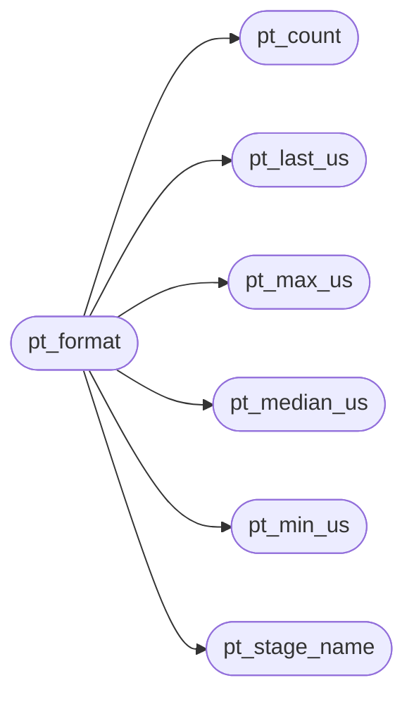

# `src/perf_trace.c`

> Source: [src/perf_trace.c:1](../../src/perf_trace.c#L1) | language `c` | coverage 75.0% | [API index](../index.md)

## Contents

- **Functions:** [`pt_init`](#pt_init), [`pt_elapsed_us`](#pt_elapsed_us), [`pt_record`](#pt_record), [`pt_count`](#pt_count), [`pt_last_us`](#pt_last_us), [`pt_min_us`](#pt_min_us), [`pt_max_us`](#pt_max_us), [`pt_median_us`](#pt_median_us), [`pt_stage_name`](#pt_stage_name), [`pt_format`](#pt_format)
- **Macros:** [`PT_LINE_CAP`](#pt_line_cap)

## Call Graph

Solid arrows stay in this module, dashed arrows leave it.



## Functions

<a id="pt_init"></a>

### `pt_init`

`function` | [src/perf_trace.c:16](../../src/perf_trace.c#L16)

```c
void pt_init(pt_trace *t)
```

Reset all stages to empty.

NULL-safe (no-op).

**Parameters**

| Name | Type | Default | Description |
|---|---|---|---|
| `t` | `pt_trace *` |  |  |

> **Inherited:** Documentation from [`pt_init`](#pt_init) (include/perf_trace.h:46).

---

<a id="pt_elapsed_us"></a>

### `pt_elapsed_us`

`function` | [src/perf_trace.c:21](../../src/perf_trace.c#L21)

```c
uint64_t pt_elapsed_us(uint64_t start_us, uint64_t end_us)
```

end_us - start_us with an anti-underflow guard: end < start yields 0 instead of wrapping to a huge uint64_t.

Pure.

**Parameters**

| Name | Type | Default | Description |
|---|---|---|---|
| `start_us` | `uint64_t` |  |  |
| `end_us` | `uint64_t` |  |  |

**Returns:** `uint64_t`

> **Inherited:** Documentation from [`pt_elapsed_us`](#pt_elapsed_us) (include/perf_trace.h:50).

---

<a id="pt_record"></a>

### `pt_record`

`function` | [src/perf_trace.c:26](../../src/perf_trace.c#L26)

```c
void pt_record(pt_trace *t, pt_stage stage, uint64_t elapsed_us)
```

Record one sample (microseconds) for the given stage.

NULL-safe and stage-bounds-safe: t==NULL or an out-of-range stage is a no-op.

**Parameters**

| Name | Type | Default | Description |
|---|---|---|---|
| `t` | `pt_trace *` |  |  |
| `stage` | `pt_stage` |  |  |
| `elapsed_us` | `uint64_t` |  |  |

> **Inherited:** Documentation from [`pt_record`](#pt_record) (include/perf_trace.h:54).

---

<a id="pt_count"></a>

### `pt_count`

`function` | [src/perf_trace.c:35](../../src/perf_trace.c#L35)

```c
size_t pt_count(const pt_trace *t, pt_stage stage)
```

Samples currently held in the stage's ring (<= PT_MAX_SAMPLES).

**Parameters**

| Name | Type | Default | Description |
|---|---|---|---|
| `t` | `pt_trace *` |  |  |
| `stage` | `pt_stage` |  |  |

**Returns:** `size_t`

> **Inherited:** Documentation from [`pt_count`](#pt_count) (include/perf_trace.h:57).

*Called by:* [`pt_format`](#pt_format)

---

<a id="pt_last_us"></a>

### `pt_last_us`

`function` | [src/perf_trace.c:40](../../src/perf_trace.c#L40)

```c
uint64_t pt_last_us(const pt_trace *t, pt_stage stage)
```

Most recently recorded sample; 0 if none or t==NULL.

**Parameters**

| Name | Type | Default | Description |
|---|---|---|---|
| `t` | `pt_trace *` |  |  |
| `stage` | `pt_stage` |  |  |

**Returns:** `uint64_t`

> **Inherited:** Documentation from [`pt_last_us`](#pt_last_us) (include/perf_trace.h:60).

*Called by:* [`pt_format`](#pt_format)

---

<a id="pt_min_us"></a>

### `pt_min_us`

`function` | [src/perf_trace.c:49](../../src/perf_trace.c#L49)

```c
uint64_t pt_min_us(const pt_trace *t, pt_stage stage)
```

Min / max / median over the samples currently in the ring.

0 if empty.

**Parameters**

| Name | Type | Default | Description |
|---|---|---|---|
| `t` | `pt_trace *` |  |  |
| `stage` | `pt_stage` |  |  |

**Returns:** `uint64_t`

> **Inherited:** Documentation from [`pt_min_us`](#pt_min_us) (include/perf_trace.h:63).

*Called by:* [`pt_format`](#pt_format)

---

<a id="pt_max_us"></a>

### `pt_max_us`

`function` | [src/perf_trace.c:60](../../src/perf_trace.c#L60)

```c
uint64_t pt_max_us(const pt_trace *t, pt_stage stage)
```

**Parameters**

| Name | Type | Default | Description |
|---|---|---|---|
| `t` | `pt_trace *` |  |  |
| `stage` | `pt_stage` |  |  |

**Returns:** `uint64_t`

*Called by:* [`pt_format`](#pt_format)

---

<a id="pt_median_us"></a>

### `pt_median_us`

`function` | [src/perf_trace.c:79](../../src/perf_trace.c#L79)

```c
uint64_t pt_median_us(const pt_trace *t, pt_stage stage)
```

**Parameters**

| Name | Type | Default | Description |
|---|---|---|---|
| `t` | `pt_trace *` |  |  |
| `stage` | `pt_stage` |  |  |

**Returns:** `uint64_t`

*Called by:* [`pt_format`](#pt_format)

---

<a id="pt_stage_name"></a>

### `pt_stage_name`

`function` `const` | [src/perf_trace.c:89](../../src/perf_trace.c#L89)

```c
const char *pt_stage_name(pt_stage stage)
```

Short lowercase stage name ("fetch".."shape"); "unknown" if out of range.

Static string, never NULL.

**Parameters**

| Name | Type | Default | Description |
|---|---|---|---|
| `stage` | `pt_stage` |  |  |

**Returns:** `char *`

> **Inherited:** Documentation from [`pt_stage_name`](#pt_stage_name) (include/perf_trace.h:69).

*Called by:* [`pt_format`](#pt_format)

---

<a id="pt_format"></a>

### `pt_format`

`function` | [src/perf_trace.c:109](../../src/perf_trace.c#L109)

```c
size_t pt_format(const pt_trace *t, char *buf, size_t cap)
```

Deterministic dump, one line per stage with count > 0, enum order: stage=<name> n=<total> last_us=<n> min_us=<n> max_us=<n> median_us=<n>\n snprintf fail-closed (V-004): truncates at a line boundary if buf fills, never overflows.

Returns bytes written (excluding the NUL). buf==NULL or cap==0 returns 0 without writing.

**Parameters**

| Name | Type | Default | Description |
|---|---|---|---|
| `t` | `pt_trace *` |  |  |
| `buf` | `char *` |  |  |
| `cap` | `size_t` |  |  |

**Returns:** `size_t`

> **Inherited:** Documentation from [`pt_format`](#pt_format) (include/perf_trace.h:76).

*Calls:* [`pt_count`](#pt_count), [`pt_last_us`](#pt_last_us), [`pt_max_us`](#pt_max_us), [`pt_median_us`](#pt_median_us), [`pt_min_us`](#pt_min_us), [`pt_stage_name`](#pt_stage_name)

---

## Macros

<a id="pt_line_cap"></a>

### `PT_LINE_CAP`

`macro` | [src/perf_trace.c:107](../../src/perf_trace.c#L107)

```c
#define PT_LINE_CAP
```

Upper bound on one formatted line: longest stage name ("rd_build", 8) plus five uint64_t fields (<=20 digits each) and literal text comfortably fits in 160 bytes; verified by construction, not by truncation.

---
