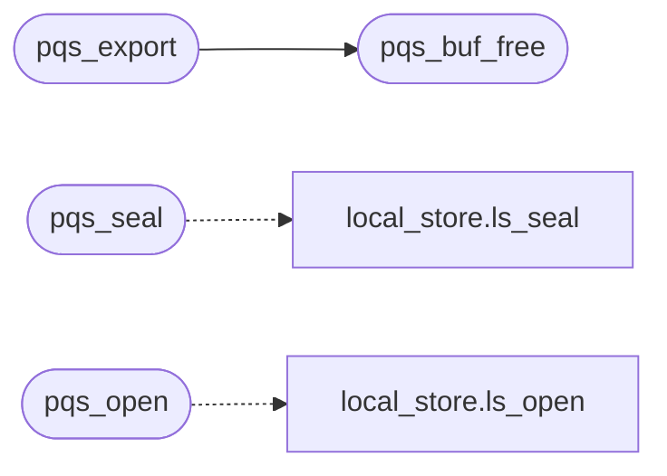

# `src/pq_seal.c`

> Source: [src/pq_seal.c:1](../../src/pq_seal.c#L1) | language `c` | coverage 10.0% | [API index](../index.md)

## Contents

- **Structs:** [`pqs_keys`](#pqs_keys)
- **Functions:** [`pqs_buf_free`](#pqs_buf_free), [`pqs_free`](#pqs_free), [`pqs_generate`](#pqs_generate), [`pqs_export`](#pqs_export), [`pqs_import`](#pqs_import), [`pqs_seal`](#pqs_seal), [`pqs_open`](#pqs_open)
- **Macros:** [`PQS_SS_LEN`](#pqs_ss_len)

## Call Graph

Solid arrows stay in this module, dashed arrows leave it.



## Structs

<a id="pqs_keys"></a>

### `pqs_keys`

`struct` | [src/pq_seal.c:19](../../src/pq_seal.c#L19)

```c
struct pqs_keys
```

---

## Functions

<a id="pqs_buf_free"></a>

### `pqs_buf_free`

`function` | [src/pq_seal.c:23](../../src/pq_seal.c#L23)

```c
void pqs_buf_free(uint8_t *buf, size_t len)
```

Zeroes then frees a buffer returned by this module.

**Parameters**

| Name | Type | Default | Description |
|---|---|---|---|
| `buf` | `uint8_t *` |  |  |
| `len` | `size_t` |  |  |

> **Inherited:** Documentation from [`pqs_buf_free`](#pqs_buf_free) (include/pq_seal.h:51).

*Called by:* [`pqs_export`](#pqs_export)

---

<a id="pqs_free"></a>

### `pqs_free`

`function` | [src/pq_seal.c:29](../../src/pq_seal.c#L29)

```c
void pqs_free(pqs_keys *k)
```

**Parameters**

| Name | Type | Default | Description |
|---|---|---|---|
| `k` | `pqs_keys *` |  |  |

---

<a id="pqs_generate"></a>

### `pqs_generate`

`function` | [src/pq_seal.c:42](../../src/pq_seal.c#L42)

```c
pqs_status pqs_generate(pqs_keys **out)
```

**Parameters**

| Name | Type | Default | Description |
|---|---|---|---|
| `out` | `pqs_keys **` |  |  |

**Returns:** `pqs_status`

*Called by:* [`hc_open`](src.http_cache.c.md#hc_open)

---

<a id="pqs_export"></a>

### `pqs_export`

`function` | [src/pq_seal.c:55](../../src/pq_seal.c#L55)

```c
pqs_status pqs_export(const pqs_keys *k, uint8_t **der, size_t *len)
```

**Parameters**

| Name | Type | Default | Description |
|---|---|---|---|
| `k` | `pqs_keys *` |  |  |
| `der` | `uint8_t **` |  |  |
| `len` | `size_t *` |  |  |

**Returns:** `pqs_status`

*Calls:* [`pqs_buf_free`](#pqs_buf_free)

*Called by:* [`hc_open`](src.http_cache.c.md#hc_open)

---

<a id="pqs_import"></a>

### `pqs_import`

`function` | [src/pq_seal.c:68](../../src/pq_seal.c#L68)

```c
pqs_status pqs_import(const uint8_t *der, size_t len, pqs_keys **out)
```

**Parameters**

| Name | Type | Default | Description |
|---|---|---|---|
| `der` | `uint8_t *` |  |  |
| `len` | `size_t` |  |  |
| `out` | `pqs_keys **` |  |  |

**Returns:** `pqs_status`

*Called by:* [`hc_open`](src.http_cache.c.md#hc_open)

---

<a id="pqs_seal"></a>

### `pqs_seal`

`function` | [src/pq_seal.c:106](../../src/pq_seal.c#L106)

```c
pqs_status pqs_seal(const pqs_keys *k, const uint8_t wrap[LS_KEY_LEN], const uint8_t *pt, size_t pt_len, uint8_t **out, size_t *out_len)
```

**Parameters**

| Name | Type | Default | Description |
|---|---|---|---|
| `k` | `pqs_keys *` |  |  |
| `LS_KEY_LEN` | `uint8_t wrap[ ]` |  |  |
| `pt` | `uint8_t *` |  |  |
| `pt_len` | `size_t` |  |  |
| `out` | `uint8_t **` |  |  |
| `out_len` | `size_t *` |  |  |

**Returns:** `pqs_status`

*Calls:* [`ls_seal`](src.local_store.c.md#ls_seal)

---

<a id="pqs_open"></a>

### `pqs_open`

`function` | [src/pq_seal.c:147](../../src/pq_seal.c#L147)

```c
pqs_status pqs_open(const pqs_keys *k, const uint8_t wrap[LS_KEY_LEN], const uint8_t *in, size_t in_len, uint8_t **out, size_t *out_len)
```

**Parameters**

| Name | Type | Default | Description |
|---|---|---|---|
| `k` | `pqs_keys *` |  |  |
| `LS_KEY_LEN` | `uint8_t wrap[ ]` |  |  |
| `in` | `uint8_t *` |  |  |
| `in_len` | `size_t` |  |  |
| `out` | `uint8_t **` |  |  |
| `out_len` | `size_t *` |  |  |

**Returns:** `pqs_status`

*Calls:* [`ls_open`](src.local_store.c.md#ls_open)

---

## Macros

<a id="pqs_ss_len"></a>

### `PQS_SS_LEN`

`macro` | [src/pq_seal.c:17](../../src/pq_seal.c#L17)

```c
#define PQS_SS_LEN
```

---
