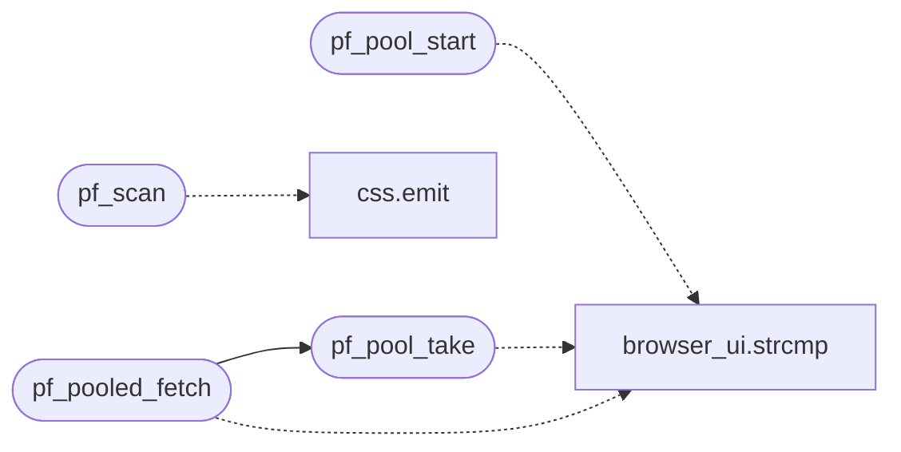

# `src/prefetch.c`

> Source: [src/prefetch.c:1](../../src/prefetch.c#L1) | language `c` | coverage 40.0% | [API index](../index.md)

## Contents

- **Structs:** [`attr_span`](#attr_span)
- **Functions:** [`pf_scan`](#pf_scan), [`pf_list_free`](#pf_list_free), [`pf_pool_start`](#pf_pool_start), [`pf_pool_take`](#pf_pool_take), [`pf_pool_finish`](#pf_pool_finish), [`pf_pooled_fetch`](#pf_pooled_fetch)
- **Macros:** [`_POSIX_C_SOURCE`](#_posix_c_source), [`PF_MAX_URL`](#pf_max_url)

## Call Graph

Solid arrows stay in this module, dashed arrows leave it.



## Structs

<a id="attr_span"></a>

### `attr_span`

`struct` | [src/prefetch.c:62](../../src/prefetch.c#L62)

```c
typedef struct attr_span
```

---

## Functions

<a id="pf_scan"></a>

### `pf_scan`

`function` | [src/prefetch.c:130](../../src/prefetch.c#L130)

```c
int pf_scan(const char *html, size_t len, pf_list *out)
```

Lookahead scan of hostile HTML.

Fills out (owns the URLs; free with pf_list_free). Comment, <script> and <style> contents are opaque; a <link> whose rel list lacks the "stylesheet" token is ignored (fail closed). Returns 0 (even with zero refs) or -1 on NULL arguments. Never performs I/O.

**Parameters**

| Name | Type | Default | Description |
|---|---|---|---|
| `html` | `char *` |  |  |
| `len` | `size_t` |  |  |
| `out` | `pf_list *` |  |  |

**Returns:** `int`

> **Inherited:** Documentation from [`pf_scan`](#pf_scan) (include/prefetch.h:59).

*Calls:* [`emit`](src.css.c.md#emit)

---

<a id="pf_list_free"></a>

### `pf_list_free`

`function` | [src/prefetch.c:193](../../src/prefetch.c#L193)

```c
void pf_list_free(pf_list *l)
```

**Parameters**

| Name | Type | Default | Description |
|---|---|---|---|
| `l` | `pf_list *` |  |  |

---

<a id="pf_pool_start"></a>

### `pf_pool_start`

`function` | [src/prefetch.c:227](../../src/prefetch.c#L227)

```c
int pf_pool_start(pf_pool *p, const char *const *urls, size_t nurls, pf_fetch_fn fetch, void *ctx)
```

**Parameters**

| Name | Type | Default | Description |
|---|---|---|---|
| `p` | `pf_pool *` |  |  |
| `urls` | `char *const *` |  |  |
| `nurls` | `size_t` |  |  |
| `fetch` | `pf_fetch_fn` |  |  |
| `ctx` | `void *` |  |  |

**Returns:** `int`

*Calls:* [`strcmp`](gui.browser_ui.c.md#strcmp)

---

<a id="pf_pool_take"></a>

### `pf_pool_take`

`function` | [src/prefetch.c:271](../../src/prefetch.c#L271)

```c
int pf_pool_take(pf_pool *p, const char *url, int *rc, int *status, char **body, size_t *len, char **ctype)
```

Cache-first take.

On a hit (url matches an unconsumed job) WAITS for that job and MOVES the result to the caller: *rc is the callback's return value and, when *rc == 0, the caller owns the returned body and ctype. Returns 1 on hit, 0 on miss (unknown or already-consumed URL, pool not started): the caller then fetches directly. A fetch failure is a hit with *rc != 0 -- the caller must NOT retry (same outcome as the serial path, without duplicating requests). Single owner: a second take of the same URL is a miss.

**Parameters**

| Name | Type | Default | Description |
|---|---|---|---|
| `p` | `pf_pool *` |  |  |
| `url` | `char *` |  |  |
| `rc` | `int *` |  |  |
| `status` | `int *` |  |  |
| `body` | `char **` |  |  |
| `len` | `size_t *` |  |  |
| `ctype` | `char **` |  |  |

**Returns:** `int`

> **Inherited:** Documentation from [`pf_pool_take`](#pf_pool_take) (include/prefetch.h:115).

*Calls:* [`strcmp`](gui.browser_ui.c.md#strcmp)

*Called by:* [`pf_pooled_fetch`](#pf_pooled_fetch)

---

<a id="pf_pool_finish"></a>

### `pf_pool_finish`

`function` | [src/prefetch.c:310](../../src/prefetch.c#L310)

```c
void pf_pool_finish(pf_pool *p)
```

Joins the worker threads and frees every unconsumed result.

Blocks until in-flight fetches end (bounded by the fetcher's timeouts). Idempotent; after finish, take always misses.

**Parameters**

| Name | Type | Default | Description |
|---|---|---|---|
| `p` | `pf_pool *` |  |  |

> **Inherited:** Documentation from [`pf_pool_finish`](#pf_pool_finish) (include/prefetch.h:121).

---

<a id="pf_pooled_fetch"></a>

### `pf_pooled_fetch`

`function` | [src/prefetch.c:324](../../src/prefetch.c#L324)

```c
int pf_pooled_fetch(void *vctx, const char *method, const char *url, const char *body, size_t body_len, int *out_status, char **out_body, size_t *out_len, char **out_ctype)
```

**Parameters**

| Name | Type | Default | Description |
|---|---|---|---|
| `vctx` | `void *` |  |  |
| `method` | `char *` |  |  |
| `url` | `char *` |  |  |
| `body` | `char *` |  |  |
| `body_len` | `size_t` |  |  |
| `out_status` | `int *` |  |  |
| `out_body` | `char **` |  |  |
| `out_len` | `size_t *` |  |  |
| `out_ctype` | `char **` |  |  |

**Returns:** `int`

*Calls:* [`strcmp`](gui.browser_ui.c.md#strcmp), [`pf_pool_take`](#pf_pool_take)

---

## Macros

<a id="_posix_c_source"></a>

### `_POSIX_C_SOURCE`

`macro` | [src/prefetch.c:12](../../src/prefetch.c#L12)

```c
#define _POSIX_C_SOURCE
```

---

<a id="pf_max_url"></a>

### `PF_MAX_URL`

`macro` | [src/prefetch.c:21](../../src/prefetch.c#L21)

```c
#define PF_MAX_URL
```

Longest raw reference the scanner keeps; matches URL_MAX_LEN (url.h) so a ref the fetch path would reject on length is never even queued.

---
