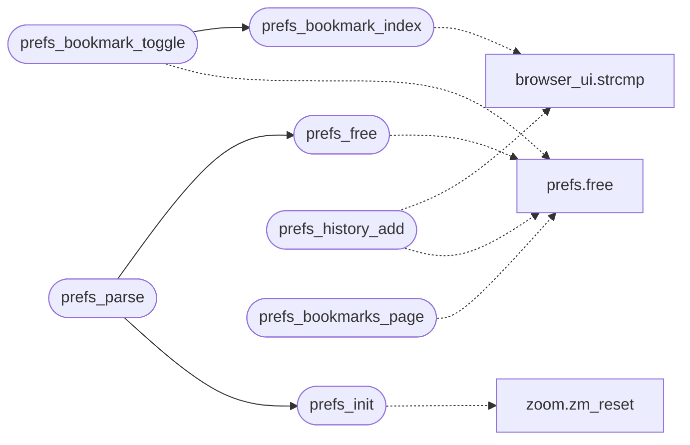

# `src/prefs.c`

> Source: [src/prefs.c:1](../../src/prefs.c#L1) | language `c` | coverage 30.8% | [API index](../index.md)

## Contents

- **Structs:** [`sbuf`](#sbuf)
- **Functions:** [`prefs_init`](#prefs_init), [`prefs_free`](#prefs_free), [`prefs_bookmark_index`](#prefs_bookmark_index), [`prefs_bookmark_toggle`](#prefs_bookmark_toggle), [`prefs_history_add`](#prefs_history_add), [`prefs_format`](#prefs_format), [`prefs_parse`](#prefs_parse), [`prefs_suggest`](#prefs_suggest), [`prefs_bookmarks_page`](#prefs_bookmarks_page)
- **Macros:** [`_POSIX_C_SOURCE`](#_posix_c_source), [`PREFS_MAGIC`](#prefs_magic)

## Call Graph

Solid arrows stay in this module, dashed arrows leave it.



## Structs

<a id="sbuf"></a>

### `sbuf`

`struct` | [src/prefs.c:367](../../src/prefs.c#L367)

```c
typedef struct sbuf { char *data; size_t len, cap; int oom; } sbuf;
```

---

## Functions

<a id="prefs_init"></a>

### `prefs_init`

`function` | [src/prefs.c:66](../../src/prefs.c#L66)

```c
void prefs_init(prefs_state *p)
```

Safe defaults (a virgin session: everything private/off, zoom 100%, remember_history on).

NULL-safe.

**Parameters**

| Name | Type | Default | Description |
|---|---|---|---|
| `p` | `prefs_state *` |  |  |

> **Inherited:** Documentation from [`prefs_init`](#prefs_init) (include/prefs.h:65).

*Calls:* [`zm_reset`](include.zoom.h.md#zm_reset)

*Called by:* [`prefs_parse`](#prefs_parse)

---

<a id="prefs_free"></a>

### `prefs_free`

`function` | [src/prefs.c:74](../../src/prefs.c#L74)

```c
void prefs_free(prefs_state *p)
```

Releases owned lists.

Idempotent; NULL-safe.

**Parameters**

| Name | Type | Default | Description |
|---|---|---|---|
| `p` | `prefs_state *` |  |  |

> **Inherited:** Documentation from [`prefs_free`](#prefs_free) (include/prefs.h:68).

*Calls:* [`free`](include.prefs.h.md#free)

*Called by:* [`prefs_parse`](#prefs_parse)

---

<a id="prefs_bookmark_index"></a>

### `prefs_bookmark_index`

`function` | [src/prefs.c:125](../../src/prefs.c#L125)

```c
int prefs_bookmark_index(const prefs_state *p, const char *url)
```

Index of the bookmark with exactly that URL, or -1.

NULL-safe.

**Parameters**

| Name | Type | Default | Description |
|---|---|---|---|
| `p` | `prefs_state *` |  |  |
| `url` | `char *` |  |  |

**Returns:** `int`

> **Inherited:** Documentation from [`prefs_bookmark_index`](#prefs_bookmark_index) (include/prefs.h:81).

*Calls:* [`strcmp`](gui.browser_ui.c.md#strcmp)

*Called by:* [`prefs_bookmark_toggle`](#prefs_bookmark_toggle)

---

<a id="prefs_bookmark_toggle"></a>

### `prefs_bookmark_toggle`

`function` | [src/prefs.c:132](../../src/prefs.c#L132)

```c
prefs_status prefs_bookmark_toggle(prefs_state *p, const char *url, const char *title, int *added)
```

**Parameters**

| Name | Type | Default | Description |
|---|---|---|---|
| `p` | `prefs_state *` |  |  |
| `url` | `char *` |  |  |
| `title` | `char *` |  |  |
| `added` | `int *` |  |  |

**Returns:** `prefs_status`

*Calls:* [`free`](include.prefs.h.md#free), [`prefs_bookmark_index`](#prefs_bookmark_index)

*Called by:* [`LLVMFuzzerTestOneInput`](fuzz.fuzz_prefs.c.md#llvmfuzzertestoneinput)

---

<a id="prefs_history_add"></a>

### `prefs_history_add`

`function` | [src/prefs.c:152](../../src/prefs.c#L152)

```c
prefs_status prefs_history_add(prefs_state *p, const char *url)
```

**Parameters**

| Name | Type | Default | Description |
|---|---|---|---|
| `p` | `prefs_state *` |  |  |
| `url` | `char *` |  |  |

**Returns:** `prefs_status`

*Calls:* [`strcmp`](gui.browser_ui.c.md#strcmp), [`free`](include.prefs.h.md#free)

*Called by:* [`LLVMFuzzerTestOneInput`](fuzz.fuzz_prefs.c.md#llvmfuzzertestoneinput)

---

<a id="prefs_format"></a>

### `prefs_format`

`function` | [src/prefs.c:183](../../src/prefs.c#L183)

```c
prefs_status prefs_format(const prefs_state *p, char **out, size_t *out_len)
```

**Parameters**

| Name | Type | Default | Description |
|---|---|---|---|
| `p` | `prefs_state *` |  |  |
| `out` | `char **` |  |  |
| `out_len` | `size_t *` |  |  |

**Returns:** `prefs_status`

*Called by:* [`LLVMFuzzerTestOneInput`](fuzz.fuzz_prefs.c.md#llvmfuzzertestoneinput), [`profile_save`](src.profile.c.md#profile_save)

---

<a id="prefs_parse"></a>

### `prefs_parse`

`function` | [src/prefs.c:241](../../src/prefs.c#L241)

```c
prefs_status prefs_parse(const char *text, size_t len, prefs_state *out)
```

**Parameters**

| Name | Type | Default | Description |
|---|---|---|---|
| `text` | `char *` |  |  |
| `len` | `size_t` |  |  |
| `out` | `prefs_state *` |  |  |

**Returns:** `prefs_status`

*Calls:* [`prefs_free`](#prefs_free), [`prefs_init`](#prefs_init)

*Called by:* [`LLVMFuzzerTestOneInput`](fuzz.fuzz_prefs.c.md#llvmfuzzertestoneinput), [`profile_load`](src.profile.c.md#profile_load)

---

<a id="prefs_suggest"></a>

### `prefs_suggest`

`function` | [src/prefs.c:344](../../src/prefs.c#L344)

```c
int prefs_suggest(const prefs_state *p, const char *query, char *out, size_t row_len, int max_rows)
```

Omnibox autocomplete: up to max_rows distinct URLs matching query (case- insensitive) written to out (rows of row_len bytes, NUL-terminated).

Priority: bookmark-prefix, history-prefix, bookmark-substring (URL or title), history-substring; "prefix" also matches past the scheme and a leading "www.". Empty query matches everything (bookmarks first). Returns the count written. Pure.

**Parameters**

| Name | Type | Default | Description |
|---|---|---|---|
| `p` | `prefs_state *` |  |  |
| `query` | `char *` |  |  |
| `out` | `char *` |  |  |
| `row_len` | `size_t` |  |  |
| `max_rows` | `int` |  |  |

**Returns:** `int`

> **Inherited:** Documentation from [`prefs_suggest`](#prefs_suggest) (include/prefs.h:100).

---

<a id="prefs_bookmarks_page"></a>

### `prefs_bookmarks_page`

`function` | [src/prefs.c:408](../../src/prefs.c#L408)

```c
prefs_status prefs_bookmarks_page(const prefs_state *p, char **out, size_t *out_len)
```

**Parameters**

| Name | Type | Default | Description |
|---|---|---|---|
| `p` | `prefs_state *` |  |  |
| `out` | `char **` |  |  |
| `out_len` | `size_t *` |  |  |

**Returns:** `prefs_status`

*Calls:* [`free`](include.prefs.h.md#free)

*Called by:* [`LLVMFuzzerTestOneInput`](fuzz.fuzz_prefs.c.md#llvmfuzzertestoneinput), [`arrives`](gui.browser_ui.c.md#arrives)

---

## Macros

<a id="_posix_c_source"></a>

### `_POSIX_C_SOURCE`

`macro` | [src/prefs.c:11](../../src/prefs.c#L11)

```c
#define _POSIX_C_SOURCE
```

---

<a id="prefs_magic"></a>

### `PREFS_MAGIC`

`macro` | [src/prefs.c:20](../../src/prefs.c#L20)

```c
#define PREFS_MAGIC
```

---
