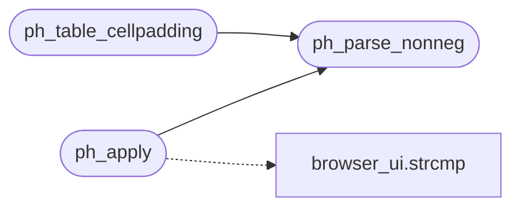

# `src/pres_hints.c`

> Source: [src/pres_hints.c:1](../../src/pres_hints.c#L1) | language `c` | coverage 85.7% | [API index](../index.md)

pres_hints (ph_) -- see include/pres_hints.h and spec/pres_hints.md.

## Contents

- **Functions:** [`ph_parse_dimension`](#ph_parse_dimension), [`ph_apply`](#ph_apply), [`ph_parse_nonneg`](#ph_parse_nonneg), [`ph_table_cellpadding`](#ph_table_cellpadding), [`ph_cell_padding`](#ph_cell_padding)
- **Macros:** [`PH_PER_MILLE_MAX`](#ph_per_mille_max)

## Call Graph

Solid arrows stay in this module, dashed arrows leave it.



## Functions

<a id="ph_parse_dimension"></a>

### `ph_parse_dimension`

`function` | [src/pres_hints.c:14](../../src/pres_hints.c#L14)

```c
int ph_parse_dimension(const char *s, size_t len, int *px, int *per_mille)
```

Parses an HTML dimension: 1 with *px set (percent 0), 2 with *per_mille set, 0 = invalid.

**Parameters**

| Name | Type | Default | Description |
|---|---|---|---|
| `s` | `char *` |  |  |
| `len` | `size_t` |  |  |
| `px` | `int *` |  |  |
| `per_mille` | `int *` |  |  |

**Returns:** `int`

> **Inherited:** Documentation from [`ph_parse_dimension`](#ph_parse_dimension) (include/pres_hints.h:24).

---

<a id="ph_apply"></a>

### `ph_apply`

`function` | [src/pres_hints.c:93](../../src/pres_hints.c#L93)

```c
void ph_apply(const char *tag, ph_attr_fn get, void *ctx, unsigned flags, css_style *cs)
```

Applies the hints of element [`tag`](include.css_select.h.md#tag) (lower-case, NUL-terminated) to *cs; flags is a set of PH_*.

No-op on a NULL tag, getter or style.

**Parameters**

| Name | Type | Default | Description |
|---|---|---|---|
| `tag` | `char *` |  |  |
| `get` | `ph_attr_fn` |  |  |
| `ctx` | `void *` |  |  |
| `flags` | `unsigned` |  |  |
| `cs` | `css_style *` |  |  |

> **Inherited:** Documentation from [`ph_apply`](#ph_apply) (include/pres_hints.h:31).

*Calls:* [`strcmp`](gui.browser_ui.c.md#strcmp), [`ph_parse_nonneg`](#ph_parse_nonneg)

---

<a id="ph_parse_nonneg"></a>

### `ph_parse_nonneg`

`function` | [src/pres_hints.c:140](../../src/pres_hints.c#L140)

```c
int ph_parse_nonneg(const char *s, size_t len, int *out)
```

HTML "rules for parsing non-negative integers": 1 with *out set (0 is valid), 0 = invalid.

**Parameters**

| Name | Type | Default | Description |
|---|---|---|---|
| `s` | `char *` |  |  |
| `len` | `size_t` |  |  |
| `out` | `int *` |  |  |

**Returns:** `int`

> **Inherited:** Documentation from [`ph_parse_nonneg`](#ph_parse_nonneg) (include/pres_hints.h:34).

*Called by:* [`ph_apply`](#ph_apply), [`ph_table_cellpadding`](#ph_table_cellpadding)

---

<a id="ph_table_cellpadding"></a>

### `ph_table_cellpadding`

`function` | [src/pres_hints.c:156](../../src/pres_hints.c#L156)

```c
int ph_table_cellpadding(ph_attr_fn get, void *ctx)
```

The cellpadding of a <table> whose attributes `get` reads: px, or -1 when absent/invalid.

**Parameters**

| Name | Type | Default | Description |
|---|---|---|---|
| `get` | `ph_attr_fn` |  |  |
| `ctx` | `void *` |  |  |

**Returns:** `int`

> **Inherited:** Documentation from [`ph_table_cellpadding`](#ph_table_cellpadding) (include/pres_hints.h:37).

*Calls:* [`ph_parse_nonneg`](#ph_parse_nonneg)

---

<a id="ph_cell_padding"></a>

### `ph_cell_padding`

`function` | [src/pres_hints.c:164](../../src/pres_hints.c#L164)

```c
void ph_cell_padding(int cellpad, css_style *cs)
```

A table cell's padding: every side the cascade left unset takes cellpad px, or the UA sheet's 1px when cellpad < 0.

No-op on a NULL style.

**Parameters**

| Name | Type | Default | Description |
|---|---|---|---|
| `cellpad` | `int` |  |  |
| `cs` | `css_style *` |  |  |

> **Inherited:** Documentation from [`ph_cell_padding`](#ph_cell_padding) (include/pres_hints.h:41).

---

## Macros

<a id="ph_per_mille_max"></a>

### `PH_PER_MILLE_MAX`

`macro` | [src/pres_hints.c:8](../../src/pres_hints.c#L8)

```c
#define PH_PER_MILLE_MAX
```

---
