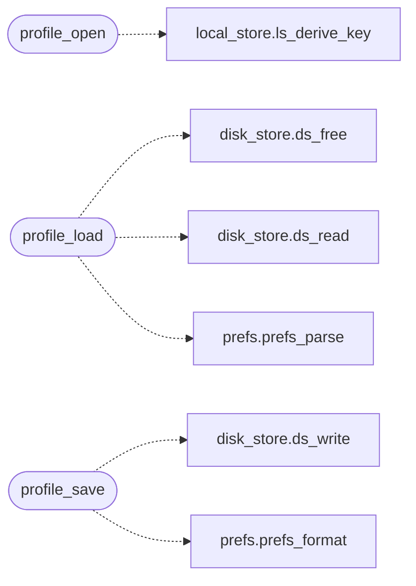

# `src/profile.c`

> Source: [src/profile.c:1](../../src/profile.c#L1) | language `c` | coverage 14.3% | [API index](../index.md)

## Contents

- **Functions:** [`profile_open`](#profile_open), [`profile_load`](#profile_load), [`profile_save`](#profile_save), [`profile_close`](#profile_close)
- **Macros:** [`_POSIX_C_SOURCE`](#_posix_c_source), [`PROFILE_KEYFILE_LEN`](#profile_keyfile_len)

## Call Graph

Solid arrows stay in this module, dashed arrows leave it.



## Functions

<a id="profile_open"></a>

### `profile_open`

`function` | [src/profile.c:59](../../src/profile.c#L59)

```c
profile_status profile_open(profile_ctx *ctx, const char *dir)
```

**Parameters**

| Name | Type | Default | Description |
|---|---|---|---|
| `ctx` | `profile_ctx *` |  |  |
| `dir` | `char *` |  |  |

**Returns:** `profile_status`

*Calls:* [`ls_derive_key`](src.local_store.c.md#ls_derive_key)

---

<a id="profile_load"></a>

### `profile_load`

`function` | [src/profile.c:112](../../src/profile.c#L112)

```c
profile_status profile_load(const profile_ctx *ctx, prefs_state *out)
```

**Parameters**

| Name | Type | Default | Description |
|---|---|---|---|
| `ctx` | `profile_ctx *` |  |  |
| `out` | `prefs_state *` |  |  |

**Returns:** `profile_status`

*Calls:* [`ds_free`](include.disk_store.h.md#ds_free), [`ds_read`](src.disk_store.c.md#ds_read), [`prefs_parse`](src.prefs.c.md#prefs_parse)

---

<a id="profile_save"></a>

### `profile_save`

`function` | [src/profile.c:133](../../src/profile.c#L133)

```c
profile_status profile_save(const profile_ctx *ctx, const prefs_state *p)
```

**Parameters**

| Name | Type | Default | Description |
|---|---|---|---|
| `ctx` | `profile_ctx *` |  |  |
| `p` | `prefs_state *` |  |  |

**Returns:** `profile_status`

*Calls:* [`ds_write`](src.disk_store.c.md#ds_write), [`prefs_format`](src.prefs.c.md#prefs_format)

---

<a id="profile_close"></a>

### `profile_close`

`function` | [src/profile.c:149](../../src/profile.c#L149)

```c
void profile_close(profile_ctx *ctx)
```

Securely wipes the key in ctx.

Idempotent; NULL-safe.

**Parameters**

| Name | Type | Default | Description |
|---|---|---|---|
| `ctx` | `profile_ctx *` |  |  |

> **Inherited:** Documentation from [`profile_close`](#profile_close) (include/profile.h:67).

---

## Macros

<a id="_posix_c_source"></a>

### `_POSIX_C_SOURCE`

`macro` | [src/profile.c:11](../../src/profile.c#L11)

```c
#define _POSIX_C_SOURCE
```

---

<a id="profile_keyfile_len"></a>

### `PROFILE_KEYFILE_LEN`

`macro` | [src/profile.c:27](../../src/profile.c#L27)

```c
#define PROFILE_KEYFILE_LEN
```

---
