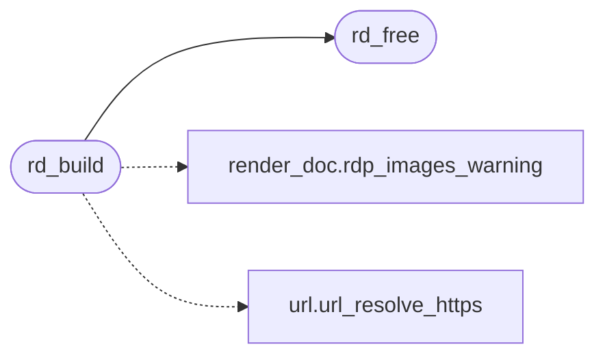

# `src/render_doc.c`

> Source: [src/render_doc.c:1](../../src/render_doc.c#L1) | language `c` | coverage 47.1% | [API index](../index.md)

## Contents

- **Functions:** [`place`](#place), [`rd_build`](#rd_build), [`unset`](#unset), [`rd_free`](#rd_free), [`rd_count`](#rd_count), [`rd_at`](#rd_at), [`rd_box_count`](#rd_box_count), [`rd_box_at`](#rd_box_at), [`rd_cont_count`](#rd_cont_count), [`rd_cont_at`](#rd_cont_at), [`rd_kind_name`](#rd_kind_name), [`rd_block_tag`](#rd_block_tag), [`rd_input_label`](#rd_input_label), [`rd_input_invisible`](#rd_input_invisible), [`rd_image_label`](#rd_image_label), [`rd_image_fail_label`](#rd_image_fail_label)

## Call Graph

Solid arrows stay in this module, dashed arrows leave it.



## Functions

<a id="place"></a>

### `place`

`function` | [src/render_doc.c:227](../../src/render_doc.c#L227)

```c
* judges it under the exact same policy an  already goes through: a data: * URI is judged in place (never resolved, never touches the network either way);
```

**Parameters**

| Name | Type | Default | Description |
|---|---|---|---|
| `resolved` | `never` |  |  |
| `way` | `never touches the network either` |  |  |

**Returns:** `* judges it under the exact same policy an  already goes through: a data: * URI is judged in`

---

<a id="rd_build"></a>

### `rd_build`

`function` | [src/render_doc.c:259](../../src/render_doc.c#L259)

```c
rd_status rd_build(const pv_view *view, rdp_caps caps, const char *top_level_url, rd_doc **out)
```

**Parameters**

| Name | Type | Default | Description |
|---|---|---|---|
| `view` | `pv_view *` |  |  |
| `caps` | `rdp_caps` |  |  |
| `top_level_url` | `char *` |  |  |
| `out` | `rd_doc **` |  |  |

**Returns:** `rd_status`

*Calls:* [`rdp_images_warning`](include.render_doc.h.md#rdp_images_warning), [`rd_free`](#rd_free), [`url_resolve_https`](src.url.c.md#url_resolve_https)

---

<a id="unset"></a>

### `unset`

`function` | [src/render_doc.c:641](../../src/render_doc.c#L641)

```c
* background paints as if unset (no border/box-shadow-style * "broken image" placeholder) -- it is decoration, not content * with alt text, matching real-browser behaviour. */ if (d->boxes[i].bg_image_url[0] != '\0')
```

**Parameters**

| Name | Type | Default | Description |
|---|---|---|---|
| `placeholder` | `no border/box-shadow-style * "broken image"` |  |  |

**Returns:** `* background paints as if`

*Called by:* [`CSS_NTH_MAX`](include.css.h.md#css_nth_max)

---

<a id="rd_free"></a>

### `rd_free`

`function` | [src/render_doc.c:706](../../src/render_doc.c#L706)

```c
void rd_free(rd_doc *d)
```

Idempotent; safe on NULL and safe to call twice.

**Parameters**

| Name | Type | Default | Description |
|---|---|---|---|
| `d` | `rd_doc *` |  |  |

> **Inherited:** Documentation from [`rd_free`](#rd_free) (include/render_doc.h:304).

*Called by:* [`rd_build`](#rd_build)

---

<a id="rd_count"></a>

### `rd_count`

`function` | [src/render_doc.c:723](../../src/render_doc.c#L723)

```c
size_t rd_count(const rd_doc *d)
```

Read accessors.

NULL-safe.

**Parameters**

| Name | Type | Default | Description |
|---|---|---|---|
| `d` | `rd_doc *` |  |  |

**Returns:** `size_t`

> **Inherited:** Documentation from [`rd_count`](#rd_count) (include/render_doc.h:307).

---

<a id="rd_at"></a>

### `rd_at`

`function` `const` | [src/render_doc.c:727](../../src/render_doc.c#L727)

```c
const rd_block *rd_at(const rd_doc *d, size_t i)
```

**Parameters**

| Name | Type | Default | Description |
|---|---|---|---|
| `d` | `rd_doc *` |  |  |
| `i` | `size_t` |  |  |

**Returns:** `rd_block *`

---

<a id="rd_box_count"></a>

### `rd_box_count`

`function` | [src/render_doc.c:732](../../src/render_doc.c#L732)

```c
size_t rd_box_count(const rd_doc *d)
```

Box tree accessors (Step D). rd_box_count is the number of box definitions (0 when caps.css is off); rd_box_at returns boxes[i] (i == a block_id) or NULL.

**Parameters**

| Name | Type | Default | Description |
|---|---|---|---|
| `d` | `rd_doc *` |  |  |

**Returns:** `size_t`

> **Inherited:** Documentation from [`rd_box_count`](#rd_box_count) (include/render_doc.h:312).

---

<a id="rd_box_at"></a>

### `rd_box_at`

`function` `const` | [src/render_doc.c:736](../../src/render_doc.c#L736)

```c
const pv_box_def *rd_box_at(const rd_doc *d, size_t i)
```

**Parameters**

| Name | Type | Default | Description |
|---|---|---|---|
| `d` | `rd_doc *` |  |  |
| `i` | `size_t` |  |  |

**Returns:** `pv_box_def *`

---

<a id="rd_cont_count"></a>

### `rd_cont_count`

`function` | [src/render_doc.c:741](../../src/render_doc.c#L741)

```c
size_t rd_cont_count(const rd_doc *d)
```

Container table accessors. rd_cont_count is the number of containers; rd_cont_at returns conts[i] (i == a run's cont_id) or NULL when out of range.

**Parameters**

| Name | Type | Default | Description |
|---|---|---|---|
| `d` | `rd_doc *` |  |  |

**Returns:** `size_t`

> **Inherited:** Documentation from [`rd_cont_count`](#rd_cont_count) (include/render_doc.h:317).

---

<a id="rd_cont_at"></a>

### `rd_cont_at`

`function` `const` | [src/render_doc.c:745](../../src/render_doc.c#L745)

```c
const pv_cont_def *rd_cont_at(const rd_doc *d, size_t i)
```

**Parameters**

| Name | Type | Default | Description |
|---|---|---|---|
| `d` | `rd_doc *` |  |  |
| `i` | `size_t` |  |  |

**Returns:** `pv_cont_def *`

---

<a id="rd_kind_name"></a>

### `rd_kind_name`

`function` `const` | [src/render_doc.c:750](../../src/render_doc.c#L750)

```c
const char *rd_kind_name(rd_kind k)
```

Stable, short English name of a block kind for structured/agent output.

Never NULL; an unknown enum value yields "block".

**Parameters**

| Name | Type | Default | Description |
|---|---|---|---|
| `k` | `rd_kind` |  |  |

**Returns:** `char *`

> **Inherited:** Documentation from [`rd_kind_name`](#rd_kind_name) (include/render_doc.h:322).

---

<a id="rd_block_tag"></a>

### `rd_block_tag`

`function` `const` | [src/render_doc.c:764](../../src/render_doc.c#L764)

```c
const char *rd_block_tag(const rd_block *b)
```

Canonical HTML tag name for a block, so the presentation layer can look up its user-agent box (box_style) without re-deriving the kind->tag mapping at the call site.

RD_HEADING -> "h1".."h6" (heading_level clamped to 1..6), RD_PARAGRAPH -> "p", RD_LINK -> "a", RD_IMAGE -> "img", RD_INPUT -> "textarea"/"button"/"input" by input_type. RD_NOTICE (a user-agent banner, not an HTML element) and a NULL block yield NULL. The returned string is a static literal (not owned).

**Parameters**

| Name | Type | Default | Description |
|---|---|---|---|
| `b` | `rd_block *` |  |  |

**Returns:** `char *`

> **Inherited:** Documentation from [`rd_block_tag`](#rd_block_tag) (include/render_doc.h:330).

---

<a id="rd_input_label"></a>

### `rd_input_label`

`function` `const` | [src/render_doc.c:795](../../src/render_doc.c#L795)

```c
const char *rd_input_label(int input_type)
```

Stable, short English name of a form control type (a pv_input_type value), e.g.

"text" / "password" / "submit". Never NULL; an unknown value yields "field".

**Parameters**

| Name | Type | Default | Description |
|---|---|---|---|
| `input_type` | `int` |  |  |

**Returns:** `char *`

> **Inherited:** Documentation from [`rd_input_label`](#rd_input_label) (include/render_doc.h:344).

---

<a id="rd_input_invisible"></a>

### `rd_input_invisible`

`function` | [src/render_doc.c:815](../../src/render_doc.c#L815)

```c
int rd_input_invisible(int input_type)
```

Nonzero iff a control of this type has no face of its own and is therefore never laid out or painted: a hidden field, or the submit proxy of a <button> whose face is its own content box.

Its data still takes part in form submission.

**Parameters**

| Name | Type | Default | Description |
|---|---|---|---|
| `input_type` | `int` |  |  |

**Returns:** `int`

> **Inherited:** Documentation from [`rd_input_invisible`](#rd_input_invisible) (include/render_doc.h:349).

---

<a id="rd_image_label"></a>

### `rd_image_label`

`function` `const` | [src/render_doc.c:819](../../src/render_doc.c#L819)

```c
const char *rd_image_label(rdp_img_decision d)
```

**Parameters**

| Name | Type | Default | Description |
|---|---|---|---|
| `d` | `rdp_img_decision` |  |  |

**Returns:** `char *`

---

<a id="rd_image_fail_label"></a>

### `rd_image_fail_label`

`function` `const` | [src/render_doc.c:830](../../src/render_doc.c#L830)

```c
const char *rd_image_fail_label(img_fail_reason reason)
```

**Parameters**

| Name | Type | Default | Description |
|---|---|---|---|
| `reason` | `img_fail_reason` |  |  |

**Returns:** `char *`

---
