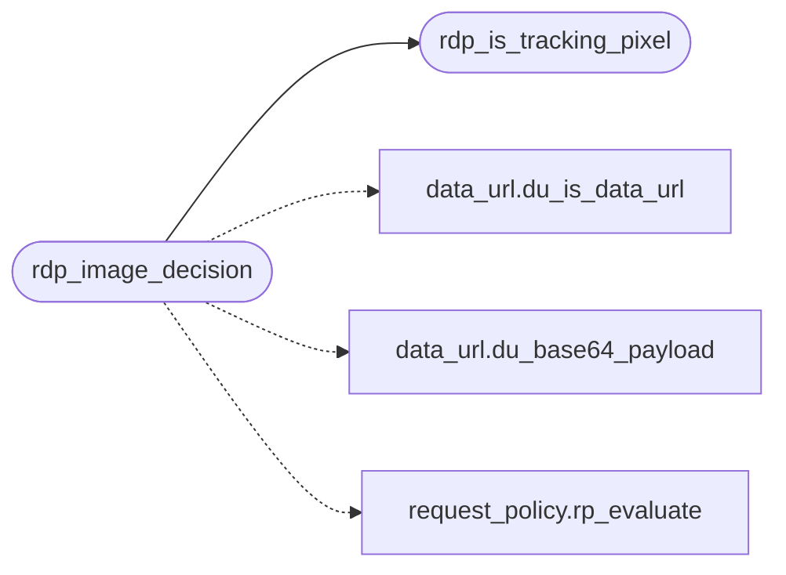

# `src/render_policy.c`

> Source: [src/render_policy.c:1](../../src/render_policy.c#L1) | language `c` | coverage 50.0% | [API index](../index.md)

## Contents

- **Functions:** [`rdp_caps_safe`](#rdp_caps_safe), [`rdp_is_tracking_pixel`](#rdp_is_tracking_pixel), [`rdp_image_decision`](#rdp_image_decision), [`rdp_img_reason`](#rdp_img_reason), [`rdp_images_warning`](#rdp_images_warning)

## Call Graph

Solid arrows stay in this module, dashed arrows leave it.



## Functions

<a id="rdp_caps_safe"></a>

### `rdp_caps_safe`

`function` | [src/render_policy.c:17](../../src/render_policy.c#L17)

```c
rdp_caps rdp_caps_safe(void)
```

**Returns:** `rdp_caps`

---

<a id="rdp_is_tracking_pixel"></a>

### `rdp_is_tracking_pixel`

`function` | [src/render_policy.c:22](../../src/render_policy.c#L22)

```c
int rdp_is_tracking_pixel(int w, int h)
```

Tracking-pixel heuristic over an image's declared dimensions. w/h negative means "unknown".

Returns 1 for a tracking pixel (zero-area, or both dims <= RDP_TRACKER_MAX_DIM), 0 otherwise (including unknown dimensions).

**Parameters**

| Name | Type | Default | Description |
|---|---|---|---|
| `w` | `int` |  |  |
| `h` | `int` |  |  |

**Returns:** `int`

> **Inherited:** Documentation from [`rdp_is_tracking_pixel`](#rdp_is_tracking_pixel) (include/render_policy.h:53).

*Called by:* [`rdp_image_decision`](#rdp_image_decision)

---

<a id="rdp_image_decision"></a>

### `rdp_image_decision`

`function` | [src/render_policy.c:28](../../src/render_policy.c#L28)

```c
rdp_img_decision rdp_image_decision(rdp_caps caps, const char *top_level_url, const char *image_url, int declared_w, int declared_h)
```

**Parameters**

| Name | Type | Default | Description |
|---|---|---|---|
| `caps` | `rdp_caps` |  |  |
| `top_level_url` | `char *` |  |  |
| `image_url` | `char *` |  |  |
| `declared_w` | `int` |  |  |
| `declared_h` | `int` |  |  |

**Returns:** `rdp_img_decision`

*Calls:* [`du_is_data_url`](include.data_url.h.md#du_is_data_url), [`du_base64_payload`](src.data_url.c.md#du_base64_payload), [`rdp_is_tracking_pixel`](#rdp_is_tracking_pixel), [`rp_evaluate`](src.request_policy.c.md#rp_evaluate)

---

<a id="rdp_img_reason"></a>

### `rdp_img_reason`

`function` `const` | [src/render_policy.c:63](../../src/render_policy.c#L63)

```c
const char *rdp_img_reason(rdp_img_decision d)
```

Stable, short, English reason string for structured/agent-friendly output.

Never NULL; an unknown enum value yields "unknown".

**Parameters**

| Name | Type | Default | Description |
|---|---|---|---|
| `d` | `rdp_img_decision` |  |  |

**Returns:** `char *`

> **Inherited:** Documentation from [`rdp_img_reason`](#rdp_img_reason) (include/render_policy.h:66).

---

<a id="rdp_images_warning"></a>

### `rdp_images_warning`

`function` `const` | [src/render_policy.c:74](../../src/render_policy.c#L74)

```c
const char *rdp_images_warning(void)
```

Fixed warning shown when the user enables images.

Never NULL or empty.

**Returns:** `char *`

> **Inherited:** Documentation from [`rdp_images_warning`](#rdp_images_warning) (include/render_policy.h:69).

---
