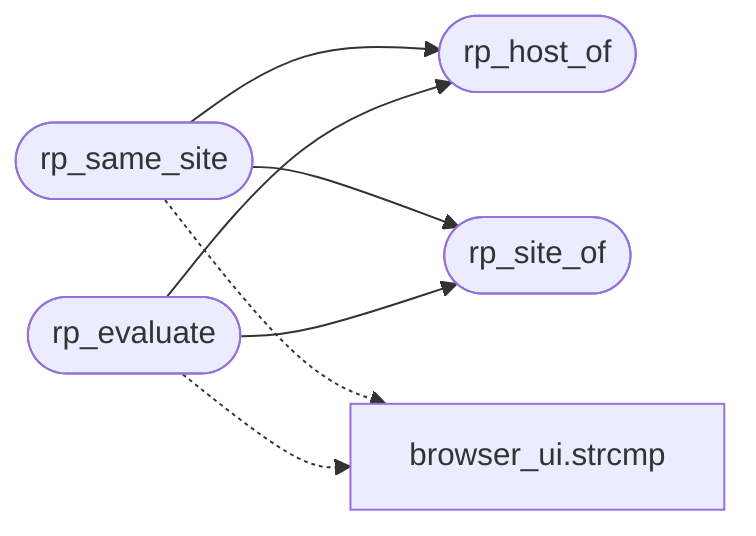

# `src/request_policy.c`

> Source: [src/request_policy.c:1](../../src/request_policy.c#L1) | language `c` | coverage 57.1% | [API index](../index.md)

## Contents

- **Functions:** [`rp_host_of`](#rp_host_of), [`rp_site_of`](#rp_site_of), [`rp_same_site`](#rp_same_site), [`rp_evaluate`](#rp_evaluate)
- **Macros:** [`RP_MAX_HOST`](#rp_max_host), [`RP_MAX_LABELS`](#rp_max_labels)

## Call Graph

Solid arrows stay in this module, dashed arrows leave it.



## Functions

<a id="rp_host_of"></a>

### `rp_host_of`

`function` | [src/request_policy.c:76](../../src/request_policy.c#L76)

```c
int rp_host_of(const char *url, char *out, size_t out_size)
```

Lowercased host of an absolute URL into out.

Returns 0 on success, -1 if no host can be parsed or it does not fit in out.

**Parameters**

| Name | Type | Default | Description |
|---|---|---|---|
| `url` | `char *` |  |  |
| `out` | `char *` |  |  |
| `out_size` | `size_t` |  |  |

**Returns:** `int`

> **Inherited:** Documentation from [`rp_host_of`](#rp_host_of) (include/request_policy.h:30).

*Called by:* [`rp_evaluate`](#rp_evaluate), [`rp_same_site`](#rp_same_site)

---

<a id="rp_site_of"></a>

### `rp_site_of`

`function` | [src/request_policy.c:102](../../src/request_policy.c#L102)

```c
int rp_site_of(const char *host, char *out, size_t out_size)
```

Registrable domain ("site") of a host into out (simplified public-suffix rule).

Returns 0 on success, -1 on empty host or insufficient buffer.

**Parameters**

| Name | Type | Default | Description |
|---|---|---|---|
| `host` | `char *` |  |  |
| `out` | `char *` |  |  |
| `out_size` | `size_t` |  |  |

**Returns:** `int`

> **Inherited:** Documentation from [`rp_site_of`](#rp_site_of) (include/request_policy.h:34).

*Called by:* [`rp_evaluate`](#rp_evaluate), [`rp_same_site`](#rp_same_site)

---

<a id="rp_same_site"></a>

### `rp_same_site`

`function` | [src/request_policy.c:134](../../src/request_policy.c#L134)

```c
int rp_same_site(const char *top_level_url, const char *request_url)
```

1 if both URLs share the same site, 0 otherwise (including parse failure).

**Parameters**

| Name | Type | Default | Description |
|---|---|---|---|
| `top_level_url` | `char *` |  |  |
| `request_url` | `char *` |  |  |

**Returns:** `int`

> **Inherited:** Documentation from [`rp_same_site`](#rp_same_site) (include/request_policy.h:37).

*Calls:* [`strcmp`](gui.browser_ui.c.md#strcmp), [`rp_host_of`](#rp_host_of), [`rp_site_of`](#rp_site_of)

---

<a id="rp_evaluate"></a>

### `rp_evaluate`

`function` | [src/request_policy.c:143](../../src/request_policy.c#L143)

```c
rp_decision rp_evaluate(const char *top_level_url, const char *request_url)
```

**Parameters**

| Name | Type | Default | Description |
|---|---|---|---|
| `top_level_url` | `char *` |  |  |
| `request_url` | `char *` |  |  |

**Returns:** `rp_decision`

*Calls:* [`strcmp`](gui.browser_ui.c.md#strcmp), [`rp_host_of`](#rp_host_of), [`rp_site_of`](#rp_site_of)

*Called by:* [`rdp_image_decision`](src.render_policy.c.md#rdp_image_decision)

---

## Macros

<a id="rp_max_host"></a>

### `RP_MAX_HOST`

`macro` | [src/request_policy.c:17](../../src/request_policy.c#L17)

```c
#define RP_MAX_HOST
```

---

<a id="rp_max_labels"></a>

### `RP_MAX_LABELS`

`macro` | [src/request_policy.c:18](../../src/request_policy.c#L18)

```c
#define RP_MAX_LABELS
```

RFC 1035 maximum host length

---
