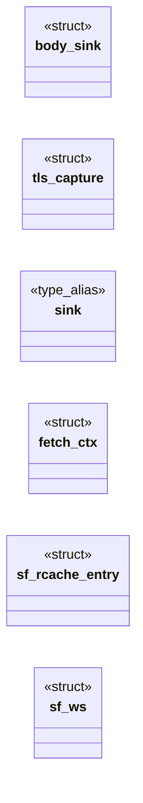
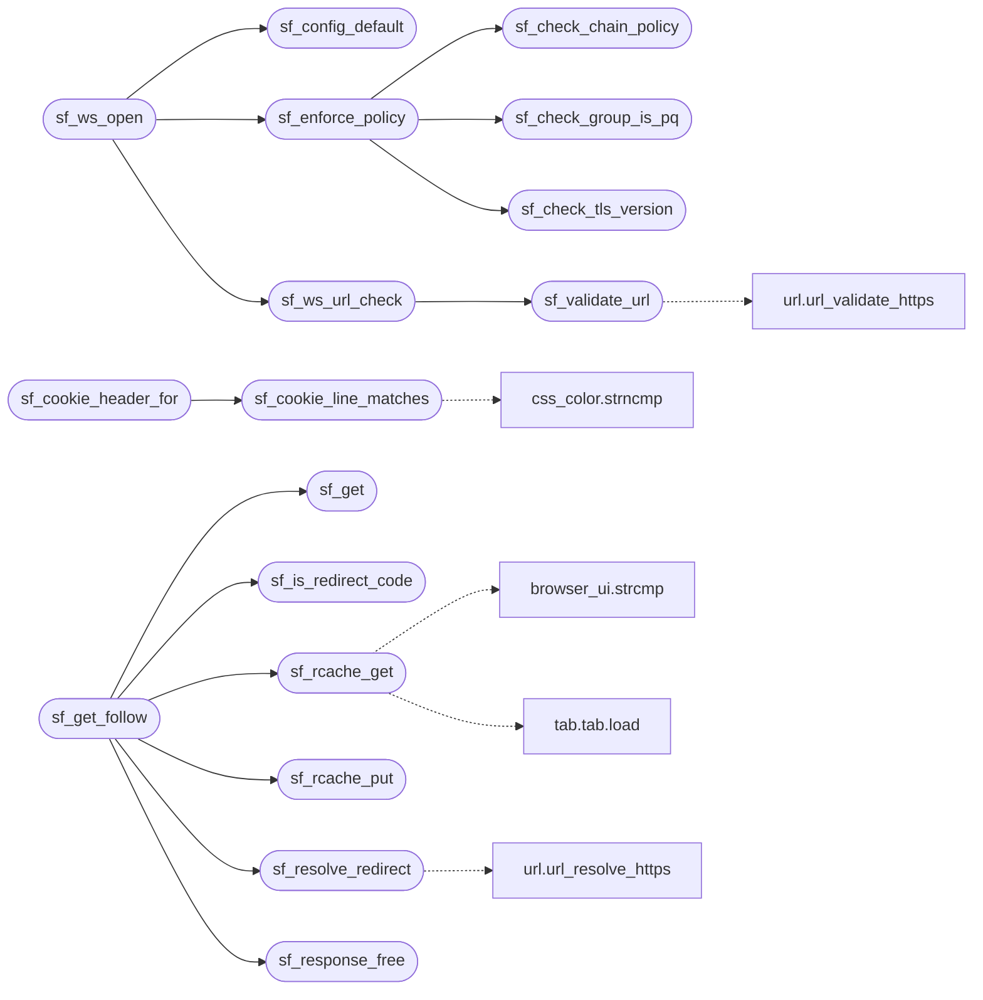

# `src/secure_fetch.c`

> Source: [src/secure_fetch.c:1](../../src/secure_fetch.c#L1) | language `c` | coverage 27.5% | [API index](../index.md)

## Contents

- **Structs:** [`body_sink`](#body_sink), [`tls_capture`](#tls_capture), [`fetch_ctx`](#fetch_ctx), [`sf_rcache_entry`](#sf_rcache_entry), [`sf_ws`](#sf_ws)
- **Type Aliases:** [`sink`](#sink)
- **Functions:** [`sf_global_init`](#sf_global_init), [`sf_cookie_line_matches`](#sf_cookie_line_matches), [`sf_cookie_header_for`](#sf_cookie_header_for), [`sf_cookie_put`](#sf_cookie_put), [`sf_config_default`](#sf_config_default), [`sf_user_agent_or_default`](#sf_user_agent_or_default), [`sf_accept_language_or_default`](#sf_accept_language_or_default), [`sf_impersonate_kex_groups`](#sf_impersonate_kex_groups), [`sf_impersonate_tls13_ciphers`](#sf_impersonate_tls13_ciphers), [`sf_validate_url`](#sf_validate_url), [`sf_check_tls_version`](#sf_check_tls_version), [`sf_check_group_is_pq`](#sf_check_group_is_pq), [`sf_check_chain_policy`](#sf_check_chain_policy), [`sf_enforce_policy`](#sf_enforce_policy), [`sf_is_redirect_code`](#sf_is_redirect_code), [`sf_header_value`](#sf_header_value), [`sf_parse_location_header`](#sf_parse_location_header), [`sf_resolve_redirect`](#sf_resolve_redirect), [`module`](#module), [`sf_response_free`](#sf_response_free), [`progress`](#progress), [`database`](#database), [`group`](#group), [`this`](#this), [`redirect`](#redirect), [`sf_get`](#sf_get), [`sf_post`](#sf_post), [`sf_rcache_clear`](#sf_rcache_clear), [`sf_rcache_set_backing`](#sf_rcache_set_backing), [`sf_rcache_put`](#sf_rcache_put), [`sf_rcache_get`](#sf_rcache_get), [`sf_get_follow`](#sf_get_follow), [`sf_ws_url_check`](#sf_ws_url_check), [`sf_ws_open`](#sf_ws_open), [`sf_ws_send`](#sf_ws_send), [`sf_ws_recv`](#sf_ws_recv), [`sf_ws_fd`](#sf_ws_fd), [`sf_ws_close`](#sf_ws_close), [`sf_fallback_policy`](#sf_fallback_policy), [`sf_get_follow_navigable`](#sf_get_follow_navigable), [`sf_post_navigable`](#sf_post_navigable)
- **Macros:** [`_POSIX_C_SOURCE`](#_posix_c_source), [`SF_RCACHE_SLOTS`](#sf_rcache_slots), [`SF_RCACHE_TTL_S`](#sf_rcache_ttl_s)

## Type Diagram



## Call Graph

Solid arrows stay in this module, dashed arrows leave it.



## Structs

<a id="body_sink"></a>

### `body_sink`

`struct` | [src/secure_fetch.c:473](../../src/secure_fetch.c#L473)

```c
typedef struct body_sink
```

---

<a id="tls_capture"></a>

### `tls_capture`

`struct` | [src/secure_fetch.c:486](../../src/secure_fetch.c#L486)

```c
typedef struct tls_capture
```

Snapshot of the negotiated TLS state. curl exposes the live SSL* only while a transfer is in progress (via CURLINFO_TLS_SSL_PTR); after curl_easy_perform returns, internals is NULL.

So we capture from inside the header/write callbacks and copy everything into owned storage, since SSL_get0_group_name / the chain pointers are only valid while the SSL object lives.

---

<a id="fetch_ctx"></a>

### `fetch_ctx`

`struct` | [src/secure_fetch.c:496](../../src/secure_fetch.c#L496)

```c
typedef struct fetch_ctx
```

---

<a id="sf_rcache_entry"></a>

### `sf_rcache_entry`

`struct` | [src/secure_fetch.c:1108](../../src/secure_fetch.c#L1108)

```c
typedef struct
```

---

<a id="sf_ws"></a>

### `sf_ws`

`struct` | [src/secure_fetch.c:1273](../../src/secure_fetch.c#L1273)

```c
struct sf_ws
```

---

## Type Aliases

<a id="sink"></a>

### `sink`

`type_alias` | [src/secure_fetch.c:495](../../src/secure_fetch.c#L495)

```c
typedef struct fetch_ctx { body_sink sink;
```

---

## Functions

<a id="sf_global_init"></a>

### `sf_global_init`

`function` | [src/secure_fetch.c:82](../../src/secure_fetch.c#L82)

```c
void sf_global_init(void)
```

Initialises process-global transport state (libcurl/OpenSSL) once, from the main thread, before any concurrent sf_get/sf_post. libcurl's implicit init on first use is NOT thread-safe, so an orchestrator that fetches from worker threads MUST call this first.

Idempotent; safe to call more than once. A single-threaded caller need not call it. There is intentionally no cleanup: it would race in-flight fetches at shutdown, and the OS reclaims everything on exit.

> **Inherited:** Documentation from [`sf_global_init`](#sf_global_init) (include/secure_fetch.h:219).

---

<a id="sf_cookie_line_matches"></a>

### `sf_cookie_line_matches`

`function` | [src/secure_fetch.c:97](../../src/secure_fetch.c#L97)

```c
int sf_cookie_line_matches(const char *line, const char *host, const char *path, long now, char *out, size_t outsz)
```

Pure: parses one CURLINFO_COOKIELIST Netscape line ("domain\\tflag\\tpath\\tsecure\\t expiry\\tname\\tvalue"); if the cookie applies to (host, path), is not HttpOnly and is unexpired at `now`, writes "name=value" to out (bounded) and returns 1, else 0.

**Parameters**

| Name | Type | Default | Description |
|---|---|---|---|
| `line` | `char *` |  |  |
| `host` | `char *` |  |  |
| `path` | `char *` |  |  |
| `now` | `long` |  |  |
| `out` | `char *` |  |  |
| `outsz` | `size_t` |  |  |

**Returns:** `int`

> **Inherited:** Documentation from [`sf_cookie_line_matches`](#sf_cookie_line_matches) (include/secure_fetch.h:237).

*Calls:* [`strncmp`](src.css_color.c.md#strncmp)

*Called by:* [`sf_cookie_header_for`](#sf_cookie_header_for)

---

<a id="sf_cookie_header_for"></a>

### `sf_cookie_header_for`

`function` | [src/secure_fetch.c:167](../../src/secure_fetch.c#L167)

```c
size_t sf_cookie_header_for(const char *url, char *out, size_t outsz)
```

**Parameters**

| Name | Type | Default | Description |
|---|---|---|---|
| `url` | `char *` |  |  |
| `out` | `char *` |  |  |
| `outsz` | `size_t` |  |  |

**Returns:** `size_t`

*Calls:* [`sf_cookie_line_matches`](#sf_cookie_line_matches)

---

<a id="sf_cookie_put"></a>

### `sf_cookie_put`

`function` | [src/secure_fetch.c:196](../../src/secure_fetch.c#L196)

```c
void sf_cookie_put(const char *url, const char *namevalue)
```

Injects a JS-set cookie ("name=value") into the shared jar, scoped to url's host, as if it arrived via Set-Cookie -- so a trusted page's document.cookie writes reach the next request. namevalue past the first ';' (attributes) is ignored.

No-op on malformed input.

**Parameters**

| Name | Type | Default | Description |
|---|---|---|---|
| `url` | `char *` |  |  |
| `namevalue` | `char *` |  |  |

> **Inherited:** Documentation from [`sf_cookie_put`](#sf_cookie_put) (include/secure_fetch.h:232).

---

<a id="sf_config_default"></a>

### `sf_config_default`

`function` | [src/secure_fetch.c:217](../../src/secure_fetch.c#L217)

```c
sf_config sf_config_default(void)
```

**Returns:** `sf_config`

*Called by:* [`HL_JS_NAV_MAX`](src.freedom.c.md#hl_js_nav_max), [`gets`](src.freedom.c.md#gets), [`sf_ws_open`](#sf_ws_open), [`wh_open_async`](src.ws_hub.c.md#wh_open_async)

---

<a id="sf_user_agent_or_default"></a>

### `sf_user_agent_or_default`

`function` `const` | [src/secure_fetch.c:249](../../src/secure_fetch.c#L249)

```c
const char *sf_user_agent_or_default(const char *ua)
```

Returns ua when it is a non-empty string, else SF_DEFAULT_USER_AGENT.

Pure: the single place that resolves the effective User-Agent, so the orchestrator never sends an empty header and the default lives in one tested spot.

**Parameters**

| Name | Type | Default | Description |
|---|---|---|---|
| `ua` | `char *` |  |  |

**Returns:** `char *`

> **Inherited:** Documentation from [`sf_user_agent_or_default`](#sf_user_agent_or_default) (include/secure_fetch.h:246).

---

<a id="sf_accept_language_or_default"></a>

### `sf_accept_language_or_default`

`function` `const` | [src/secure_fetch.c:253](../../src/secure_fetch.c#L253)

```c
const char *sf_accept_language_or_default(const char *lang)
```

As sf_user_agent_or_default for Accept-Language.

Both refuse a value holding a control byte (a CR/LF would split the request): the default is sent instead, never the tainted string.

**Parameters**

| Name | Type | Default | Description |
|---|---|---|---|
| `lang` | `char *` |  |  |

**Returns:** `char *`

> **Inherited:** Documentation from [`sf_accept_language_or_default`](#sf_accept_language_or_default) (include/secure_fetch.h:250).

---

<a id="sf_impersonate_kex_groups"></a>

### `sf_impersonate_kex_groups`

`function` `const` | [src/secure_fetch.c:257](../../src/secure_fetch.c#L257)

```c
const char *sf_impersonate_kex_groups(void)
```

The interim impersonation ClientHello strings (pure; single source of truth so the shaping is unit-testable without a live handshake).

Both are classical (no MLKEM).

**Returns:** `char *`

> **Inherited:** Documentation from [`sf_impersonate_kex_groups`](#sf_impersonate_kex_groups) (include/secure_fetch.h:254).

---

<a id="sf_impersonate_tls13_ciphers"></a>

### `sf_impersonate_tls13_ciphers`

`function` `const` | [src/secure_fetch.c:258](../../src/secure_fetch.c#L258)

```c
const char *sf_impersonate_tls13_ciphers(void)
```

**Returns:** `char *`

---

<a id="sf_validate_url"></a>

### `sf_validate_url`

`function` | [src/secure_fetch.c:262](../../src/secure_fetch.c#L262)

```c
sf_status sf_validate_url(const char *url)
```

**Parameters**

| Name | Type | Default | Description |
|---|---|---|---|
| `url` | `char *` |  |  |

**Returns:** `sf_status`

*Calls:* [`url_validate_https`](src.url.c.md#url_validate_https)

*Called by:* [`sf_ws_url_check`](#sf_ws_url_check)

---

<a id="sf_check_tls_version"></a>

### `sf_check_tls_version`

`function` | [src/secure_fetch.c:282](../../src/secure_fetch.c#L282)

```c
sf_status sf_check_tls_version(const char *negotiated_version)
```

**Parameters**

| Name | Type | Default | Description |
|---|---|---|---|
| `negotiated_version` | `char *` |  |  |

**Returns:** `sf_status`

*Called by:* [`sf_enforce_policy`](#sf_enforce_policy)

---

<a id="sf_check_group_is_pq"></a>

### `sf_check_group_is_pq`

`function` | [src/secure_fetch.c:287](../../src/secure_fetch.c#L287)

```c
sf_status sf_check_group_is_pq(const char *negotiated_group)
```

**Parameters**

| Name | Type | Default | Description |
|---|---|---|---|
| `negotiated_group` | `char *` |  |  |

**Returns:** `sf_status`

*Called by:* [`sf_enforce_policy`](#sf_enforce_policy)

---

<a id="sf_check_chain_policy"></a>

### `sf_check_chain_policy`

`function` | [src/secure_fetch.c:296](../../src/secure_fetch.c#L296)

```c
sf_status sf_check_chain_policy(const sf_chain_info *chain, sf_policy policy)
```

**Parameters**

| Name | Type | Default | Description |
|---|---|---|---|
| `chain` | `sf_chain_info *` |  |  |
| `policy` | `sf_policy` |  |  |

**Returns:** `sf_status`

*Called by:* [`sf_enforce_policy`](#sf_enforce_policy)

---

<a id="sf_enforce_policy"></a>

### `sf_enforce_policy`

`function` | [src/secure_fetch.c:306](../../src/secure_fetch.c#L306)

```c
sf_status sf_enforce_policy(const char *tls_version, const char *group, const sf_chain_info *chain, sf_policy policy)
```

**Parameters**

| Name | Type | Default | Description |
|---|---|---|---|
| `tls_version` | `char *` |  |  |
| `group` | `char *` |  |  |
| `chain` | `sf_chain_info *` |  |  |
| `policy` | `sf_policy` |  |  |

**Returns:** `sf_status`

*Calls:* [`sf_check_chain_policy`](#sf_check_chain_policy), [`sf_check_group_is_pq`](#sf_check_group_is_pq), [`sf_check_tls_version`](#sf_check_tls_version)

*Called by:* [`sf_ws_open`](#sf_ws_open)

---

<a id="sf_is_redirect_code"></a>

### `sf_is_redirect_code`

`function` | [src/secure_fetch.c:346](../../src/secure_fetch.c#L346)

```c
int sf_is_redirect_code(long http_code)
```

Nonzero only for HTTP redirect status codes (301, 302, 303, 307, 308).

**Parameters**

| Name | Type | Default | Description |
|---|---|---|---|
| `http_code` | `long` |  |  |

**Returns:** `int`

> **Inherited:** Documentation from [`sf_is_redirect_code`](#sf_is_redirect_code) (include/secure_fetch.h:286).

*Called by:* [`sf_get_follow`](#sf_get_follow)

---

<a id="sf_header_value"></a>

### `sf_header_value`

`function` | [src/secure_fetch.c:353](../../src/secure_fetch.c#L353)

```c
int sf_header_value(const char *header_line, const char *name, char *out, size_t outsz)
```

Generic header-line reader for the cache validators: when header_line is `name:` (matched case-insensitively, name without the colon) copies the trimmed value to out and returns 1; 0 for another header, an empty value, or one that does not fit.

No I/O.

**Parameters**

| Name | Type | Default | Description |
|---|---|---|---|
| `header_line` | `char *` |  |  |
| `name` | `char *` |  |  |
| `out` | `char *` |  |  |
| `outsz` | `size_t` |  |  |

**Returns:** `int`

> **Inherited:** Documentation from [`sf_header_value`](#sf_header_value) (include/secure_fetch.h:297).

---

<a id="sf_parse_location_header"></a>

### `sf_parse_location_header`

`function` | [src/secure_fetch.c:375](../../src/secure_fetch.c#L375)

```c
sf_status sf_parse_location_header(const char *header_line, char *out, size_t outsz)
```

**Parameters**

| Name | Type | Default | Description |
|---|---|---|---|
| `header_line` | `char *` |  |  |
| `out` | `char *` |  |  |
| `outsz` | `size_t` |  |  |

**Returns:** `sf_status`

---

<a id="sf_resolve_redirect"></a>

### `sf_resolve_redirect`

`function` | [src/secure_fetch.c:393](../../src/secure_fetch.c#L393)

```c
sf_status sf_resolve_redirect(const char *base_url, const char *location, char *out, size_t outsz)
```

**Parameters**

| Name | Type | Default | Description |
|---|---|---|---|
| `base_url` | `char *` |  |  |
| `location` | `char *` |  |  |
| `out` | `char *` |  |  |
| `outsz` | `size_t` |  |  |

**Returns:** `sf_status`

*Calls:* [`url_resolve_https`](src.url.c.md#url_resolve_https)

*Called by:* [`sf_get_follow`](#sf_get_follow)

---

<a id="module"></a>

### `module`

`function` | [src/secure_fetch.c:398](../../src/secure_fetch.c#L398)

```c
* pure url module (DRY);
```

**Returns:** `* pure url`

---

<a id="sf_response_free"></a>

### `sf_response_free`

`function` | [src/secure_fetch.c:445](../../src/secure_fetch.c#L445)

```c
void sf_response_free(sf_response *resp)
```

Idempotent; safe on a zero-initialised struct and safe to call twice.

**Parameters**

| Name | Type | Default | Description |
|---|---|---|---|
| `resp` | `sf_response *` |  |  |

> **Inherited:** Documentation from [`sf_response_free`](#sf_response_free) (include/secure_fetch.h:368).

*Called by:* [`sf_get_follow`](#sf_get_follow)

---

<a id="progress"></a>

### `progress`

`function` | [src/secure_fetch.c:482](../../src/secure_fetch.c#L482)

```c
* transfer is in progress (via CURLINFO_TLS_SSL_PTR);
```

**Parameters**

| Name | Type | Default | Description |
|---|---|---|---|
| `CURLINFO_TLS_SSL_PTR` | `via` |  |  |

**Returns:** `* transfer is in`

---

<a id="database"></a>

### `database`

`function` | [src/secure_fetch.c:526](../../src/secure_fetch.c#L526)

```c
* NID in the OBJ database (OBJ_sn2nid returns 0 on OpenSSL 3.6), so the * NID path below reports every PQ-hybrid handshake as unnamed and the * policy check rejects it -- exactly the sites doing TLS r
```

**Parameters**

| Name | Type | Default | Description |
|---|---|---|---|
| `OpenSSL` | `OBJ_sn2nid returns 0 on 3.6` |  |  |

**Returns:** `* NID in the OBJ`

---

<a id="group"></a>

### `group`

`function` | [src/secure_fetch.c:540](../../src/secure_fetch.c#L540)

```c
* group (for both TLS 1.2 ECDHE and TLS 1.3). */ nid = SSL_get_shared_group(ssl, 0);
```

**Parameters**

| Name | Type | Default | Description |
|---|---|---|---|
| `TLS` | `for both TLS 1.2 ECDHE and 1.3` |  |  |

**Returns:** `*`

---

<a id="this"></a>

### `this`

`function` | [src/secure_fetch.c:572](../../src/secure_fetch.c#L572)

```c
* We must NOT hardcode this (e.g., to "X25519"), as it breaks the checks. * PQ for groups that are not X25519 and causes false rejections. * If it is NULL (no group / not TLS 1.3 / no PFS), we copy ""
```

**Parameters**

| Name | Type | Default | Description |
|---|---|---|---|
| `g` | `e. .` |  |  |
| `X25519` | `to " "` |  |  |

**Returns:** `* We must NOT hardcode`

---

<a id="redirect"></a>

### `redirect`

`function` | [src/secure_fetch.c:859](../../src/secure_fetch.c#L859)

```c
* redirect (CURLOPT_UNRESTRICTED_AUTH is 0), so credentials never leak to a * different orig...
```

**Parameters**

| Name | Type | Default | Description |
|---|---|---|---|
| `is` | `CURLOPT_UNRESTRICTED_AUTH 0` |  |  |

**Returns:** `*`

---

<a id="sf_get"></a>

### `sf_get`

`function` | [src/secure_fetch.c:1085](../../src/secure_fetch.c#L1085)

```c
sf_status sf_get(const char *url, const sf_config *cfg, sf_response *out)
```

**Parameters**

| Name | Type | Default | Description |
|---|---|---|---|
| `url` | `char *` |  |  |
| `cfg` | `sf_config *` |  |  |
| `out` | `sf_response *` |  |  |

**Returns:** `sf_status`

*Called by:* [`sf_get_follow`](#sf_get_follow)

---

<a id="sf_post"></a>

### `sf_post`

`function` | [src/secure_fetch.c:1089](../../src/secure_fetch.c#L1089)

```c
sf_status sf_post(const char *url, const sf_config *cfg, const void *body, size_t body_len, const char *content_type, sf_response *out)
```

**Parameters**

| Name | Type | Default | Description |
|---|---|---|---|
| `url` | `char *` |  |  |
| `cfg` | `sf_config *` |  |  |
| `body` | `void *` |  |  |
| `body_len` | `size_t` |  |  |
| `content_type` | `char *` |  |  |
| `out` | `sf_response *` |  |  |

**Returns:** `sf_status`

---

<a id="sf_rcache_clear"></a>

### `sf_rcache_clear`

`function` | [src/secure_fetch.c:1119](../../src/secure_fetch.c#L1119)

```c
void sf_rcache_clear(void)
```

1 on hit

> **Inherited:** Documentation from [`sf_rcache_clear`](#sf_rcache_clear) (include/secure_fetch.h:394).

---

<a id="sf_rcache_set_backing"></a>

### `sf_rcache_set_backing`

`function` | [src/secure_fetch.c:1130](../../src/secure_fetch.c#L1130)

```c
void sf_rcache_set_backing(sf_rcache_load_fn load, sf_rcache_save_fn save, void *ctx)
```

**Parameters**

| Name | Type | Default | Description |
|---|---|---|---|
| `load` | `sf_rcache_load_fn` |  |  |
| `save` | `sf_rcache_save_fn` |  |  |
| `ctx` | `void *` |  |  |

---

<a id="sf_rcache_put"></a>

### `sf_rcache_put`

`function` | [src/secure_fetch.c:1157](../../src/secure_fetch.c#L1157)

```c
int sf_rcache_put(const char *from, const char *to, time_t now)
```

Permanent-redirect memory: a 301/308 seen by sf_get_follow is remembered in RAM only (never on disk) for a day, so the same URL is not asked twice.

Remembering changes WHEN a redirect is learned, never what policy the target is fetched under.

**Parameters**

| Name | Type | Default | Description |
|---|---|---|---|
| `from` | `char *` |  |  |
| `to` | `char *` |  |  |
| `now` | `time_t` |  |  |

**Returns:** `int`

> **Inherited:** Documentation from [`sf_rcache_put`](#sf_rcache_put) (include/secure_fetch.h:392).

*Called by:* [`sf_get_follow`](#sf_get_follow)

---

<a id="sf_rcache_get"></a>

### `sf_rcache_get`

`function` | [src/secure_fetch.c:1167](../../src/secure_fetch.c#L1167)

```c
int sf_rcache_get(const char *from, time_t now, char *out, size_t cap)
```

**Parameters**

| Name | Type | Default | Description |
|---|---|---|---|
| `from` | `char *` |  |  |
| `now` | `time_t` |  |  |
| `out` | `char *` |  |  |
| `cap` | `size_t` |  |  |

**Returns:** `int`

*Calls:* [`strcmp`](gui.browser_ui.c.md#strcmp), [`tab.load`](src.tab.c.md#tab-load)

*Called by:* [`sf_get_follow`](#sf_get_follow)

---

<a id="sf_get_follow"></a>

### `sf_get_follow`

`function` | [src/secure_fetch.c:1196](../../src/secure_fetch.c#L1196)

```c
sf_status sf_get_follow(const char *url, const sf_config *cfg, sf_response *out, int max_redirects)
```

**Parameters**

| Name | Type | Default | Description |
|---|---|---|---|
| `url` | `char *` |  |  |
| `cfg` | `sf_config *` |  |  |
| `out` | `sf_response *` |  |  |
| `max_redirects` | `int` |  |  |

**Returns:** `sf_status`

*Calls:* [`sf_get`](#sf_get), [`sf_is_redirect_code`](#sf_is_redirect_code), [`sf_rcache_get`](#sf_rcache_get), [`sf_rcache_put`](#sf_rcache_put), [`sf_resolve_redirect`](#sf_resolve_redirect), [`sf_response_free`](#sf_response_free)

*Called by:* [`HL_JS_NAV_MAX`](src.freedom.c.md#hl_js_nav_max)

---

<a id="sf_ws_url_check"></a>

### `sf_ws_url_check`

`function` | [src/secure_fetch.c:1280](../../src/secure_fetch.c#L1280)

```c
sf_status sf_ws_url_check(const char *url)
```

**Parameters**

| Name | Type | Default | Description |
|---|---|---|---|
| `url` | `char *` |  |  |

**Returns:** `sf_status`

*Calls:* [`sf_validate_url`](#sf_validate_url)

*Called by:* [`sf_ws_open`](#sf_ws_open)

---

<a id="sf_ws_open"></a>

### `sf_ws_open`

`function` | [src/secure_fetch.c:1301](../../src/secure_fetch.c#L1301)

```c
sf_status sf_ws_open(const char *url, const sf_config *cfg, sf_ws **out)
```

**Parameters**

| Name | Type | Default | Description |
|---|---|---|---|
| `url` | `char *` |  |  |
| `cfg` | `sf_config *` |  |  |
| `out` | `sf_ws **` |  |  |

**Returns:** `sf_status`

*Calls:* [`sf_config_default`](#sf_config_default), [`sf_enforce_policy`](#sf_enforce_policy), [`sf_ws_url_check`](#sf_ws_url_check)

---

<a id="sf_ws_send"></a>

### `sf_ws_send`

`function` | [src/secure_fetch.c:1356](../../src/secure_fetch.c#L1356)

```c
sf_status sf_ws_send(sf_ws *ws, const void *data, size_t len, int binary)
```

**Parameters**

| Name | Type | Default | Description |
|---|---|---|---|
| `ws` | `sf_ws *` |  |  |
| `data` | `void *` |  |  |
| `len` | `size_t` |  |  |
| `binary` | `int` |  |  |

**Returns:** `sf_status`

*Called by:* [`wh_send`](src.ws_hub.c.md#wh_send)

---

<a id="sf_ws_recv"></a>

### `sf_ws_recv`

`function` | [src/secure_fetch.c:1379](../../src/secure_fetch.c#L1379)

```c
sf_status sf_ws_recv(sf_ws *ws, void *buf, size_t cap, size_t *got, int *flags, size_t *left)
```

**Parameters**

| Name | Type | Default | Description |
|---|---|---|---|
| `ws` | `sf_ws *` |  |  |
| `buf` | `void *` |  |  |
| `cap` | `size_t` |  |  |
| `got` | `size_t *` |  |  |
| `flags` | `int *` |  |  |
| `left` | `size_t *` |  |  |

**Returns:** `sf_status`

*Called by:* [`wh_on_readable`](src.ws_hub.c.md#wh_on_readable)

---

<a id="sf_ws_fd"></a>

### `sf_ws_fd`

`function` | [src/secure_fetch.c:1401](../../src/secure_fetch.c#L1401)

```c
int sf_ws_fd(const sf_ws *ws)
```

The connection's socket for poll(), or -1.

**Parameters**

| Name | Type | Default | Description |
|---|---|---|---|
| `ws` | `sf_ws *` |  |  |

**Returns:** `int`

> **Inherited:** Documentation from [`sf_ws_fd`](#sf_ws_fd) (include/secure_fetch.h:341).

---

<a id="sf_ws_close"></a>

### `sf_ws_close`

`function` | [src/secure_fetch.c:1408](../../src/secure_fetch.c#L1408)

```c
void sf_ws_close(sf_ws *ws)
```

Sends a close frame when possible and frees the connection.

NULL is a no-op.

**Parameters**

| Name | Type | Default | Description |
|---|---|---|---|
| `ws` | `sf_ws *` |  |  |

> **Inherited:** Documentation from [`sf_ws_close`](#sf_ws_close) (include/secure_fetch.h:344).

---

<a id="sf_fallback_policy"></a>

### `sf_fallback_policy`

`function` | [src/secure_fetch.c:1419](../../src/secure_fetch.c#L1419)

```c
int sf_fallback_policy(sf_status failed, sf_policy tried, int allowlisted, sf_policy *next)
```

**Parameters**

| Name | Type | Default | Description |
|---|---|---|---|
| `failed` | `sf_status` |  |  |
| `tried` | `sf_policy` |  |  |
| `allowlisted` | `int` |  |  |
| `next` | `sf_policy *` |  |  |

**Returns:** `int`

---

<a id="sf_get_follow_navigable"></a>

### `sf_get_follow_navigable`

`function` | [src/secure_fetch.c:1473](../../src/secure_fetch.c#L1473)

```c
sf_status sf_get_follow_navigable(const char *url, sf_config *cfg, sf_response *out, int *downgraded, int allowlisted)
```

**Parameters**

| Name | Type | Default | Description |
|---|---|---|---|
| `url` | `char *` |  |  |
| `cfg` | `sf_config *` |  |  |
| `out` | `sf_response *` |  |  |
| `downgraded` | `int *` |  |  |
| `allowlisted` | `int` |  |  |

**Returns:** `sf_status`

*Called by:* [`gets`](src.freedom.c.md#gets)

---

<a id="sf_post_navigable"></a>

### `sf_post_navigable`

`function` | [src/secure_fetch.c:1478](../../src/secure_fetch.c#L1478)

```c
sf_status sf_post_navigable(const char *url, sf_config *cfg, const void *body, size_t body_len, const char *content_type, sf_response *out, int *downgraded, int allowlisted)
```

**Parameters**

| Name | Type | Default | Description |
|---|---|---|---|
| `url` | `char *` |  |  |
| `cfg` | `sf_config *` |  |  |
| `body` | `void *` |  |  |
| `body_len` | `size_t` |  |  |
| `content_type` | `char *` |  |  |
| `out` | `sf_response *` |  |  |
| `downgraded` | `int *` |  |  |
| `allowlisted` | `int` |  |  |

**Returns:** `sf_status`

*Called by:* [`gets`](src.freedom.c.md#gets)

---

## Macros

<a id="_posix_c_source"></a>

### `_POSIX_C_SOURCE`

`macro` | [src/secure_fetch.c:12](../../src/secure_fetch.c#L12)

```c
#define _POSIX_C_SOURCE
```

---

<a id="sf_rcache_slots"></a>

### `SF_RCACHE_SLOTS`

`macro` | [src/secure_fetch.c:1105](../../src/secure_fetch.c#L1105)

```c
#define SF_RCACHE_SLOTS
```

---

<a id="sf_rcache_ttl_s"></a>

### `SF_RCACHE_TTL_S`

`macro` | [src/secure_fetch.c:1106](../../src/secure_fetch.c#L1106)

```c
#define SF_RCACHE_TTL_S
```

---
