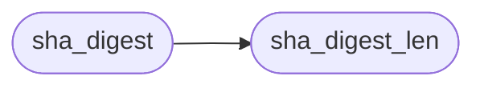

# `src/sha2.c`

> Source: [src/sha2.c:1](../../src/sha2.c#L1) | language `c` | coverage 42.9% | [API index](../index.md)

## Contents

- **Functions:** [`sha_digest_len`](#sha_digest_len), [`sha_alg_from_name`](#sha_alg_from_name), [`sha_digest`](#sha_digest)
- **Macros:** [`ROR32`](#ror32), [`ROL32`](#rol32), [`ROR64`](#ror64)

## Call Graph

Solid arrows stay in this module, dashed arrows leave it.



## Functions

<a id="sha_digest_len"></a>

### `sha_digest_len`

`function` | [src/sha2.c:12](../../src/sha2.c#L12)

```c
size_t sha_digest_len(sha_alg alg)
```

Digest length in bytes of alg (20/32/48/64), or 0 for an unknown alg.

**Parameters**

| Name | Type | Default | Description |
|---|---|---|---|
| `alg` | `sha_alg` |  |  |

**Returns:** `size_t`

> **Inherited:** Documentation from [`sha_digest_len`](#sha_digest_len) (include/sha2.h:21).

*Called by:* [`sha_digest`](#sha_digest)

---

<a id="sha_alg_from_name"></a>

### `sha_alg_from_name`

`function` | [src/sha2.c:31](../../src/sha2.c#L31)

```c
int sha_alg_from_name(const char *name, sha_alg *out)
```

Maps a WebCrypto algorithm name ("SHA-256", case-insensitive) to alg.

0 on success, -1 unknown.

**Parameters**

| Name | Type | Default | Description |
|---|---|---|---|
| `name` | `char *` |  |  |
| `out` | `sha_alg *` |  |  |

**Returns:** `int`

> **Inherited:** Documentation from [`sha_alg_from_name`](#sha_alg_from_name) (include/sha2.h:24).

---

<a id="sha_digest"></a>

### `sha_digest`

`function` | [src/sha2.c:152](../../src/sha2.c#L152)

```c
int sha_digest(sha_alg alg, const void *data, size_t len, uint8_t *out)
```

Hashes data[0..len) into out (>= sha_digest_len(alg) bytes).

0 on success, -1 on a bad argument. data may be NULL only when len == 0.

**Parameters**

| Name | Type | Default | Description |
|---|---|---|---|
| `alg` | `sha_alg` |  |  |
| `data` | `void *` |  |  |
| `len` | `size_t` |  |  |
| `out` | `uint8_t *` |  |  |

**Returns:** `int`

> **Inherited:** Documentation from [`sha_digest`](#sha_digest) (include/sha2.h:28).

*Calls:* [`sha_digest_len`](#sha_digest_len)

---

## Macros

<a id="ror32"></a>

### `ROR32`

`macro` | [src/sha2.c:8](../../src/sha2.c#L8)

```c
#define ROR32(x, n)
```

---

<a id="rol32"></a>

### `ROL32`

`macro` | [src/sha2.c:9](../../src/sha2.c#L9)

```c
#define ROL32(x, n)
```

---

<a id="ror64"></a>

### `ROR64`

`macro` | [src/sha2.c:10](../../src/sha2.c#L10)

```c
#define ROR64(x, n)
```

---
