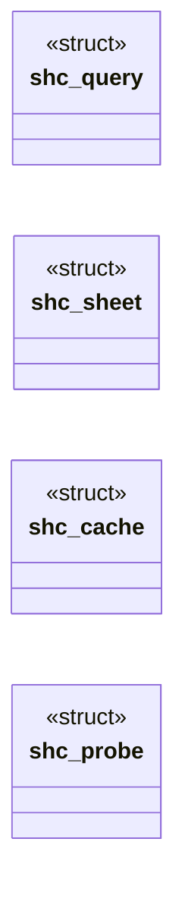
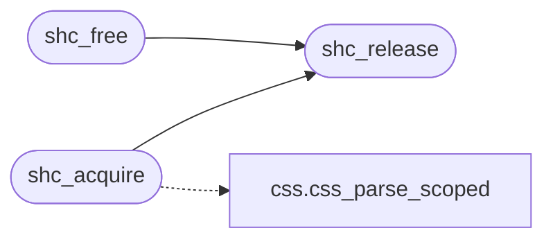

# `src/sheet_cache.c`

> Source: [src/sheet_cache.c:1](../../src/sheet_cache.c#L1) | language `c` | coverage 81.8% | [API index](../index.md)

sheet_cache -- see include/sheet_cache.h and spec/sheet_cache.md.

## Contents

- **Structs:** [`shc_query`](#shc_query), [`shc_sheet`](#shc_sheet), [`shc_cache`](#shc_cache), [`shc_probe`](#shc_probe)
- **Functions:** [`shc_new`](#shc_new), [`shc_release`](#shc_release), [`shc_free`](#shc_free), [`shc_css`](#shc_css), [`shc_stats_get`](#shc_stats_get), [`shc_acquire`](#shc_acquire)

## Type Diagram



## Call Graph

Solid arrows stay in this module, dashed arrows leave it.



## Structs

<a id="shc_query"></a>

### `shc_query`

`struct` | [src/sheet_cache.c:12](../../src/sheet_cache.c#L12)

```c
typedef struct shc_query
```

One question the parse asked the root matcher, and the answer it got.

---

<a id="shc_sheet"></a>

### `shc_sheet`

`struct` | [src/sheet_cache.c:17](../../src/sheet_cache.c#L17)

```c
struct shc_sheet
```

---

<a id="shc_cache"></a>

### `shc_cache`

`struct` | [src/sheet_cache.c:30](../../src/sheet_cache.c#L30)

```c
struct shc_cache
```

---

<a id="shc_probe"></a>

### `shc_probe`

`struct` | [src/sheet_cache.c:39](../../src/sheet_cache.c#L39)

```c
typedef struct shc_probe
```

Records what the root matcher is asked and what it answers.

The parse depends on the live DOM through these answers and nothing else, so a later derivation may reuse the sheet iff the matcher still answers every recorded question the same way.

---

## Functions

<a id="shc_new"></a>

### `shc_new`

`function` | [src/sheet_cache.c:89](../../src/sheet_cache.c#L89)

```c
shc_cache *shc_new(size_t max_text_bytes)
```

max_text_bytes: texts longer than this are parsed but never retained; 0 selects FC_SHC_MAX_TEXT_BYTES.

NULL on OOM.

**Parameters**

| Name | Type | Default | Description |
|---|---|---|---|
| `max_text_bytes` | `size_t` |  |  |

**Returns:** `shc_cache *`

> **Inherited:** Documentation from [`shc_new`](#shc_new) (include/sheet_cache.h:52).

---

<a id="shc_release"></a>

### `shc_release`

`function` | [src/sheet_cache.c:96](../../src/sheet_cache.c#L96)

```c
void shc_release(shc_sheet *s)
```

Drops one reference.

NULL-safe.

**Parameters**

| Name | Type | Default | Description |
|---|---|---|---|
| `s` | `shc_sheet *` |  |  |

> **Inherited:** Documentation from [`shc_release`](#shc_release) (include/sheet_cache.h:67).

*Called by:* [`shc_acquire`](#shc_acquire), [`shc_free`](#shc_free)

---

<a id="shc_free"></a>

### `shc_free`

`function` | [src/sheet_cache.c:101](../../src/sheet_cache.c#L101)

```c
void shc_free(shc_cache *c)
```

Drops the cache's own reference to its entry.

NULL-safe.

**Parameters**

| Name | Type | Default | Description |
|---|---|---|---|
| `c` | `shc_cache *` |  |  |

> **Inherited:** Documentation from [`shc_free`](#shc_free) (include/sheet_cache.h:55).

*Calls:* [`shc_release`](#shc_release)

---

<a id="shc_css"></a>

### `shc_css`

`function` `const` | [src/sheet_cache.c:107](../../src/sheet_cache.c#L107)

```c
const css_sheet *shc_css(const shc_sheet *s)
```

The read-only sheet behind a handle; NULL when the parse itself failed (the css module treats a NULL sheet as empty) or s is NULL.

**Parameters**

| Name | Type | Default | Description |
|---|---|---|---|
| `s` | `shc_sheet *` |  |  |

**Returns:** `css_sheet *`

> **Inherited:** Documentation from [`shc_css`](#shc_css) (include/sheet_cache.h:64).

---

<a id="shc_stats_get"></a>

### `shc_stats_get`

`function` | [src/sheet_cache.c:111](../../src/sheet_cache.c#L111)

```c
void shc_stats_get(const shc_cache *c, shc_stats *out)
```

Counters since shc_new; zeroes *out on a NULL cache.

**Parameters**

| Name | Type | Default | Description |
|---|---|---|---|
| `c` | `shc_cache *` |  |  |
| `out` | `shc_stats *` |  |  |

> **Inherited:** Documentation from [`shc_stats_get`](#shc_stats_get) (include/sheet_cache.h:70).

---

<a id="shc_acquire"></a>

### `shc_acquire`

`function` | [src/sheet_cache.c:155](../../src/sheet_cache.c#L155)

```c
shc_sheet *shc_acquire(shc_cache *cache, const shc_key *key)
```

The parsed sheet for *key: the retained one when every input matches, a fresh parse otherwise. cache == NULL parses without retaining.

Returns NULL on a NULL key, a NULL text with len > 0, len == SIZE_MAX, or OOM of the handle.

**Parameters**

| Name | Type | Default | Description |
|---|---|---|---|
| `cache` | `shc_cache *` |  |  |
| `key` | `shc_key *` |  |  |

**Returns:** `shc_sheet *`

> **Inherited:** Documentation from [`shc_acquire`](#shc_acquire) (include/sheet_cache.h:60).

*Calls:* [`css_parse_scoped`](src.css.c.md#css_parse_scoped), [`shc_release`](#shc_release)

---
