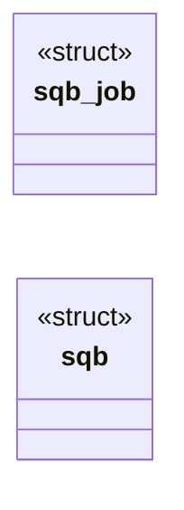
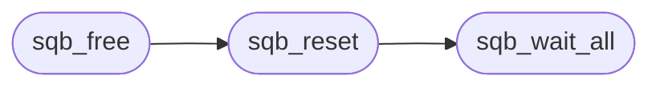

# `src/subreq_batch.c`

> Source: [src/subreq_batch.c:1](../../src/subreq_batch.c#L1) | language `c` | coverage 45.5% | [API index](../index.md)

## Contents

- **Structs:** [`sqb_job`](#sqb_job), [`sqb`](#sqb)
- **Functions:** [`sqb_new`](#sqb_new), [`sqb_submit`](#sqb_submit), [`sqb_count`](#sqb_count), [`sqb_wait_all`](#sqb_wait_all), [`sqb_result`](#sqb_result), [`sqb_reset`](#sqb_reset), [`sqb_free`](#sqb_free)
- **Macros:** [`_GNU_SOURCE`](#_gnu_source)

## Type Diagram



## Call Graph

Solid arrows stay in this module, dashed arrows leave it.



## Structs

<a id="sqb_job"></a>

### `sqb_job`

`struct` | [src/subreq_batch.c:11](../../src/subreq_batch.c#L11)

```c
typedef struct sqb_job
```

---

<a id="sqb"></a>

### `sqb`

`struct` | [src/subreq_batch.c:21](../../src/subreq_batch.c#L21)

```c
struct sqb
```

---

## Functions

<a id="sqb_new"></a>

### `sqb_new`

`function` | [src/subreq_batch.c:75](../../src/subreq_batch.c#L75)

```c
sqb *sqb_new(int max_threads, sqb_run_fn run, void *ctx)
```

**Parameters**

| Name | Type | Default | Description |
|---|---|---|---|
| `max_threads` | `int` |  |  |
| `run` | `sqb_run_fn` |  |  |
| `ctx` | `void *` |  |  |

**Returns:** `sqb *`

---

<a id="sqb_submit"></a>

### `sqb_submit`

`function` | [src/subreq_batch.c:86](../../src/subreq_batch.c#L86)

```c
int sqb_submit(sqb *b, int refused, const sqb_req *req)
```

Queues one request. refused != 0 queues a ready-made failure (no thread, no fetch) so the result count always equals the submit count.

Returns 0, or -1 when full / out of memory (nothing queued: the caller must answer the worker itself).

**Parameters**

| Name | Type | Default | Description |
|---|---|---|---|
| `b` | `sqb *` |  |  |
| `refused` | `int` |  |  |
| `req` | `sqb_req *` |  |  |

**Returns:** `int`

> **Inherited:** Documentation from [`sqb_submit`](#sqb_submit) (include/subreq_batch.h:41).

---

<a id="sqb_count"></a>

### `sqb_count`

`function` | [src/subreq_batch.c:112](../../src/subreq_batch.c#L112)

```c
size_t sqb_count(const sqb *b)
```

**Parameters**

| Name | Type | Default | Description |
|---|---|---|---|
| `b` | `sqb *` |  |  |

**Returns:** `size_t`

---

<a id="sqb_wait_all"></a>

### `sqb_wait_all`

`function` | [src/subreq_batch.c:114](../../src/subreq_batch.c#L114)

```c
void sqb_wait_all(sqb *b)
```

Joins every running request.

**Parameters**

| Name | Type | Default | Description |
|---|---|---|---|
| `b` | `sqb *` |  |  |

> **Inherited:** Documentation from [`sqb_wait_all`](#sqb_wait_all) (include/subreq_batch.h:44).

*Called by:* [`sqb_reset`](#sqb_reset)

---

<a id="sqb_result"></a>

### `sqb_result`

`function` `const` | [src/subreq_batch.c:122](../../src/subreq_batch.c#L122)

```c
const sqb_res *sqb_result(const sqb *b, size_t i)
```

Valid after sqb_wait_all, for i < sqb_count.

**Parameters**

| Name | Type | Default | Description |
|---|---|---|---|
| `b` | `sqb *` |  |  |
| `i` | `size_t` |  |  |

**Returns:** `sqb_res *`

> **Inherited:** Documentation from [`sqb_result`](#sqb_result) (include/subreq_batch.h:46).

---

<a id="sqb_reset"></a>

### `sqb_reset`

`function` | [src/subreq_batch.c:126](../../src/subreq_batch.c#L126)

```c
void sqb_reset(sqb *b)
```

Joins and frees every job and result; the batch is reusable.

**Parameters**

| Name | Type | Default | Description |
|---|---|---|---|
| `b` | `sqb *` |  |  |

> **Inherited:** Documentation from [`sqb_reset`](#sqb_reset) (include/subreq_batch.h:48).

*Calls:* [`sqb_wait_all`](#sqb_wait_all)

*Called by:* [`sqb_free`](#sqb_free)

---

<a id="sqb_free"></a>

### `sqb_free`

`function` | [src/subreq_batch.c:133](../../src/subreq_batch.c#L133)

```c
void sqb_free(sqb *b)
```

**Parameters**

| Name | Type | Default | Description |
|---|---|---|---|
| `b` | `sqb *` |  |  |

*Calls:* [`sqb_reset`](#sqb_reset)

---

## Macros

<a id="_gnu_source"></a>

### `_GNU_SOURCE`

`macro` | [src/subreq_batch.c:2](../../src/subreq_batch.c#L2)

```c
#define _GNU_SOURCE
```

subreq_batch -- see include/subreq_batch.h and spec/subreq_async.md.

---
