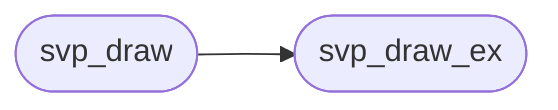

# `src/svg_paint.c`

> Source: [src/svg_paint.c:1](../../src/svg_paint.c#L1) | language `c` | coverage 66.7% | [API index](../index.md)

svg_paint — Cairo back end for the shapes svg_render extracted.

## Contents

- **Functions:** [`svp_draw`](#svp_draw), [`svp_draw_ex`](#svp_draw_ex)

## Call Graph

Solid arrows stay in this module, dashed arrows leave it.



## Functions

<a id="svp_draw"></a>

### `svp_draw`

`function` | [src/svg_paint.c:139](../../src/svg_paint.c#L139)

```c
void svp_draw(cairo_t *cr, const sv_image *img, double x, double y, double w, double h, int current_rgb)
```

Paints `img` into the rect [x, y, w, h] of `cr`, scaled uniformly and centred ("xMidYMid meet"). current_rgb is the inherited text colour, substituted wherever a shape asked for `currentColor` (packed 0xRRGGBB).

The Cairo state is saved and restored around the call, and painting is clipped to the rect, so a hostile transform can never draw outside the box the layout gave the image.

No-ops on a NULL argument or a non-positive rect.

**Parameters**

| Name | Type | Default | Description |
|---|---|---|---|
| `cr` | `cairo_t *` |  |  |
| `img` | `sv_image *` |  |  |
| `x` | `double` |  |  |
| `y` | `double` |  |  |
| `w` | `double` |  |  |
| `h` | `double` |  |  |
| `current_rgb` | `int` |  |  |

> **Inherited:** Documentation from [`svp_draw`](#svp_draw) (include/svg_paint.h:31).

*Calls:* [`svp_draw_ex`](#svp_draw_ex)

---

<a id="svp_draw_ex"></a>

### `svp_draw_ex`

`function` | [src/svg_paint.c:144](../../src/svg_paint.c#L144)

```c
void svp_draw_ex(cairo_t *cr, const sv_image *img, double x, double y, double w, double h, int current_rgb, int draw_text)
```

**Parameters**

| Name | Type | Default | Description |
|---|---|---|---|
| `cr` | `cairo_t *` |  |  |
| `img` | `sv_image *` |  |  |
| `x` | `double` |  |  |
| `y` | `double` |  |  |
| `w` | `double` |  |  |
| `h` | `double` |  |  |
| `current_rgb` | `int` |  |  |
| `draw_text` | `int` |  |  |

*Called by:* [`svp_draw`](#svp_draw), [`sr_rasterize`](src.svg_raster.c.md#sr_rasterize)

---
