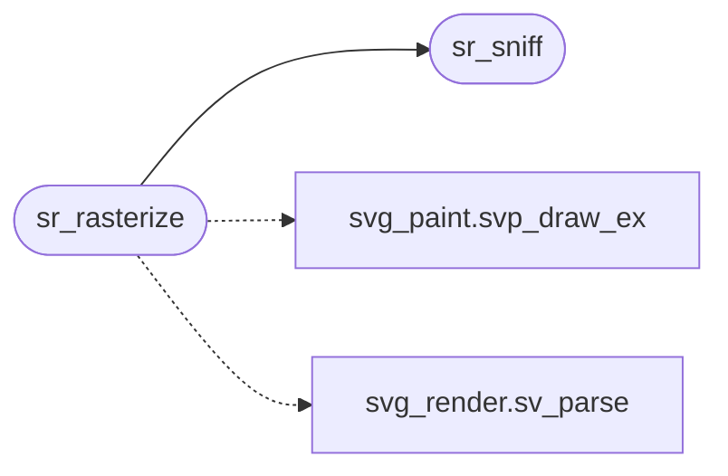

# `src/svg_raster.c`

> Source: [src/svg_raster.c:1](../../src/svg_raster.c#L1) | language `c` | coverage 66.7% | [API index](../index.md)

svg_raster -- SVG served as an image, rasterized inside the confined worker. spec/svg_raster.md.

## Contents

- **Functions:** [`sr_sniff`](#sr_sniff), [`sr_rasterize`](#sr_rasterize)

## Call Graph

Solid arrows stay in this module, dashed arrows leave it.



## Functions

<a id="sr_sniff"></a>

### `sr_sniff`

`function` | [src/svg_raster.c:25](../../src/svg_raster.c#L25)

```c
int sr_sniff(const uint8_t *bytes, size_t len)
```

1 when the first element of the document (after BOM, whitespace, the XML declaration, comments and a doctype) is <svg; 0 otherwise.

Pure.

**Parameters**

| Name | Type | Default | Description |
|---|---|---|---|
| `bytes` | `uint8_t *` |  |  |
| `len` | `size_t` |  |  |

**Returns:** `int`

> **Inherited:** Documentation from [`sr_sniff`](#sr_sniff) (include/svg_raster.h:29).

*Called by:* [`sr_rasterize`](#sr_rasterize)

---

<a id="sr_rasterize"></a>

### `sr_rasterize`

`function` | [src/svg_raster.c:50](../../src/svg_raster.c#L50)

```c
img_status sr_rasterize(const uint8_t *bytes, size_t len, img_pixels *out)
```

**Parameters**

| Name | Type | Default | Description |
|---|---|---|---|
| `bytes` | `uint8_t *` |  |  |
| `len` | `size_t` |  |  |
| `out` | `img_pixels *` |  |  |

**Returns:** `img_status`

*Calls:* [`svp_draw_ex`](src.svg_paint.c.md#svp_draw_ex), [`sr_sniff`](#sr_sniff), [`sv_parse`](src.svg_render.c.md#sv_parse)

---
