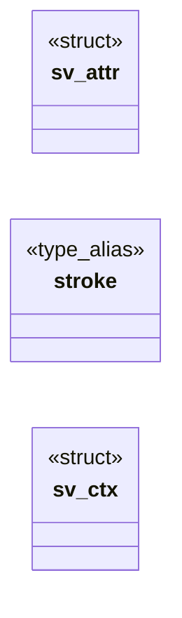

# `src/svg_render.c`

> Source: [src/svg_render.c:1](../../src/svg_render.c#L1) | language `c` | coverage 55.6% | [API index](../index.md)

svg_render — inline <svg> markup -> a bounded list of geometric shapes.

## Contents

- **Structs:** [`sv_attr`](#sv_attr), [`sv_ctx`](#sv_ctx)
- **Type Aliases:** [`stroke`](#stroke)
- **Functions:** [`point`](#point), [`sv_fit`](#sv_fit), [`sv_parse`](#sv_parse), [`sv_parse_ex`](#sv_parse_ex)
- **Macros:** [`SV_MAX_ATTRS`](#sv_max_attrs)

## Type Diagram



## Call Graph

Solid arrows stay in this module, dashed arrows leave it.


## Structs

<a id="sv_attr"></a>

### `sv_attr`

`struct` | [src/svg_render.c:91](../../src/svg_render.c#L91)

```c
typedef struct sv_attr
```

One attribute of the tag currently being scanned.

---

<a id="sv_ctx"></a>

### `sv_ctx`

`struct` | [src/svg_render.c:151](../../src/svg_render.c#L151)

```c
typedef struct sv_ctx
```

The presentation context an element inherits from its <g> chain, plus the accumulated transform.

Copied by value at each level, so a group can never leak its state to a later sibling.

---

## Type Aliases

<a id="stroke"></a>

### `stroke`

`type_alias` | [src/svg_render.c:151](../../src/svg_render.c#L151)

```c
typedef struct sv_ctx { int fill, stroke;
```

The presentation context an element inherits from its <g> chain, plus the accumulated transform.

Copied by value at each level, so a group can never leak its state to a later sibling.

---

## Functions

<a id="point"></a>

### `point`

`function` | [src/svg_render.c:556](../../src/svg_render.c#L556)

```c
* current point (SVG 8.3.6). */ int had = (prev == 'C' || prev == 'c' || prev == 'S' || prev == 's');
```

**Parameters**

| Name | Type | Default | Description |
|---|---|---|---|
| `SVG` |  |  |  |

**Returns:** `* current`

---

<a id="sv_fit"></a>

### `sv_fit`

`function` | [src/svg_render.c:743](../../src/svg_render.c#L743)

```c
void sv_fit(const sv_image *img, double dw, double dh, double *scale, double *off_x, double *off_y)
```

Maps the image's user space onto the destination rect [dx, dy, dw, dh] the way a `preserveAspectRatio="xMidYMid meet"` SVG does: uniform scale, centred.

Writes the scale and the translation the painter must apply. Never divides by zero (a degenerate viewBox yields scale 1 and no offset).

**Parameters**

| Name | Type | Default | Description |
|---|---|---|---|
| `img` | `sv_image *` |  |  |
| `dw` | `double` |  |  |
| `dh` | `double` |  |  |
| `scale` | `double *` |  |  |
| `off_x` | `double *` |  |  |
| `off_y` | `double *` |  |  |

> **Inherited:** Documentation from [`sv_fit`](#sv_fit) (include/svg_render.h:131).

---

<a id="sv_parse"></a>

### `sv_parse`

`function` | [src/svg_render.c:763](../../src/svg_render.c#L763)

```c
sv_status sv_parse(const char *markup, size_t len, sv_image *out)
```

**Parameters**

| Name | Type | Default | Description |
|---|---|---|---|
| `markup` | `char *` |  |  |
| `len` | `size_t` |  |  |
| `out` | `sv_image *` |  |  |

**Returns:** `sv_status`

*Calls:* [`sv_parse_ex`](#sv_parse_ex)

*Called by:* [`LLVMFuzzerTestOneInput`](fuzz.fuzz_svg_render.c.md#llvmfuzzertestoneinput)

---

<a id="sv_parse_ex"></a>

### `sv_parse_ex`

`function` | [src/svg_render.c:767](../../src/svg_render.c#L767)

```c
sv_status sv_parse_ex(const char *markup, size_t len, sv_image *out, int root_fill)
```

**Parameters**

| Name | Type | Default | Description |
|---|---|---|---|
| `markup` | `char *` |  |  |
| `len` | `size_t` |  |  |
| `out` | `sv_image *` |  |  |
| `root_fill` | `int` |  |  |

**Returns:** `sv_status`

*Called by:* [`sv_parse`](#sv_parse)

---

## Macros

<a id="sv_max_attrs"></a>

### `SV_MAX_ATTRS`

`macro` | [src/svg_render.c:96](../../src/svg_render.c#L96)

```c
#define SV_MAX_ATTRS
```

---
