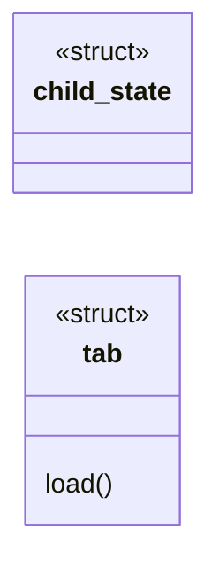
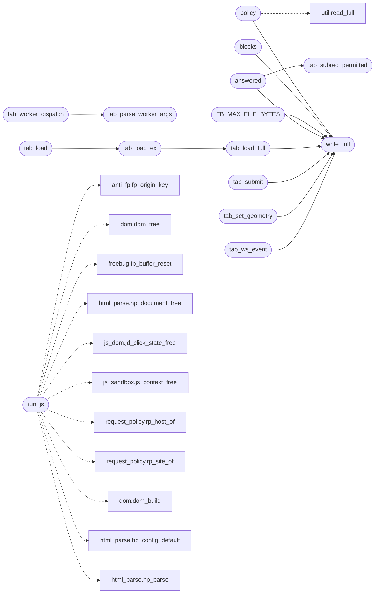

# `src/tab.c`

> Source: [src/tab.c:1](../../src/tab.c#L1) | language `c` | coverage 36.8% | [API index](../index.md)

## Contents

- **Structs:** [`child_state`](#child_state), [`tab`](#tab)
- **Functions:** [`policy`](#policy), [`run_js`](#run_js), [`buffer`](#buffer), [`host`](#host), [`blocks`](#blocks), [`FB_MAX_FILE_BYTES`](#fb_max_file_bytes), [`run`](#run), [`window`](#window), [`fallback`](#fallback), [`WHERE`](#where), [`content`](#content), [`once`](#once), [`swap`](#swap), [`write_full`](#write_full), [`EPIPE`](#epipe), [`tzset`](#tzset), [`depth`](#depth), [`tab_parse_worker_args`](#tab_parse_worker_args), [`tab_worker_dispatch`](#tab_worker_dispatch), [`tests`](#tests), [`layout`](#layout), [`column`](#column), [`tab_set_fetcher`](#tab_set_fetcher), [`tab_set_css_sink`](#tab_set_css_sink), [`tab_set_net_allowed`](#tab_set_net_allowed), [`tab_set_css_allowed`](#tab_set_css_allowed), [`tab_last_subreq_stats`](#tab_last_subreq_stats), [`tab_set_viewport_w`](#tab_set_viewport_w), [`tab_set_cookies`](#tab_set_cookies), [`tab_subreq_permitted`](#tab_subreq_permitted), [`answered`](#answered), [`tab_load`](#tab_load), [`tab_load_ex`](#tab_load_ex), [`tab_load_full`](#tab_load_full), [`tab_click`](#tab_click), [`tab_tick`](#tab_tick), [`tab_submit`](#tab_submit), [`tab_read_view`](#tab_read_view), [`tab_eval`](#tab_eval), [`tab_decode_image`](#tab_decode_image), [`tab_decode_image_data_url`](#tab_decode_image_data_url), [`tab_alive`](#tab_alive), [`tab_child_pid`](#tab_child_pid), [`tab_close`](#tab_close), [`tab_page_free`](#tab_page_free), [`tab_eval_result_free`](#tab_eval_result_free), [`tab_image_free`](#tab_image_free), [`tab_set_geometry`](#tab_set_geometry), [`tab_popstate`](#tab_popstate), [`tab_ws_event`](#tab_ws_event), [`tab_set_storage`](#tab_set_storage)
- **Macros:** [`_GNU_SOURCE`](#_gnu_source), [`TAB_SCREEN_W`](#tab_screen_w), [`TAB_WIRE_HEAD_N`](#tab_wire_head_n), [`TAB_WIRE_A_N`](#tab_wire_a_n), [`TAB_WIRE_B_N`](#tab_wire_b_n), [`TAB_WIRE_BOX_F_N`](#tab_wire_box_f_n), [`TAB_WIRE_GRID_N`](#tab_wire_grid_n), [`TAB_MAX_RUNS`](#tab_max_runs), [`PV_MAX_CONTAINERS_WIRE`](#pv_max_containers_wire), [`TAB_MAX_URL`](#tab_max_url), [`TAB_MAX_WS_MSG`](#tab_max_ws_msg), [`TAB_MAX_STORAGE`](#tab_max_storage), [`TAB_MAX_HIST_OPS`](#tab_max_hist_ops), [`TAB_MAX_HIST_BYTES`](#tab_max_hist_bytes), [`TAB_MAX_OPENS`](#tab_max_opens), [`TAB_MAX_OPEN_BYTES`](#tab_max_open_bytes), [`TAB_MAX_GEOM_WORDS`](#tab_max_geom_words), [`TAB_MAX_SUBREQ`](#tab_max_subreq), [`TAB_MAX_SUBRESOURCE`](#tab_max_subresource), [`TAB_MAX_JS_JOBS`](#tab_max_js_jobs), [`TAB_MAX_EXTERN_CSS`](#tab_max_extern_css)

## Type Diagram



## Call Graph

Solid arrows stay in this module, dashed arrows leave it.



## Structs

<a id="child_state"></a>

### `child_state`

`struct` | [src/tab.c:125](../../src/tab.c#L125)

```c
typedef struct child_state
```

---

<a id="tab"></a>

### `tab`

`struct` | [src/tab.c:1942](../../src/tab.c#L1942)

```c
struct tab
```

**Members**

| Member | Kind | Summary |
|---|---|---|
| [`load`](#tab-load) | method |  |

<a id="tab-load"></a>

#### `tab.load`

`method` | [src/tab.c:1949](../../src/tab.c#L1949)

```c
* subresource requests this load (set per page: host in allow.conf AND js.conf);
```

**Parameters**

| Name | Type | Default | Description |
|---|---|---|---|
| `conf` | `set per page: host in allow.conf AND js.` |  |  |

**Returns:** `* subresource requests this`

---

## Functions

<a id="policy"></a>

### `policy`

`function` | [src/tab.c:176](../../src/tab.c#L176)

```c
* policy (host blocklist/tracker filter, realm routing, TLS-PQ) before fetching, so a * compromi...
```

**Parameters**

| Name | Type | Default | Description |
|---|---|---|---|
| `filter` | `host blocklist/tracker` |  |  |
| `routing` | `realm` |  |  |
| `PQ` | `TLS-` |  |  |

**Returns:** `*`

*Calls:* [`read_full`](include.util.h.md#read_full), [`write_full`](#write_full)

---

<a id="run_js"></a>

### `run_js`

`function` | [src/tab.c:230](../../src/tab.c#L230)

```c
* regardless of run_js (a no-JS load simply never records a request). */ static int child_load(ch...
```

**Parameters**

| Name | Type | Default | Description |
|---|---|---|---|
| `request` | `a no-JS load simply never records a` |  |  |

**Returns:** `* regardless of`

*Calls:* [`fp_origin_key`](include.anti_fp.h.md#fp_origin_key), [`dom_free`](include.dom.h.md#dom_free), [`fb_buffer_reset`](include.freebug.h.md#fb_buffer_reset), [`hp_document_free`](include.html_parse.h.md#hp_document_free), [`jd_click_state_free`](include.js_dom.h.md#jd_click_state_free), [`js_context_free`](include.js_sandbox.h.md#js_context_free), [`rp_host_of`](include.request_policy.h.md#rp_host_of), [`rp_site_of`](include.request_policy.h.md#rp_site_of), [`dom_build`](src.dom.c.md#dom_build), [`hp_config_default`](src.html_parse.c.md#hp_config_default), [`hp_parse`](src.html_parse.c.md#hp_parse), [`jd_install`](src.js_dom.c.md#jd_install) and 9 more

---

<a id="buffer"></a>

### `buffer`

`function` | [src/tab.c:273](../../src/tab.c#L273)

```c
* the buffer (stable child_state member) is wired into the new context's runtime * opaque. Installed regardless of run_js so the REPL works on any page. */ fb_buffer_reset(&cs->log);
```

**Parameters**

| Name | Type | Default | Description |
|---|---|---|---|
| `member` | `stable child_state` |  |  |

**Returns:** `* the`

---

<a id="host"></a>

### `host`

`function` | [src/tab.c:285](../../src/tab.c#L285)

```c
* granted net access for this host (allow.conf AND js.conf). Otherwise they stay * undefined (Same-Origin-by-construction holds). child_fetch still refuses unless * net_active is set during the script
```

**Parameters**

| Name | Type | Default | Description |
|---|---|---|---|
| `conf` | `allow.conf AND js.` |  |  |

**Returns:** `* granted net access for this`

---

<a id="blocks"></a>

### `blocks`

`function` | [src/tab.c:331](../../src/tab.c#L331)

```c
* The scalar fields are marshalled as bulk int32 blocks (head[6], block A[36], the * grid array, block B[26]) exactly like the box-def f[] array, NOT one write_full per * field: the block literal lists each field once, so read_view mirrors it by index and * a desync becomes structurally hard. Adding a field is one entry in the write block + * one in the read extraction, like the box def. NO tags/versioning: the worker is the * SAME binary as the parent (/proc/self/exe --tab-worker), so write_view and read_view * are always the same build -- there is no version skew to tolerate. */ static int write_view(int wfd, const pv_view *v)
```

**Parameters**

| Name | Type | Default | Description |
|---|---|---|---|
| `head` |  |  |  |
| `A` | `block [36]` |  |  |
| `array` | `the * grid` |  |  |
| `B` | `block [26]` |  |  |

**Returns:** `* The scalar fields are marshalled as bulk int32`

*Calls:* [`pv_at`](include.page_view.h.md#pv_at), [`pv_box_at`](include.page_view.h.md#pv_box_at), [`pv_box_count`](include.page_view.h.md#pv_box_count), [`pv_cont_at`](include.page_view.h.md#pv_cont_at), [`pv_cont_count`](include.page_view.h.md#pv_cont_count), [`pv_count`](include.page_view.h.md#pv_count), [`write_full`](#write_full)

---

<a id="fb_max_file_bytes"></a>

### `FB_MAX_FILE_BYTES`

`function` | [src/tab.c:722](../../src/tab.c#L722)

```c
* FB_MAX_FILE_BYTES (the buffer enforces all), so a hostile worker cannot amplify * the stream. ...
```

A stored source name is truncated to this many bytes (NUL excluded).

It is not counted against FB_MAX_TOTAL_BYTES: entries are capped, so total file memory is bounded at FB_MAX_ENTRIES * FB_MAX_FILE_BYTES regardless.

**Parameters**

| Name | Type | Default | Description |
|---|---|---|---|
| `all` | `the buffer enforces` |  |  |

**Returns:** `*`

> **Inherited:** Documentation from [`FB_MAX_FILE_BYTES`](#fb_max_file_bytes) (include/freebug.h:62).

*Calls:* [`fb_buffer_at`](include.freebug.h.md#fb_buffer_at), [`fb_buffer_count`](include.freebug.h.md#fb_buffer_count), [`write_full`](#write_full)

---

<a id="run"></a>

### `run`

`function` | [src/tab.c:801](../../src/tab.c#L801)

```c
* already contains a PV_VIDEO run (avoids duplicates on repeated injection). * Call after every ...
```

**Parameters**

| Name | Type | Default | Description |
|---|---|---|---|
| `injection` | `avoids duplicates on repeated` |  |  |

**Returns:** `* already contains a PV_VIDEO`

*Calls:* [`dom_get_attribute`](include.dom.h.md#dom_get_attribute), [`pv_at`](include.page_view.h.md#pv_at), [`pv_count`](include.page_view.h.md#pv_count), [`dom_get_by_tag`](src.dom.c.md#dom_get_by_tag), [`pv_append_video`](src.page_view.c.md#pv_append_video)

---

<a id="window"></a>

### `window`

`function` | [src/tab.c:922](../../src/tab.c#L922)

```c
* net window (cs->net_active). */ static void child_fetch_stylesheets(child_state *cs)
```

**Parameters**

| Name | Type | Default | Description |
|---|---|---|---|
| `net_active` | `cs->` |  |  |

**Returns:** `* net`

*Calls:* [`dropped`](include.html_parse.h.md#dropped), [`hp_extract_stylesheet_hrefs`](include.html_parse.h.md#hp_extract_stylesheet_hrefs), [`hp_free_stylesheet_hrefs`](include.html_parse.h.md#hp_free_stylesheet_hrefs)

---

<a id="fallback"></a>

### `fallback`

`function` | [src/tab.c:1043](../../src/tab.c#L1043)

```c
* <noscript> fallback (rendered only under js=0) inflates the block * count and the fuller-view heuristic picks it even with JS on. */ (void)pv_build_styled(cs->doc, run_js, reader, prefers_dark, cs->
```

**Parameters**

| Name | Type | Default | Description |
|---|---|---|---|
| `js` | `rendered only under` | `0` |  |

**Returns:** `* <noscript>`

---

<a id="where"></a>

### `WHERE`

`function` | [src/tab.c:1201](../../src/tab.c#L1201)

```c
* the console still says WHERE (a module's URL, "inline #n", a src). */ if (es != JS_OK && r.is_exception && r.value != NULL) fb_buffer_push_loc(&cs->log, FB_ERROR, r.value, r.value_len, r.file != NUL
```

**Parameters**

| Name | Type | Default | Description |
|---|---|---|---|
| `src` | `a module's URL, "inline #n", a` |  |  |

**Returns:** `* the console still says`

---

<a id="content"></a>

### `content`

`function` | [src/tab.c:1234](../../src/tab.c#L1234)

```c
* content (same-origin fetches through the trusted parent), scan for * video URLs (.m3u8), and create <video> elements in the DOM for any * found. */ if (cs->idx != NULL) jd_process_iframes(cs->js, cs
```

**Parameters**

| Name | Type | Default | Description |
|---|---|---|---|
| `parent` | `same-origin fetches through the trusted` |  |  |

**Returns:** `*`

---

<a id="once"></a>

### `once`

`function` | [src/tab.c:1279](../../src/tab.c#L1279)

```c
* ensures the preserved view gets the video only once (initial load). */ inject_video_into_view(cs, &view);
```

**Parameters**

| Name | Type | Default | Description |
|---|---|---|---|
| `load` | `initial` |  |  |

**Returns:** `* ensures the preserved view gets the video only`

---

<a id="swap"></a>

### `swap`

`function` | [src/tab.c:1288](../../src/tab.c#L1288)

```c
* display:none hiding an element via class swap (CSS, not * DOM removal). */ if (ok && v...
```

**Parameters**

| Name | Type | Default | Description |
|---|---|---|---|
| `removal` | `not * DOM` |  |  |

**Returns:** `* display:none hiding an element via`

*Calls:* [`pv_count`](include.page_view.h.md#pv_count)

---

<a id="write_full"></a>

### `write_full`

`function` | [src/tab.c:1308](../../src/tab.c#L1308)

```c
&& write_full(wfd, &xl, sizeof xl) == 0 && (xl == 0 || write_full(wfd, text, xl) == 0) && write_view(wfd, write_which) == 0 && write_full(wfd, &nlen, sizeof nlen) == 0 && (nlen == 0 || write_full(wfd,
```

**Parameters**

| Name | Type | Default | Description |
|---|---|---|---|
| `xl` |  |  |  |
| `xl` | `sizeof` |  |  |

**Returns:** `&&`

*Called by:* [`FB_MAX_FILE_BYTES`](#fb_max_file_bytes), [`answered`](#answered), [`blocks`](#blocks), [`policy`](#policy), [`tab_load_full`](#tab_load_full), [`tab_set_geometry`](#tab_set_geometry), [`tab_submit`](#tab_submit), [`tab_ws_event`](#tab_ws_event)

---

<a id="epipe"></a>

### `EPIPE`

`function` | [src/tab.c:1714](../../src/tab.c#L1714)

```c
* surfaces as EPIPE (graceful loop exit), not a signal. */ ignore_sigpipe();
```

**Parameters**

| Name | Type | Default | Description |
|---|---|---|---|
| `exit` | `graceful loop` |  |  |

**Returns:** `* surfaces as`

---

<a id="tzset"></a>

### `tzset`

`function` | [src/tab.c:1730](../../src/tab.c#L1730)

```c
* tzset() caches it while syscalls are still unrestricted. */ setenv("TZ", "UTC0", 1);
```

**Returns:** `*`

---

<a id="depth"></a>

### `depth`

`function` | [src/tab.c:1735](../../src/tab.c#L1735)

```c
* defense in depth (seccomp already excludes open/socket/exec);
```

**Parameters**

| Name | Type | Default | Description |
|---|---|---|---|
| `exec` | `seccomp already excludes open/socket/` |  |  |

**Returns:** `* defense in`

*Called by:* [`form`](include.render_doc.h.md#form)

---

<a id="tab_parse_worker_args"></a>

### `tab_parse_worker_args`

`function` | [src/tab.c:1922](../../src/tab.c#L1922)

```c
int tab_parse_worker_args(int argc, const char *const *argv, int *rfd, int *wfd)
```

Pure validator of the worker handoff arguments (the security-relevant surface of the exec): returns nonzero and writes the two fds iff argv is exactly "<prog> --tab-worker <rfd> <wfd>" with both fds non-negative decimal integers within a sane bound.

No side effects; fail-closed (any malformation => 0).

**Parameters**

| Name | Type | Default | Description |
|---|---|---|---|
| `argc` | `int` |  |  |
| `argv` | `char *const *` |  |  |
| `rfd` | `int *` |  |  |
| `wfd` | `int *` |  |  |

**Returns:** `int`

> **Inherited:** Documentation from [`tab_parse_worker_args`](#tab_parse_worker_args) (include/tab.h:163).

*Calls:* [`strcmp`](gui.browser_ui.c.md#strcmp)

*Called by:* [`tab_worker_dispatch`](#tab_worker_dispatch)

---

<a id="tab_worker_dispatch"></a>

### `tab_worker_dispatch`

`function` | [src/tab.c:1932](../../src/tab.c#L1932)

```c
void tab_worker_dispatch(int argc, char **argv)
```

**Parameters**

| Name | Type | Default | Description |
|---|---|---|---|
| `argc` | `int` |  |  |
| `argv` | `char **` |  |  |

*Calls:* [`tab_parse_worker_args`](#tab_parse_worker_args)

---

<a id="tests"></a>

### `tests`

`function` | [src/tab.c:2087](../../src/tab.c#L2087)

```c
* here lost the reserved box in the real browser while the page_view * tests (which never cross the pipe) stayed green. */ st = pv_append_image(v, heading, brk, text, (src != NULL) ? src : "", img_w,
```

**Parameters**

| Name | Type | Default | Description |
|---|---|---|---|
| `pipe` | `which never cross the` |  |  |

**Returns:** `* here lost the reserved box in the real browser while the page_view *`

---

<a id="layout"></a>

### `layout`

`function` | [src/tab.c:2190](../../src/tab.c#L2190)

```c
* only at layout (bx_lp_px): setting one without the other would make * the pair disagree about the same property. */ pv_set_box_pct(v, (int)bwpct, (int)b[36], (int)b[37], (int)b[38], (int)b[39]);
```

**Returns:** `setting one without the other would make * the pair disagree about the same property. */ pv_set_box_pct(v, (int)bwpct, (int)b[36], (int)b[37], (int)b[38], (int)b[39])`

---

<a id="column"></a>

### `column`

`function` | [src/tab.c:2201](../../src/tab.c#L2201)

```c
* a narrow column (jkanime's player). Mirrors the emission side, where a * control now carries the same annotation as text runs. */ pv_set_container(v, (int)cid, (int)cdisp, (int)cgap, (int)cjust, (in
```

**Parameters**

| Name | Type | Default | Description |
|---|---|---|---|
| `player` | `jkanime's` |  |  |

**Returns:** `* a narrow`

---

<a id="tab_set_fetcher"></a>

### `tab_set_fetcher`

`function` | [src/tab.c:2628](../../src/tab.c#L2628)

```c
void tab_set_fetcher(tab *t, tab_fetch_fn fn, void *ctx)
```

Installs the subresource fetcher used for XHR/fetch (NULL clears it: requests are then refused). fn/ctx must outlive any tab_load_full call that may trigger a subresource.

**Parameters**

| Name | Type | Default | Description |
|---|---|---|---|
| `t` | `tab *` |  |  |
| `fn` | `tab_fetch_fn` |  |  |
| `ctx` | `void *` |  |  |

> **Inherited:** Documentation from [`tab_set_fetcher`](#tab_set_fetcher) (include/tab.h:186).

---

<a id="tab_set_css_sink"></a>

### `tab_set_css_sink`

`function` | [src/tab.c:2634](../../src/tab.c#L2634)

```c
void tab_set_css_sink(tab *t, tab_css_sink_fn fn, void *ctx)
```

**Parameters**

| Name | Type | Default | Description |
|---|---|---|---|
| `t` | `tab *` |  |  |
| `fn` | `tab_css_sink_fn` |  |  |
| `ctx` | `void *` |  |  |

---

<a id="tab_set_net_allowed"></a>

### `tab_set_net_allowed`

`function` | [src/tab.c:2640](../../src/tab.c#L2640)

```c
void tab_set_net_allowed(tab *t, int allowed)
```

Grants/revokes page-JS network access (XMLHttpRequest/fetch) for the NEXT load.

Set it true ONLY when the page's host is in BOTH allow.conf AND js.conf (the sovereignty boundary); false (default) keeps XHR/fetch undefined (Same-Origin-by-construction).

**Parameters**

| Name | Type | Default | Description |
|---|---|---|---|
| `t` | `tab *` |  |  |
| `allowed` | `int` |  |  |

> **Inherited:** Documentation from [`tab_set_net_allowed`](#tab_set_net_allowed) (include/tab.h:204).

---

<a id="tab_set_css_allowed"></a>

### `tab_set_css_allowed`

`function` | [src/tab.c:2645](../../src/tab.c#L2645)

```c
void tab_set_css_allowed(tab *t, int allowed)
```

**Parameters**

| Name | Type | Default | Description |
|---|---|---|---|
| `t` | `tab *` |  |  |
| `allowed` | `int` |  |  |

---

<a id="tab_last_subreq_stats"></a>

### `tab_last_subreq_stats`

`function` | [src/tab.c:2650](../../src/tab.c#L2650)

```c
void tab_last_subreq_stats(const tab *t, size_t *count, uint64_t *total_us)
```

Subresources the parent served for the LAST load (the worker's TAG_SUBREQ: XHR, fetch, external scripts, ES modules): how many, and the total wall time the worker spent blocked on them, in microseconds.

A diagnostic (FREEDOM_PERF): it separates "the page's JS is slow" from "the page waited on the network".

**Parameters**

| Name | Type | Default | Description |
|---|---|---|---|
| `t` | `tab *` |  |  |
| `count` | `size_t *` |  |  |
| `total_us` | `uint64_t *` |  |  |

> **Inherited:** Documentation from [`tab_last_subreq_stats`](#tab_last_subreq_stats) (include/tab.h:236).

---

<a id="tab_set_viewport_w"></a>

### `tab_set_viewport_w`

`function` | [src/tab.c:2655](../../src/tab.c#L2655)

```c
void tab_set_viewport_w(tab *t, int px)
```

Sets the render viewport width (px) used to evaluate @media width queries on the NEXT load, so a responsive page selects the same breakpoint the paint width would (the page is painted at this width). <= 0 restores the normalized default.

Only the @media width query sees it; viewport UNITS (vw/vh) still resolve against the fixed normalized desktop, so no real geometry leaks into computed lengths.

**Parameters**

| Name | Type | Default | Description |
|---|---|---|---|
| `t` | `tab *` |  |  |
| `px` | `int` |  |  |

> **Inherited:** Documentation from [`tab_set_viewport_w`](#tab_set_viewport_w) (include/tab.h:230).

---

<a id="tab_set_cookies"></a>

### `tab_set_cookies`

`function` | [src/tab.c:2660](../../src/tab.c#L2660)

```c
void tab_set_cookies(tab *t, const char *cookies)
```

Seeds the page's document.cookie jar for the NEXT load with cookies ("name=value; ...") the trusted parent read from its ephemeral network jar (sf_cookie_header_for).

Only meaningful for a trusted host (allow.conf AND js.conf); pass NULL/"" otherwise so the jar stays disabled (untrusted sites see no cookies -- Zero Knowledge). The bytes are copied. In-memory only; never persisted.

**Parameters**

| Name | Type | Default | Description |
|---|---|---|---|
| `t` | `tab *` |  |  |
| `cookies` | `char *` |  |  |

> **Inherited:** Documentation from [`tab_set_cookies`](#tab_set_cookies) (include/tab.h:211).

---

<a id="tab_subreq_permitted"></a>

### `tab_subreq_permitted`

`function` | [src/tab.c:2666](../../src/tab.c#L2666)

```c
int tab_subreq_permitted(int net_allowed, int css_allowed, const char *method)
```

Pure parent-side subresource gate (Zero Trust: decided from the PARENT's grants for this load, never the worker's claims): net_allowed permits any well-formed method; css_allowed alone permits exactly "GET"; a NULL/empty method or no grant is refused.

**Parameters**

| Name | Type | Default | Description |
|---|---|---|---|
| `net_allowed` | `int` |  |  |
| `css_allowed` | `int` |  |  |
| `method` | `char *` |  |  |

**Returns:** `int`

> **Inherited:** Documentation from [`tab_subreq_permitted`](#tab_subreq_permitted) (include/tab.h:241).

*Calls:* [`strcmp`](gui.browser_ui.c.md#strcmp)

*Called by:* [`answered`](#answered)

---

<a id="answered"></a>

### `answered`

`function` | [src/tab.c:2678](../../src/tab.c#L2678)

```c
* A refused frame is still consumed and answered (status 0), so the protocol never * desyncs. Re...
```

**Parameters**

| Name | Type | Default | Description |
|---|---|---|---|
| `status` |  |  |  |

**Returns:** `* A refused frame is still consumed and`

*Calls:* [`tab_subreq_permitted`](#tab_subreq_permitted), [`write_full`](#write_full)

---

<a id="tab_load"></a>

### `tab_load`

`function` | [src/tab.c:2922](../../src/tab.c#L2922)

```c
tab_status tab_load(tab *t, const char *html, size_t len, tab_page *out)
```

**Parameters**

| Name | Type | Default | Description |
|---|---|---|---|
| `t` | `tab *` |  |  |
| `html` | `char *` |  |  |
| `len` | `size_t` |  |  |
| `out` | `tab_page *` |  |  |

**Returns:** `tab_status`

*Calls:* [`tab_load_ex`](#tab_load_ex)

---

<a id="tab_load_ex"></a>

### `tab_load_ex`

`function` | [src/tab.c:2926](../../src/tab.c#L2926)

```c
tab_status tab_load_ex(tab *t, const char *html, size_t len, int run_js, tab_page *out)
```

**Parameters**

| Name | Type | Default | Description |
|---|---|---|---|
| `t` | `tab *` |  |  |
| `html` | `char *` |  |  |
| `len` | `size_t` |  |  |
| `run_js` | `int` |  |  |
| `out` | `tab_page *` |  |  |

**Returns:** `tab_status`

*Calls:* [`tab_load_full`](#tab_load_full)

*Called by:* [`tab_load`](#tab_load)

---

<a id="tab_load_full"></a>

### `tab_load_full`

`function` | [src/tab.c:2930](../../src/tab.c#L2930)

```c
tab_status tab_load_full(tab *t, const char *html, size_t len, const char *page_url, int run_js, int reader, int prefers_dark, tab_page *out)
```

**Parameters**

| Name | Type | Default | Description |
|---|---|---|---|
| `t` | `tab *` |  |  |
| `html` | `char *` |  |  |
| `len` | `size_t` |  |  |
| `page_url` | `char *` |  |  |
| `run_js` | `int` |  |  |
| `reader` | `int` |  |  |
| `prefers_dark` | `int` |  |  |
| `out` | `tab_page *` |  |  |

**Returns:** `tab_status`

*Calls:* [`fb_buffer_free`](include.freebug.h.md#fb_buffer_free), [`fb_buffer_init`](include.freebug.h.md#fb_buffer_init), [`pv_free`](include.page_view.h.md#pv_free), [`read_full`](include.util.h.md#read_full), [`write_full`](#write_full)

*Called by:* [`tab_load_ex`](#tab_load_ex)

---

<a id="tab_click"></a>

### `tab_click`

`function` | [src/tab.c:3125](../../src/tab.c#L3125)

```c
tab_status tab_click(tab *t, dom_node_id node_id, tab_page *out)
```

**Parameters**

| Name | Type | Default | Description |
|---|---|---|---|
| `t` | `tab *` |  |  |
| `node_id` | `dom_node_id` |  |  |
| `out` | `tab_page *` |  |  |

**Returns:** `tab_status`

---

<a id="tab_tick"></a>

### `tab_tick`

`function` | [src/tab.c:3132](../../src/tab.c#L3132)

```c
tab_status tab_tick(tab *t, int elapsed_ms, tab_page *out)
```

**Parameters**

| Name | Type | Default | Description |
|---|---|---|---|
| `t` | `tab *` |  |  |
| `elapsed_ms` | `int` |  |  |
| `out` | `tab_page *` |  |  |

**Returns:** `tab_status`

---

<a id="tab_submit"></a>

### `tab_submit`

`function` | [src/tab.c:3141](../../src/tab.c#L3141)

```c
tab_status tab_submit(tab *t, dom_node_id node_id, int *prevented)
```

Dispatches a submit event on the form enclosing node_id.

Simple response: [TAG_RESULT][ok:int32][prevented:int32]. No view re-derivation.

**Parameters**

| Name | Type | Default | Description |
|---|---|---|---|
| `t` | `tab *` |  |  |
| `node_id` | `dom_node_id` |  |  |
| `prevented` | `int *` |  |  |

**Returns:** `tab_status`

*Calls:* [`read_full`](include.util.h.md#read_full), [`write_full`](#write_full)

---

<a id="tab_read_view"></a>

### `tab_read_view`

`function` | [src/tab.c:3246](../../src/tab.c#L3246)

```c
tab_status tab_read_view(tab *t, tab_page *out)
```

Reads the TAG_RESULT + TAG_VIEW response into *out (titles + view + console).

Used by tab_mutation_request, tab_subreq, tab_dispatch_event.

**Parameters**

| Name | Type | Default | Description |
|---|---|---|---|
| `t` | `tab *` |  |  |
| `out` | `tab_page *` |  |  |

**Returns:** `tab_status`

---

<a id="tab_eval"></a>

### `tab_eval`

`function` | [src/tab.c:3346](../../src/tab.c#L3346)

```c
tab_status tab_eval(tab *t, const char *js, size_t len, tab_eval_result *out)
```

**Parameters**

| Name | Type | Default | Description |
|---|---|---|---|
| `t` | `tab *` |  |  |
| `js` | `char *` |  |  |
| `len` | `size_t` |  |  |
| `out` | `tab_eval_result *` |  |  |

**Returns:** `tab_status`

*Calls:* [`fb_buffer_free`](include.freebug.h.md#fb_buffer_free), [`fb_buffer_init`](include.freebug.h.md#fb_buffer_init), [`read_full`](include.util.h.md#read_full)

---

<a id="tab_decode_image"></a>

### `tab_decode_image`

`function` | [src/tab.c:3428](../../src/tab.c#L3428)

```c
tab_status tab_decode_image(tab *t, const uint8_t *bytes, size_t len, tab_image *out)
```

**Parameters**

| Name | Type | Default | Description |
|---|---|---|---|
| `t` | `tab *` |  |  |
| `bytes` | `uint8_t *` |  |  |
| `len` | `size_t` |  |  |
| `out` | `tab_image *` |  |  |

**Returns:** `tab_status`

---

<a id="tab_decode_image_data_url"></a>

### `tab_decode_image_data_url`

`function` | [src/tab.c:3434](../../src/tab.c#L3434)

```c
tab_status tab_decode_image_data_url(tab *t, const char *data_url, tab_image *out)
```

**Parameters**

| Name | Type | Default | Description |
|---|---|---|---|
| `t` | `tab *` |  |  |
| `data_url` | `char *` |  |  |
| `out` | `tab_image *` |  |  |

**Returns:** `tab_status`

*Calls:* [`du_base64_payload`](src.data_url.c.md#du_base64_payload)

---

<a id="tab_alive"></a>

### `tab_alive`

`function` | [src/tab.c:3452](../../src/tab.c#L3452)

```c
int tab_alive(const tab *t)
```

Nonzero while the worker process is believed alive.

**Parameters**

| Name | Type | Default | Description |
|---|---|---|---|
| `t` | `tab *` |  |  |

**Returns:** `int`

> **Inherited:** Documentation from [`tab_alive`](#tab_alive) (include/tab.h:357).

---

<a id="tab_child_pid"></a>

### `tab_child_pid`

`function` | [src/tab.c:3458](../../src/tab.c#L3458)

```c
pid_t tab_child_pid(const tab *t)
```

The worker's process id (for monitoring), or -1.

**Parameters**

| Name | Type | Default | Description |
|---|---|---|---|
| `t` | `tab *` |  |  |

**Returns:** `pid_t`

> **Inherited:** Documentation from [`tab_child_pid`](#tab_child_pid) (include/tab.h:360).

---

<a id="tab_close"></a>

### `tab_close`

`function` | [src/tab.c:3462](../../src/tab.c#L3462)

```c
void tab_close(tab *t)
```

Terminates the worker and frees the handle.

Safe on NULL.

**Parameters**

| Name | Type | Default | Description |
|---|---|---|---|
| `t` | `tab *` |  |  |

> **Inherited:** Documentation from [`tab_close`](#tab_close) (include/tab.h:363).

---

<a id="tab_page_free"></a>

### `tab_page_free`

`function` | [src/tab.c:3477](../../src/tab.c#L3477)

```c
void tab_page_free(tab_page *p)
```

Idempotent releasers for the result structs.

Safe on NULL / zeroed structs.

**Parameters**

| Name | Type | Default | Description |
|---|---|---|---|
| `p` | `tab_page *` |  |  |

> **Inherited:** Documentation from [`tab_page_free`](#tab_page_free) (include/tab.h:366).

*Calls:* [`fb_buffer_free`](include.freebug.h.md#fb_buffer_free), [`pv_free`](include.page_view.h.md#pv_free)

---

<a id="tab_eval_result_free"></a>

### `tab_eval_result_free`

`function` | [src/tab.c:3507](../../src/tab.c#L3507)

```c
void tab_eval_result_free(tab_eval_result *r)
```

**Parameters**

| Name | Type | Default | Description |
|---|---|---|---|
| `r` | `tab_eval_result *` |  |  |

*Calls:* [`fb_buffer_free`](include.freebug.h.md#fb_buffer_free)

---

<a id="tab_image_free"></a>

### `tab_image_free`

`function` | [src/tab.c:3516](../../src/tab.c#L3516)

```c
void tab_image_free(tab_image *img)
```

**Parameters**

| Name | Type | Default | Description |
|---|---|---|---|
| `img` | `tab_image *` |  |  |

---

<a id="tab_set_geometry"></a>

### `tab_set_geometry`

`function` | [src/tab.c:3526](../../src/tab.c#L3526)

```c
tab_status tab_set_geometry(tab *t, const jg_table *g)
```

**Parameters**

| Name | Type | Default | Description |
|---|---|---|---|
| `t` | `tab *` |  |  |
| `g` | `jg_table *` |  |  |

**Returns:** `tab_status`

*Calls:* [`read_full`](include.util.h.md#read_full), [`write_full`](#write_full)

---

<a id="tab_popstate"></a>

### `tab_popstate`

`function` | [src/tab.c:3552](../../src/tab.c#L3552)

```c
tab_status tab_popstate(tab *t, int index, tab_page *out)
```

**Parameters**

| Name | Type | Default | Description |
|---|---|---|---|
| `t` | `tab *` |  |  |
| `index` | `int` |  |  |
| `out` | `tab_page *` |  |  |

**Returns:** `tab_status`

---

<a id="tab_ws_event"></a>

### `tab_ws_event`

`function` | [src/tab.c:3558](../../src/tab.c#L3558)

```c
tab_status tab_ws_event(tab *t, int id, int kind, int code, const char *data, size_t len, tab_page *out)
```

**Parameters**

| Name | Type | Default | Description |
|---|---|---|---|
| `t` | `tab *` |  |  |
| `id` | `int` |  |  |
| `kind` | `int` |  |  |
| `code` | `int` |  |  |
| `data` | `char *` |  |  |
| `len` | `size_t` |  |  |
| `out` | `tab_page *` |  |  |

**Returns:** `tab_status`

*Calls:* [`write_full`](#write_full)

---

<a id="tab_set_storage"></a>

### `tab_set_storage`

`function` | [src/tab.c:3577](../../src/tab.c#L3577)

```c
void tab_set_storage(tab *t, const char *blob, size_t len)
```

Seeds localStorage for the next load from the parent's in-memory store for the page origin (web_storage snapshot, copied).

Used only when the load is trusted (net granted); NULL/0 clears it. See spec/web_storage.md.

**Parameters**

| Name | Type | Default | Description |
|---|---|---|---|
| `t` | `tab *` |  |  |
| `blob` | `char *` |  |  |
| `len` | `size_t` |  |  |

> **Inherited:** Documentation from [`tab_set_storage`](#tab_set_storage) (include/tab.h:216).

---

## Macros

<a id="_gnu_source"></a>

### `_GNU_SOURCE`

`macro` | [src/tab.c:14](../../src/tab.c#L14)

```c
#define _GNU_SOURCE
```

---

<a id="tab_screen_w"></a>

### `TAB_SCREEN_W`

`macro` | [src/tab.c:58](../../src/tab.c#L58)

```c
#define TAB_SCREEN_W
```

Fixed, normalized output size; fp_bucket_screen snaps it the same for all.

---

<a id="tab_wire_head_n"></a>

### `TAB_WIRE_HEAD_N`

`macro` | [src/tab.c:63](../../src/tab.c#L63)

```c
#define TAB_WIRE_HEAD_N
```

IPC wire block widths.

Single source of truth for write_view/read_view. Change requires same-diff in both functions; _Static_assert below enforces.

---

<a id="tab_wire_a_n"></a>

### `TAB_WIRE_A_N`

`macro` | [src/tab.c:64](../../src/tab.c#L64)

```c
#define TAB_WIRE_A_N
```

---

<a id="tab_wire_b_n"></a>

### `TAB_WIRE_B_N`

`macro` | [src/tab.c:65](../../src/tab.c#L65)

```c
#define TAB_WIRE_B_N
```

---

<a id="tab_wire_box_f_n"></a>

### `TAB_WIRE_BOX_F_N`

`macro` | [src/tab.c:66](../../src/tab.c#L66)

```c
#define TAB_WIRE_BOX_F_N
```

---

<a id="tab_wire_grid_n"></a>

### `TAB_WIRE_GRID_N`

`macro` | [src/tab.c:67](../../src/tab.c#L67)

```c
#define TAB_WIRE_GRID_N
```

---

<a id="tab_max_runs"></a>

### `TAB_MAX_RUNS`

`macro` | [src/tab.c:71](../../src/tab.c#L71)

```c
#define TAB_MAX_RUNS
```

Anti-amplification cap on the number of display-list runs the parent will accept from the (possibly exploited) child.

Plenty for any real page.

---

<a id="pv_max_containers_wire"></a>

### `PV_MAX_CONTAINERS_WIRE`

`macro` | [src/tab.c:75](../../src/tab.c#L75)

```c
#define PV_MAX_CONTAINERS_WIRE
```

Upper bound on the container table coming off the wire.

Mirrors page_view's own PV_MAX_CONTAINERS: the worker can never register more than that, so a larger count is a corrupt or hostile stream and the whole view is rejected.

---

<a id="tab_max_url"></a>

### `TAB_MAX_URL`

`macro` | [src/tab.c:78](../../src/tab.c#L78)

```c
#define TAB_MAX_URL
```

Cap on the page URL carried by OP_LOAD (URLs are small; defensive vs a desync).

---

<a id="tab_max_ws_msg"></a>

### `TAB_MAX_WS_MSG`

`macro` | [src/tab.c:87](../../src/tab.c#L87)

```c
#define TAB_MAX_WS_MSG
```

A WebSocket message pushed to the page (OP_WS_EVENT) is bounded like the connection's own per-message cap.

---

<a id="tab_max_storage"></a>

### `TAB_MAX_STORAGE`

`macro` | [src/tab.c:91](../../src/tab.c#L91)

```c
#define TAB_MAX_STORAGE
```

A localStorage snapshot on the wire: the quota plus the per-pair framing of a store of WST_MAX_KEYS pairs (spec/web_storage.md).

---

<a id="tab_max_hist_ops"></a>

### `TAB_MAX_HIST_OPS`

`macro` | [src/tab.c:95](../../src/tab.c#L95)

```c
#define TAB_MAX_HIST_OPS
```

History ops one response may carry (2 x JD_HIST_MAX: every push can be followed by a coalesced replace) and the bytes of their serialised form.

---

<a id="tab_max_hist_bytes"></a>

### `TAB_MAX_HIST_BYTES`

`macro` | [src/tab.c:96](../../src/tab.c#L96)

```c
#define TAB_MAX_HIST_BYTES
```

---

<a id="tab_max_opens"></a>

### `TAB_MAX_OPENS`

`macro` | [src/tab.c:98](../../src/tab.c#L98)

```c
#define TAB_MAX_OPENS
```

window.open targets one response may carry (the shim records at most 4).

---

<a id="tab_max_open_bytes"></a>

### `TAB_MAX_OPEN_BYTES`

`macro` | [src/tab.c:99](../../src/tab.c#L99)

```c
#define TAB_MAX_OPEN_BYTES
```

---

<a id="tab_max_geom_words"></a>

### `TAB_MAX_GEOM_WORDS`

`macro` | [src/tab.c:102](../../src/tab.c#L102)

```c
#define TAB_MAX_GEOM_WORDS
```

OP_GEOM payload bound in int32 words: a full js_geom table.

---

<a id="tab_max_subreq"></a>

### `TAB_MAX_SUBREQ`

`macro` | [src/tab.c:112](../../src/tab.c#L112)

```c
#define TAB_MAX_SUBREQ
```

Per-page subresource caps (anti-DoS): a hostile script cannot drive unbounded fetches or amplification through the parent.

---

<a id="tab_max_subresource"></a>

### `TAB_MAX_SUBRESOURCE`

`macro` | [src/tab.c:113](../../src/tab.c#L113)

```c
#define TAB_MAX_SUBRESOURCE
```

---

<a id="tab_max_js_jobs"></a>

### `TAB_MAX_JS_JOBS`

`macro` | [src/tab.c:114](../../src/tab.c#L114)

```c
#define TAB_MAX_JS_JOBS
```

matches SF_DEFAULT_MAX_BODY; modern app bundles (e.g. youtube main) exceed 8 MiB

---

<a id="tab_max_extern_css"></a>

### `TAB_MAX_EXTERN_CSS`

`macro` | [src/tab.c:795](../../src/tab.c#L795)

```c
#define TAB_MAX_EXTERN_CSS
```

Cap on the accumulated external stylesheet text (same order as page_view's PV_MAX_STYLE_BYTES): a sheet that would overflow it is dropped WHOLE (fail closed, never truncated mid-rule).

---
