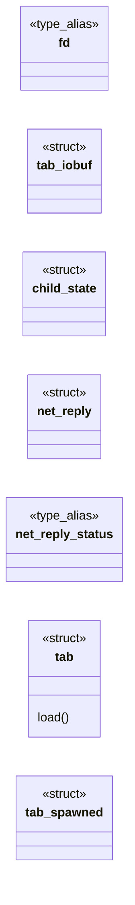
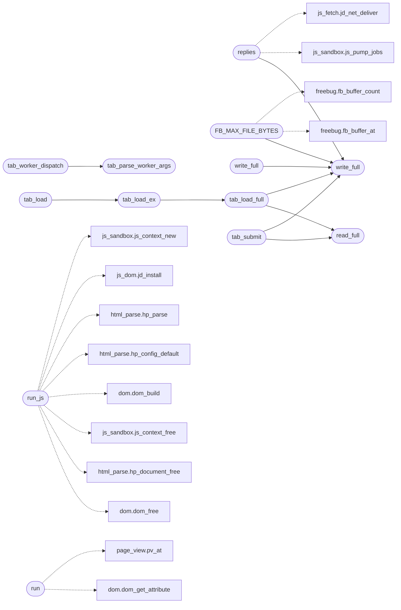

# `src/tab.c`

> Source: [src/tab.c:1](../../src/tab.c#L1) | language `c` | coverage 44.1% | [API index](../index.md)

## Contents

- **Structs:** [`tab_iobuf`](#tab_iobuf), [`child_state`](#child_state), [`net_reply`](#net_reply), [`tab`](#tab), [`tab_spawned`](#tab_spawned)
- **Type Aliases:** [`fd`](#fd)
- **Functions:** [`replies`](#replies), [`run_js`](#run_js), [`buffer`](#buffer), [`blocks`](#blocks), [`FB_MAX_FILE_BYTES`](#fb_max_file_bytes), [`run`](#run), [`window`](#window), [`libraries`](#libraries), [`WHERE`](#where), [`content`](#content), [`once`](#once), [`swap`](#swap), [`write_full`](#write_full), [`EPIPE`](#epipe), [`tzset`](#tzset), [`depth`](#depth), [`tab_parse_worker_args`](#tab_parse_worker_args), [`tab_worker_dispatch`](#tab_worker_dispatch), [`tests`](#tests), [`layout`](#layout), [`column`](#column), [`tab_prewarm`](#tab_prewarm), [`tab_prewarmed`](#tab_prewarmed), [`tab_prewarmed_pid`](#tab_prewarmed_pid), [`tab_shutdown_spare`](#tab_shutdown_spare), [`tab_open`](#tab_open), [`tab_set_fetcher`](#tab_set_fetcher), [`tab_set_css_sink`](#tab_set_css_sink), [`tab_set_op_net_budget_ms`](#tab_set_op_net_budget_ms), [`tab_set_net_allowed`](#tab_set_net_allowed), [`tab_set_css_allowed`](#tab_set_css_allowed), [`tab_last_subreq_stats`](#tab_last_subreq_stats), [`tab_set_identity`](#tab_set_identity), [`tab_set_frame_id`](#tab_set_frame_id), [`tab_set_viewport_w`](#tab_set_viewport_w), [`tab_set_cookies`](#tab_set_cookies), [`tab_subreq_permitted`](#tab_subreq_permitted), [`tab_report_response_headers`](#tab_report_response_headers), [`tab_inflight_request_headers`](#tab_inflight_request_headers), [`tab_load`](#tab_load), [`tab_load_ex`](#tab_load_ex), [`tab_load_full`](#tab_load_full), [`tab_click`](#tab_click), [`tab_tick`](#tab_tick), [`tab_submit`](#tab_submit), [`tab_read_view`](#tab_read_view), [`frames`](#frames), [`tab_eval`](#tab_eval), [`tab_decode_image`](#tab_decode_image), [`tab_decode_image_data_url`](#tab_decode_image_data_url), [`tab_alive`](#tab_alive), [`tab_child_pid`](#tab_child_pid), [`tab_close`](#tab_close), [`tab_page_free`](#tab_page_free), [`tab_eval_result_free`](#tab_eval_result_free), [`tab_image_free`](#tab_image_free), [`tab_set_geometry`](#tab_set_geometry), [`tab_async_fd`](#tab_async_fd), [`tab_async_busy`](#tab_async_busy), [`tab_tick_async`](#tab_tick_async), [`tab_geometry_async`](#tab_geometry_async), [`tab_async_finish`](#tab_async_finish), [`tab_popstate`](#tab_popstate), [`tab_ws_event`](#tab_ws_event), [`tab_set_storage`](#tab_set_storage)
- **Macros:** [`_GNU_SOURCE`](#_gnu_source), [`TAB_IOBUF_BYTES`](#tab_iobuf_bytes), [`write_full`](#write_full), [`read_full`](#read_full), [`TAB_SCREEN_W`](#tab_screen_w), [`TAB_WIRE_HEAD_N`](#tab_wire_head_n), [`TAB_WIRE_A_N`](#tab_wire_a_n), [`TAB_WIRE_B_N`](#tab_wire_b_n), [`TAB_WIRE_BOX_F_N`](#tab_wire_box_f_n), [`TAB_WIRE_GRID_N`](#tab_wire_grid_n), [`TAB_MAX_RUNS`](#tab_max_runs), [`PV_MAX_CONTAINERS_WIRE`](#pv_max_containers_wire), [`TAB_MAX_URL`](#tab_max_url), [`TAB_MAX_WS_MSG`](#tab_max_ws_msg), [`TAB_MAX_STORAGE`](#tab_max_storage), [`TAB_MAX_HIST_OPS`](#tab_max_hist_ops), [`TAB_MAX_HIST_BYTES`](#tab_max_hist_bytes), [`TAB_MAX_OPENS`](#tab_max_opens), [`TAB_MAX_OPEN_BYTES`](#tab_max_open_bytes), [`TAB_MAX_GEOM_WORDS`](#tab_max_geom_words), [`TAB_MAX_ASYNC_PENDING`](#tab_max_async_pending), [`TAB_MAX_NET_ROUNDS`](#tab_max_net_rounds), [`TAB_ASYNC_THREADS`](#tab_async_threads), [`TAB_MAX_BATCH_BYTES`](#tab_max_batch_bytes), [`TAB_MAX_SUBREQ`](#tab_max_subreq), [`TAB_MAX_SUBRESOURCE`](#tab_max_subresource), [`TAB_MAX_JS_JOBS`](#tab_max_js_jobs), [`TAB_MAX_EXTERN_CSS`](#tab_max_extern_css)

## Type Diagram



## Call Graph

Solid arrows stay in this module, dashed arrows leave it.



## Structs

<a id="tab_iobuf"></a>

### `tab_iobuf`

`struct` | [src/tab.c:57](../../src/tab.c#L57)

```c
typedef struct tab_iobuf
```

Batched pipe I/O for the view codec. write_view/read_view move one int32 block and one length-prefixed string at a time: ~46 000 read(2) and as many write(2) calls for a single Wikipedia page, each a context switch for 4-64 bytes.

Inside those two functions the traffic goes through a per-THREAD 64 KiB buffer instead (no state is shared: the async tick thread and the caller each have their own). The byte stream is unchanged. Writes are flushed before write_view returns. A read buffer may hold the bytes that follow the view in the same reply: they stay in it and the next read on that fd consumes them first, so no byte is ever lost; the protocol is request/response lockstep, so nothing beyond the reply can be in the pipe.  define TAB_IOBUF_BYTES (64u * 1024u)

---

<a id="child_state"></a>

### `child_state`

`struct` | [src/tab.c:223](../../src/tab.c#L223)

```c
typedef struct child_state
```

---

<a id="net_reply"></a>

### `net_reply`

`struct` | [src/tab.c:391](../../src/tab.c#L391)

```c
typedef struct net_reply
```

jd_fetch_fn: the confined worker has NO network (CLONE_NEWNET + seccomp).

An XHR/fetch from page script is proxied to the TRUSTED parent over the existing pipes: write a TAG_SUBREQ frame, block for the parent's reply. The parent re-applies the FULL network policy (host blocklist/tracker filter, realm routing, TLS-PQ) before fetching, so a compromised worker still cannot reach a blocked host. Refused/over-budget/IO-error => non-zero (XHR completes with status 0). Only callable inside a page-load script window (net_active) so it never desyncs the OP_EVAL/OP_DECODE_IMAGE response paths.

**Members**

| Member | Kind | Summary |
|---|---|---|
| [`status`](#net_reply-status) | type_alias | jd_fetch_fn: the confined worker has NO network (CLONE_NEWNET + seccomp). |

<a id="net_reply-status"></a>

#### `net_reply.status`

`type_alias` | [src/tab.c:391](../../src/tab.c#L391)

```c
typedef struct net_reply { int32_t status;
```

jd_fetch_fn: the confined worker has NO network (CLONE_NEWNET + seccomp).

An XHR/fetch from page script is proxied to the TRUSTED parent over the existing pipes: write a TAG_SUBREQ frame, block for the parent's reply. The parent re-applies the FULL network policy (host blocklist/tracker filter, realm routing, TLS-PQ) before fetching, so a compromised worker still cannot reach a blocked host. Refused/over-budget/IO-error => non-zero (XHR completes with status 0). Only callable inside a page-load script window (net_active) so it never desyncs the OP_EVAL/OP_DECODE_IMAGE response paths.

---

<a id="tab"></a>

### `tab`

`struct` | [src/tab.c:2518](../../src/tab.c#L2518)

```c
struct tab
```

**Members**

| Member | Kind | Summary |
|---|---|---|
| [`load`](#tab-load) | method |  |

<a id="tab-load"></a>

#### `tab.load`

`method` | [src/tab.c:2525](../../src/tab.c#L2525)

```c
* subresource requests this load (set per page: host in allow.conf AND js.conf);
```

**Parameters**

| Name | Type | Default | Description |
|---|---|---|---|
| `conf` | `set per page: host in allow.conf AND js.` |  |  |

**Returns:** `* subresource requests this`

---

<a id="tab_spawned"></a>

### `tab_spawned`

`struct` | [src/tab.c:3219](../../src/tab.c#L3219)

```c
typedef struct
```

An idle worker waiting for the next tab_open (spec/tab.md "Worker de repuesto").

---

## Type Aliases

<a id="fd"></a>

### `fd`

`type_alias` | [src/tab.c:57](../../src/tab.c#L57)

```c
typedef struct tab_iobuf { int fd;
```

Batched pipe I/O for the view codec. write_view/read_view move one int32 block and one length-prefixed string at a time: ~46 000 read(2) and as many write(2) calls for a single Wikipedia page, each a context switch for 4-64 bytes.

Inside those two functions the traffic goes through a per-THREAD 64 KiB buffer instead (no state is shared: the async tick thread and the caller each have their own). The byte stream is unchanged. Writes are flushed before write_view returns. A read buffer may hold the bytes that follow the view in the same reply: they stay in it and the next read on that fd consumes them first, so no byte is ever lost; the protocol is request/response lockstep, so nothing beyond the reply can be in the pipe.  define TAB_IOBUF_BYTES (64u * 1024u)

---

## Functions

<a id="replies"></a>

### `replies`

`function` | [src/tab.c:484](../../src/tab.c#L484)

```c
* writing replies (no pipe deadlock). */ static void child_net_drain(child_state *cs)
```

**Parameters**

| Name | Type | Default | Description |
|---|---|---|---|
| `deadlock` | `no pipe` |  |  |

**Returns:** `* writing`

*Calls:* [`js_pump_jobs`](include.js_sandbox.h.md#js_pump_jobs), [`jd_net_deliver`](src.js_fetch.c.md#jd_net_deliver), [`write_full`](#write_full)

---

<a id="run_js"></a>

### `run_js`

`function` | [src/tab.c:529](../../src/tab.c#L529)

```c
* regardless of run_js (a no-JS load simply never records a request). */ /* Installs the page-ind...
```

**Parameters**

| Name | Type | Default | Description |
|---|---|---|---|
| `request` | `a no-JS load simply never records a` |  |  |

**Returns:** `* regardless of`

*Calls:* [`dom_free`](include.dom.h.md#dom_free), [`hp_document_free`](include.html_parse.h.md#hp_document_free), [`js_context_free`](include.js_sandbox.h.md#js_context_free), [`dom_build`](src.dom.c.md#dom_build), [`hp_config_default`](src.html_parse.c.md#hp_config_default), [`hp_parse`](src.html_parse.c.md#hp_parse), [`jd_install`](src.js_dom.c.md#jd_install), [`js_context_new`](src.js_sandbox.c.md#js_context_new)

---

<a id="buffer"></a>

### `buffer`

`function` | [src/tab.c:621](../../src/tab.c#L621)

```c
* the buffer (stable child_state member) is wired into the new context's runtime * opaque. Installed regardless of run_js so the REPL works on any page. */ fb_buffer_reset(&cs->log);
```

**Parameters**

| Name | Type | Default | Description |
|---|---|---|---|
| `member` | `stable child_state` |  |  |

**Returns:** `* the`

---

<a id="blocks"></a>

### `blocks`

`function` | [src/tab.c:686](../../src/tab.c#L686)

```c
* * The scalar fields are marshalled as bulk int32 blocks (head[6], block A[36], the * grid array, block B[26]) exactly like the box-def f[] array, NOT one write_full per * field: the block literal li
```

**Parameters**

| Name | Type | Default | Description |
|---|---|---|---|
| `head` |  |  |  |
| `A` | `block [36]` |  |  |
| `array` | `the * grid` |  |  |
| `B` | `block [26]` |  |  |

**Returns:** `* * The scalar fields are marshalled as bulk int32`

---

<a id="fb_max_file_bytes"></a>

### `FB_MAX_FILE_BYTES`

`function` | [src/tab.c:1130](../../src/tab.c#L1130)

```c
* FB_MAX_FILE_BYTES (the buffer enforces all), so a hostile worker cannot amplify * the stream. ...
```

A stored source name is truncated to this many bytes (NUL excluded).

It is not counted against FB_MAX_TOTAL_BYTES: entries are capped, so total file memory is bounded at FB_MAX_ENTRIES * FB_MAX_FILE_BYTES regardless.

**Parameters**

| Name | Type | Default | Description |
|---|---|---|---|
| `all` | `the buffer enforces` |  |  |

**Returns:** `*`

> **Inherited:** Documentation from [`FB_MAX_FILE_BYTES`](#fb_max_file_bytes) (include/freebug.h:62).

*Calls:* [`fb_buffer_at`](include.freebug.h.md#fb_buffer_at), [`fb_buffer_count`](include.freebug.h.md#fb_buffer_count), [`write_full`](#write_full)

---

<a id="run"></a>

### `run`

`function` | [src/tab.c:1209](../../src/tab.c#L1209)

```c
* already contains a PV_VIDEO run (avoids duplicates on repeated injection). * Call after every ...
```

**Parameters**

| Name | Type | Default | Description |
|---|---|---|---|
| `injection` | `avoids duplicates on repeated` |  |  |

**Returns:** `* already contains a PV_VIDEO`

*Calls:* [`dom_get_attribute`](include.dom.h.md#dom_get_attribute), [`pv_at`](include.page_view.h.md#pv_at), [`pv_count`](include.page_view.h.md#pv_count), [`dom_get_by_tag`](src.dom.c.md#dom_get_by_tag), [`pv_append_video`](src.page_view.c.md#pv_append_video)

---

<a id="window"></a>

### `window`

`function` | [src/tab.c:1338](../../src/tab.c#L1338)

```c
* net window (cs->net_active). */ static void child_fetch_stylesheets(child_state *cs)
```

**Parameters**

| Name | Type | Default | Description |
|---|---|---|---|
| `net_active` | `cs->` |  |  |

**Returns:** `* net`

*Calls:* [`dropped`](include.html_parse.h.md#dropped), [`hp_extract_stylesheet_hrefs`](include.html_parse.h.md#hp_extract_stylesheet_hrefs), [`hp_free_stylesheet_hrefs`](include.html_parse.h.md#hp_free_stylesheet_hrefs)

---

<a id="libraries"></a>

### `libraries`

`function` | [src/tab.c:1526](../../src/tab.c#L1526)

```c
* load heavier libraries (jQuery, Bootstrap, etc.) that need more time. * Untrusted hosts get the default budget (1s) to limit abuse. */ prof_lap("js-enable", &ph);
```

**Parameters**

| Name | Type | Default | Description |
|---|---|---|---|
| `etc` |  |  |  |

**Returns:** `* load heavier`

---

<a id="where"></a>

### `WHERE`

`function` | [src/tab.c:1691](../../src/tab.c#L1691)

```c
* the console still says WHERE (a module's URL, "inline #n", a src). */ if (es != JS_OK && r.is_exception && r.value != NULL) fb_buffer_push_loc(&cs->log, FB_ERROR, r.value, r.value_len, r.file != NUL
```

**Parameters**

| Name | Type | Default | Description |
|---|---|---|---|
| `src` | `a module's URL, "inline #n", a` |  |  |

**Returns:** `* the console still says`

---

<a id="content"></a>

### `content`

`function` | [src/tab.c:1756](../../src/tab.c#L1756)

```c
* content (same-origin fetches through the trusted parent), scan for * video URLs (.m3u8), and create <video> elements in the DOM for any * found. */ if (cs->idx != NULL) jd_process_iframes(cs->js, cs
```

**Parameters**

| Name | Type | Default | Description |
|---|---|---|---|
| `parent` | `same-origin fetches through the trusted` |  |  |

**Returns:** `*`

---

<a id="once"></a>

### `once`

`function` | [src/tab.c:1807](../../src/tab.c#L1807)

```c
* ensures the preserved view gets the video only once (initial load). */ inject_video_into_view(cs, &view);
```

**Parameters**

| Name | Type | Default | Description |
|---|---|---|---|
| `load` | `initial` |  |  |

**Returns:** `* ensures the preserved view gets the video only`

---

<a id="swap"></a>

### `swap`

`function` | [src/tab.c:1816](../../src/tab.c#L1816)

```c
* display:none hiding an element via class swap (CSS, not * DOM removal). */ if (ok && v...
```

**Parameters**

| Name | Type | Default | Description |
|---|---|---|---|
| `removal` | `not * DOM` |  |  |

**Returns:** `* display:none hiding an element via`

*Calls:* [`pv_count`](include.page_view.h.md#pv_count)

---

<a id="write_full"></a>

### `write_full`

`function` | [src/tab.c:1837](../../src/tab.c#L1837)

```c
&& write_full(wfd, &xl, sizeof xl) == 0 && (xl == 0 || write_full(wfd, text, xl) == 0) && write_view(wfd, write_which) == 0 && write_full(wfd, &nlen, sizeof nlen) == 0 && (nlen == 0 || write_full(wfd,
```

**Parameters**

| Name | Type | Default | Description |
|---|---|---|---|
| `xl` |  |  |  |
| `xl` | `sizeof` |  |  |

**Returns:** `&&`

*Calls:* [`write_full`](#write_full)

---

<a id="epipe"></a>

### `EPIPE`

`function` | [src/tab.c:2257](../../src/tab.c#L2257)

```c
* surfaces as EPIPE (graceful loop exit), not a signal. */ ignore_sigpipe();
```

**Parameters**

| Name | Type | Default | Description |
|---|---|---|---|
| `exit` | `graceful loop` |  |  |

**Returns:** `* surfaces as`

---

<a id="tzset"></a>

### `tzset`

`function` | [src/tab.c:2273](../../src/tab.c#L2273)

```c
* tzset() caches it while syscalls are still unrestricted. */ setenv("TZ", "UTC0", 1);
```

**Returns:** `*`

---

<a id="depth"></a>

### `depth`

`function` | [src/tab.c:2287](../../src/tab.c#L2287)

```c
* defense in depth (seccomp already excludes open/socket/exec);
```

**Parameters**

| Name | Type | Default | Description |
|---|---|---|---|
| `exec` | `seccomp already excludes open/socket/` |  |  |

**Returns:** `* defense in`

*Called by:* [`form`](include.render_doc.h.md#form)

---

<a id="tab_parse_worker_args"></a>

### `tab_parse_worker_args`

`function` | [src/tab.c:2498](../../src/tab.c#L2498)

```c
int tab_parse_worker_args(int argc, const char *const *argv, int *rfd, int *wfd)
```

Pure validator of the worker handoff arguments (the security-relevant surface of the exec): returns nonzero and writes the two fds iff argv is exactly "<prog> --tab-worker <rfd> <wfd>" with both fds non-negative decimal integers within a sane bound.

No side effects; fail-closed (any malformation => 0).

**Parameters**

| Name | Type | Default | Description |
|---|---|---|---|
| `argc` | `int` |  |  |
| `argv` | `char *const *` |  |  |
| `rfd` | `int *` |  |  |
| `wfd` | `int *` |  |  |

**Returns:** `int`

> **Inherited:** Documentation from [`tab_parse_worker_args`](#tab_parse_worker_args) (include/tab.h:167).

*Calls:* [`strcmp`](gui.browser_ui.c.md#strcmp)

*Called by:* [`tab_worker_dispatch`](#tab_worker_dispatch)

---

<a id="tab_worker_dispatch"></a>

### `tab_worker_dispatch`

`function` | [src/tab.c:2508](../../src/tab.c#L2508)

```c
void tab_worker_dispatch(int argc, char **argv)
```

**Parameters**

| Name | Type | Default | Description |
|---|---|---|---|
| `argc` | `int` |  |  |
| `argv` | `char **` |  |  |

*Calls:* [`tab_parse_worker_args`](#tab_parse_worker_args)

---

<a id="tests"></a>

### `tests`

`function` | [src/tab.c:2691](../../src/tab.c#L2691)

```c
* here lost the reserved box in the real browser while the page_view * tests (which never cross the pipe) stayed green. */ st = pv_append_image(v, heading, brk, text, (src != NULL) ? src : "", img_w,
```

**Parameters**

| Name | Type | Default | Description |
|---|---|---|---|
| `pipe` | `which never cross the` |  |  |

**Returns:** `* here lost the reserved box in the real browser while the page_view *`

---

<a id="layout"></a>

### `layout`

`function` | [src/tab.c:2798](../../src/tab.c#L2798)

```c
* only at layout (bx_lp_px): setting one without the other would make * the pair disagree about the same property. */ pv_set_box_pct(v, (int)bwpct, (int)b[36], (int)b[37], (int)b[38], (int)b[39]);
```

**Returns:** `setting one without the other would make * the pair disagree about the same property. */ pv_set_box_pct(v, (int)bwpct, (int)b[36], (int)b[37], (int)b[38], (int)b[39])`

---

<a id="column"></a>

### `column`

`function` | [src/tab.c:2809](../../src/tab.c#L2809)

```c
* a narrow column (jkanime's player). Mirrors the emission side, where a * control now carries the same annotation as text runs. */ pv_set_container(v, (int)cid, (int)cdisp, (int)cgap, (int)cjust, (in
```

**Parameters**

| Name | Type | Default | Description |
|---|---|---|---|
| `player` | `jkanime's` |  |  |

**Returns:** `* a narrow`

---

<a id="tab_prewarm"></a>

### `tab_prewarm`

`function` | [src/tab.c:3292](../../src/tab.c#L3292)

```c
void tab_prewarm(void)
```

Starts one idle, confined worker in advance so the next tab_open does not wait for fork + exec + sandbox setup (spec/tab.md "Worker de repuesto").

Idempotent; best-effort (a failed spawn just means tab_open spawns on demand). The spare has received no content.

> **Inherited:** Documentation from [`tab_prewarm`](#tab_prewarm) (include/tab.h:176).

---

<a id="tab_prewarmed"></a>

### `tab_prewarmed`

`function` | [src/tab.c:3298](../../src/tab.c#L3298)

```c
int tab_prewarmed(void)
```

1 while a spare worker is waiting for the next tab_open.

**Returns:** `int`

> **Inherited:** Documentation from [`tab_prewarmed`](#tab_prewarmed) (include/tab.h:179).

---

<a id="tab_prewarmed_pid"></a>

### `tab_prewarmed_pid`

`function` | [src/tab.c:3305](../../src/tab.c#L3305)

```c
int tab_prewarmed_pid(void)
```

Process id of that spare, 0 when there is none (diagnostics and tests).

**Returns:** `int`

> **Inherited:** Documentation from [`tab_prewarmed_pid`](#tab_prewarmed_pid) (include/tab.h:182).

---

<a id="tab_shutdown_spare"></a>

### `tab_shutdown_spare`

`function` | [src/tab.c:3312](../../src/tab.c#L3312)

```c
void tab_shutdown_spare(void)
```

Kills and reaps the spare, if any.

Safe to call when there is none.

> **Inherited:** Documentation from [`tab_shutdown_spare`](#tab_shutdown_spare) (include/tab.h:185).

---

<a id="tab_open"></a>

### `tab_open`

`function` | [src/tab.c:3321](../../src/tab.c#L3321)

```c
tab_status tab_open(tab **out)
```

**Parameters**

| Name | Type | Default | Description |
|---|---|---|---|
| `out` | `tab **` |  |  |

**Returns:** `tab_status`

---

<a id="tab_set_fetcher"></a>

### `tab_set_fetcher`

`function` | [src/tab.c:3344](../../src/tab.c#L3344)

```c
void tab_set_fetcher(tab *t, tab_fetch_fn fn, void *ctx)
```

Installs the subresource fetcher used for XHR/fetch (NULL clears it: requests are then refused). fn/ctx must outlive any tab_load_full call that may trigger a subresource.

**Parameters**

| Name | Type | Default | Description |
|---|---|---|---|
| `t` | `tab *` |  |  |
| `fn` | `tab_fetch_fn` |  |  |
| `ctx` | `void *` |  |  |

> **Inherited:** Documentation from [`tab_set_fetcher`](#tab_set_fetcher) (include/tab.h:204).

---

<a id="tab_set_css_sink"></a>

### `tab_set_css_sink`

`function` | [src/tab.c:3350](../../src/tab.c#L3350)

```c
void tab_set_css_sink(tab *t, tab_css_sink_fn fn, void *ctx)
```

**Parameters**

| Name | Type | Default | Description |
|---|---|---|---|
| `t` | `tab *` |  |  |
| `fn` | `tab_css_sink_fn` |  |  |
| `ctx` | `void *` |  |  |

---

<a id="tab_set_op_net_budget_ms"></a>

### `tab_set_op_net_budget_ms`

`function` | [src/tab.c:3356](../../src/tab.c#L3356)

```c
void tab_set_op_net_budget_ms(tab *t, int ms)
```

Per-operation network time budget in ms for requests the worker issues AFTER the load (default FC_TAB_OP_NET_BUDGET_MS; <= 0 restores it).

Tests lower it.

**Parameters**

| Name | Type | Default | Description |
|---|---|---|---|
| `t` | `tab *` |  |  |
| `ms` | `int` |  |  |

> **Inherited:** Documentation from [`tab_set_op_net_budget_ms`](#tab_set_op_net_budget_ms) (include/tab.h:236).

---

<a id="tab_set_net_allowed"></a>

### `tab_set_net_allowed`

`function` | [src/tab.c:3360](../../src/tab.c#L3360)

```c
void tab_set_net_allowed(tab *t, int allowed)
```

Grants/revokes page-JS network access (XMLHttpRequest/fetch) for the NEXT load.

Set it true ONLY when the page's host is in BOTH allow.conf AND js.conf (the sovereignty boundary); false (default) keeps XHR/fetch undefined (Same-Origin-by-construction).

**Parameters**

| Name | Type | Default | Description |
|---|---|---|---|
| `t` | `tab *` |  |  |
| `allowed` | `int` |  |  |

> **Inherited:** Documentation from [`tab_set_net_allowed`](#tab_set_net_allowed) (include/tab.h:232).

---

<a id="tab_set_css_allowed"></a>

### `tab_set_css_allowed`

`function` | [src/tab.c:3365](../../src/tab.c#L3365)

```c
void tab_set_css_allowed(tab *t, int allowed)
```

**Parameters**

| Name | Type | Default | Description |
|---|---|---|---|
| `t` | `tab *` |  |  |
| `allowed` | `int` |  |  |

---

<a id="tab_last_subreq_stats"></a>

### `tab_last_subreq_stats`

`function` | [src/tab.c:3370](../../src/tab.c#L3370)

```c
void tab_last_subreq_stats(const tab *t, size_t *count, uint64_t *total_us)
```

Subresources the parent served for the LAST load (the worker's TAG_SUBREQ: XHR, fetch, external scripts, ES modules): how many, and the total wall time the worker spent blocked on them, in microseconds.

A diagnostic (FREEDOM_PERF): it separates "the page's JS is slow" from "the page waited on the network".

**Parameters**

| Name | Type | Default | Description |
|---|---|---|---|
| `t` | `tab *` |  |  |
| `count` | `size_t *` |  |  |
| `total_us` | `uint64_t *` |  |  |

> **Inherited:** Documentation from [`tab_last_subreq_stats`](#tab_last_subreq_stats) (include/tab.h:293).

---

<a id="tab_set_identity"></a>

### `tab_set_identity`

`function` | [src/tab.c:3375](../../src/tab.c#L3375)

```c
void tab_set_identity(tab *t, const char *serialized)
```

The user's identity override (idn_serialize text, spec/identity.md) for the NEXT loads: the worker applies it to navigator and, for a trusted host with a fixed place, installs geolocation.

"" / NULL (or a string that does not fit) is the normalized default.

**Parameters**

| Name | Type | Default | Description |
|---|---|---|---|
| `t` | `tab *` |  |  |
| `serialized` | `char *` |  |  |

> **Inherited:** Documentation from [`tab_set_identity`](#tab_set_identity) (include/tab.h:287).

---

<a id="tab_set_frame_id"></a>

### `tab_set_frame_id`

`function` | [src/tab.c:3383](../../src/tab.c#L3383)

```c
void tab_set_frame_id(tab *t, int id)
```

**Parameters**

| Name | Type | Default | Description |
|---|---|---|---|
| `t` | `tab *` |  |  |
| `id` | `int` |  |  |

---

<a id="tab_set_viewport_w"></a>

### `tab_set_viewport_w`

`function` | [src/tab.c:3388](../../src/tab.c#L3388)

```c
void tab_set_viewport_w(tab *t, int px)
```

Sets the render viewport width (px) used to evaluate @media width queries on the NEXT load, so a responsive page selects the same breakpoint the paint width would (the page is painted at this width). <= 0 restores the normalized default.

Only the @media width query sees it; viewport UNITS (vw/vh) still resolve against the fixed normalized desktop, so no real geometry leaks into computed lengths.

**Parameters**

| Name | Type | Default | Description |
|---|---|---|---|
| `t` | `tab *` |  |  |
| `px` | `int` |  |  |

> **Inherited:** Documentation from [`tab_set_viewport_w`](#tab_set_viewport_w) (include/tab.h:277).

---

<a id="tab_set_cookies"></a>

### `tab_set_cookies`

`function` | [src/tab.c:3393](../../src/tab.c#L3393)

```c
void tab_set_cookies(tab *t, const char *cookies)
```

Seeds the page's document.cookie jar for the NEXT load with cookies ("name=value; ...") the trusted parent read from its ephemeral network jar (sf_cookie_header_for).

Only meaningful for a trusted host (allow.conf AND js.conf); pass NULL/"" otherwise so the jar stays disabled (untrusted sites see no cookies -- Zero Knowledge). The bytes are copied. In-memory only; never persisted.

**Parameters**

| Name | Type | Default | Description |
|---|---|---|---|
| `t` | `tab *` |  |  |
| `cookies` | `char *` |  |  |

> **Inherited:** Documentation from [`tab_set_cookies`](#tab_set_cookies) (include/tab.h:258).

---

<a id="tab_subreq_permitted"></a>

### `tab_subreq_permitted`

`function` | [src/tab.c:3399](../../src/tab.c#L3399)

```c
int tab_subreq_permitted(int net_allowed, int css_allowed, const char *method)
```

Pure parent-side subresource gate (Zero Trust: decided from the PARENT's grants for this load, never the worker's claims): net_allowed permits any well-formed method; css_allowed alone permits exactly "GET"; a NULL/empty method or no grant is refused.

**Parameters**

| Name | Type | Default | Description |
|---|---|---|---|
| `net_allowed` | `int` |  |  |
| `css_allowed` | `int` |  |  |
| `method` | `char *` |  |  |

**Returns:** `int`

> **Inherited:** Documentation from [`tab_subreq_permitted`](#tab_subreq_permitted) (include/tab.h:298).

*Calls:* [`strcmp`](gui.browser_ui.c.md#strcmp)

---

<a id="tab_report_response_headers"></a>

### `tab_report_response_headers`

`function` | [src/tab.c:3413](../../src/tab.c#L3413)

```c
void tab_report_response_headers(const char *lines)
```

Inside a tab_fetch_fn call: reports the response header lines ("name: value\n", no Set-Cookie) the page's XHR/fetch may read.

Copied (bounded); the fetcher keeps ownership of `lines`. Outside a fetcher call it is a no-op.

**Parameters**

| Name | Type | Default | Description |
|---|---|---|---|
| `lines` | `char *` |  |  |

> **Inherited:** Documentation from [`tab_report_response_headers`](#tab_report_response_headers) (include/tab.h:214).

---

<a id="tab_inflight_request_headers"></a>

### `tab_inflight_request_headers`

`function` `const` | [src/tab.c:3425](../../src/tab.c#L3425)

```c
const char *tab_inflight_request_headers(void)
```

Inside a tab_fetch_fn call: the request headers the page attached to this XHR/fetch, already filtered by rp_sanitize_request_headers ("Name: value\n" lines), or NULL when it set none.

Valid only for the duration of that call, on the calling thread; NULL anywhere else.

**Returns:** `char *`

> **Inherited:** Documentation from [`tab_inflight_request_headers`](#tab_inflight_request_headers) (include/tab.h:209).

---

<a id="tab_load"></a>

### `tab_load`

`function` | [src/tab.c:3807](../../src/tab.c#L3807)

```c
tab_status tab_load(tab *t, const char *html, size_t len, tab_page *out)
```

**Parameters**

| Name | Type | Default | Description |
|---|---|---|---|
| `t` | `tab *` |  |  |
| `html` | `char *` |  |  |
| `len` | `size_t` |  |  |
| `out` | `tab_page *` |  |  |

**Returns:** `tab_status`

*Calls:* [`tab_load_ex`](#tab_load_ex)

---

<a id="tab_load_ex"></a>

### `tab_load_ex`

`function` | [src/tab.c:3811](../../src/tab.c#L3811)

```c
tab_status tab_load_ex(tab *t, const char *html, size_t len, int run_js, tab_page *out)
```

**Parameters**

| Name | Type | Default | Description |
|---|---|---|---|
| `t` | `tab *` |  |  |
| `html` | `char *` |  |  |
| `len` | `size_t` |  |  |
| `run_js` | `int` |  |  |
| `out` | `tab_page *` |  |  |

**Returns:** `tab_status`

*Calls:* [`tab_load_full`](#tab_load_full)

*Called by:* [`tab_load`](#tab_load)

---

<a id="tab_load_full"></a>

### `tab_load_full`

`function` | [src/tab.c:3815](../../src/tab.c#L3815)

```c
tab_status tab_load_full(tab *t, const char *html, size_t len, const char *page_url, int run_js, int reader, int prefers_dark, tab_page *out)
```

**Parameters**

| Name | Type | Default | Description |
|---|---|---|---|
| `t` | `tab *` |  |  |
| `html` | `char *` |  |  |
| `len` | `size_t` |  |  |
| `page_url` | `char *` |  |  |
| `run_js` | `int` |  |  |
| `reader` | `int` |  |  |
| `prefers_dark` | `int` |  |  |
| `out` | `tab_page *` |  |  |

**Returns:** `tab_status`

*Calls:* [`fb_buffer_free`](include.freebug.h.md#fb_buffer_free), [`fb_buffer_init`](include.freebug.h.md#fb_buffer_init), [`pv_free`](include.page_view.h.md#pv_free), [`read_full`](#read_full), [`write_full`](#write_full)

*Called by:* [`tab_load_ex`](#tab_load_ex)

---

<a id="tab_click"></a>

### `tab_click`

`function` | [src/tab.c:4016](../../src/tab.c#L4016)

```c
tab_status tab_click(tab *t, dom_node_id node_id, tab_page *out)
```

**Parameters**

| Name | Type | Default | Description |
|---|---|---|---|
| `t` | `tab *` |  |  |
| `node_id` | `dom_node_id` |  |  |
| `out` | `tab_page *` |  |  |

**Returns:** `tab_status`

---

<a id="tab_tick"></a>

### `tab_tick`

`function` | [src/tab.c:4024](../../src/tab.c#L4024)

```c
tab_status tab_tick(tab *t, int elapsed_ms, tab_page *out)
```

**Parameters**

| Name | Type | Default | Description |
|---|---|---|---|
| `t` | `tab *` |  |  |
| `elapsed_ms` | `int` |  |  |
| `out` | `tab_page *` |  |  |

**Returns:** `tab_status`

*Called by:* [`fh_tick`](src.frame_host.c.md#fh_tick)

---

<a id="tab_submit"></a>

### `tab_submit`

`function` | [src/tab.c:4034](../../src/tab.c#L4034)

```c
tab_status tab_submit(tab *t, dom_node_id node_id, int *prevented)
```

Dispatches a submit event on the form enclosing node_id.

Simple response: [TAG_RESULT][ok:int32][prevented:int32]. No view re-derivation.

**Parameters**

| Name | Type | Default | Description |
|---|---|---|---|
| `t` | `tab *` |  |  |
| `node_id` | `dom_node_id` |  |  |
| `prevented` | `int *` |  |  |

**Returns:** `tab_status`

*Calls:* [`read_full`](#read_full), [`write_full`](#write_full)

---

<a id="tab_read_view"></a>

### `tab_read_view`

`function` | [src/tab.c:4142](../../src/tab.c#L4142)

```c
tab_status tab_read_view(tab *t, tab_page *out)
```

Reads the TAG_RESULT + TAG_VIEW response into *out (titles + view + console).

Used by tab_mutation_request, tab_subreq, tab_dispatch_event.

**Parameters**

| Name | Type | Default | Description |
|---|---|---|---|
| `t` | `tab *` |  |  |
| `out` | `tab_page *` |  |  |

**Returns:** `tab_status`

---

<a id="frames"></a>

### `frames`

`function` | [src/tab.c:4148](../../src/tab.c#L4148)

```c
* TAG_SUBREQ frames (XHR/fetch/import()/script src) on the way: the same gated fetcher as the * load, net grant of the page, never the stylesheet grant. Anything else is a desync. */ static tab_status
```

**Parameters**

| Name | Type | Default | Description |
|---|---|---|---|
| `src` | `XHR/fetch/import()/script` |  |  |

**Returns:** `* TAG_SUBREQ`

---

<a id="tab_eval"></a>

### `tab_eval`

`function` | [src/tab.c:4263](../../src/tab.c#L4263)

```c
tab_status tab_eval(tab *t, const char *js, size_t len, tab_eval_result *out)
```

**Parameters**

| Name | Type | Default | Description |
|---|---|---|---|
| `t` | `tab *` |  |  |
| `js` | `char *` |  |  |
| `len` | `size_t` |  |  |
| `out` | `tab_eval_result *` |  |  |

**Returns:** `tab_status`

---

<a id="tab_decode_image"></a>

### `tab_decode_image`

`function` | [src/tab.c:4346](../../src/tab.c#L4346)

```c
tab_status tab_decode_image(tab *t, const uint8_t *bytes, size_t len, tab_image *out)
```

**Parameters**

| Name | Type | Default | Description |
|---|---|---|---|
| `t` | `tab *` |  |  |
| `bytes` | `uint8_t *` |  |  |
| `len` | `size_t` |  |  |
| `out` | `tab_image *` |  |  |

**Returns:** `tab_status`

---

<a id="tab_decode_image_data_url"></a>

### `tab_decode_image_data_url`

`function` | [src/tab.c:4353](../../src/tab.c#L4353)

```c
tab_status tab_decode_image_data_url(tab *t, const char *data_url, tab_image *out)
```

**Parameters**

| Name | Type | Default | Description |
|---|---|---|---|
| `t` | `tab *` |  |  |
| `data_url` | `char *` |  |  |
| `out` | `tab_image *` |  |  |

**Returns:** `tab_status`

---

<a id="tab_alive"></a>

### `tab_alive`

`function` | [src/tab.c:4372](../../src/tab.c#L4372)

```c
int tab_alive(const tab *t)
```

Nonzero while the worker process is believed alive.

**Parameters**

| Name | Type | Default | Description |
|---|---|---|---|
| `t` | `tab *` |  |  |

**Returns:** `int`

> **Inherited:** Documentation from [`tab_alive`](#tab_alive) (include/tab.h:414).

---

<a id="tab_child_pid"></a>

### `tab_child_pid`

`function` | [src/tab.c:4378](../../src/tab.c#L4378)

```c
pid_t tab_child_pid(const tab *t)
```

The worker's process id (for monitoring), or -1.

**Parameters**

| Name | Type | Default | Description |
|---|---|---|---|
| `t` | `tab *` |  |  |

**Returns:** `pid_t`

> **Inherited:** Documentation from [`tab_child_pid`](#tab_child_pid) (include/tab.h:417).

---

<a id="tab_close"></a>

### `tab_close`

`function` | [src/tab.c:4382](../../src/tab.c#L4382)

```c
void tab_close(tab *t)
```

Terminates the worker and frees the handle.

Safe on NULL.

**Parameters**

| Name | Type | Default | Description |
|---|---|---|---|
| `t` | `tab *` |  |  |

> **Inherited:** Documentation from [`tab_close`](#tab_close) (include/tab.h:420).

---

<a id="tab_page_free"></a>

### `tab_page_free`

`function` | [src/tab.c:4400](../../src/tab.c#L4400)

```c
void tab_page_free(tab_page *p)
```

Idempotent releasers for the result structs.

Safe on NULL / zeroed structs.

**Parameters**

| Name | Type | Default | Description |
|---|---|---|---|
| `p` | `tab_page *` |  |  |

> **Inherited:** Documentation from [`tab_page_free`](#tab_page_free) (include/tab.h:423).

---

<a id="tab_eval_result_free"></a>

### `tab_eval_result_free`

`function` | [src/tab.c:4430](../../src/tab.c#L4430)

```c
void tab_eval_result_free(tab_eval_result *r)
```

**Parameters**

| Name | Type | Default | Description |
|---|---|---|---|
| `r` | `tab_eval_result *` |  |  |

---

<a id="tab_image_free"></a>

### `tab_image_free`

`function` | [src/tab.c:4439](../../src/tab.c#L4439)

```c
void tab_image_free(tab_image *img)
```

**Parameters**

| Name | Type | Default | Description |
|---|---|---|---|
| `img` | `tab_image *` |  |  |

---

<a id="tab_set_geometry"></a>

### `tab_set_geometry`

`function` | [src/tab.c:4479](../../src/tab.c#L4479)

```c
tab_status tab_set_geometry(tab *t, const jg_table *g)
```

**Parameters**

| Name | Type | Default | Description |
|---|---|---|---|
| `t` | `tab *` |  |  |
| `g` | `jg_table *` |  |  |

**Returns:** `tab_status`

---

<a id="tab_async_fd"></a>

### `tab_async_fd`

`function` | [src/tab.c:4531](../../src/tab.c#L4531)

```c
int tab_async_fd(tab *t)
```

**Parameters**

| Name | Type | Default | Description |
|---|---|---|---|
| `t` | `tab *` |  |  |

**Returns:** `int`

---

<a id="tab_async_busy"></a>

### `tab_async_busy`

`function` | [src/tab.c:4540](../../src/tab.c#L4540)

```c
int tab_async_busy(const tab *t)
```

**Parameters**

| Name | Type | Default | Description |
|---|---|---|---|
| `t` | `tab *` |  |  |

**Returns:** `int`

---

<a id="tab_tick_async"></a>

### `tab_tick_async`

`function` | [src/tab.c:4557](../../src/tab.c#L4557)

```c
tab_status tab_tick_async(tab *t, int elapsed_ms)
```

**Parameters**

| Name | Type | Default | Description |
|---|---|---|---|
| `t` | `tab *` |  |  |
| `elapsed_ms` | `int` |  |  |

**Returns:** `tab_status`

---

<a id="tab_geometry_async"></a>

### `tab_geometry_async`

`function` | [src/tab.c:4567](../../src/tab.c#L4567)

```c
tab_status tab_geometry_async(tab *t, const jg_table *g)
```

**Parameters**

| Name | Type | Default | Description |
|---|---|---|---|
| `t` | `tab *` |  |  |
| `g` | `jg_table *` |  |  |

**Returns:** `tab_status`

---

<a id="tab_async_finish"></a>

### `tab_async_finish`

`function` | [src/tab.c:4582](../../src/tab.c#L4582)

```c
tab_status tab_async_finish(tab *t, tab_page *out, tab_status *job_status, int *was_tick)
```

**Parameters**

| Name | Type | Default | Description |
|---|---|---|---|
| `t` | `tab *` |  |  |
| `out` | `tab_page *` |  |  |
| `job_status` | `tab_status *` |  |  |
| `was_tick` | `int *` |  |  |

**Returns:** `tab_status`

---

<a id="tab_popstate"></a>

### `tab_popstate`

`function` | [src/tab.c:4604](../../src/tab.c#L4604)

```c
tab_status tab_popstate(tab *t, int index, tab_page *out)
```

**Parameters**

| Name | Type | Default | Description |
|---|---|---|---|
| `t` | `tab *` |  |  |
| `index` | `int` |  |  |
| `out` | `tab_page *` |  |  |

**Returns:** `tab_status`

---

<a id="tab_ws_event"></a>

### `tab_ws_event`

`function` | [src/tab.c:4611](../../src/tab.c#L4611)

```c
tab_status tab_ws_event(tab *t, int id, int kind, int code, const char *data, size_t len, tab_page *out)
```

**Parameters**

| Name | Type | Default | Description |
|---|---|---|---|
| `t` | `tab *` |  |  |
| `id` | `int` |  |  |
| `kind` | `int` |  |  |
| `code` | `int` |  |  |
| `data` | `char *` |  |  |
| `len` | `size_t` |  |  |
| `out` | `tab_page *` |  |  |

**Returns:** `tab_status`

---

<a id="tab_set_storage"></a>

### `tab_set_storage`

`function` | [src/tab.c:4631](../../src/tab.c#L4631)

```c
void tab_set_storage(tab *t, const char *blob, size_t len)
```

Seeds localStorage for the next load from the parent's in-memory store for the page origin (web_storage snapshot, copied).

Used only when the load is trusted (net granted); NULL/0 clears it. See spec/web_storage.md.

**Parameters**

| Name | Type | Default | Description |
|---|---|---|---|
| `t` | `tab *` |  |  |
| `blob` | `char *` |  |  |
| `len` | `size_t` |  |  |

> **Inherited:** Documentation from [`tab_set_storage`](#tab_set_storage) (include/tab.h:263).

---

## Macros

<a id="_gnu_source"></a>

### `_GNU_SOURCE`

`macro` | [src/tab.c:14](../../src/tab.c#L14)

```c
#define _GNU_SOURCE
```

---

<a id="tab_iobuf_bytes"></a>

### `TAB_IOBUF_BYTES`

`macro` | [src/tab.c:56](../../src/tab.c#L56)

```c
#define TAB_IOBUF_BYTES
```

Batched pipe I/O for the view codec. write_view/read_view move one int32 block and one length-prefixed string at a time: ~46 000 read(2) and as many write(2) calls for a single Wikipedia page, each a context switch for 4-64 bytes.

Inside those two functions the traffic goes through a per-THREAD 64 KiB buffer instead (no state is shared: the async tick thread and the caller each have their own). The byte stream is unchanged. Writes are flushed before write_view returns. A read buffer may hold the bytes that follow the view in the same reply: they stay in it and the next read on that fd consumes them first, so no byte is ever lost; the protocol is request/response lockstep, so nothing beyond the reply can be in the pipe.

---

<a id="write_full"></a>

### `write_full`

`macro` | [src/tab.c:110](../../src/tab.c#L110)

```c
#define write_full(fd, buf, n)
```

*Called by:* [`FB_MAX_FILE_BYTES`](#fb_max_file_bytes), [`replies`](#replies), [`tab_load_full`](#tab_load_full), [`tab_submit`](#tab_submit), [`write_full`](#write_full)

---

<a id="read_full"></a>

### `read_full`

`macro` | [src/tab.c:111](../../src/tab.c#L111)

```c
#define read_full(fd, buf, n)
```

*Called by:* [`tab_load_full`](#tab_load_full), [`tab_submit`](#tab_submit)

---

<a id="tab_screen_w"></a>

### `TAB_SCREEN_W`

`macro` | [src/tab.c:132](../../src/tab.c#L132)

```c
#define TAB_SCREEN_W
```

Fixed, normalized output size; fp_bucket_screen snaps it the same for all.

---

<a id="tab_wire_head_n"></a>

### `TAB_WIRE_HEAD_N`

`macro` | [src/tab.c:137](../../src/tab.c#L137)

```c
#define TAB_WIRE_HEAD_N
```

IPC wire block widths.

Single source of truth for write_view/read_view. Change requires same-diff in both functions; _Static_assert below enforces.

---

<a id="tab_wire_a_n"></a>

### `TAB_WIRE_A_N`

`macro` | [src/tab.c:138](../../src/tab.c#L138)

```c
#define TAB_WIRE_A_N
```

---

<a id="tab_wire_b_n"></a>

### `TAB_WIRE_B_N`

`macro` | [src/tab.c:139](../../src/tab.c#L139)

```c
#define TAB_WIRE_B_N
```

---

<a id="tab_wire_box_f_n"></a>

### `TAB_WIRE_BOX_F_N`

`macro` | [src/tab.c:140](../../src/tab.c#L140)

```c
#define TAB_WIRE_BOX_F_N
```

---

<a id="tab_wire_grid_n"></a>

### `TAB_WIRE_GRID_N`

`macro` | [src/tab.c:141](../../src/tab.c#L141)

```c
#define TAB_WIRE_GRID_N
```

---

<a id="tab_max_runs"></a>

### `TAB_MAX_RUNS`

`macro` | [src/tab.c:160](../../src/tab.c#L160)

```c
#define TAB_MAX_RUNS
```

Anti-amplification cap on the number of display-list runs the parent will accept from the (possibly exploited) child.

Plenty for any real page.

---

<a id="pv_max_containers_wire"></a>

### `PV_MAX_CONTAINERS_WIRE`

`macro` | [src/tab.c:164](../../src/tab.c#L164)

```c
#define PV_MAX_CONTAINERS_WIRE
```

Upper bound on the container table coming off the wire.

Mirrors page_view's own PV_MAX_CONTAINERS: the worker can never register more than that, so a larger count is a corrupt or hostile stream and the whole view is rejected.

---

<a id="tab_max_url"></a>

### `TAB_MAX_URL`

`macro` | [src/tab.c:167](../../src/tab.c#L167)

```c
#define TAB_MAX_URL
```

Cap on the page URL carried by OP_LOAD (URLs are small; defensive vs a desync).

---

<a id="tab_max_ws_msg"></a>

### `TAB_MAX_WS_MSG`

`macro` | [src/tab.c:176](../../src/tab.c#L176)

```c
#define TAB_MAX_WS_MSG
```

A WebSocket message pushed to the page (OP_WS_EVENT) is bounded like the connection's own per-message cap.

---

<a id="tab_max_storage"></a>

### `TAB_MAX_STORAGE`

`macro` | [src/tab.c:180](../../src/tab.c#L180)

```c
#define TAB_MAX_STORAGE
```

A localStorage snapshot on the wire: the quota plus the per-pair framing of a store of WST_MAX_KEYS pairs (spec/web_storage.md).

---

<a id="tab_max_hist_ops"></a>

### `TAB_MAX_HIST_OPS`

`macro` | [src/tab.c:184](../../src/tab.c#L184)

```c
#define TAB_MAX_HIST_OPS
```

History ops one response may carry (2 x JD_HIST_MAX: every push can be followed by a coalesced replace) and the bytes of their serialised form.

---

<a id="tab_max_hist_bytes"></a>

### `TAB_MAX_HIST_BYTES`

`macro` | [src/tab.c:185](../../src/tab.c#L185)

```c
#define TAB_MAX_HIST_BYTES
```

---

<a id="tab_max_opens"></a>

### `TAB_MAX_OPENS`

`macro` | [src/tab.c:187](../../src/tab.c#L187)

```c
#define TAB_MAX_OPENS
```

window.open targets one response may carry (the shim records at most 4).

---

<a id="tab_max_open_bytes"></a>

### `TAB_MAX_OPEN_BYTES`

`macro` | [src/tab.c:188](../../src/tab.c#L188)

```c
#define TAB_MAX_OPEN_BYTES
```

---

<a id="tab_max_geom_words"></a>

### `TAB_MAX_GEOM_WORDS`

`macro` | [src/tab.c:191](../../src/tab.c#L191)

```c
#define TAB_MAX_GEOM_WORDS
```

OP_GEOM payload bound in int32 words: a full js_geom table.

---

<a id="tab_max_async_pending"></a>

### `TAB_MAX_ASYNC_PENDING`

`macro` | [src/tab.c:203](../../src/tab.c#L203)

```c
#define TAB_MAX_ASYNC_PENDING
```

---

<a id="tab_max_net_rounds"></a>

### `TAB_MAX_NET_ROUNDS`

`macro` | [src/tab.c:204](../../src/tab.c#L204)

```c
#define TAB_MAX_NET_ROUNDS
```

deferred requests outstanding

---

<a id="tab_async_threads"></a>

### `TAB_ASYNC_THREADS`

`macro` | [src/tab.c:205](../../src/tab.c#L205)

```c
#define TAB_ASYNC_THREADS
```

drain rounds per operation

---

<a id="tab_max_batch_bytes"></a>

### `TAB_MAX_BATCH_BYTES`

`macro` | [src/tab.c:206](../../src/tab.c#L206)

```c
#define TAB_MAX_BATCH_BYTES
```

overlapping fetches (Firefox per-host limit)

---

<a id="tab_max_subreq"></a>

### `TAB_MAX_SUBREQ`

`macro` | [src/tab.c:210](../../src/tab.c#L210)

```c
#define TAB_MAX_SUBREQ
```

Per-page subresource caps (anti-DoS): a hostile script cannot drive unbounded fetches or amplification through the parent.

---

<a id="tab_max_subresource"></a>

### `TAB_MAX_SUBRESOURCE`

`macro` | [src/tab.c:211](../../src/tab.c#L211)

```c
#define TAB_MAX_SUBRESOURCE
```

---

<a id="tab_max_js_jobs"></a>

### `TAB_MAX_JS_JOBS`

`macro` | [src/tab.c:212](../../src/tab.c#L212)

```c
#define TAB_MAX_JS_JOBS
```

matches SF_DEFAULT_MAX_BODY; modern app bundles (e.g. youtube main) exceed 8 MiB

---

<a id="tab_max_extern_css"></a>

### `TAB_MAX_EXTERN_CSS`

`macro` | [src/tab.c:1203](../../src/tab.c#L1203)

```c
#define TAB_MAX_EXTERN_CSS
```

Cap on the accumulated external stylesheet text (same order as page_view's PV_MAX_STYLE_BYTES): a sheet that would overflow it is dropped WHOLE (fail closed, never truncated mid-rule).

---
