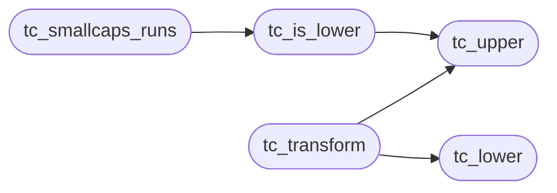

# `src/text_case.c`

> Source: [src/text_case.c:1](../../src/text_case.c#L1) | language `c` | coverage 50.0% | [API index](../index.md)

## Contents

- **Functions:** [`tc_upper`](#tc_upper), [`tc_lower`](#tc_lower), [`tc_is_lower`](#tc_is_lower), [`tc_transform`](#tc_transform), [`tc_smallcaps_runs`](#tc_smallcaps_runs)

## Call Graph

Solid arrows stay in this module, dashed arrows leave it.



## Functions

<a id="tc_upper"></a>

### `tc_upper`

`function` | [src/text_case.c:18](../../src/text_case.c#L18)

```c
uint32_t tc_upper(uint32_t cp)
```

**Parameters**

| Name | Type | Default | Description |
|---|---|---|---|
| `cp` | `uint32_t` |  |  |

**Returns:** `uint32_t`

*Called by:* [`tc_is_lower`](#tc_is_lower), [`tc_transform`](#tc_transform)

---

<a id="tc_lower"></a>

### `tc_lower`

`function` | [src/text_case.c:37](../../src/text_case.c#L37)

```c
uint32_t tc_lower(uint32_t cp)
```

**Parameters**

| Name | Type | Default | Description |
|---|---|---|---|
| `cp` | `uint32_t` |  |  |

**Returns:** `uint32_t`

*Called by:* [`tc_transform`](#tc_transform)

---

<a id="tc_is_lower"></a>

### `tc_is_lower`

`function` | [src/text_case.c:54](../../src/text_case.c#L54)

```c
int tc_is_lower(uint32_t cp)
```

1 when cp is a lowercase letter tc_upper maps to something else.

**Parameters**

| Name | Type | Default | Description |
|---|---|---|---|
| `cp` | `uint32_t` |  |  |

**Returns:** `int`

> **Inherited:** Documentation from [`tc_is_lower`](#tc_is_lower) (include/text_case.h:24).

*Calls:* [`tc_upper`](#tc_upper)

*Called by:* [`tc_smallcaps_runs`](#tc_smallcaps_runs)

---

<a id="tc_transform"></a>

### `tc_transform`

`function` | [src/text_case.c:95](../../src/text_case.c#L95)

```c
size_t tc_transform(const char *s, size_t n, int transform, int word_start, char *out, size_t cap)
```

Copies s[0,n) to out applying transform (CSS_TT_UPPERCASE / _LOWERCASE / _CAPITALIZE; any other value copies verbatim). word_start says s begins a word (for capitalize).

Returns n, or 0 (out untouched) when s/out is NULL or cap < n.

**Parameters**

| Name | Type | Default | Description |
|---|---|---|---|
| `s` | `char *` |  |  |
| `n` | `size_t` |  |  |
| `transform` | `int` |  |  |
| `word_start` | `int` |  |  |
| `out` | `char *` |  |  |
| `cap` | `size_t` |  |  |

**Returns:** `size_t`

> **Inherited:** Documentation from [`tc_transform`](#tc_transform) (include/text_case.h:29).

*Calls:* [`tc_lower`](#tc_lower), [`tc_upper`](#tc_upper)

---

<a id="tc_smallcaps_runs"></a>

### `tc_smallcaps_runs`

`function` | [src/text_case.c:117](../../src/text_case.c#L117)

```c
size_t tc_smallcaps_runs(const char *s, size_t n, tc_run *out, size_t cap)
```

Splits s[0,n) into consecutive maximal runs of lowercase letters vs the rest, covering the whole text in order.

Returns the runs written; when cap is too small the last run absorbs the remainder. 0 for NULL/empty input or cap 0.

**Parameters**

| Name | Type | Default | Description |
|---|---|---|---|
| `s` | `char *` |  |  |
| `n` | `size_t` |  |  |
| `out` | `tc_run *` |  |  |
| `cap` | `size_t` |  |  |

**Returns:** `size_t`

> **Inherited:** Documentation from [`tc_smallcaps_runs`](#tc_smallcaps_runs) (include/text_case.h:41).

*Calls:* [`tc_is_lower`](#tc_is_lower)

---
